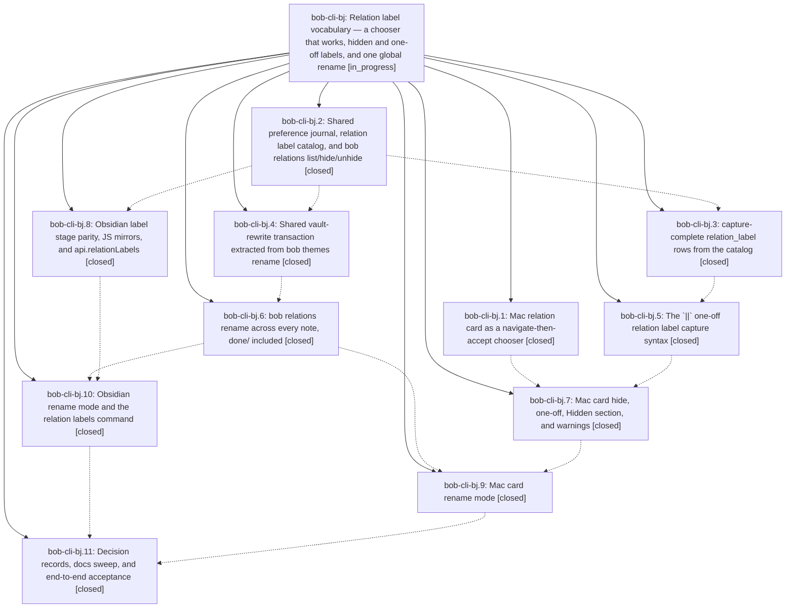

# Bead: bob-cli-bj — Relation label vocabulary — a chooser that works, hidden and one-off labels, and one global rename

[Bead Pages](../README.md) / bob-cli-bj

**Status:** ◐ in_progress · **Type:** ▸ plan · **Tier:** epic
**Owner:** `bryanbugyi34@gmail.com` · **Created by:** [bbugyi200.apollo.research.2e.linker.w0](https://github.com/bobs-org/bob-cli--agents/blob/main/sessions/bbugyi200.apollo.research.2e.linker.w0.md) · **Assignee:** `bob-cli-bj.land`
**Created:** 2026-10-24 13:34:45 EDT
**Plan:** [202610/relation\_label\_vocabulary.md](https://github.com/bobs-org/bob-cli--plans/blob/main/202610/relation_label_vocabulary.md)

<!-- sase:links:start -->

## Links

| Relation | Artifact | Why |
| --- | --- | --- |
| implemented-by | [plan:202610/relation_label_vocabulary.md][1] | derived from the plan's `bead_id:` frontmatter field |

_Plus 1 automatic references — see [Referenced By](#referenced-by)._

[1]: https://github.com/bobs-org/bob-cli--plans/blob/main/202610/relation_label_vocabulary.md

<!-- sase:links:end -->

## Description

The Bob Mac Capture relation card is a reliable, beautiful chooser: Ctrl+N/P move a visible highlight through existing relation labels, Tab accepts, and nothing collapses. Relation labels can be hidden from suggestions (Ctrl+D, with undo), shown again (Ctrl+H section) and unhidden, created hidden with `~note:id||label` (with a clear warning when that hides an existing label), and renamed everywhere — from the card, `bob relations rename`, and Obsidian — in one previewed, revertable commit.

## Notes

[2026-10-24T20:11:30Z · bob-cli-bc.land] DISCOVERED ISSUE (from bob-cli-bc.land, proposed by bob-cli-bc.8 note #1): bob-mac-capture Tests/BobMacCaptureTests/CaptureRelationPanelTests.swift:227 (testRelationCardFiltersAndRanksCatalogLocally, added by bj.1 commit 7dc96cf) calls CaptureCompletionCandidate(replacement:label:count:hidden:), but the memberwise init in Sources/CaptureCore/CaptureModels.swift declares hidden (added by bc.7 a49a08b, 18:11Z, before 7dc96cf at 18:25Z) ahead of count, so swift typecheck-tests fails with 'argument hidden must precede count'. bc.8 reproduced it on the clean base; it is still present at bob-mac-capture origin/master fbea724. Fix: pass hidden: true before count: 10 in that test (or reorder the init params if bj prefers), then run the BobMacCaptureTests typecheck on athena/mac. Routed here because bj.1 authored the test and bj.7 (Mac card hide/Hidden section) is actively editing the same hidden-label path; no task created.

[2026-10-24T22:20:44Z · bob-cli-bk.land] DISCOVERED ISSUE corroboration from bob-cli-bk.land: current bob-mac-capture 7bfa312 CI https://github.com/bobs-org/bob-mac-capture/actions/runs/40137474050 passes Lint Swift formatting and Build (including the inbox route UI) but Test cannot compile at Tests/BobMacCaptureTests/CaptureRelationPanelTests.swift:227: argument hidden must precede count. This is exactly the bj.1 7dc96cf error already recorded in epic note #1; bj.7 is active. No new task; unrelated to bk routing. Evidence obtained from the completed CI log, not a new local reproduction.

## Phases

| Bead | Title | Status | Size | Created | Agents | Commits |
|---|---|---|---|---|---:|---:|
| [bob-cli-bj.1](bob-cli-bj.1.md) | Mac relation card as a navigate-then-accept chooser | ✓ closed | medium | 2026-10-24 | 1 | 0 |
| [bob-cli-bj.10](bob-cli-bj.10.md) | Obsidian rename mode and the relation labels command | ✓ closed | medium | 2026-10-24 | 1 | 1 |
| [bob-cli-bj.11](bob-cli-bj.11.md) | Decision records, docs sweep, and end-to-end acceptance | ✓ closed | small | 2026-10-24 | 1 | 1 |
| [bob-cli-bj.2](bob-cli-bj.2.md) | Shared preference journal, relation label catalog, and bob relations list/hide/unhide | ✓ closed | medium | 2026-10-24 | 1 | 1 |
| [bob-cli-bj.3](bob-cli-bj.3.md) | capture-complete relation\_label rows from the catalog | ✓ closed | small | 2026-10-24 | 1 | 1 |
| [bob-cli-bj.4](bob-cli-bj.4.md) | Shared vault-rewrite transaction extracted from bob themes rename | ✓ closed | medium | 2026-10-24 | 1 | 1 |
| [bob-cli-bj.5](bob-cli-bj.5.md) | The \`\|\|\` one-off relation label capture syntax | ✓ closed | medium | 2026-10-24 | 1 | 1 |
| [bob-cli-bj.6](bob-cli-bj.6.md) | bob relations rename across every note, done/ included | ✓ closed | medium | 2026-10-24 | 1 | 1 |
| [bob-cli-bj.7](bob-cli-bj.7.md) | Mac card hide, one-off, Hidden section, and warnings | ✓ closed | medium | 2026-10-24 | 1 | 0 |
| [bob-cli-bj.8](bob-cli-bj.8.md) | Obsidian label stage parity, JS mirrors, and api.relationLabels | ✓ closed | medium | 2026-10-24 | 1 | 1 |
| [bob-cli-bj.9](bob-cli-bj.9.md) | Mac card rename mode | ✓ closed | medium | 2026-10-24 | 1 | 0 |

## Lineage

## Agents

| Agent | Bead | Commits |
|---|---|---:|
| [bbugyi200.apollo.bob-cli-bj.1](https://github.com/bobs-org/bob-cli--agents/blob/main/sessions/bbugyi200.apollo.bob-cli-bj.1.md) | [bob-cli-bj.1](bob-cli-bj.1.md) | 0 |
| [bbugyi200.apollo.bob-cli-bj.10](https://github.com/bobs-org/bob-cli--agents/blob/main/agents/bbugyi200.apollo.bob-cli-bj.10/README.md) | [bob-cli-bj.10](bob-cli-bj.10.md) | 1 |
| [bbugyi200.apollo.bob-cli-bj.11](https://github.com/bobs-org/bob-cli--agents/blob/main/agents/bbugyi200.apollo.bob-cli-bj.11/README.md) | [bob-cli-bj.11](bob-cli-bj.11.md) | 1 |
| [bbugyi200.apollo.bob-cli-bj.2](https://github.com/bobs-org/bob-cli--agents/blob/main/agents/bbugyi200.apollo.bob-cli-bj.2/README.md) | [bob-cli-bj.2](bob-cli-bj.2.md) | 1 |
| [bbugyi200.apollo.bob-cli-bj.3](https://github.com/bobs-org/bob-cli--agents/blob/main/agents/bbugyi200.apollo.bob-cli-bj.3/README.md) | [bob-cli-bj.3](bob-cli-bj.3.md) | 1 |
| [bbugyi200.apollo.bob-cli-bj.4](https://github.com/bobs-org/bob-cli--agents/blob/main/agents/bbugyi200.apollo.bob-cli-bj.4/README.md) | [bob-cli-bj.4](bob-cli-bj.4.md) | 1 |
| [bbugyi200.apollo.bob-cli-bj.5](https://github.com/bobs-org/bob-cli--agents/blob/main/agents/bbugyi200.apollo.bob-cli-bj.5/README.md) | [bob-cli-bj.5](bob-cli-bj.5.md) | 1 |
| [bbugyi200.apollo.bob-cli-bj.6](https://github.com/bobs-org/bob-cli--agents/blob/main/agents/bbugyi200.apollo.bob-cli-bj.6/README.md) | [bob-cli-bj.6](bob-cli-bj.6.md) | 1 |
| [bbugyi200.apollo.bob-cli-bj.7](https://github.com/bobs-org/bob-cli--agents/blob/main/agents/bbugyi200.apollo.bob-cli-bj.7/README.md) | [bob-cli-bj.7](bob-cli-bj.7.md) | 0 |
| [bbugyi200.apollo.bob-cli-bj.8](https://github.com/bobs-org/bob-cli--agents/blob/main/agents/bbugyi200.apollo.bob-cli-bj.8/README.md) | [bob-cli-bj.8](bob-cli-bj.8.md) | 1 |
| [bbugyi200.apollo.bob-cli-bj.9](https://github.com/bobs-org/bob-cli--agents/blob/main/agents/bbugyi200.apollo.bob-cli-bj.9/README.md) | [bob-cli-bj.9](bob-cli-bj.9.md) | 0 |
| [bbugyi200.apollo.bob-cli-bj.land](https://github.com/bobs-org/bob-cli--agents/blob/main/agents/bbugyi200.apollo.bob-cli-bj.land/README.md) | [bob-cli-bj](README.md) | 0 |

## Commits

| Repo | Commit | Subject | Bead | Committed |
|---|---|---|---|---|
| bob-cli | [`57d7761`](https://github.com/bobs-org/bob-cli/commit/57d77612109f72c1f51aecbcb43c6be106e7398b) | feat(relations): shared preference journal, label catalog, and bob relations list/hide/unhide | [bob-cli-bj.2](bob-cli-bj.2.md) | 2026-10-24 15:08:39 EDT |
| bob-plugins | [`bob-plugins@eb6d26e`](https://github.com/bobs-org/bob-plugins/commit/eb6d26e2e244ebb4b919518c0b4e5e71407a779d) | feat(relation-labels): add journal-backed vocabulary API and picker controls | [bob-cli-bj.8](bob-cli-bj.8.md) | 2026-10-24 15:45:08 EDT |
| bob-cli | [`fd9380c`](https://github.com/bobs-org/bob-cli/commit/fd9380cbaefb8ceb481a914ca6490b6f70e54143) | refactor(themes): extract rename transaction into vault\_rewrite module | [bob-cli-bj.4](bob-cli-bj.4.md) | 2026-10-24 16:07:40 EDT |
| bob-cli | [`6def3ac`](https://github.com/bobs-org/bob-cli/commit/6def3ac88179c25ff6b54b4119c13c2875601ec8) | feat(capture-complete): use cached relation-label catalog | [bob-cli-bj.3](bob-cli-bj.3.md) | 2026-10-24 16:08:31 EDT |
| bob-cli | [`4c46dad`](https://github.com/bobs-org/bob-cli/commit/4c46dadd118a28c0c5255941419a77efc01c870b) | feat(relations): add verified label rename command | [bob-cli-bj.6](bob-cli-bj.6.md) | 2026-10-24 16:56:34 EDT |
| bob-plugins | [`bob-plugins@e368e38`](https://github.com/bobs-org/bob-plugins/commit/e368e38d836db83b44b8d09d92b83396b0f0f6c0) | feat(relation-labels): add Obsidian rename workflow | [bob-cli-bj.10](bob-cli-bj.10.md) | 2026-10-24 17:21:33 EDT |
| bob-cli | [`895b9ba`](https://github.com/bobs-org/bob-cli/commit/895b9ba7608b5c215334132d6d0ae0747e8c0210) | feat(capture): add \|\| one-off relation label syntax with hide-on-commit | [bob-cli-bj.5](bob-cli-bj.5.md) | 2026-10-24 17:51:32 EDT |
| bob-cli | [`8f50b30`](https://github.com/bobs-org/bob-cli/commit/8f50b304b97bcf2e28a98cf4bd60020f0b8df58c) | docs(records): add relation-label decisions, drop planned markers, record acceptance | [bob-cli-bj.11](bob-cli-bj.11.md) | 2026-10-24 19:34:36 EDT |

<!-- sase:referenced-by:start -->

## Referenced By

| Relation | Artifact | Why | Uses |
| --- | --- | --- | ---: |
| read-by | [agent:bob-cli-bj.2][1] | epic context for phase | 1 |

[1]: https://github.com/bobs-org/bob-cli--agents/blob/main/agents/bbugyi200.apollo.bob-cli-bj.2/README.md

<!-- sase:referenced-by:end -->
