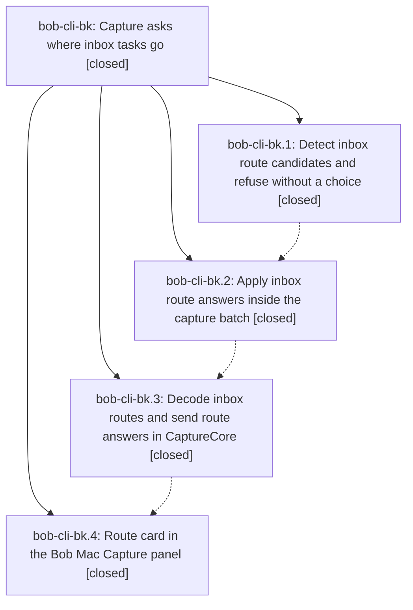

# Bead: bob-cli-bk — Capture asks where inbox tasks go

[Bead Pages](../README.md) / bob-cli-bk

**Status:** ✓ closed · **Resolution:** done · **Type:** ▸ plan · **Tier:** epic
**Owner:** `bryanbugyi34@gmail.com` · **Created by:** [bbugyi200.apollo.a9](https://github.com/bobs-org/bob-cli--agents/blob/main/sessions/bbugyi200.apollo.a9.md) · **Assignee:** `bob-cli-bk.land`
**Created:** 2026-10-24 14:00:26 EDT · **Closed:** 2026-10-24 19:03:14 EDT
**Plan:** [202610/capture\_inbox\_routing.md](https://github.com/bobs-org/bob-cli--plans/blob/main/202610/capture_inbox_routing.md)

<!-- sase:links:start -->

## Links

| Relation | Artifact | Why |
| --- | --- | --- |
| implemented-by | [plan:202610/capture_inbox_routing.md][1] | derived from the plan's `bead_id:` frontmatter field |

[1]: https://github.com/bobs-org/bob-cli--plans/blob/main/202610/capture_inbox_routing.md

<!-- sase:links:end -->

## Description

Every capture that changes the status of an existing inbox task makes Bob Mac Capture ask which area or open project the task belongs in, and bob applies the capture and the move in one atomic batch.

## Notes

[2026-10-24T22:20:50Z · bob-cli-bk.land] LAND TRIAGE (before remaining-work tale): Read every note on bk.1-.4 and the approved plan. Consolidated memory-record proposals bk.1 #1, bk.2 #1, bk.3 #1, bk.4 #1 into bob-cli-br (memory, small, ready), related to 4t but distinct: capture atomic-batch/thin-client contract versus Obsidian gesture routing. No decision memory edited. DECLINED bk.2 #2 stale published-URL task: relations.md and nav are now present via 57d77612, extended by 4c46dadd; bk.4 #2 reports current docs-check including published URLs passed. DECLINED bk.2 #3 themes rename kinds and #4 four completion/help failures: 09b26957 adds rename old/new kinds, restores the required help phrase, bounds theme cache and isolates XDG_CACHE_HOME; bc final note #6 records just check passing after those repairs. bk.1 #2 reported the same pre-existing failure family; no distinct remaining issue. Independently found Mac test compile failure hidden-before-count in current 7bfa312 CI 40137474050: corroborated on causally responsible active epic bj (already its note #1), no task. CI formatting and application Build pass, superseding bk.4 #2 unverified UI compilation; tests remain blocked by bj. The final remaining-work coder must carry these outcomes into the close note.

[2026-10-24T22:21:02Z · bob-cli-bk.land] LAND REVIEW: remaining epic-owned work found in current bob-cli 3bc7e45e. (1) inbox_route.rs destination_snapshot reads unstaged notes, plan_task_move computes postimages, then apply_inbox_routes calls ensure_loaded to reread disk and adopt a newer preimage; an intervening edit can pass commit validation and be overwritten. Existing IRA15 only edits after planning, so misses this window. (2) locate_dest_line uses a unique title/status search for id-less moves; a pre-existing identical destination task or two same-title moved tasks makes a valid exact-line move fail. Group-relative movement.source_line also cannot directly match pre-route TaskBlockTracker coordinates after earlier groups remove lines. (3) route_engine_refusal always names the first group member, even when PlanError names a later failing candidate. (4) glossary:inbox-file incorrectly says non-closing capture although route_closes=route was accepted. These are remaining epic work for one medium tale, not follow-up tasks. Post-start integration review includes 57d77612/6def3ac8 relation catalog invalidation, 895b9ba7 one-off hide-after-commit, and 3bc7e45e adapting IRA15 to the updated commit signature; add combined routing/relation regressions. Mac 7bfa312 UI Build and format lint passed CI 40137474050; Test compilation is blocked by the separately owned bj issue. No bk epic-symbol entries; no parent_bead. Root and linked source trees remain unmodified during review.

[2026-10-24T23:03:14Z · bob-cli-bk.land] Finish tale on baseline bob-cli 3bc7e45e + mac 7bfa312 (no drift; linked repos untouched). Decisions preserved: route_closes=route, route_side_effects=all, memory_inbox_file=yes, memory_decision_record=no. S1 atomic snapshot: new CaptureBatchPlanner::stage_snapshot_postimage binds unstaged dest/repair postimages to the consumed snapshot; drift is typed NoteChanged with no writes (stage_move_postimages; new regression covers dest + repaired file; IRA15 rollback still passes). S2 exact identity: MoveRecord.dest_line from the planner, source Line selectors remapped past earlier removals, old_line now pre-route for tracker forwarding, refusal blamed to the failing member (task-specific) with first-member fallback for destination-wide; deleted title/status text search (relocate/locate/root_line). New regressions: identical id-less roots with different children routed to different dests despite identical title/status already at dest; refusal names second member (n=2 ^second) with no writes. S3 integration: shared batch commit, one-off hide-after-commit, commit-signature integration kept; new bulk regression (status-changing inbox + one-off relation) proves guard/refusal writes neither notes nor hide events and success repairs links + single hide event with dry==real JSON. Memory: glossary:inbox-file capture sentence now 'A capture ...' (Obsidian non-closing exclusions kept); memory init + docs-gen; strand re-read and docs/reference/glossary.md agree. Verification: just check exit 0 (fmt, clippy unused gate, 3407 lib + 2052 CLI incl 16/16 inbox_route + new tests, all suites green); just docs-check 448 passed; check-full not run per plan. Mac: no Swift changed; prior evidence stands (CI 40137474050 format+Build pass on 7bfa312; test compile blocked solely by bj hidden-before-count, corroborated on bj). Triage: bk.1 #1/bk.2 #1/bk.3 #1/bk.4 #1 -> ready small memory task bob-cli-br (related to 4t, distinct Obsidian contract); bk.2 #2 declined (57d77612 relations.md+nav, 4c46dadd extension, bk.4 docs-check pass); bk.2 #3/#4 + bk.1 #2 reds declined as duplicates (09b26957 themes rename/help/cache/XDG isolation; bc close #6 green); Mac hidden/count on active epic bj, no new task. No parent_bead; epic-symbols empty at close.

## Phases

| Bead | Title | Status | Size | Created | Agents | Commits |
|---|---|---|---|---|---:|---:|
| [bob-cli-bk.1](bob-cli-bk.1.md) | Detect inbox route candidates and refuse without a choice | ✓ closed | medium | 2026-10-24 | 1 | 1 |
| [bob-cli-bk.2](bob-cli-bk.2.md) | Apply inbox route answers inside the capture batch | ✓ closed | medium | 2026-10-24 | 1 | 1 |
| [bob-cli-bk.3](bob-cli-bk.3.md) | Decode inbox routes and send route answers in CaptureCore | ✓ closed | medium | 2026-10-24 | 1 | 1 |
| [bob-cli-bk.4](bob-cli-bk.4.md) | Route card in the Bob Mac Capture panel | ✓ closed | medium | 2026-10-24 | 1 | 2 |

## Lineage

## Agents

| Agent | Bead | Commits |
|---|---|---:|
| [bbugyi200.apollo.bob-cli-bk.1](https://github.com/bobs-org/bob-cli--agents/blob/main/agents/bbugyi200.apollo.bob-cli-bk.1/README.md) | [bob-cli-bk.1](bob-cli-bk.1.md) | 1 |
| [bbugyi200.apollo.bob-cli-bk.2](https://github.com/bobs-org/bob-cli--agents/blob/main/agents/bbugyi200.apollo.bob-cli-bk.2/README.md) | [bob-cli-bk.2](bob-cli-bk.2.md) | 1 |
| [bbugyi200.apollo.bob-cli-bk.3](https://github.com/bobs-org/bob-cli--agents/blob/main/agents/bbugyi200.apollo.bob-cli-bk.3/README.md) | [bob-cli-bk.3](bob-cli-bk.3.md) | 1 |
| [bbugyi200.apollo.bob-cli-bk.4](https://github.com/bobs-org/bob-cli--agents/blob/main/sessions/bbugyi200.apollo.bob-cli-bk.4.md) | [bob-cli-bk.4](bob-cli-bk.4.md) | 2 |
| [bbugyi200.apollo.bob-cli-bk.land](https://github.com/bobs-org/bob-cli--agents/blob/main/sessions/bbugyi200.apollo.bob-cli-bk.land.md) | [bob-cli-bk](README.md) | 1 |

## Commits

| Repo | Commit | Subject | Bead | Committed |
|---|---|---|---|---|
| bob-cli | [`bb52dd0`](https://github.com/bobs-org/bob-cli/commit/bb52dd0ab1c5d947a84b2c98f6e29620c7a3e7ff) | feat(capture): detect inbox route choices | [bob-cli-bk.1](bob-cli-bk.1.md) | 2026-10-24 14:58:27 EDT |
| bob-cli | [`4f13e97`](https://github.com/bobs-org/bob-cli/commit/4f13e979eb3dba1a69c840bfb2c34a9d0ff7ecd6) | feat(capture): route inbox answers through task-move engine | [bob-cli-bk.2](bob-cli-bk.2.md) | 2026-10-24 16:34:24 EDT |
| bob-mac-capture | [`bob-mac-capture@2968311`](https://github.com/bobs-org/bob-mac-capture/commit/2968311e5fa7924ed99bf83e52df865ee6e114c1) | feat(mac-capture): decode inbox routes and send route answers in CaptureCore | [bob-cli-bk.3](bob-cli-bk.3.md) | 2026-10-24 17:16:02 EDT |
| bob-cli | [`e70f9ea`](https://github.com/bobs-org/bob-cli/commit/e70f9ea40a7be87ffc761b851eda2613d288e9c8) | docs(memory): explain capture inbox routing | [bob-cli-bk.4](bob-cli-bk.4.md) | 2026-10-24 18:10:17 EDT |
| bob-mac-capture | [`bob-mac-capture@7bfa312`](https://github.com/bobs-org/bob-mac-capture/commit/7bfa31275b3dccbb72e15f664065bddd8363a39d) | feat(capture): add inbox route card | [bob-cli-bk.4](bob-cli-bk.4.md) | 2026-10-24 18:11:20 EDT |
| bob-cli | [`e5c7d0f`](https://github.com/bobs-org/bob-cli/commit/e5c7d0fcab0d256ae6a4ebe00e92092b73ffe179) | feat(capture): finish inbox routing with atomic snapshot and exact task identity | [bob-cli-bk](README.md) | 2026-10-24 19:04:51 EDT |
