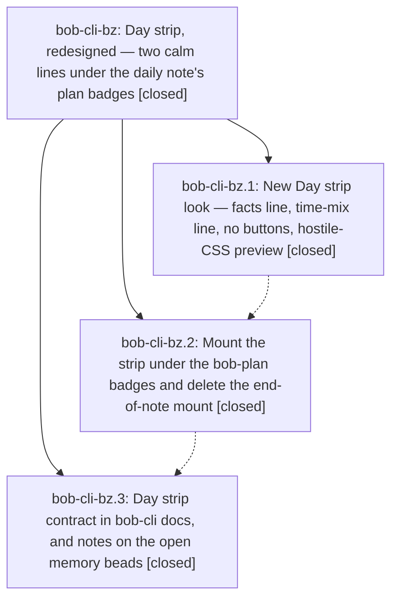

# Bead: bob-cli-bz — Day strip, redesigned — two calm lines under the daily note's plan badges

[Bead Pages](../README.md) / bob-cli-bz

**Status:** ✓ closed · **Resolution:** done · **Type:** ▸ plan · **Tier:** epic
**Owner:** `bryanbugyi34@gmail.com` · **Created by:** [bbugyi200.athena.143](https://github.com/bobs-org/bob-cli--agents/blob/main/sessions/bbugyi200.athena.143.md) · **Assignee:** `bob-cli-bz.land`
**Created:** 2026-10-25 07:46:43 EDT · **Closed:** 2026-10-25 09:21:10 EDT
**Plan:** [202610/day\_strip\_under\_the\_badges.md](https://github.com/bobs-org/bob-cli--plans/blob/main/202610/day_strip_under_the_badges.md)

<!-- sase:links:start -->

## Links

| Relation | Artifact | Why |
| --- | --- | --- |
| implemented-by | [plan:202610/day_strip_under_the_badges.md][1] | derived from the plan's `bead_id:` frontmatter field |

_Plus 2 automatic references — see [Referenced By](#referenced-by)._

[1]: https://github.com/bobs-org/bob-cli--plans/blob/main/202610/day_strip_under_the_badges.md

<!-- sase:links:end -->

## Description

On every canonical daily note that has a `bob-plan` block, the Day strip renders directly under the plan badges, in Live Preview and Reading view, as two calm, readable lines. The first line holds five facts (`WORKED 5h 25m  REVIEWED 64  DONE 30 CREATED 40  REVIEW CLOSED not yet`). The second holds the area time mix plus `so far · HH:MM`. Nothing overlaps or overflows under real Obsidian styles, a preview harness enforces that, and the CodeMirror end-of-note mount is gone.

## Notes

[2026-10-25T12:59:47Z · bob-cli-bz.land] LANDING AUDIT (2026-10-25): Read the epic and every note on bob-cli-bz.1/.2/.3 plus plan:202610/day_strip_under_the_badges.md. The epic has no DECISIONS overrides and no parent (parent_id=null). Verified bob-plugins commits d77503c and 8388ef2 against the model, painter, CSS, preview, registry, plan-host hooks, docs, manifest, fragment registration, and tests. The CodeMirror mount/collapse/history code is deleted; root host preservation and no-button facts are implemented; edited fragments are <=1000 lines (plan hook file 989). Re-ran 47 Day strip tests (all pass), npm run build:check (pass), and the Chromium preview (84 cells, zero failures/overflow); inspected 540px light and 410px dark screenshots. Verified bob-cli-bs and bob-cli-bt both have the phase-3 supersession notes. Integration audit from epic creation through current origins: bob-cli f4f6a9ca is test-only executable-stub infrastructure; bob-plugins ab71502 is a test-only ranker timing stabilization. Neither touches the feature or needs adaptation. No later non-epic plugin commits exist. No --epic-symbol entries exist; this bob-cli justfile has no symvision recipe.

Remaining epic work: (1) The new plan host creates records visible=true and immediately calls dayStripCheck before IntersectionObserver has reported visibility. Isolated harness probe on a cold automatic plan host observes spawns=1 before any callback, then still spawns=1 when its first callback says offscreen. The new host must establish visibility before fetching while still painting synchronously from cache. Cover first-visible, first-offscreen, initially detached/excluded hosts, and no-observer fallback. (2) 8388ef2 added an early return in dayStripHandleRollover after refreshDayStripPlanHosts, bypassing the repaint of explicit fence records. Both an offscreen fence and a visible fence with a deferred rollover refetch retain the ready/provisional DOM and "so far" after midnight; the pure model says skeleton. Repaint every registered host immediately on rollover, then fetch under the normal gate. (3) bob-cli-bz.3 cites 38ad9e88, but after fetching origin that object is absent, origin/master is f4f6a9ca, and docs/stats.md still describes the old bottom mount, history marks, collapse, and fence stand-down. Recover or reapply the documented phase-3 contract on the integration branch. Will propose one medium tale including final epic closeout; do not close the epic before these repairs. No just check-full was run.

[2026-10-25T12:59:51Z · bob-cli-bz.land] FOLLOW-UP TRIAGE: Collected every child note: bob-cli-bz.1 #1-#2, bob-cli-bz.2 #1, bob-cli-bz.3 #1. There are zero PROPOSED FOLLOW-UP entries, so no task proposals were accepted, declined, or filed and /sase_new_task was not needed. The existing memory tasks bob-cli-bs and bob-cli-bt already carry the required supersession notes; do not duplicate them or edit memory in this repair. The automatic plan-host visibility gap, fence rollover regression, and missing phase-3 docs are remaining epic acceptance/integration work and are assigned to the repair tale, not unrelated follow-up tasks. Preserve these outcomes in the eventual close note.

[2026-10-25T13:21:10Z · bob-cli-bz.land] Landing repairs verified. All child notes (bz.1 #1-#2, bz.2 #1, bz.3 #1) and the Day strip design contract reviewed; five LABEL-value facts, area mix with so far HH:MM, no buttons/history/collapse, under bob-plan badges in both views, never writing note bytes. Plugin commits d77503c and 8388ef2 verified plus working-tree repairs: automatic-host visibility gating (cold host 0 spawns before callback, false stays 0, true fetches once; sync cache paint with 0 spawn; detached/excluded release; no-observer fallback) and fence rollover (visible+offscreen skeleton synchronously, offscreen 0 spawn, visible resolves as past with no so far; automatic today host skeletons then resolves past alongside future attach) with regression tests in test-ledger-tools-day-strip-plan-host.cjs (13 pass) and test-ledger-tools-day-strip-hosts.cjs (30 pass). Missing docs integrated: docs/stats.md Day strip rewritten to shipped contract; dashboard.md and reference/json-outputs.md checked, still true, no edits. Post-start drift checked: bob-cli 6292c35b (EPIPE) and 0e75ca56 (perf gate) plus bob-plugins origin at 8388ef2, none touch Day strip, no adaptation needed. Gates: npm run build, npm test (3655 pass), npm run validate, npm run docs:check (447 passed), preview-day-strip 84 cells zero failures/overflow (540px light and 410px dark inspected); just docs-check and just check pass; bob plugins sync ok (0 copied, 19 unchanged, up to date). No PROPOSED FOLLOW-UPs, no new tasks; bs/bt supersession notes retained, memory untouched. Symbol cleanup: sase bead epic-symbols clean, no exemptions; just symvision absent as audited.

## Phases

| Bead | Title | Status | Size | Created | Agents | Commits |
|---|---|---|---|---|---:|---:|
| [bob-cli-bz.1](bob-cli-bz.1.md) | New Day strip look — facts line, time-mix line, no buttons, hostile-CSS preview | ✓ closed | medium | 2026-10-25 | 1 | 1 |
| [bob-cli-bz.2](bob-cli-bz.2.md) | Mount the strip under the bob-plan badges and delete the end-of-note mount | ✓ closed | medium | 2026-10-25 | 1 | 1 |
| [bob-cli-bz.3](bob-cli-bz.3.md) | Day strip contract in bob-cli docs, and notes on the open memory beads | ✓ closed | small | 2026-10-25 | 1 | 0 |

## Lineage

## Agents

| Agent | Bead | Commits |
|---|---|---:|
| [bbugyi200.athena.bob-cli-bz.1](https://github.com/bobs-org/bob-cli--agents/blob/main/agents/bbugyi200.athena.bob-cli-bz.1/README.md) | [bob-cli-bz.1](bob-cli-bz.1.md) | 1 |
| [bbugyi200.athena.bob-cli-bz.2](https://github.com/bobs-org/bob-cli--agents/blob/main/agents/bbugyi200.athena.bob-cli-bz.2/README.md) | [bob-cli-bz.2](bob-cli-bz.2.md) | 1 |
| [bbugyi200.athena.bob-cli-bz.3](https://github.com/bobs-org/bob-cli--agents/blob/main/agents/bbugyi200.athena.bob-cli-bz.3/README.md) | [bob-cli-bz.3](bob-cli-bz.3.md) | 0 |
| [bbugyi200.athena.bob-cli-bz.land](https://github.com/bobs-org/bob-cli--agents/blob/main/sessions/bbugyi200.athena.bob-cli-bz.land.md) | [bob-cli-bz](README.md) | 2 |

## Commits

| Repo | Commit | Subject | Bead | Committed |
|---|---|---|---|---|
| bob-plugins | [`bob-plugins@d77503c`](https://github.com/bobs-org/bob-plugins/commit/d77503c4ebd350cec00e73b26800249ae3369b75) | feat(ledger-tools): simplify day strip to two calm label-value lines | [bob-cli-bz.1](bob-cli-bz.1.md) | 2026-10-25 08:19:42 EDT |
| bob-plugins | [`bob-plugins@8388ef2`](https://github.com/bobs-org/bob-plugins/commit/8388ef20bd96e984668f969eef95b69ef5005f8f) | feat(ledger-tools): host Day strip under bob-plan badges | [bob-cli-bz.2](bob-cli-bz.2.md) | 2026-10-25 08:37:41 EDT |
| bob-cli | [`269e597`](https://github.com/bobs-org/bob-cli/commit/269e597305d802f00e914b8429dd8b48a96b0192) | docs(stats): document Day strip under plan badges | [bob-cli-bz](README.md) | 2026-10-25 09:22:28 EDT |
| bob-plugins | [`bob-plugins@efaaaa0`](https://github.com/bobs-org/bob-plugins/commit/efaaaa08d48cd6286396f7d173b51b62a67bdd66) | fix(ledger-tools): gate plan-host fetches on visibility and repaint fences on rollover | [bob-cli-bz](README.md) | 2026-10-25 09:22:58 EDT |

<!-- sase:referenced-by:start -->

## Referenced By

| Relation | Artifact | Why | Uses |
| --- | --- | --- | ---: |
| read-by | [agent:bob-cli-bz.1][1] | epic scope | 2 |
| read-by | [agent:bob-cli-bz.2][2] | Need epic DECISIONS for strip-home phase | 1 |

[1]: https://github.com/bobs-org/bob-cli--agents/blob/main/agents/bbugyi200.athena.bob-cli-bz.1/README.md
[2]: https://github.com/bobs-org/bob-cli--agents/blob/main/agents/bbugyi200.athena.bob-cli-bz.2/README.md

<!-- sase:referenced-by:end -->
