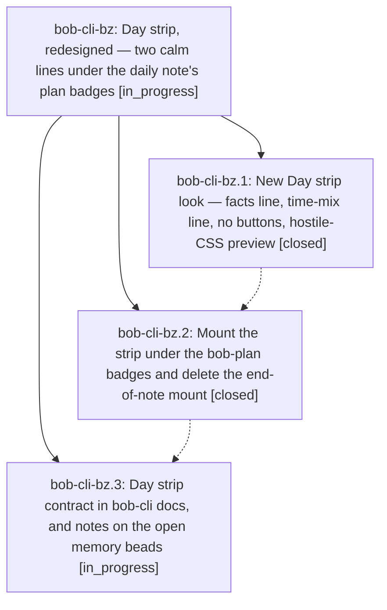

# Bead: bob-cli-bz — Day strip, redesigned — two calm lines under the daily note's plan badges

[Bead Pages](../README.md) / bob-cli-bz

**Status:** ◐ in_progress · **Type:** ▸ plan · **Tier:** epic
**Owner:** `bryanbugyi34@gmail.com` · **Created by:** [bbugyi200.athena.143](https://github.com/bobs-org/bob-cli--agents/blob/main/sessions/bbugyi200.athena.143.md) · **Assignee:** `bob-cli-bz.land`
**Created:** 2026-10-25 07:46:43 EDT
**Plan:** [202610/day\_strip\_under\_the\_badges.md](https://github.com/bobs-org/bob-cli--plans/blob/main/202610/day_strip_under_the_badges.md)

<!-- sase:links:start -->

## Links

| Relation | Artifact | Why |
| --- | --- | --- |
| implemented-by | [plan:202610/day_strip_under_the_badges.md][1] | derived from the plan's `bead_id:` frontmatter field |

_Plus 1 automatic references — see [Referenced By](#referenced-by)._

[1]: https://github.com/bobs-org/bob-cli--plans/blob/main/202610/day_strip_under_the_badges.md

<!-- sase:links:end -->

## Description

On every canonical daily note that has a `bob-plan` block, the Day strip renders directly under the plan badges, in Live Preview and Reading view, as two calm, readable lines. The first line holds five facts (`WORKED 5h 25m  REVIEWED 64  DONE 30 CREATED 40  REVIEW CLOSED not yet`). The second holds the area time mix plus `so far · HH:MM`. Nothing overlaps or overflows under real Obsidian styles, a preview harness enforces that, and the CodeMirror end-of-note mount is gone.

## Phases

| Bead | Title | Status | Size | Created | Agents | Commits |
|---|---|---|---|---|---:|---:|
| [bob-cli-bz.1](bob-cli-bz.1.md) | New Day strip look — facts line, time-mix line, no buttons, hostile-CSS preview | ✓ closed | medium | 2026-10-25 | 1 | 1 |
| [bob-cli-bz.2](bob-cli-bz.2.md) | Mount the strip under the bob-plan badges and delete the end-of-note mount | ✓ closed | medium | 2026-10-25 | 1 | 1 |
| [bob-cli-bz.3](bob-cli-bz.3.md) | Day strip contract in bob-cli docs, and notes on the open memory beads | ◐ in_progress | small | 2026-10-25 | 1 | 0 |

## Lineage

## Agents

| Agent | Bead | Commits |
|---|---|---:|
| [bbugyi200.athena.bob-cli-bz.1](https://github.com/bobs-org/bob-cli--agents/blob/main/agents/bbugyi200.athena.bob-cli-bz.1/README.md) | [bob-cli-bz.1](bob-cli-bz.1.md) | 1 |
| [bbugyi200.athena.bob-cli-bz.2](https://github.com/bobs-org/bob-cli--agents/blob/main/agents/bbugyi200.athena.bob-cli-bz.2/README.md) | [bob-cli-bz.2](bob-cli-bz.2.md) | 1 |
| [bbugyi200.athena.bob-cli-bz.3](https://github.com/bobs-org/bob-cli--agents/blob/main/agents/bbugyi200.athena.bob-cli-bz.3/README.md) | [bob-cli-bz.3](bob-cli-bz.3.md) | 0 |
| [bbugyi200.athena.bob-cli-bz.land](https://github.com/bobs-org/bob-cli--agents/blob/main/agents/bbugyi200.athena.bob-cli-bz.land/README.md) | [bob-cli-bz](README.md) | 0 |

## Commits

| Repo | Commit | Subject | Bead | Committed |
|---|---|---|---|---|
| bob-plugins | [`bob-plugins@d77503c`](https://github.com/bobs-org/bob-plugins/commit/d77503c4ebd350cec00e73b26800249ae3369b75) | feat(ledger-tools): simplify day strip to two calm label-value lines | [bob-cli-bz.1](bob-cli-bz.1.md) | 2026-10-25 08:19:42 EDT |
| bob-plugins | [`bob-plugins@8388ef2`](https://github.com/bobs-org/bob-plugins/commit/8388ef20bd96e984668f969eef95b69ef5005f8f) | feat(ledger-tools): host Day strip under bob-plan badges | [bob-cli-bz.2](bob-cli-bz.2.md) | 2026-10-25 08:37:41 EDT |

<!-- sase:referenced-by:start -->

## Referenced By

| Relation | Artifact | Why | Uses |
| --- | --- | --- | ---: |
| read-by | [agent:bob-cli-bz.1][1] | epic scope | 2 |

[1]: https://github.com/bobs-org/bob-cli--agents/blob/main/agents/bbugyi200.athena.bob-cli-bz.1/README.md

<!-- sase:referenced-by:end -->
