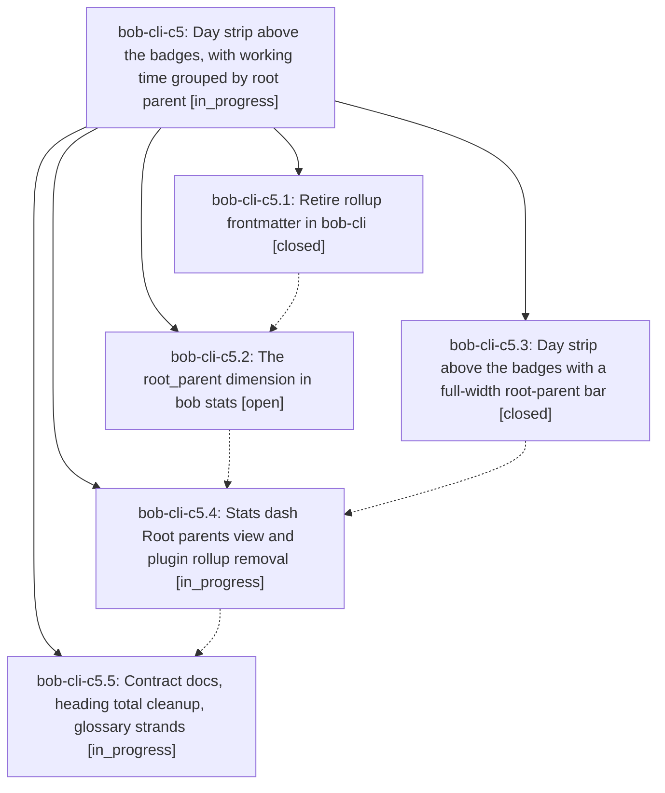

# Bead: bob-cli-c5 — Day strip above the badges, with working time grouped by root parent

[Bead Pages](../README.md) / bob-cli-c5

**Status:** ◐ in_progress · **Type:** ▸ plan · **Tier:** epic
**Owner:** `bryanbugyi34@gmail.com` · **Created by:** [bbugyi200.athena.145](https://github.com/bobs-org/bob-cli--agents/blob/main/sessions/bbugyi200.athena.145.md) · **Assignee:** `bob-cli-c5.land`
**Created:** 2026-10-25 10:27:22 EDT
**Plan:** [202610/day\_strip\_above\_badges\_root\_parents.md](https://github.com/bobs-org/bob-cli--plans/blob/main/202610/day_strip_above_badges_root_parents.md)

<!-- sase:links:start -->

## Links

| Relation | Artifact | Why |
| --- | --- | --- |
| implemented-by | [plan:202610/day_strip_above_badges_root_parents.md][1] | derived from the plan's `bead_id:` frontmatter field |
| related | [bead:bob-cli-c6][2] | Active Day strip epic whose phase c5.4 edits openStatsForDay's hand-off (homesView); coordinate to avoid a collision, but c5 did not cause this newLeaf defect |

_Plus 2 automatic references — see [Referenced By](#referenced-by)._

[1]: https://github.com/bobs-org/bob-cli--plans/blob/main/202610/day_strip_above_badges_root_parents.md
[2]: https://github.com/bobs-org/bob-cli--beads/blob/main/pages/bob-cli-c6/README.md

<!-- sase:links:end -->

## Description

On every canonical daily note the Day strip sits above the bob-plan badges, and its full-width working-time bar, grouped by root parent (top-level project, or the area a task lives in), separates it from them. The stats dash defaults to the same root-parent grouping, with sub-project detail one click away. The rollup frontmatter key and the `## Pomodoros` heading total are retired. Four new glossary strands name the concepts.

## Phases

| Bead | Title | Status | Size | Created | Agents | Commits |
|---|---|---|---|---|---:|---:|
| [bob-cli-c5.1](bob-cli-c5.1.md) | Retire rollup frontmatter in bob-cli | ✓ closed | medium | 2026-10-25 | 1 | 0 |
| [bob-cli-c5.2](bob-cli-c5.2.md) | The root\_parent dimension in bob stats | ○ open | medium | 2026-10-25 | 1 | 0 |
| [bob-cli-c5.3](bob-cli-c5.3.md) | Day strip above the badges with a full-width root-parent bar | ✓ closed | medium | 2026-10-25 | 1 | 1 |
| [bob-cli-c5.4](bob-cli-c5.4.md) | Stats dash Root parents view and plugin rollup removal | ◐ in_progress | medium | 2026-10-25 | 1 | 0 |
| [bob-cli-c5.5](bob-cli-c5.5.md) | Contract docs, heading total cleanup, glossary strands | ◐ in_progress | small | 2026-10-25 | 1 | 0 |

## Lineage

## Agents

| Agent | Bead | Commits |
|---|---|---:|
| [bbugyi200.athena.bob-cli-c5.1](https://github.com/bobs-org/bob-cli--agents/blob/main/agents/bbugyi200.athena.bob-cli-c5.1/README.md) | [bob-cli-c5.1](bob-cli-c5.1.md) | 0 |
| [bbugyi200.athena.bob-cli-c5.2](https://github.com/bobs-org/bob-cli--agents/blob/main/agents/bbugyi200.athena.bob-cli-c5.2/README.md) | [bob-cli-c5.2](bob-cli-c5.2.md) | 0 |
| [bbugyi200.athena.bob-cli-c5.3](https://github.com/bobs-org/bob-cli--agents/blob/main/agents/bbugyi200.athena.bob-cli-c5.3/README.md) | [bob-cli-c5.3](bob-cli-c5.3.md) | 1 |
| [bbugyi200.athena.bob-cli-c5.4](https://github.com/bobs-org/bob-cli--agents/blob/main/agents/bbugyi200.athena.bob-cli-c5.4/README.md) | [bob-cli-c5.4](bob-cli-c5.4.md) | 0 |
| [bbugyi200.athena.bob-cli-c5.5](https://github.com/bobs-org/bob-cli--agents/blob/main/agents/bbugyi200.athena.bob-cli-c5.5/README.md) | [bob-cli-c5.5](bob-cli-c5.5.md) | 0 |
| [bbugyi200.athena.bob-cli-c5.land](https://github.com/bobs-org/bob-cli--agents/blob/main/agents/bbugyi200.athena.bob-cli-c5.land/README.md) | [bob-cli-c5](README.md) | 0 |

## Commits

| Repo | Commit | Subject | Bead | Committed |
|---|---|---|---|---|
| bob-plugins | [`bob-plugins@998a7f9`](https://github.com/bobs-org/bob-plugins/commit/998a7f99e865ff481262c003c14a72f64eb64211) | feat(ledger-tools): day strip above badges with full-width root-parent bar | [bob-cli-c5.3](bob-cli-c5.3.md) | 2026-10-25 11:25:19 EDT |

<!-- sase:referenced-by:start -->

## Referenced By

| Relation | Artifact | Why | Uses |
| --- | --- | --- | ---: |
| read-by | [agent:bob-cli-an.6.6.6.5.6.5.5.6.6.land][1] | Check whether the active Day strip epic causally owns the openStatsForDay newLeaf defect | 1 |
| read-by | [agent:bob-cli-c5.1][2] | epic scope for c5.1 | 1 |

[1]: https://github.com/bobs-org/bob-cli--agents/blob/main/agents/bbugyi200.athena.bob-cli-an.6.6.6.5.6.5.5.6.6.land/README.md
[2]: https://github.com/bobs-org/bob-cli--agents/blob/main/agents/bbugyi200.athena.bob-cli-c5.1/README.md

<!-- sase:referenced-by:end -->
