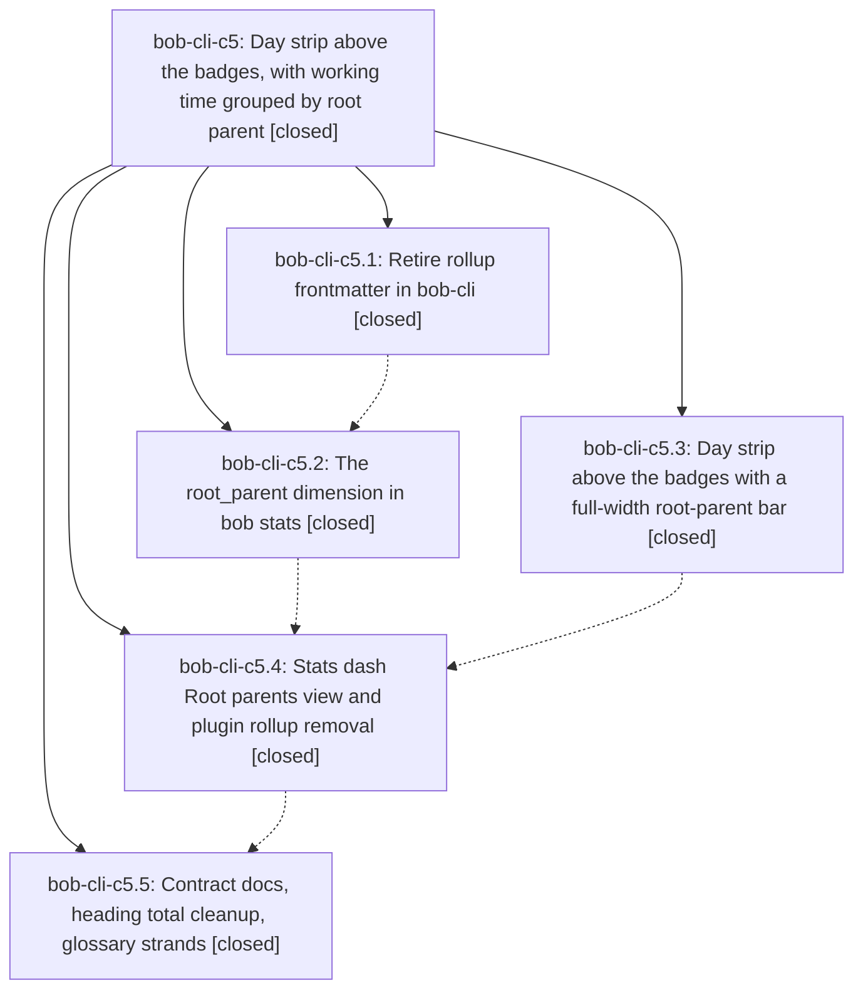

# Bead: bob-cli-c5 — Day strip above the badges, with working time grouped by root parent

[Bead Pages](../README.md) / bob-cli-c5

**Status:** ✓ closed · **Resolution:** done · **Type:** ▸ plan · **Tier:** epic
**Owner:** `bryanbugyi34@gmail.com` · **Created by:** [bbugyi200.athena.145](https://github.com/bobs-org/bob-cli--agents/blob/main/sessions/bbugyi200.athena.145.md) · **Assignee:** `bob-cli-c5.land`
**Created:** 2026-10-25 10:27:22 EDT · **Closed:** 2026-10-25 12:52:34 EDT
**Plan:** [202610/day\_strip\_above\_badges\_root\_parents.md](https://github.com/bobs-org/bob-cli--plans/blob/main/202610/day_strip_above_badges_root_parents.md)

<!-- sase:links:start -->

## Links

| Relation | Artifact | Why |
| --- | --- | --- |
| implemented-by | [plan:202610/day_strip_above_badges_root_parents.md][1] | derived from the plan's `bead_id:` frontmatter field |
| related | [bead:bob-cli-c6][2] | Active Day strip epic whose phase c5.4 edits openStatsForDay's hand-off (homesView); coordinate to avoid a collision, but c5 did not cause this newLeaf defect |
| related | [bead:bob-cli-c7][3] | Proposed by phase bob-cli-c5.3, whose plan-host tests use boolean identity asserts to dodge this OOM |
| related | file:explicit:63ae84e2d7c276db27a5cf47 | attached via sase artifact create --bead |
| related | file:explicit:7ab52cb4f56575ba18bda295 | attached via sase artifact create --bead |

_Plus 3 automatic references — see [Referenced By](#referenced-by)._

[1]: https://github.com/bobs-org/bob-cli--plans/blob/main/202610/day_strip_above_badges_root_parents.md
[2]: https://github.com/bobs-org/bob-cli--beads/blob/main/pages/bob-cli-c6/README.md
[3]: https://github.com/bobs-org/bob-cli--beads/blob/main/pages/bob-cli-c7/README.md

<!-- sase:links:end -->

## Description

On every canonical daily note the Day strip sits above the bob-plan badges, and its full-width working-time bar, grouped by root parent (top-level project, or the area a task lives in), separates it from them. The stats dash defaults to the same root-parent grouping, with sub-project detail one click away. The rollup frontmatter key and the `## Pomodoros` heading total are retired. Four new glossary strands name the concepts.

## Notes

[2026-10-25T15:47:47Z · bryanbugyi34@gmail.com] The epic lander agent should make sure that we use colors that are distinct for each root parent shown in the working time bar. This doesn't seem to be the cast at the moment. See the 🔒 20261025\_114653.png screenshot for context.

[2026-10-25T16:31:41Z · bob-cli-c5.land] LAND TRIAGE: (1) c5.3 PROPOSED FOLLOW-UP (node:assert/strict failure formatting OOMs on cyclic FakeNode graphs) -> new task bob-cli-c7 (bug, small, ready), independently reproduced by the lander (85-node FakeNode tree: assert.equal on two siblings aborts with a heap OOM after ~10 s at 1 GB); a test-harness property, not caused by this epic's feature. No other PROPOSED FOLLOW-UP entries on c5.1-c5.5. (2) bob-cli-c6 (openStatsForDay ignores newLeaf) stays its own ready task: pre-existing defect, not caused by c5; c5.4 only added the homesView=roots hand-off beside it. (3) Remaining epic work found in verification: Bryan's note #1 (distinct colours per root parent in the working-time bar; same-area roots currently all render the area hue) and the dead pomodoroHomeRollupValue stub left in bob-plugins 142-pomodoro-home-chips.js. Planned as a lander tale that also closes the epic.

[2026-10-25T16:52:34Z · bob-cli-c5.land] Land verified: phases c5.1-c5.5 closed and checked against source (bob-cli 0cf45b8c rollup retired, residence_chain, leftover-key test; 5078e8f8 root_parent dimension with H16, catalog, render order, perf within 10%; 24fcc300 docs/stats.md contract; c2ef18c6 four glossary strands; bob-plugins 998a7f9 strip as first bob-plan child with full-width root bar and area fallback; 4150279 Root parents dash, sub-project disclosure, roots hand-off, JS rollup mirror removed, vectors byte-identical). Vault: template plus 27 bob-plan notes read a bare ## Pomodoros. bob-cli-bt closed, bob-cli-bs noted. Post-epic commits (ref-doctor, gkeep, capture-complete, popout mark gates, Task Card close) do not touch the feature; Bob Mac Capture has no rollup references. Lander tale: Bryan's note #1 done - statsPanelDistinctHues gives every root parent in the Day strip bar and the dash root bar its own colour (biggest root keeps the area hue, collisions take the next free palette hue, unlinked/unfiled gray), docs updated, ledger-tools 1.71.0 synced; dead pomodoroHomeRollupValue stub removed. Follow-ups: c5.3 FakeNode assert OOM -> bob-cli-c7 (reproduced); bob-cli-c6 stays a separate pre-existing task. No epic symbols.

## Attachments

- 🔒 20261025\_114653.png · image/png · 2854×1686 · 270.646 KiB (private attachment)

## Phases

| Bead | Title | Status | Size | Created | Agents | Commits |
|---|---|---|---|---|---:|---:|
| [bob-cli-c5.1](bob-cli-c5.1.md) | Retire rollup frontmatter in bob-cli | ✓ closed | medium | 2026-10-25 | 1 | 1 |
| [bob-cli-c5.2](bob-cli-c5.2.md) | The root\_parent dimension in bob stats | ✓ closed | medium | 2026-10-25 | 1 | 1 |
| [bob-cli-c5.3](bob-cli-c5.3.md) | Day strip above the badges with a full-width root-parent bar | ✓ closed | medium | 2026-10-25 | 1 | 1 |
| [bob-cli-c5.4](bob-cli-c5.4.md) | Stats dash Root parents view and plugin rollup removal | ✓ closed | medium | 2026-10-25 | 1 | 1 |
| [bob-cli-c5.5](bob-cli-c5.5.md) | Contract docs, heading total cleanup, glossary strands | ✓ closed | small | 2026-10-25 | 1 | 0 |

## Lineage

## Agents

| Agent | Bead | Commits |
|---|---|---:|
| [bbugyi200.athena.bob-cli-c5.1](https://github.com/bobs-org/bob-cli--agents/blob/main/agents/bbugyi200.athena.bob-cli-c5.1/README.md) | [bob-cli-c5.1](bob-cli-c5.1.md) | 1 |
| [bbugyi200.athena.bob-cli-c5.2](https://github.com/bobs-org/bob-cli--agents/blob/main/agents/bbugyi200.athena.bob-cli-c5.2/README.md) | [bob-cli-c5.2](bob-cli-c5.2.md) | 1 |
| [bbugyi200.athena.bob-cli-c5.3](https://github.com/bobs-org/bob-cli--agents/blob/main/agents/bbugyi200.athena.bob-cli-c5.3/README.md) | [bob-cli-c5.3](bob-cli-c5.3.md) | 1 |
| [bbugyi200.athena.bob-cli-c5.4](https://github.com/bobs-org/bob-cli--agents/blob/main/agents/bbugyi200.athena.bob-cli-c5.4/README.md) | [bob-cli-c5.4](bob-cli-c5.4.md) | 1 |
| [bbugyi200.athena.bob-cli-c5.5](https://github.com/bobs-org/bob-cli--agents/blob/main/agents/bbugyi200.athena.bob-cli-c5.5/README.md) | [bob-cli-c5.5](bob-cli-c5.5.md) | 0 |
| [bbugyi200.athena.bob-cli-c5.land](https://github.com/bobs-org/bob-cli--agents/blob/main/sessions/bbugyi200.athena.bob-cli-c5.land.md) | [bob-cli-c5](README.md) | 1 |

## Commits

| Repo | Commit | Subject | Bead | Committed |
|---|---|---|---|---|
| bob-cli | [`0cf45b8`](https://github.com/bobs-org/bob-cli/commit/0cf45b8ccfcfcd981085d004a8d2a875d1b7c198) | feat(homes)!: retire project rollup frontmatter | [bob-cli-c5.1](bob-cli-c5.1.md) | 2026-10-25 10:58:53 EDT |
| bob-plugins | [`bob-plugins@998a7f9`](https://github.com/bobs-org/bob-plugins/commit/998a7f99e865ff481262c003c14a72f64eb64211) | feat(ledger-tools): day strip above badges with full-width root-parent bar | [bob-cli-c5.3](bob-cli-c5.3.md) | 2026-10-25 11:25:19 EDT |
| bob-cli | [`5078e8f`](https://github.com/bobs-org/bob-cli/commit/5078e8f821652dd66d7b61ce131a61232d08a415) | feat(stats): add root\_parent dimension to pomodoro homes and stats | [bob-cli-c5.2](bob-cli-c5.2.md) | 2026-10-25 11:34:38 EDT |
| bob-plugins | [`bob-plugins@4150279`](https://github.com/bobs-org/bob-plugins/commit/41502791c5ab350415ac91a75c5adbfb3d23013e) | feat(ledger-tools): stats Root parents view with sub-project disclosure | [bob-cli-c5.4](bob-cli-c5.4.md) | 2026-10-25 12:02:50 EDT |
| bob-cli | [`4e3a391`](https://github.com/bobs-org/bob-cli/commit/4e3a39150c37f83a0134baf6a61035992af42430) | docs(stats): distinct colours per root parent in Day strip and dash | [bob-cli-c5](README.md) | 2026-10-25 12:54:48 EDT |

<!-- sase:referenced-by:start -->

## Referenced By

| Relation | Artifact | Why | Uses |
| --- | --- | --- | ---: |
| read-by | [agent:bob-cli-an.6.6.6.5.6.5.5.6.6.land][1] | Check whether the active Day strip epic causally owns the openStatsForDay newLeaf defect | 1 |
| read-by | [agent:bob-cli-c5.1][2] | epic scope for c5.1 | 1 |
| read-by | [agent:bob-cli-c5.4][3] | Need epic scope and prior phase status | 1 |

[1]: https://github.com/bobs-org/bob-cli--agents/blob/main/sessions/bbugyi200.athena.bob-cli-an.6.6.6.5.6.5.5.6.6.land.md
[2]: https://github.com/bobs-org/bob-cli--agents/blob/main/agents/bbugyi200.athena.bob-cli-c5.1/README.md
[3]: https://github.com/bobs-org/bob-cli--agents/blob/main/agents/bbugyi200.athena.bob-cli-c5.4/README.md

<!-- sase:referenced-by:end -->
