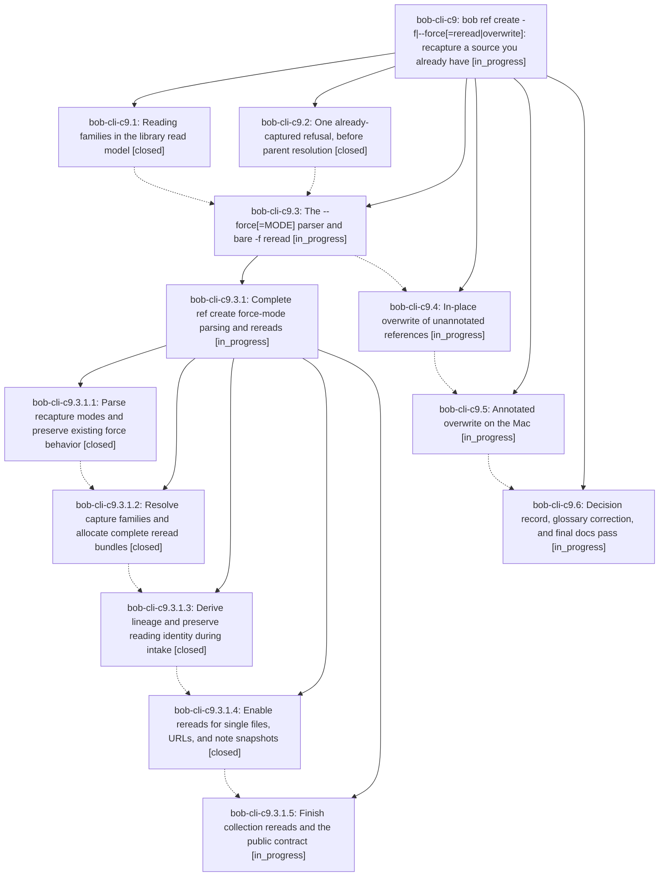

# Bead: bob-cli-c9 — bob ref create -f\|--force\[=reread\|overwrite\]: recapture a source you already have

[Bead Pages](../README.md) / bob-cli-c9

**Status:** ◐ in_progress · **Type:** ▸ plan · **Tier:** epic
**Owner:** `bryanbugyi34@gmail.com` · **Created by:** [bbugyi200.athena.14a](https://github.com/bobs-org/bob-cli--agents/blob/main/sessions/bbugyi200.athena.14a.md) · **Assignee:** `bob-cli-c9.land`
**Created:** 2026-10-25 14:15:31 EDT
**Plan:** [202610/ref\_create\_force\_recapture.md](https://github.com/bobs-org/bob-cli--plans/blob/main/202610/ref_create_force_recapture.md)

<!-- sase:links:start -->

## Links

| Relation | Artifact | Why |
| --- | --- | --- |
| implemented-by | [plan:202610/ref_create_force_recapture.md][1] | derived from the plan's `bead_id:` frontmatter field |

_Plus 2 automatic references — see [Referenced By](#referenced-by)._

[1]: https://github.com/bobs-org/bob-cli--plans/blob/main/202610/ref_create_force_recapture.md

<!-- sase:links:end -->

## Description

A source that is already a reference can be captured again on purpose. Bare -f adds a new <root>__vN reading linked to the earlier ones. -f overwrite recaptures a reference in place and keeps its path, id, and reading task. Before that, anything you made in the old note is frozen into ref_history/. Without -f, a duplicate is refused before any fetch, with one clear message that names the existing copies and the exact fix.

## Phases

| Bead | Title | Status | Size | Created | Agents | Commits |
|---|---|---|---|---|---:|---:|
| [bob-cli-c9.1](bob-cli-c9.1.md) | Reading families in the library read model | ✓ closed | medium | 2026-10-25 | 1 | 1 |
| [bob-cli-c9.2](bob-cli-c9.2.md) | One already-captured refusal, before parent resolution | ✓ closed | medium | 2026-10-25 | 1 | 1 |
| [bob-cli-c9.3](bob-cli-c9.3.md) | The --force\[=MODE\] parser and bare -f reread | ◐ in_progress | large | 2026-10-25 | 1 | 0 |
| [bob-cli-c9.4](bob-cli-c9.4.md) | In-place overwrite of unannotated references | ◐ in_progress | large | 2026-10-25 | 1 | 0 |
| [bob-cli-c9.5](bob-cli-c9.5.md) | Annotated overwrite on the Mac | ◐ in_progress | large | 2026-10-25 | 1 | 0 |
| [bob-cli-c9.6](bob-cli-c9.6.md) | Decision record, glossary correction, and final docs pass | ◐ in_progress | small | 2026-10-25 | 1 | 0 |

## Lineage

## Agents

| Agent | Bead | Commits |
|---|---|---:|
| [bbugyi200.athena.bob-cli-c9.1](https://github.com/bobs-org/bob-cli--agents/blob/main/agents/bbugyi200.athena.bob-cli-c9.1/README.md) | [bob-cli-c9.1](bob-cli-c9.1.md) | 1 |
| [bbugyi200.athena.bob-cli-c9.2](https://github.com/bobs-org/bob-cli--agents/blob/main/agents/bbugyi200.athena.bob-cli-c9.2/README.md) | [bob-cli-c9.2](bob-cli-c9.2.md) | 1 |
| [bbugyi200.athena.bob-cli-c9.3](https://github.com/bobs-org/bob-cli--agents/blob/main/sessions/bbugyi200.athena.bob-cli-c9.3.md) | [bob-cli-c9.3](bob-cli-c9.3.md) | 0 |
| [bbugyi200.athena.bob-cli-c9.3.1.1](https://github.com/bobs-org/bob-cli--agents/blob/main/agents/bbugyi200.athena.bob-cli-c9.3.1.1/README.md) | [bob-cli-c9.3.1.1](bob-cli-c9.3.1.1.md) | 1 |
| [bbugyi200.athena.bob-cli-c9.3.1.2](https://github.com/bobs-org/bob-cli--agents/blob/main/agents/bbugyi200.athena.bob-cli-c9.3.1.2/README.md) | [bob-cli-c9.3.1.2](bob-cli-c9.3.1.2.md) | 1 |
| [bbugyi200.athena.bob-cli-c9.3.1.3](https://github.com/bobs-org/bob-cli--agents/blob/main/agents/bbugyi200.athena.bob-cli-c9.3.1.3/README.md) | [bob-cli-c9.3.1.3](bob-cli-c9.3.1.3.md) | 1 |
| [bbugyi200.athena.bob-cli-c9.3.1.4](https://github.com/bobs-org/bob-cli--agents/blob/main/agents/bbugyi200.athena.bob-cli-c9.3.1.4/README.md) | [bob-cli-c9.3.1.4](bob-cli-c9.3.1.4.md) | 1 |
| [bbugyi200.athena.bob-cli-c9.3.1.5](https://github.com/bobs-org/bob-cli--agents/blob/main/agents/bbugyi200.athena.bob-cli-c9.3.1.5/README.md) | [bob-cli-c9.3.1.5](bob-cli-c9.3.1.5.md) | 0 |
| [bbugyi200.athena.bob-cli-c9.3.1.land](https://github.com/bobs-org/bob-cli--agents/blob/main/agents/bbugyi200.athena.bob-cli-c9.3.1.land/README.md) | [bob-cli-c9.3.1](bob-cli-c9.3.1.md) | 0 |
| [bbugyi200.athena.bob-cli-c9.4](https://github.com/bobs-org/bob-cli--agents/blob/main/agents/bbugyi200.athena.bob-cli-c9.4/README.md) | [bob-cli-c9.4](bob-cli-c9.4.md) | 0 |
| [bbugyi200.athena.bob-cli-c9.5](https://github.com/bobs-org/bob-cli--agents/blob/main/agents/bbugyi200.athena.bob-cli-c9.5/README.md) | [bob-cli-c9.5](bob-cli-c9.5.md) | 0 |
| [bbugyi200.athena.bob-cli-c9.6](https://github.com/bobs-org/bob-cli--agents/blob/main/agents/bbugyi200.athena.bob-cli-c9.6/README.md) | [bob-cli-c9.6](bob-cli-c9.6.md) | 0 |
| [bbugyi200.athena.bob-cli-c9.land](https://github.com/bobs-org/bob-cli--agents/blob/main/agents/bbugyi200.athena.bob-cli-c9.land/README.md) | [bob-cli-c9](README.md) | 0 |

## Commits

| Repo | Commit | Subject | Bead | Committed |
|---|---|---|---|---|
| bob-cli | [`e852198`](https://github.com/bobs-org/bob-cli/commit/e852198de298a5cc138c26c183f0f5597d2f9b13) | feat(ref): one already-captured refusal, before parent resolution | [bob-cli-c9.2](bob-cli-c9.2.md) | 2026-10-25 14:58:17 EDT |
| bob-cli | [`16f86b7`](https://github.com/bobs-org/bob-cli/commit/16f86b7df6d9e8ee69822404ada9092ba8220339) | feat(ref): reading families in the library read model | [bob-cli-c9.1](bob-cli-c9.1.md) | 2026-10-25 15:05:38 EDT |
| bob-cli | [`2e08351`](https://github.com/bobs-org/bob-cli/commit/2e08351e893b59f79aa6de7f3c663db1000f640f) | feat(highlights): add force parser with reread/overwrite modes | [bob-cli-c9.3.1.1](bob-cli-c9.3.1.1.md) | 2026-10-25 16:22:11 EDT |
| bob-cli | [`347c36b`](https://github.com/bobs-org/bob-cli/commit/347c36b1c7add475a8a3a739dc1f024db7d7aebd) | feat(highlights): read-only family planning recapture with no reread writes | [bob-cli-c9.3.1.2](bob-cli-c9.3.1.2.md) | 2026-10-25 17:00:04 EDT |
| bob-cli | [`291efa6`](https://github.com/bobs-org/bob-cli/commit/291efa6b374695cace353fab593504d5c0cc6600) | feat(highlights): derive birth earlier lineage and reading-aware ref task IDs | [bob-cli-c9.3.1.3](bob-cli-c9.3.1.3.md) | 2026-10-25 17:53:00 EDT |
| bob-cli | [`499294b`](https://github.com/bobs-org/bob-cli/commit/499294b3fa35a2a01a4b4173ed8bc9fea9764ae9) | feat(ref)!: enable rereads for single files, URLs, and note snapshots | [bob-cli-c9.3.1.4](bob-cli-c9.3.1.4.md) | 2026-10-25 18:45:24 EDT |

<!-- sase:referenced-by:start -->

## Referenced By

| Relation | Artifact | Why | Uses |
| --- | --- | --- | ---: |
| read-by | [agent:bob-cli-c9.1][1] | Need epic scope for family phase | 1 |
| read-by | [agent:bob-cli-c9.2][2] | parent epic scope | 1 |

[1]: https://github.com/bobs-org/bob-cli--agents/blob/main/agents/bbugyi200.athena.bob-cli-c9.1/README.md
[2]: https://github.com/bobs-org/bob-cli--agents/blob/main/agents/bbugyi200.athena.bob-cli-c9.2/README.md

<!-- sase:referenced-by:end -->
