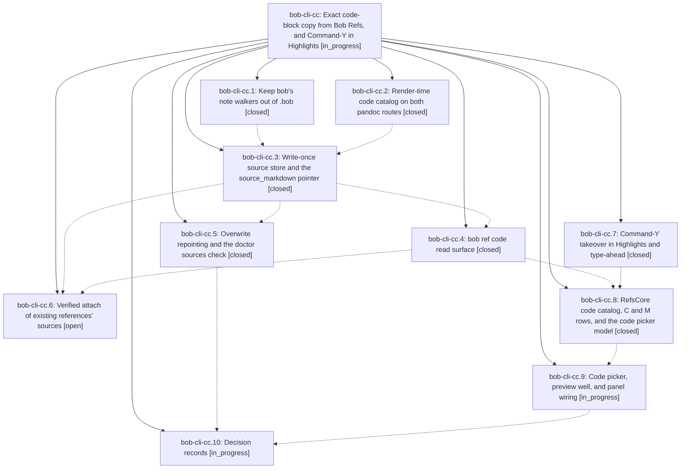

# Bead: bob-cli-cc — Exact code-block copy from Bob Refs, and Command-Y in Highlights

[Bead Pages](../README.md) / bob-cli-cc

**Status:** ◐ in_progress · **Type:** ▸ plan · **Tier:** epic
**Owner:** `bryanbugyi34@gmail.com` · **Created by:** [bbugyi200.athena.research.5b.linker.w0](https://github.com/bobs-org/bob-cli--agents/blob/main/sessions/bbugyi200.athena.research.5b.linker.w0.md) · **Assignee:** `bob-cli-cc.land`
**Created:** 2026-10-26 09:00:55 EDT
**Plan:** [202610/ref\_code\_block\_copy.md](https://github.com/bobs-org/bob-cli--plans/blob/main/202610/ref_code_block_copy.md)

<!-- sase:links:start -->

## Links

| Relation | Artifact | Why |
| --- | --- | --- |
| implemented-by | [plan:202610/ref_code_block_copy.md][1] | derived from the plan's `bead_id:` frontmatter field |

_Plus 1 automatic references — see [Referenced By](#referenced-by)._

[1]: https://github.com/bobs-org/bob-cli--plans/blob/main/202610/ref_code_block_copy.md

<!-- sase:links:end -->

## Description

While reading a bob-rendered reference in Highlights, Command-Y C Return puts the code block on the current page on the clipboard byte for byte (tabs, indentation, long lines, Mermaid source). The original Markdown of every new reference is preserved in the vault, one key (M) away, and `bob ref code` gives agents and the CLI the same data.

## Phases

| Bead | Title | Status | Size | Created | Agents | Commits |
|---|---|---|---|---|---:|---:|
| [bob-cli-cc.1](bob-cli-cc.1.md) | Keep bob's note walkers out of .bob | ✓ closed | small | 2026-10-26 | 1 | 1 |
| [bob-cli-cc.10](bob-cli-cc.10.md) | Decision records | ◐ in_progress | xsmall | 2026-10-26 | 1 | 0 |
| [bob-cli-cc.2](bob-cli-cc.2.md) | Render-time code catalog on both pandoc routes | ✓ closed | medium | 2026-10-26 | 1 | 1 |
| [bob-cli-cc.3](bob-cli-cc.3.md) | Write-once source store and the source\_markdown pointer | ✓ closed | medium | 2026-10-26 | 1 | 1 |
| [bob-cli-cc.4](bob-cli-cc.4.md) | bob ref code read surface | ✓ closed | medium | 2026-10-26 | 1 | 1 |
| [bob-cli-cc.5](bob-cli-cc.5.md) | Overwrite repointing and the doctor sources check | ✓ closed | medium | 2026-10-26 | 1 | 0 |
| [bob-cli-cc.6](bob-cli-cc.6.md) | Verified attach of existing references' sources | ○ open | medium | 2026-10-26 | 1 | 0 |
| [bob-cli-cc.7](bob-cli-cc.7.md) | Command-Y takeover in Highlights and type-ahead | ✓ closed | medium | 2026-10-26 | 1 | 1 |
| [bob-cli-cc.8](bob-cli-cc.8.md) | RefsCore code catalog, C and M rows, and the code picker model | ✓ closed | medium | 2026-10-26 | 1 | 1 |
| [bob-cli-cc.9](bob-cli-cc.9.md) | Code picker, preview well, and panel wiring | ◐ in_progress | medium | 2026-10-26 | 1 | 0 |

## Lineage

## Agents

| Agent | Bead | Commits |
|---|---|---:|
| [bbugyi200.athena.bob-cli-cc.1](https://github.com/bobs-org/bob-cli--agents/blob/main/agents/bbugyi200.athena.bob-cli-cc.1/README.md) | [bob-cli-cc.1](bob-cli-cc.1.md) | 1 |
| [bbugyi200.athena.bob-cli-cc.10](https://github.com/bobs-org/bob-cli--agents/blob/main/agents/bbugyi200.athena.bob-cli-cc.10/README.md) | [bob-cli-cc.10](bob-cli-cc.10.md) | 0 |
| [bbugyi200.athena.bob-cli-cc.2](https://github.com/bobs-org/bob-cli--agents/blob/main/sessions/bbugyi200.athena.bob-cli-cc.2.md) | [bob-cli-cc.2](bob-cli-cc.2.md) | 1 |
| [bbugyi200.athena.bob-cli-cc.3](https://github.com/bobs-org/bob-cli--agents/blob/main/agents/bbugyi200.athena.bob-cli-cc.3/README.md) | [bob-cli-cc.3](bob-cli-cc.3.md) | 1 |
| [bbugyi200.athena.bob-cli-cc.4](https://github.com/bobs-org/bob-cli--agents/blob/main/agents/bbugyi200.athena.bob-cli-cc.4/README.md) | [bob-cli-cc.4](bob-cli-cc.4.md) | 1 |
| [bbugyi200.athena.bob-cli-cc.5](https://github.com/bobs-org/bob-cli--agents/blob/main/agents/bbugyi200.athena.bob-cli-cc.5/README.md) | [bob-cli-cc.5](bob-cli-cc.5.md) | 0 |
| [bbugyi200.athena.bob-cli-cc.6](https://github.com/bobs-org/bob-cli--agents/blob/main/agents/bbugyi200.athena.bob-cli-cc.6/README.md) | [bob-cli-cc.6](bob-cli-cc.6.md) | 0 |
| [bbugyi200.athena.bob-cli-cc.7](https://github.com/bobs-org/bob-cli--agents/blob/main/agents/bbugyi200.athena.bob-cli-cc.7/README.md) | [bob-cli-cc.7](bob-cli-cc.7.md) | 1 |
| [bbugyi200.athena.bob-cli-cc.8](https://github.com/bobs-org/bob-cli--agents/blob/main/sessions/bbugyi200.athena.bob-cli-cc.8.md) | [bob-cli-cc.8](bob-cli-cc.8.md) | 1 |
| [bbugyi200.athena.bob-cli-cc.9](https://github.com/bobs-org/bob-cli--agents/blob/main/agents/bbugyi200.athena.bob-cli-cc.9/README.md) | [bob-cli-cc.9](bob-cli-cc.9.md) | 0 |
| [bbugyi200.athena.bob-cli-cc.land](https://github.com/bobs-org/bob-cli--agents/blob/main/agents/bbugyi200.athena.bob-cli-cc.land/README.md) | [bob-cli-cc](README.md) | 0 |

## Commits

| Repo | Commit | Subject | Bead | Committed |
|---|---|---|---|---|
| bob-cli | [`01f7ec9`](https://github.com/bobs-org/bob-cli/commit/01f7ec972ccbe499ca46dc1e377023c0c32bdf92) | fix(vault): keep note walkers out of .bob | [bob-cli-cc.1](bob-cli-cc.1.md) | 2026-10-26 09:20:31 EDT |
| bob-mac-capture | [`bob-mac-capture@7b9bbdd`](https://github.com/bobs-org/bob-mac-capture/commit/7b9bbddabfd2b3368bb77287842e045f677cabb7) | feat(refs): Command-Y takeover opens the Copy card from Highlights | [bob-cli-cc.7](bob-cli-cc.7.md) | 2026-10-26 09:53:32 EDT |
| bob-cli | [`c7ced49`](https://github.com/bobs-org/bob-cli/commit/c7ced497d875f5c569d1a324ca9ac5a59a6e49eb) | feat(highlights-ref): build render-time code catalog | [bob-cli-cc.2](bob-cli-cc.2.md) | 2026-10-26 10:32:44 EDT |
| bob-cli | [`009060f`](https://github.com/bobs-org/bob-cli/commit/009060f9b4b2b09f67c1d7754a23c9c64923a412) | feat(highlights-ref): write-once source store and source\_markdown pointer | [bob-cli-cc.3](bob-cli-cc.3.md) | 2026-10-26 11:18:37 EDT |
| bob-cli | [`fb28faa`](https://github.com/bobs-org/bob-cli/commit/fb28faa1af7094601f2762a03ff681301a836d50) | feat(ref): add saved code catalog read command | [bob-cli-cc.4](bob-cli-cc.4.md) | 2026-10-26 11:40:34 EDT |
| bob-mac-capture | [`bob-mac-capture@d8a828f`](https://github.com/bobs-org/bob-mac-capture/commit/d8a828f173182f7084a1bc40ec276434287873b1) | feat(refs): add code picker and catalog models | [bob-cli-cc.8](bob-cli-cc.8.md) | 2026-10-26 12:20:36 EDT |

<!-- sase:referenced-by:start -->

## Referenced By

| Relation | Artifact | Why | Uses |
| --- | --- | --- | ---: |
| read-by | [agent:bob-cli-cc.3][1] | Need parent epic plan and design | 1 |

[1]: https://github.com/bobs-org/bob-cli--agents/blob/main/agents/bbugyi200.athena.bob-cli-cc.3/README.md

<!-- sase:referenced-by:end -->
