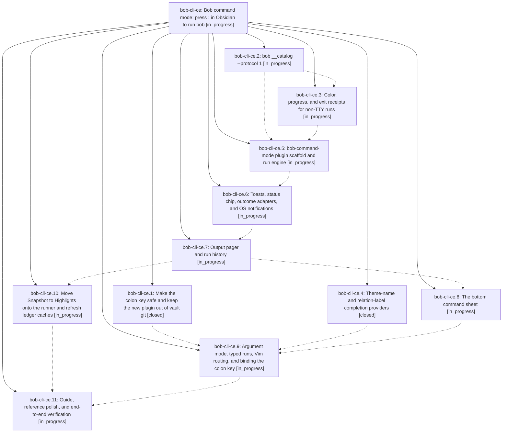

# Bead: bob-cli-ce — Bob command mode: press : in Obsidian to run bob

[Bead Pages](../README.md) / bob-cli-ce

**Status:** ◐ in_progress · **Type:** ▸ plan · **Tier:** epic
**Owner:** `bryanbugyi34@gmail.com` · **Created by:** [bbugyi200.athena.research.5c.linker.w0](https://github.com/bobs-org/bob-cli--agents/blob/main/sessions/bbugyi200.athena.research.5c.linker.w0.md) · **Assignee:** `bob-cli-ce.land`
**Created:** 2026-10-26 10:35:52 EDT
**Plan:** [202610/bob\_colon\_command\_mode.md](https://github.com/bobs-org/bob-cli--plans/blob/main/202610/bob_colon_command_mode.md)

## Description

Pressing `:` in Obsidian's Vim normal mode opens a fast, beautiful bob command sheet. The user filters a bob-owned catalog of every useful bob command, runs one with context-aware arguments and safe-write guards, and is notified when it finishes, with three honest outcome classes (completed, needs attention, failed). The full output is always one key away in a pager that doubles as run history. Vim's own ex line stays reachable through `::`, Vim-shaped input, and `g:`.

## Phases

| Bead | Title | Status | Size | Created | Agents | Commits |
|---|---|---|---|---|---:|---:|
| [bob-cli-ce.1](bob-cli-ce.1.md) | Make the colon key safe and keep the new plugin out of vault git | ✓ closed | small | 2026-10-26 | 1 | 0 |
| [bob-cli-ce.10](bob-cli-ce.10.md) | Move Snapshot to Highlights onto the runner and refresh ledger caches | ◐ in_progress | small | 2026-10-26 | 1 | 0 |
| [bob-cli-ce.11](bob-cli-ce.11.md) | Guide, reference polish, and end-to-end verification | ◐ in_progress | small | 2026-10-26 | 1 | 0 |
| [bob-cli-ce.2](bob-cli-ce.2.md) | bob \_\_catalog --protocol 1 | ◐ in_progress | medium | 2026-10-26 | 1 | 0 |
| [bob-cli-ce.3](bob-cli-ce.3.md) | Color, progress, and exit receipts for non-TTY runs | ◐ in_progress | small | 2026-10-26 | 1 | 0 |
| [bob-cli-ce.4](bob-cli-ce.4.md) | Theme-name and relation-label completion providers | ✓ closed | small | 2026-10-26 | 1 | 1 |
| [bob-cli-ce.5](bob-cli-ce.5.md) | bob-command-mode plugin scaffold and run engine | ◐ in_progress | medium | 2026-10-26 | 1 | 0 |
| [bob-cli-ce.6](bob-cli-ce.6.md) | Toasts, status chip, outcome adapters, and OS notifications | ◐ in_progress | medium | 2026-10-26 | 1 | 0 |
| [bob-cli-ce.7](bob-cli-ce.7.md) | Output pager and run history | ◐ in_progress | medium | 2026-10-26 | 1 | 0 |
| [bob-cli-ce.8](bob-cli-ce.8.md) | The bottom command sheet | ◐ in_progress | medium | 2026-10-26 | 1 | 0 |
| [bob-cli-ce.9](bob-cli-ce.9.md) | Argument mode, typed runs, Vim routing, and binding the colon key | ◐ in_progress | medium | 2026-10-26 | 1 | 0 |

## Lineage

## Agents

| Agent | Bead | Commits |
|---|---|---:|
| [bbugyi200.athena.bob-cli-ce.1](https://github.com/bobs-org/bob-cli--agents/blob/main/agents/bbugyi200.athena.bob-cli-ce.1/README.md) | [bob-cli-ce.1](bob-cli-ce.1.md) | 0 |
| [bbugyi200.athena.bob-cli-ce.10](https://github.com/bobs-org/bob-cli--agents/blob/main/agents/bbugyi200.athena.bob-cli-ce.10/README.md) | [bob-cli-ce.10](bob-cli-ce.10.md) | 0 |
| [bbugyi200.athena.bob-cli-ce.11](https://github.com/bobs-org/bob-cli--agents/blob/main/agents/bbugyi200.athena.bob-cli-ce.11/README.md) | [bob-cli-ce.11](bob-cli-ce.11.md) | 0 |
| [bbugyi200.athena.bob-cli-ce.2](https://github.com/bobs-org/bob-cli--agents/blob/main/agents/bbugyi200.athena.bob-cli-ce.2/README.md) | [bob-cli-ce.2](bob-cli-ce.2.md) | 0 |
| [bbugyi200.athena.bob-cli-ce.3](https://github.com/bobs-org/bob-cli--agents/blob/main/agents/bbugyi200.athena.bob-cli-ce.3/README.md) | [bob-cli-ce.3](bob-cli-ce.3.md) | 0 |
| [bbugyi200.athena.bob-cli-ce.4](https://github.com/bobs-org/bob-cli--agents/blob/main/agents/bbugyi200.athena.bob-cli-ce.4/README.md) | [bob-cli-ce.4](bob-cli-ce.4.md) | 1 |
| [bbugyi200.athena.bob-cli-ce.5](https://github.com/bobs-org/bob-cli--agents/blob/main/agents/bbugyi200.athena.bob-cli-ce.5/README.md) | [bob-cli-ce.5](bob-cli-ce.5.md) | 0 |
| [bbugyi200.athena.bob-cli-ce.6](https://github.com/bobs-org/bob-cli--agents/blob/main/agents/bbugyi200.athena.bob-cli-ce.6/README.md) | [bob-cli-ce.6](bob-cli-ce.6.md) | 0 |
| [bbugyi200.athena.bob-cli-ce.7](https://github.com/bobs-org/bob-cli--agents/blob/main/agents/bbugyi200.athena.bob-cli-ce.7/README.md) | [bob-cli-ce.7](bob-cli-ce.7.md) | 0 |
| [bbugyi200.athena.bob-cli-ce.8](https://github.com/bobs-org/bob-cli--agents/blob/main/agents/bbugyi200.athena.bob-cli-ce.8/README.md) | [bob-cli-ce.8](bob-cli-ce.8.md) | 0 |
| [bbugyi200.athena.bob-cli-ce.9](https://github.com/bobs-org/bob-cli--agents/blob/main/agents/bbugyi200.athena.bob-cli-ce.9/README.md) | [bob-cli-ce.9](bob-cli-ce.9.md) | 0 |
| [bbugyi200.athena.bob-cli-ce.land](https://github.com/bobs-org/bob-cli--agents/blob/main/agents/bbugyi200.athena.bob-cli-ce.land/README.md) | [bob-cli-ce](README.md) | 0 |

## Commits

| Repo | Commit | Subject | Bead | Committed |
|---|---|---|---|---|
| bob-cli | [`92706cb`](https://github.com/bobs-org/bob-cli/commit/92706cb456ecb16286430ff7e859b698d920b261) | feat(completion): add theme and relation label providers | [bob-cli-ce.4](bob-cli-ce.4.md) | 2026-10-26 10:46:38 EDT |
