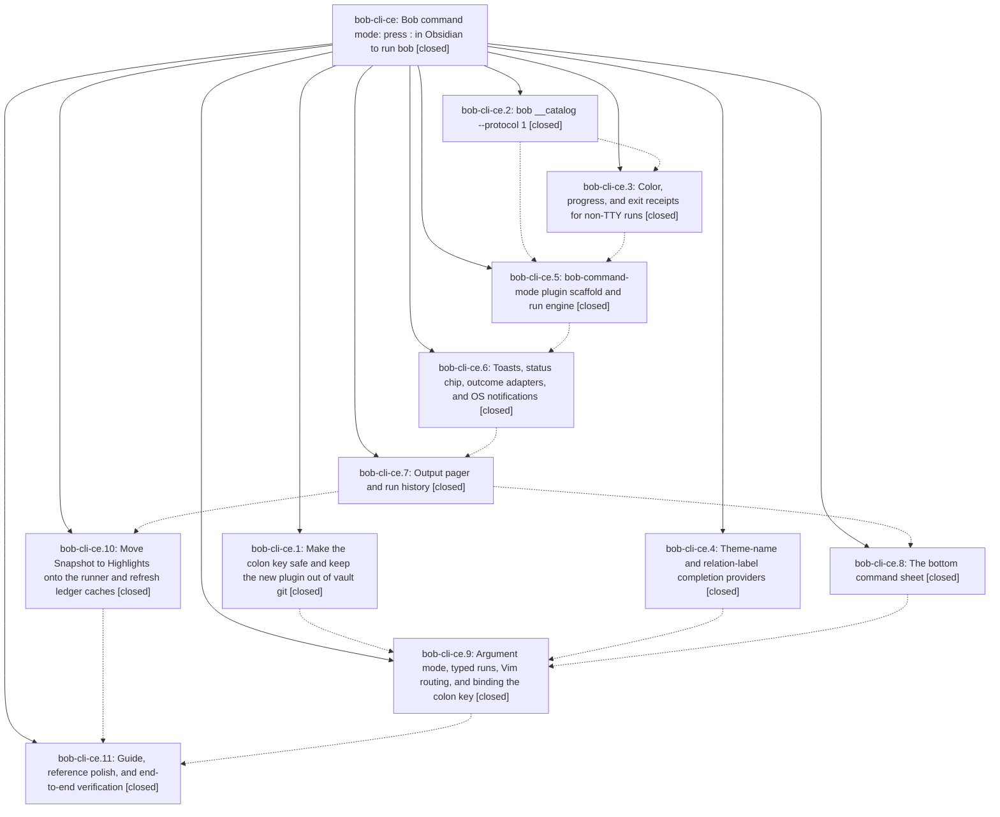

# Bead: bob-cli-ce — Bob command mode: press : in Obsidian to run bob

[Bead Pages](../README.md) / bob-cli-ce

**Status:** ✓ closed · **Resolution:** done · **Type:** ▸ plan · **Tier:** epic
**Owner:** `bryanbugyi34@gmail.com` · **Created by:** [bbugyi200.athena.research.5c.linker.w0](https://github.com/bobs-org/bob-cli--agents/blob/main/sessions/bbugyi200.athena.research.5c.linker.w0.md) · **Assignee:** `bob-cli-ce.land`
**Created:** 2026-10-26 10:35:52 EDT · **Closed:** 2026-10-26 15:18:15 EDT
**Plan:** [202610/bob\_colon\_command\_mode.md](https://github.com/bobs-org/bob-cli--plans/blob/main/202610/bob_colon_command_mode.md)

<!-- sase:links:start -->

## Links

| Relation | Artifact | Why |
| --- | --- | --- |
| implemented-by | [plan:202610/bob_colon_command_mode.md][1] | derived from the plan's `bead_id:` frontmatter field |

_Plus 2 automatic references — see [Referenced By](#referenced-by)._

[1]: https://github.com/bobs-org/bob-cli--plans/blob/main/202610/bob_colon_command_mode.md

<!-- sase:links:end -->

## Description

Pressing `:` in Obsidian's Vim normal mode opens a fast, beautiful bob command sheet. The user filters a bob-owned catalog of every useful bob command, runs one with context-aware arguments and safe-write guards, and is notified when it finishes, with three honest outcome classes (completed, needs attention, failed). The full output is always one key away in a pager that doubles as run history. Vim's own ex line stays reachable through `::`, Vim-shaped input, and `g:`.

## Notes

[2026-10-26T18:10:26Z · bryanbugyi34@gmail.com] Nothing seems to happen when I press the ':' key on my macbook in Obsidian currently. The Epic Lander agent should look into this and resolve it before closing the epic.

[2026-10-26T19:06:22Z · bob-cli-ce.land] LANDER FOLLOW-UP TRIAGE (bob-cli-ce.land): (1) The BOB_TEST_FIXTURE_PDF docs lint, proposed by ce.5 #1, ce.6 #1, ce.8 #1, ce.9 #1, ce.10 #2, and ce.11 #1, is not caused by this epic. It comes from active epic bob-cli-cc (cc.3/009060f9) and still reproduces in just docs-check on c4922e66 at source_store.rs:194. Recorded as a DISCOVERED ISSUE corroboration on bob-cli-cc; no task filed. (2) The other base-gate failures in ce.11 #1 are not caused by this epic either: bob-cli lib test fenced_column_zero_content_does_not_end_dependency_scan, 18 bob-plugins test-dependency-line-migration cases (parseDependencyLegacyChildDetails), and 'stage collections reuse one snapshot per parent'. All come from active batch-14 phase .4 (0f76d558, 241ca2d) and were recorded as a DISCOVERED ISSUE on bob-cli-an.6.6.6.5.6.5.5.6.6.6.6.6.6; no task filed. (3) The command-mode child-env assertion in ce.11 #1 is caused by this epic. scripts/test-command-mode-runner.cjs 'child env carries vault, features, receipt, and tool paths' fails whenever the caller's environment sets NO_COLOR, because the runner inherits process.env and NO_COLOR correctly suppresses CLICOLOR_FORCE. This is epic work for the landing tale. (4) ce.10 #1 ('--list') is a stray note, not a proposal; nothing to do. (5) User note #1, ':' does nothing on the MacBook: root-caused. bob-command-mode is absent from the vault's git-tracked .obsidian/community-plugins.json, so 'bob plugins list' reports VAULT=disabled. The vimrc mapping replays through Obsidian 1.14.5's bundled vim.js virtualPrompt into 'obcommand bob-command-mode:open', and vimrc-support then throws 'command not found'. The plugin is also gitignored per host, and the Mac (offline now) needs its own 'bob plugins sync'. This is epic work for the landing tale.

[2026-10-26T19:18:15Z · bob-cli-ce.land] All 11 phases verified against their commits: bob-cli 92706cb4, 0bec19d8, b5ba95c9, 60eb7812; bob-plugins 7d005fb, 90eb3c0, c036597, 5790364, e3b2763, 6f8f1c5, 6b1b6ec; vault 402d1f7b and 92c3a71e. DECISIONS honored: the four named Pomodoro capture rows ship, free-text capture stays excluded, no decisions record added. Catalog covers the post-epic ref code and ref attach-source leaves. Root cause of the ':' note: bob-command-mode was disabled in the synced .obsidian/community-plugins.json (vault git), so obcommand threw 'command not found' on every host. Enabled in vault commit def343be 'vault(athena): 1 file - .obsidian/community-plugins.json'; bob plugins list now shows bob-command-mode synced enabled on athena and vault-sync local_sha==remote_sha. Mac was unreachable (SSH connect timeout); pending manual step: run 'bob plugins sync' on the Mac once online, reload Obsidian, smoke-test ':' / 'g:' / '-' / ']s' / 'Z'. NO_COLOR fix: scripts/test-command-mode-runner.cjs runnerWith now drops inherited NO_COLOR unless extraEnv sets it; 81/81 command-mode tests pass with NO_COLOR=1 and unset. Docs: troubleshooting paragraph added to bob-cli guides/run-bob-from-obsidian.md and one sentence to bob-plugins docs/bob-command-mode.md; bob plugins sync dry-run and real both 'up to date'. Gates: bob-cli just docs-check fails only on known BOB_TEST_FIXTURE_PDF lint; bob-cli lib fenced_column_zero... still red; bob-plugins npm test 3813/3832 with only the 18 dependency-migration cases plus stage-snapshot case red; bob-plugins docs:check lint ok but reports pre-existing by-component.md generated drift also present on master. Follow-up triage: no new tasks; BOB_TEST_FIXTURE_PDF already on bob-cli-cc, legacy-reader failures already on batch-14, env test fixed here.

## Phases

| Bead | Title | Status | Size | Created | Agents | Commits |
|---|---|---|---|---|---:|---:|
| [bob-cli-ce.1](bob-cli-ce.1.md) | Make the colon key safe and keep the new plugin out of vault git | ✓ closed | small | 2026-10-26 | 1 | 0 |
| [bob-cli-ce.10](bob-cli-ce.10.md) | Move Snapshot to Highlights onto the runner and refresh ledger caches | ✓ closed | small | 2026-10-26 | 1 | 1 |
| [bob-cli-ce.11](bob-cli-ce.11.md) | Guide, reference polish, and end-to-end verification | ✓ closed | small | 2026-10-26 | 1 | 2 |
| [bob-cli-ce.2](bob-cli-ce.2.md) | bob \_\_catalog --protocol 1 | ✓ closed | medium | 2026-10-26 | 1 | 1 |
| [bob-cli-ce.3](bob-cli-ce.3.md) | Color, progress, and exit receipts for non-TTY runs | ✓ closed | small | 2026-10-26 | 1 | 1 |
| [bob-cli-ce.4](bob-cli-ce.4.md) | Theme-name and relation-label completion providers | ✓ closed | small | 2026-10-26 | 1 | 1 |
| [bob-cli-ce.5](bob-cli-ce.5.md) | bob-command-mode plugin scaffold and run engine | ✓ closed | medium | 2026-10-26 | 1 | 1 |
| [bob-cli-ce.6](bob-cli-ce.6.md) | Toasts, status chip, outcome adapters, and OS notifications | ✓ closed | medium | 2026-10-26 | 1 | 1 |
| [bob-cli-ce.7](bob-cli-ce.7.md) | Output pager and run history | ✓ closed | medium | 2026-10-26 | 1 | 1 |
| [bob-cli-ce.8](bob-cli-ce.8.md) | The bottom command sheet | ✓ closed | medium | 2026-10-26 | 1 | 1 |
| [bob-cli-ce.9](bob-cli-ce.9.md) | Argument mode, typed runs, Vim routing, and binding the colon key | ✓ closed | medium | 2026-10-26 | 1 | 1 |

## Lineage

## Agents

| Agent | Bead | Commits |
|---|---|---:|
| [bbugyi200.athena.bob-cli-ce.1](https://github.com/bobs-org/bob-cli--agents/blob/main/agents/bbugyi200.athena.bob-cli-ce.1/README.md) | [bob-cli-ce.1](bob-cli-ce.1.md) | 0 |
| [bbugyi200.athena.bob-cli-ce.10](https://github.com/bobs-org/bob-cli--agents/blob/main/agents/bbugyi200.athena.bob-cli-ce.10/README.md) | [bob-cli-ce.10](bob-cli-ce.10.md) | 1 |
| [bbugyi200.athena.bob-cli-ce.11](https://github.com/bobs-org/bob-cli--agents/blob/main/agents/bbugyi200.athena.bob-cli-ce.11/README.md) | [bob-cli-ce.11](bob-cli-ce.11.md) | 2 |
| [bbugyi200.athena.bob-cli-ce.2](https://github.com/bobs-org/bob-cli--agents/blob/main/agents/bbugyi200.athena.bob-cli-ce.2/README.md) | [bob-cli-ce.2](bob-cli-ce.2.md) | 1 |
| [bbugyi200.athena.bob-cli-ce.3](https://github.com/bobs-org/bob-cli--agents/blob/main/agents/bbugyi200.athena.bob-cli-ce.3/README.md) | [bob-cli-ce.3](bob-cli-ce.3.md) | 1 |
| [bbugyi200.athena.bob-cli-ce.4](https://github.com/bobs-org/bob-cli--agents/blob/main/agents/bbugyi200.athena.bob-cli-ce.4/README.md) | [bob-cli-ce.4](bob-cli-ce.4.md) | 1 |
| [bbugyi200.athena.bob-cli-ce.5](https://github.com/bobs-org/bob-cli--agents/blob/main/agents/bbugyi200.athena.bob-cli-ce.5/README.md) | [bob-cli-ce.5](bob-cli-ce.5.md) | 1 |
| [bbugyi200.athena.bob-cli-ce.6](https://github.com/bobs-org/bob-cli--agents/blob/main/agents/bbugyi200.athena.bob-cli-ce.6/README.md) | [bob-cli-ce.6](bob-cli-ce.6.md) | 1 |
| [bbugyi200.athena.bob-cli-ce.7](https://github.com/bobs-org/bob-cli--agents/blob/main/agents/bbugyi200.athena.bob-cli-ce.7/README.md) | [bob-cli-ce.7](bob-cli-ce.7.md) | 1 |
| [bbugyi200.athena.bob-cli-ce.8](https://github.com/bobs-org/bob-cli--agents/blob/main/agents/bbugyi200.athena.bob-cli-ce.8/README.md) | [bob-cli-ce.8](bob-cli-ce.8.md) | 1 |
| [bbugyi200.athena.bob-cli-ce.9](https://github.com/bobs-org/bob-cli--agents/blob/main/agents/bbugyi200.athena.bob-cli-ce.9/README.md) | [bob-cli-ce.9](bob-cli-ce.9.md) | 1 |
| [bbugyi200.athena.bob-cli-ce.land](https://github.com/bobs-org/bob-cli--agents/blob/main/sessions/bbugyi200.athena.bob-cli-ce.land.md) | [bob-cli-ce](README.md) | 2 |

## Commits

| Repo | Commit | Subject | Bead | Committed |
|---|---|---|---|---|
| bob-cli | [`92706cb`](https://github.com/bobs-org/bob-cli/commit/92706cb456ecb16286430ff7e859b698d920b261) | feat(completion): add theme and relation label providers | [bob-cli-ce.4](bob-cli-ce.4.md) | 2026-10-26 10:46:38 EDT |
| bob-cli | [`0bec19d`](https://github.com/bobs-org/bob-cli/commit/0bec19d89ec994ac957c22f024aeefc09eeb36f9) | feat(catalog): add hidden bob \_\_catalog --protocol 1 handshake | [bob-cli-ce.2](bob-cli-ce.2.md) | 2026-10-26 11:12:33 EDT |
| bob-cli | [`b5ba95c`](https://github.com/bobs-org/bob-cli/commit/b5ba95c96ec51418ad312e5e1b4e1fa71bb2753c) | feat(cli): honor color, progress, and exit receipts without a TTY | [bob-cli-ce.3](bob-cli-ce.3.md) | 2026-10-26 11:35:54 EDT |
| bob-plugins | [`bob-plugins@7d005fb`](https://github.com/bobs-org/bob-plugins/commit/7d005fb6373987fbda4368093e58adb840c1e190) | feat(command-mode): add bob-command-mode run engine, catalog, runner and docs | [bob-cli-ce.5](bob-cli-ce.5.md) | 2026-10-26 12:04:45 EDT |
| bob-plugins | [`bob-plugins@90eb3c0`](https://github.com/bobs-org/bob-plugins/commit/90eb3c076039f867e679394d3aa88b5a31fd3fa1) | feat(bob-command-mode): add run feedback and rerun controls | [bob-cli-ce.6](bob-cli-ce.6.md) | 2026-10-26 12:31:35 EDT |
| bob-plugins | [`bob-plugins@c036597`](https://github.com/bobs-org/bob-plugins/commit/c036597c5f05d92a1ee79f821c392c01cfbb5bf0) | feat(command-mode): add streaming output pager and run history | [bob-cli-ce.7](bob-cli-ce.7.md) | 2026-10-26 12:56:43 EDT |
| bob-plugins | [`bob-plugins@e3b2763`](https://github.com/bobs-org/bob-plugins/commit/e3b276313de3a5f58887444a2771b5ca13ecde4f) | feat(plugins): route snapshot through command-mode runner and refresh caches on run-finished | [bob-cli-ce.10](bob-cli-ce.10.md) | 2026-10-26 13:13:39 EDT |
| bob-plugins | [`bob-plugins@5790364`](https://github.com/bobs-org/bob-plugins/commit/5790364b047a5133634682d0e5aed45443715357) | feat(command-mode): add the bottom command sheet | [bob-cli-ce.8](bob-cli-ce.8.md) | 2026-10-26 13:21:24 EDT |
| bob-plugins | [`bob-plugins@6f8f1c5`](https://github.com/bobs-org/bob-plugins/commit/6f8f1c5c93edec5c2d82d41b3bc6d49760aff302) | feat(command-mode): add argument and Vim routing | [bob-cli-ce.9](bob-cli-ce.9.md) | 2026-10-26 14:06:09 EDT |
| bob-cli | [`60eb781`](https://github.com/bobs-org/bob-cli/commit/60eb781228f9c5be0053213f4be3e90cd9505c4f) | docs(command-mode): add Obsidian usage guide | [bob-cli-ce.11](bob-cli-ce.11.md) | 2026-10-26 14:26:38 EDT |
| bob-plugins | [`bob-plugins@6b1b6ec`](https://github.com/bobs-org/bob-plugins/commit/6b1b6ec9ebdd1013408692325fbe0a742d30acac) | docs(command-mode): complete plugin reference and API | [bob-cli-ce.11](bob-cli-ce.11.md) | 2026-10-26 14:27:43 EDT |
| bob-cli | [`97edc43`](https://github.com/bobs-org/bob-cli/commit/97edc43825aed9ab0e9db630f54a15bfe779f535) | docs(run-obsidian): add \`:\` troubleshooting and refresh generated docs | [bob-cli-ce](README.md) | 2026-10-26 15:20:03 EDT |
| bob-plugins | [`bob-plugins@86f9e61`](https://github.com/bobs-org/bob-plugins/commit/86f9e613ff235c8f8890419dca080e209a946117) | fix(command-mode): drop inherited NO\_COLOR in test runner, add \`:\` troubleshooting | [bob-cli-ce](README.md) | 2026-10-26 15:20:44 EDT |

<!-- sase:referenced-by:start -->

## Referenced By

| Relation | Artifact | Why | Uses |
| --- | --- | --- | ---: |
| read-by | [agent:bob-cli-ce.7][1] | Need parent epic notes and remaining pager work | 1 |
| read-by | [agent:bob-cli-ce.8][2] | epic context for sheet phase | 1 |

[1]: https://github.com/bobs-org/bob-cli--agents/blob/main/agents/bbugyi200.athena.bob-cli-ce.7/README.md
[2]: https://github.com/bobs-org/bob-cli--agents/blob/main/agents/bbugyi200.athena.bob-cli-ce.8/README.md

<!-- sase:referenced-by:end -->
