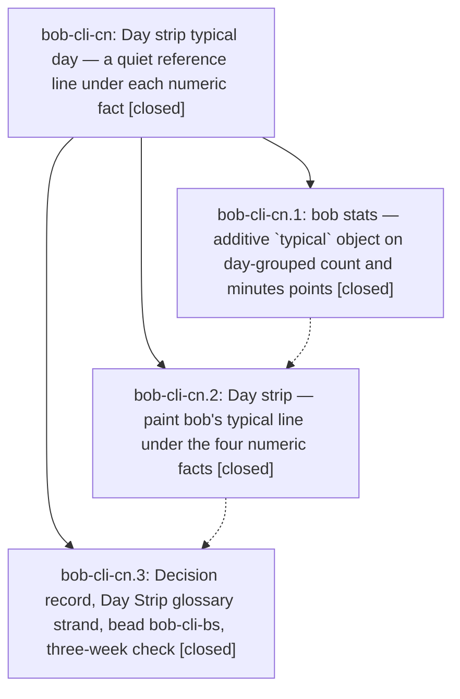

# Bead: bob-cli-cn — Day strip typical day — a quiet reference line under each numeric fact

[Bead Pages](../README.md) / bob-cli-cn

**Status:** ✓ closed · **Resolution:** done · **Type:** ▸ plan · **Tier:** epic
**Owner:** `bryanbugyi34@gmail.com` · **Created by:** [bbugyi200.athena.research.5d.linker.w0](https://github.com/bobs-org/bob-cli--agents/blob/main/sessions/bbugyi200.athena.research.5d.linker.w0.md) · **Assignee:** `bob-cli-cn.land`
**Created:** 2026-10-26 13:12:28 EDT · **Closed:** 2026-10-26 15:22:37 EDT
**Plan:** [202610/day\_strip\_typical\_day.md](https://github.com/bobs-org/bob-cli--plans/blob/main/202610/day_strip_typical_day.md)

<!-- sase:links:start -->

## Links

| Relation | Artifact | Why |
| --- | --- | --- |
| implemented-by | [plan:202610/day_strip_typical_day.md][1] | derived from the plan's `bead_id:` frontmatter field |
| related | [bead:bob-cli-cp][2] | Post-deployment exit check proposed by phase bob-cli-cn.3 note 2 |

[1]: https://github.com/bobs-org/bob-cli--plans/blob/main/202610/day_strip_typical_day.md
[2]: https://github.com/bobs-org/bob-cli--beads/blob/main/pages/bob-cli-cp/README.md

<!-- sase:links:end -->

## Description

Under Worked, Reviewed, Done, and Created, every Day strip shows one quiet line with that metric's typical day: the median of the seven days before D, needing at least four days with data. On finished days a neutral ▲, ▼, or = mark comes first, so the line reads `▼ typical 4h 10m`. Today shows `typical 4h 10m` with no mark. bob computes every number and word in a new additive `typical` object on day-grouped JSON points, and the plugin only paints it. The line has no colour, no percentages, and no bars. The strip never changes height when data arrives. The decision is recorded so no future agent "fixes" it back out.

## Notes

[2026-10-26T18:58:02Z · bob-cli-cn.land] LANDER FOLLOW-UP TRIAGE (all PROPOSED FOLLOW-UP entries reviewed using /sase_new_task; duplicate search, recent-task sweep, and active-epic sweep complete): cn.1 #2 (StoreWriteParams.verified build break) and cn.1 #4 (catalog/completion/source_store tests) are resolved in landed e9a955f9, verified by reading its complete diff; no new tasks. cn.1 #3, cn.2 #2, cn.3 #3 are the same BOB_TEST_FIXTURE_PDF docs lint, independently reproduced on clean c4922e66 by just docs-check; caused by cc.3 and attached as DISCOVERED ISSUE evidence to active bob-cli-cc, whose landing note #5 owns the exception. No duplicate task. cn.3 #1 (new typical-day decision strand) is declined: reviewer explicitly selected decision_record=no, and /sase_memory_write says to file nothing after a human decline. Existing bob-cli-bs note #3 already records the required re-scope; bs stays open and no +1 or new decision task is appropriate. cn.3 #2 is accepted as bob-cli-cp (feature, small), snoozed to 2026-11-16 09:00 America/New_York, with visible-use-date adjustment, exact feedback questions and predefined plugin-only responses; linked to cn and bs. These are the complete triage outcomes to carry into the eventual close note.

[2026-10-26T19:00:38Z · bob-cli-cn.land] LANDING REVIEW: All epic/phase notes and commits reviewed; cn.1 3f417646 and cn.2 bd9c7a8c / plugin cc5d045 implement the JSON and rendering contract. On master c4922e66 and linked plugin 0bf8920, 108 focused strip/hosts/lanes/themes/plan-host tests pass. No epic-symbol exemptions; no symvision recipe; cn has no parent_bead. Compared post-start mainline drift (since 2026-10-26 13:12 EDT), including bars switch c0489557/b70cb00, command-mode cache refresh e3b2763 and later command-mode/docs commits, relation-index coalescing 7756f51, dependency reader retirement 0f76d558/241ca2d, ref repair e9a955f9, and freshness c4922e66/0bf8920. No new consumer needs to compute typical. Two remaining epic items require a small landing tale: (1) typical.rs duplicates `(Some(value), false)` instead of calling series.rs::is_usable_value as the approved plan requires; (2) phase-3 commit 5d9bbead exists but is not contained by local or fetched origin/master, leaving the approved glossary update missing. Its diff also removes the concurrent bars-switch sentence, so recover the combined intent and regenerate from current canonical inputs. The tale will run just check, record the unrelated cc-owned docs lint if still present, and perform cn symbol cleanup, normal close, optional symvision, linked-plan status done, and parent-link recheck in the same coding turn. Follow-up triage is complete in the preceding note (cp snoozed, cc routed, no new decision task).

[2026-10-26T19:22:37Z · bob-cli-cn.land] Verified all three phases closed with no new notes, additive typical JSON and plugin rendering/cache behavior, live-parity and preview evidence from those phases; integrated post-start bars-switch wording and restored the approved glossary update (quiet typical line plus together-or-one-at-a-time bars switch and so far · HH:MM); typical and rolling medians now share is_usable_value, with a new hand-derived test that a missing calendar date, a provisional historical outlier, and an out-of-window D−8 value stay out while real zero and partial data count (median 20, 5 usable days). 12 typical_day lib tests pass. sase memory init regenerated project memory; just docs-gen refreshed glossary.md plus previously unregenerated code-copy and source-store decision pages and the command-mode guide index row; bars switch remains in generated glossary. just docs-check still fails only at src/native/highlights_ref/source_store.rs:194 undocumented BOB_TEST_FIXTURE_PDF (bob-cli-cc). sase tool run check 5b39829600353f50b5f1635b2fa57123: fmt and clippy green; cargo test --lib 3639 passed, 1 failed, 1 ignored — native::task_status_hooks::tests::sync::fenced_column_zero_content_does_not_end_dependency_scan panics at sync.rs:233; reproduced on clean c4922e66 and corroborated on causal epic bob-cli-an.6.6.6.5.6.5.5.6.6.6.6.6.6 (0f76d558). bob-plugins still 0bf8920; no plugin change. No epic-symbol entries; justfile has no symvision recipe. Follow-ups: cn.1 #2/#4 resolved by e9a955f9; cn.1 #3, cn.2 #2, cn.3 #3 routed to causal epic cc; cn.3 #1 declined per human decision_record=no with bs re-scope note retained; cn.3 #2 tracked by snoozed cp. Epic symbols resolved and descendant readiness rechecked. Linked epic plan 202610/day_strip_typical_day.md set to status: done. No parent_bead.

## Phases

| Bead | Title | Status | Size | Created | Agents | Commits |
|---|---|---|---|---|---:|---:|
| [bob-cli-cn.1](bob-cli-cn.1.md) | bob stats — additive \`typical\` object on day-grouped count and minutes points | ✓ closed | medium | 2026-10-26 | 1 | 1 |
| [bob-cli-cn.2](bob-cli-cn.2.md) | Day strip — paint bob's typical line under the four numeric facts | ✓ closed | medium | 2026-10-26 | 1 | 2 |
| [bob-cli-cn.3](bob-cli-cn.3.md) | Decision record, Day Strip glossary strand, bead bob-cli-bs, three-week check | ✓ closed | small | 2026-10-26 | 1 | 0 |

## Lineage

## Agents

| Agent | Bead | Commits |
|---|---|---:|
| [bbugyi200.athena.bob-cli-cn.1](https://github.com/bobs-org/bob-cli--agents/blob/main/agents/bbugyi200.athena.bob-cli-cn.1/README.md) | [bob-cli-cn.1](bob-cli-cn.1.md) | 1 |
| [bbugyi200.athena.bob-cli-cn.2](https://github.com/bobs-org/bob-cli--agents/blob/main/agents/bbugyi200.athena.bob-cli-cn.2/README.md) | [bob-cli-cn.2](bob-cli-cn.2.md) | 2 |
| [bbugyi200.athena.bob-cli-cn.3](https://github.com/bobs-org/bob-cli--agents/blob/main/agents/bbugyi200.athena.bob-cli-cn.3/README.md) | [bob-cli-cn.3](bob-cli-cn.3.md) | 0 |
| [bbugyi200.athena.bob-cli-cn.land](https://github.com/bobs-org/bob-cli--agents/blob/main/sessions/bbugyi200.athena.bob-cli-cn.land.md) | [bob-cli-cn](README.md) | 2 |

## Commits

| Repo | Commit | Subject | Bead | Committed |
|---|---|---|---|---|
| bob-cli | [`3f41764`](https://github.com/bobs-org/bob-cli/commit/3f417646f1c65db71ea86106906a0184b5908b03) | feat(stats): add typical day to daily points | [bob-cli-cn.1](bob-cli-cn.1.md) | 2026-10-26 14:00:55 EDT |
| bob-cli | [`bd9c7a8`](https://github.com/bobs-org/bob-cli/commit/bd9c7a8c5b061c64b2f14d1f601f7c4d64358cf4) | docs(stats): describe the Day strip typical line | [bob-cli-cn.2](bob-cli-cn.2.md) | 2026-10-26 14:32:15 EDT |
| bob-plugins | [`bob-plugins@cc5d045`](https://github.com/bobs-org/bob-plugins/commit/cc5d045b350edad0cd6d7dec47bb3df7096919c0) | feat(day-strip): show each fact's typical day | [bob-cli-cn.2](bob-cli-cn.2.md) | 2026-10-26 14:33:08 EDT |
| bob-cli | [`777df22`](https://github.com/bobs-org/bob-cli/commit/777df22f5b8f02e59a53e0d705e794e29a96decd) | fix(stats): share the usable-day rule with typical day | [bob-cli-cn](README.md) | 2026-10-26 15:32:03 EDT |
| bob-cli--plans | [`bob-cli--plans@29b3884`](https://github.com/bobs-org/bob-cli--plans/commit/29b3884db3bc673d71ed728039e2b7f0d4fedb72) | chore(plans): mark day strip typical-day plans done | [bob-cli-cn](README.md) | 2026-10-26 15:35:05 EDT |
