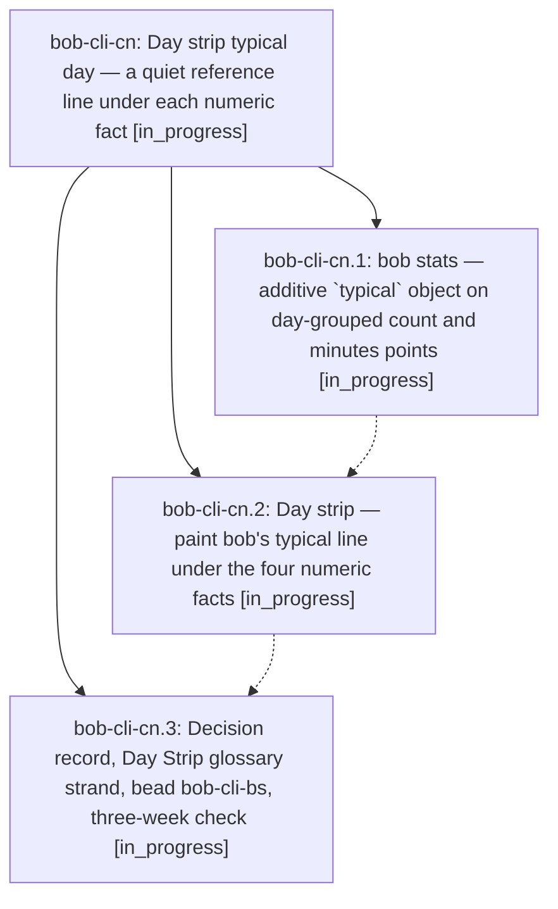

# Bead: bob-cli-cn — Day strip typical day — a quiet reference line under each numeric fact

[Bead Pages](../README.md) / bob-cli-cn

**Status:** ◐ in_progress · **Type:** ▸ plan · **Tier:** epic
**Owner:** `bryanbugyi34@gmail.com` · **Created by:** [bbugyi200.athena.research.5d.linker.w0](https://github.com/bobs-org/bob-cli--agents/blob/main/sessions/bbugyi200.athena.research.5d.linker.w0.md) · **Assignee:** `bob-cli-cn.land`
**Created:** 2026-10-26 13:12:28 EDT
**Plan:** [202610/day\_strip\_typical\_day.md](https://github.com/bobs-org/bob-cli--plans/blob/main/202610/day_strip_typical_day.md)

<!-- sase:links:start -->

## Links

| Relation | Artifact | Why |
| --- | --- | --- |
| implemented-by | [plan:202610/day_strip_typical_day.md][1] | derived from the plan's `bead_id:` frontmatter field |

[1]: https://github.com/bobs-org/bob-cli--plans/blob/main/202610/day_strip_typical_day.md

<!-- sase:links:end -->

## Description

Under Worked, Reviewed, Done, and Created, every Day strip shows one quiet line with that metric's typical day: the median of the seven days before D, needing at least four days with data. On finished days a neutral ▲, ▼, or = mark comes first, so the line reads `▼ typical 4h 10m`. Today shows `typical 4h 10m` with no mark. bob computes every number and word in a new additive `typical` object on day-grouped JSON points, and the plugin only paints it. The line has no colour, no percentages, and no bars. The strip never changes height when data arrives. The decision is recorded so no future agent "fixes" it back out.

## Phases

| Bead | Title | Status | Size | Created | Agents | Commits |
|---|---|---|---|---|---:|---:|
| [bob-cli-cn.1](bob-cli-cn.1.md) | bob stats — additive \`typical\` object on day-grouped count and minutes points | ◐ in_progress | medium | 2026-10-26 | 1 | 1 |
| [bob-cli-cn.2](bob-cli-cn.2.md) | Day strip — paint bob's typical line under the four numeric facts | ◐ in_progress | medium | 2026-10-26 | 1 | 0 |
| [bob-cli-cn.3](bob-cli-cn.3.md) | Decision record, Day Strip glossary strand, bead bob-cli-bs, three-week check | ◐ in_progress | small | 2026-10-26 | 1 | 0 |

## Lineage

## Agents

| Agent | Bead | Commits |
|---|---|---:|
| [bbugyi200.athena.bob-cli-cn.1](https://github.com/bobs-org/bob-cli--agents/blob/main/agents/bbugyi200.athena.bob-cli-cn.1/README.md) | [bob-cli-cn.1](bob-cli-cn.1.md) | 1 |
| [bbugyi200.athena.bob-cli-cn.2](https://github.com/bobs-org/bob-cli--agents/blob/main/agents/bbugyi200.athena.bob-cli-cn.2/README.md) | [bob-cli-cn.2](bob-cli-cn.2.md) | 0 |
| [bbugyi200.athena.bob-cli-cn.3](https://github.com/bobs-org/bob-cli--agents/blob/main/agents/bbugyi200.athena.bob-cli-cn.3/README.md) | [bob-cli-cn.3](bob-cli-cn.3.md) | 0 |
| [bbugyi200.athena.bob-cli-cn.land](https://github.com/bobs-org/bob-cli--agents/blob/main/agents/bbugyi200.athena.bob-cli-cn.land/README.md) | [bob-cli-cn](README.md) | 0 |

## Commits

| Repo | Commit | Subject | Bead | Committed |
|---|---|---|---|---|
| bob-cli | [`3f41764`](https://github.com/bobs-org/bob-cli/commit/3f417646f1c65db71ea86106906a0184b5908b03) | feat(stats): add typical day to daily points | [bob-cli-cn.1](bob-cli-cn.1.md) | 2026-10-26 14:00:55 EDT |
