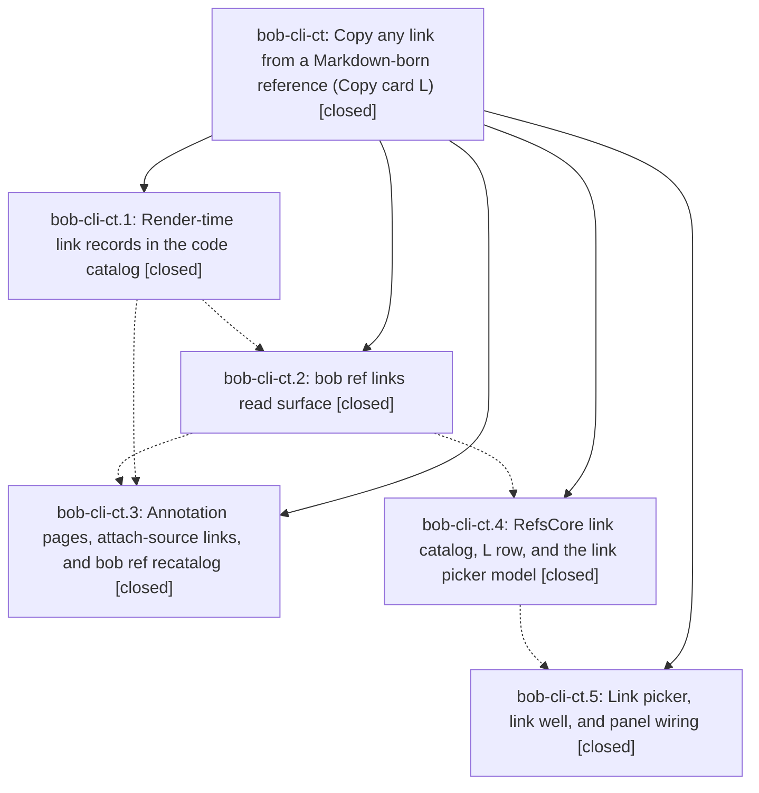

# Bead: bob-cli-ct — Copy any link from a Markdown-born reference (Copy card L)

[Bead Pages](../README.md) / bob-cli-ct

**Status:** ✓ closed · **Resolution:** done · **Type:** ▸ plan · **Tier:** epic
**Owner:** `bryanbugyi34@gmail.com` · **Created by:** [bbugyi200.athena.14k](https://github.com/bobs-org/bob-cli--agents/blob/main/sessions/bbugyi200.athena.14k.md) · **Assignee:** `bob-cli-ct.land`
**Created:** 2026-10-26 15:37:26 EDT · **Closed:** 2026-10-26 21:54:58 EDT
**Plan:** [202610/ref\_link\_copy.md](https://github.com/bobs-org/bob-cli--plans/blob/main/202610/ref_link_copy.md)

<!-- sase:links:start -->

## Links

| Relation | Artifact | Why |
| --- | --- | --- |
| implemented-by | [plan:202610/ref_link_copy.md][1] | derived from the plan's `bead_id:` frontmatter field |
| related | [bead:bob-cli-cw][2] | epic that added the L row inheriting the C row's preview rendering |
| related | [bead:bob-cli-cx][3] | epic whose Mac acceptance this completes |

_Plus 2 automatic references — see [Referenced By](#referenced-by)._

[1]: https://github.com/bobs-org/bob-cli--plans/blob/main/202610/ref_link_copy.md
[2]: https://github.com/bobs-org/bob-cli--beads/blob/main/pages/bob-cli-cw/README.md
[3]: https://github.com/bobs-org/bob-cli--beads/blob/main/pages/bob-cli-cx/README.md

<!-- sase:links:end -->

## Description

While reading a bob-rendered report in Highlights, Command-Y L Return puts the URL of the link on the current page on the clipboard, exactly the URL the PDF opens. Option-Return copies it as a Markdown link, A copies every link, and `bob ref links` gives the CLI and agents the same data.

## Notes

[2026-10-27T01:54:41Z · bob-cli-ct.land] LANDER FOLLOW-UP TRIAGE: (1) ct.1 #1 and ct.2 #1, the docs-check published-URLs gate: declined as a duplicate of bob-cli-cs, which backlog batch 15 (bob-cli-an.6.6.6.5.6.5.5.6.6.6.6.6.6.6) owns. Both broken links are already fixed (bob-cli b65bff1b, bob-plugins 1621bd6), and ct.3 later ran just docs-check green, URLs included. No +1, because the failure no longer reproduces. (2) ct.3 #6, phase work lost when finalization failed: filed bob-cli-cv (bug, large). (3) ct.5 #1, review the CI design renders: done by the lander. Run 40407215560 render-fixtures show the link picker, Markdown well, long-URL wrap, URL label, not-recorded, and loading cards rendering correctly in light and dark. The one deviation is shared with the C row: the card's C/L previews middle-truncate away '● K on this page' and draw the dot gray, not accent. Filed bob-cli-cw (bug, small); the cause is shared row rendering, not link-specific. (4) ct.5 #2, interactive Mac acceptance: filed bob-cli-cx (small). No released bob ships ref links yet (latest v0.3.1), so the acceptance stays unverified, as the plan allows. (5) Lander discovery: one vault store, muse_commentary_missing_from_exec_stream, has no links because its ref note never got a source_markdown pointer. That gap predates this epic; filed bob-cli-cy (bug, large).

[2026-10-27T01:54:58Z · bob-cli-ct.land] Verified all 5 phases against plan:202610/ref_link_copy.md and its decisions (l_key=shared, backfill=run, bare_urls=link).

bob-cli:
- 96793fda (ct.1): code_catalog.lua runs one document-order walk that records URI links (target, text, title, autolink, 160-char context, section). It inserts \BobLinkAnchor before each anchorable link, latex only, with no anchors in headings, captions, or table heads, and keeps the pcall guards. code.json gains an additive links array (StoredCatalog: serde default and skip_serializing_if, no deny_unknown_fields). The MARKDOWN_PANDOC_READER and SNAPSHOT_PANDOC_READER constants carry +autolink_bare_uris and are shared by the render, diagrams, snapshot, and attach passes.
- 82716a64 (ct.2): bob ref links has the status mapping, the 'run bob ref recatalog' detail for not_recorded, computed label, site, and markdown fields, completion, catalog, help, and docs.
- 42abfa70 (ct.3): pdf_links annotation mapper, the shared route-aware record pass, attach-source links, and bob ref recatalog (batches of 100 under a mutation session, 'bob ref recatalog: N references' commits, dry run, skip reasons). Doctor now counts links.
- bob-cli CI is green at HEAD 42abfa70 (run 40433544308).
- Vault backfill confirmed: commits e75c069, b3710c3, and 07b2e74 are on ~/bob master, and 237 of 238 stores carry links. The one exception is an orphan with no pointer; it predates the epic and is filed as bob-cli-cy.

bob-mac-capture:
- 6c3b1d4 (ct.4) and 2764ec5 (ct.5): RefsCopyCard.handle resolves L to linkPicker before queueing when sourceMarkdown is set. Option-U Markdown-link alternate added. The Visibility-table messages, the picker and well models, and the panel's parallel links fetch are in place.
- macOS CI green on both commits (runs 40403165310 and 40407215560). I reviewed the render-fixtures for the link picker, Markdown well, long URL, URL label, loading, and not-recorded states in light and dark.

Integration:
- Commits that landed during the epic but are not part of it: bob-cli b65bff1b (docs link) and 115a3610 (plugin deploy guard), bob-mac-capture f2513d2 (code-picker test fix), and bob-plugins 1621bd6 and 0b02193 (docs). None touches or duplicates the link catalog, and no plugin consumes the catalog. No integration changes were needed.

Follow-ups (detailed in the triage note):
- ct.1/ct.2 docs-URL gate: declined, a duplicate of bob-cli-cs, and both links are already fixed.
- Filed: bob-cli-cv (ct.3 finalization data loss), bob-cli-cw (C/L preview truncation and dot color, found in the render review that ct.5 #1 asked for), bob-cli-cx (ct.5 #2 Mac acceptance; no released bob has ref links yet, so it stays unverified as the plan allows), and bob-cli-cy (orphan store).
- No --epic-symbol entries.

## Phases

| Bead | Title | Status | Size | Created | Agents | Commits |
|---|---|---|---|---|---:|---:|
| [bob-cli-ct.1](bob-cli-ct.1.md) | Render-time link records in the code catalog | ✓ closed | medium | 2026-10-26 | 1 | 1 |
| [bob-cli-ct.2](bob-cli-ct.2.md) | bob ref links read surface | ✓ closed | medium | 2026-10-26 | 1 | 1 |
| [bob-cli-ct.3](bob-cli-ct.3.md) | Annotation pages, attach-source links, and bob ref recatalog | ✓ closed | medium | 2026-10-26 | 1 | 1 |
| [bob-cli-ct.4](bob-cli-ct.4.md) | RefsCore link catalog, L row, and the link picker model | ✓ closed | medium | 2026-10-26 | 1 | 1 |
| [bob-cli-ct.5](bob-cli-ct.5.md) | Link picker, link well, and panel wiring | ✓ closed | medium | 2026-10-26 | 1 | 1 |

## Lineage

## Agents

| Agent | Bead | Commits |
|---|---|---:|
| [bbugyi200.athena.bob-cli-ct.1](https://github.com/bobs-org/bob-cli--agents/blob/main/agents/bbugyi200.athena.bob-cli-ct.1/README.md) | [bob-cli-ct.1](bob-cli-ct.1.md) | 1 |
| [bbugyi200.athena.bob-cli-ct.2](https://github.com/bobs-org/bob-cli--agents/blob/main/sessions/bbugyi200.athena.bob-cli-ct.2.md) | [bob-cli-ct.2](bob-cli-ct.2.md) | 1 |
| [bbugyi200.athena.bob-cli-ct.3](https://github.com/bobs-org/bob-cli--agents/blob/main/sessions/bbugyi200.athena.bob-cli-ct.3.md) | [bob-cli-ct.3](bob-cli-ct.3.md) | 1 |
| [bbugyi200.athena.bob-cli-ct.4](https://github.com/bobs-org/bob-cli--agents/blob/main/agents/bbugyi200.athena.bob-cli-ct.4/README.md) | [bob-cli-ct.4](bob-cli-ct.4.md) | 1 |
| [bbugyi200.athena.bob-cli-ct.5](https://github.com/bobs-org/bob-cli--agents/blob/main/agents/bbugyi200.athena.bob-cli-ct.5/README.md) | [bob-cli-ct.5](bob-cli-ct.5.md) | 1 |
| [bbugyi200.athena.bob-cli-ct.land](https://github.com/bobs-org/bob-cli--agents/blob/main/agents/bbugyi200.athena.bob-cli-ct.land/README.md) | [bob-cli-ct](README.md) | 1 |

## Commits

| Repo | Commit | Subject | Bead | Committed |
|---|---|---|---|---|
| bob-cli | [`96793fd`](https://github.com/bobs-org/bob-cli/commit/96793fdac1309f1fc8c0cada42211222eef6d8b7) | feat(highlights-ref): record URI link catalog with anchor pages in code.json | [bob-cli-ct.1](bob-cli-ct.1.md) | 2026-10-26 16:03:47 EDT |
| bob-cli | [`82716a6`](https://github.com/bobs-org/bob-cli/commit/82716a6444e15457cbf432fd08636e2dcce0ea86) | feat(ref): add bob ref links read surface | [bob-cli-ct.2](bob-cli-ct.2.md) | 2026-10-26 16:53:14 EDT |
| bob-mac-capture | [`bob-mac-capture@6c3b1d4`](https://github.com/bobs-org/bob-mac-capture/commit/6c3b1d47f27e4b4d0087d2600817e9af1d6e513b) | feat(refs): add link catalog, L row, and picker model | [bob-cli-ct.4](bob-cli-ct.4.md) | 2026-10-26 17:17:51 EDT |
| bob-mac-capture | [`bob-mac-capture@2764ec5`](https://github.com/bobs-org/bob-mac-capture/commit/2764ec5f4a8fe2574bb6e466bc451a13df5dc8f3) | feat(refs): wire Copy card link picker, link well, and panel loads | [bob-cli-ct.5](bob-cli-ct.5.md) | 2026-10-26 17:46:50 EDT |
| bob-cli | [`42abfa7`](https://github.com/bobs-org/bob-cli/commit/42abfa705a445647395fedea1691d885f53722b5) | feat(ref): add annotation-backed link recataloging (bob-cli-ct.3) | [bob-cli-ct.3](bob-cli-ct.3.md) | 2026-10-26 21:36:08 EDT |
| bob-cli--plans | [`bob-cli--plans@cf8d8a0`](https://github.com/bobs-org/bob-cli--plans/commit/cf8d8a0068f9587187caad4bb7f27efb048bed73) | chore(plans): mark ref\_link\_copy epic plan done after bob-cli-ct landing | [bob-cli-ct](README.md) | 2026-10-26 21:55:40 EDT |

<!-- sase:referenced-by:start -->

## Referenced By

| Relation | Artifact | Why | Uses |
| --- | --- | --- | ---: |
| read-by | [agent:bob-cli-ct.1][1] | Need epic DECISIONS and plan context | 1 |
| read-by | [agent:bob-cli-ct.5][2] | Need epic DECISIONS and parent scope for phase ct.5 | 1 |

[1]: https://github.com/bobs-org/bob-cli--agents/blob/main/agents/bbugyi200.athena.bob-cli-ct.1/README.md
[2]: https://github.com/bobs-org/bob-cli--agents/blob/main/agents/bbugyi200.athena.bob-cli-ct.5/README.md

<!-- sase:referenced-by:end -->
