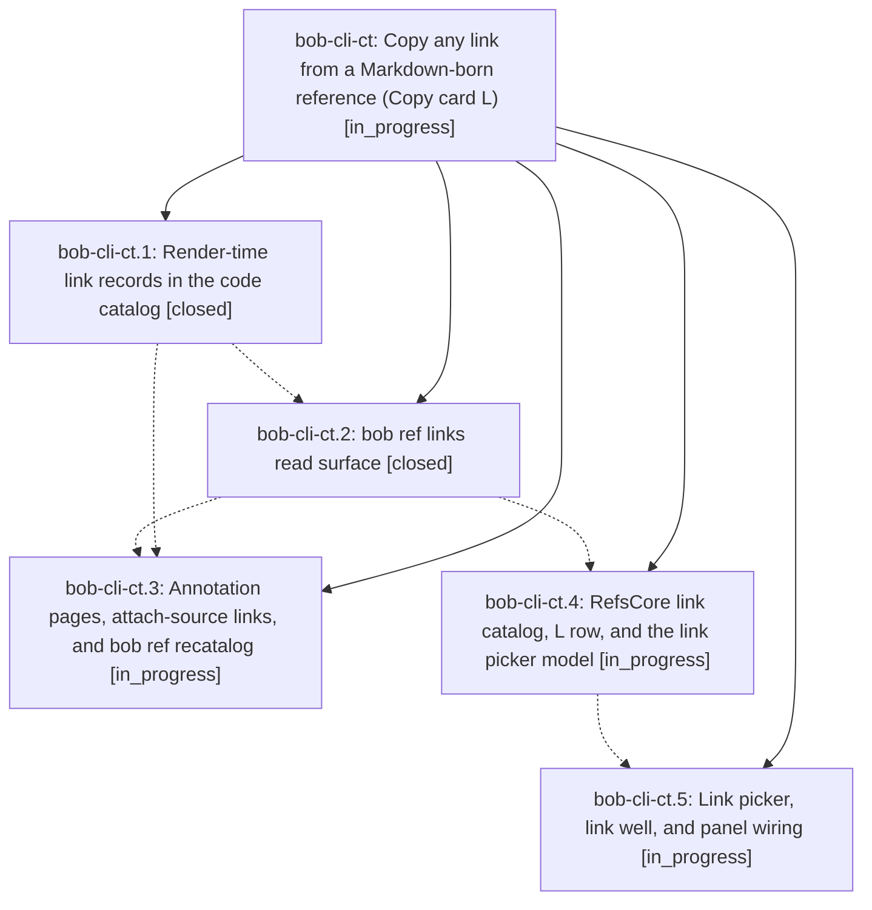

# Bead: bob-cli-ct — Copy any link from a Markdown-born reference (Copy card L)

[Bead Pages](../README.md) / bob-cli-ct

**Status:** ◐ in_progress · **Type:** ▸ plan · **Tier:** epic
**Owner:** `bryanbugyi34@gmail.com` · **Created by:** [bbugyi200.athena.14k](https://github.com/bobs-org/bob-cli--agents/blob/main/sessions/bbugyi200.athena.14k.md) · **Assignee:** `bob-cli-ct.land`
**Created:** 2026-10-26 15:37:26 EDT
**Plan:** [202610/ref\_link\_copy.md](https://github.com/bobs-org/bob-cli--plans/blob/main/202610/ref_link_copy.md)

<!-- sase:links:start -->

## Links

| Relation | Artifact | Why |
| --- | --- | --- |
| implemented-by | [plan:202610/ref_link_copy.md][1] | derived from the plan's `bead_id:` frontmatter field |

_Plus 1 automatic references — see [Referenced By](#referenced-by)._

[1]: https://github.com/bobs-org/bob-cli--plans/blob/main/202610/ref_link_copy.md

<!-- sase:links:end -->

## Description

While reading a bob-rendered report in Highlights, Command-Y L Return puts the URL of the link on the current page on the clipboard, exactly the URL the PDF opens. Option-Return copies it as a Markdown link, A copies every link, and `bob ref links` gives the CLI and agents the same data.

## Phases

| Bead | Title | Status | Size | Created | Agents | Commits |
|---|---|---|---|---|---:|---:|
| [bob-cli-ct.1](bob-cli-ct.1.md) | Render-time link records in the code catalog | ✓ closed | medium | 2026-10-26 | 1 | 1 |
| [bob-cli-ct.2](bob-cli-ct.2.md) | bob ref links read surface | ✓ closed | medium | 2026-10-26 | 1 | 1 |
| [bob-cli-ct.3](bob-cli-ct.3.md) | Annotation pages, attach-source links, and bob ref recatalog | ◐ in_progress | medium | 2026-10-26 | 1 | 0 |
| [bob-cli-ct.4](bob-cli-ct.4.md) | RefsCore link catalog, L row, and the link picker model | ◐ in_progress | medium | 2026-10-26 | 1 | 0 |
| [bob-cli-ct.5](bob-cli-ct.5.md) | Link picker, link well, and panel wiring | ◐ in_progress | medium | 2026-10-26 | 1 | 0 |

## Lineage

## Agents

| Agent | Bead | Commits |
|---|---|---:|
| [bbugyi200.athena.bob-cli-ct.1](https://github.com/bobs-org/bob-cli--agents/blob/main/agents/bbugyi200.athena.bob-cli-ct.1/README.md) | [bob-cli-ct.1](bob-cli-ct.1.md) | 1 |
| [bbugyi200.athena.bob-cli-ct.2](https://github.com/bobs-org/bob-cli--agents/blob/main/sessions/bbugyi200.athena.bob-cli-ct.2.md) | [bob-cli-ct.2](bob-cli-ct.2.md) | 1 |
| [bbugyi200.athena.bob-cli-ct.3](https://github.com/bobs-org/bob-cli--agents/blob/main/agents/bbugyi200.athena.bob-cli-ct.3/README.md) | [bob-cli-ct.3](bob-cli-ct.3.md) | 0 |
| [bbugyi200.athena.bob-cli-ct.4](https://github.com/bobs-org/bob-cli--agents/blob/main/agents/bbugyi200.athena.bob-cli-ct.4/README.md) | [bob-cli-ct.4](bob-cli-ct.4.md) | 0 |
| [bbugyi200.athena.bob-cli-ct.5](https://github.com/bobs-org/bob-cli--agents/blob/main/agents/bbugyi200.athena.bob-cli-ct.5/README.md) | [bob-cli-ct.5](bob-cli-ct.5.md) | 0 |
| [bbugyi200.athena.bob-cli-ct.land](https://github.com/bobs-org/bob-cli--agents/blob/main/agents/bbugyi200.athena.bob-cli-ct.land/README.md) | [bob-cli-ct](README.md) | 0 |

## Commits

| Repo | Commit | Subject | Bead | Committed |
|---|---|---|---|---|
| bob-cli | [`96793fd`](https://github.com/bobs-org/bob-cli/commit/96793fdac1309f1fc8c0cada42211222eef6d8b7) | feat(highlights-ref): record URI link catalog with anchor pages in code.json | [bob-cli-ct.1](bob-cli-ct.1.md) | 2026-10-26 16:03:47 EDT |
| bob-cli | [`82716a6`](https://github.com/bobs-org/bob-cli/commit/82716a6444e15457cbf432fd08636e2dcce0ea86) | feat(ref): add bob ref links read surface | [bob-cli-ct.2](bob-cli-ct.2.md) | 2026-10-26 16:53:14 EDT |

<!-- sase:referenced-by:start -->

## Referenced By

| Relation | Artifact | Why | Uses |
| --- | --- | --- | ---: |
| read-by | [agent:bob-cli-ct.1][1] | Need epic DECISIONS and plan context | 1 |

[1]: https://github.com/bobs-org/bob-cli--agents/blob/main/agents/bbugyi200.athena.bob-cli-ct.1/README.md

<!-- sase:referenced-by:end -->
