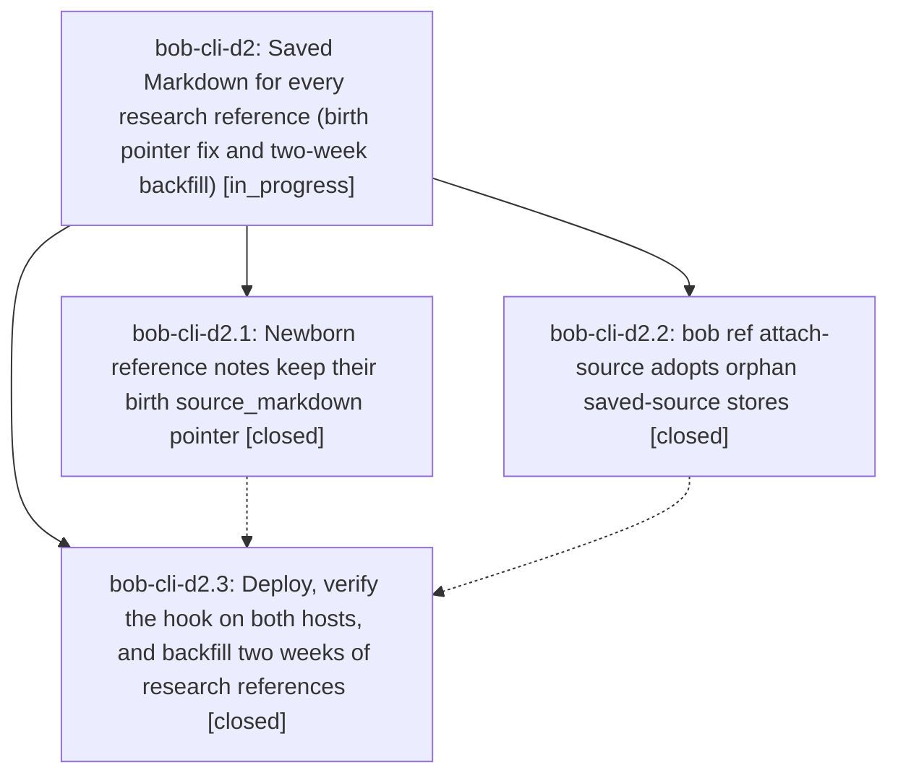

# Bead: bob-cli-d2 — Saved Markdown for every research reference (birth pointer fix and two-week backfill)

[Bead Pages](../README.md) / bob-cli-d2

**Status:** ◐ in_progress · **Type:** ▸ plan · **Tier:** epic
**Owner:** `bryanbugyi34@gmail.com` · **Created by:** [bbugyi200.athena.14o](https://github.com/bobs-org/bob-cli--agents/blob/main/sessions/bbugyi200.athena.14o.md) · **Assignee:** `bob-cli-d2.land`
**Created:** 2026-10-27 07:42:23 EDT
**Plan:** [202610/research\_ref\_saved\_markdown.md](https://github.com/bobs-org/bob-cli--plans/blob/main/202610/research_ref_saved_markdown.md)

<!-- sase:links:start -->

## Links

| Relation | Artifact | Why |
| --- | --- | --- |
| implemented-by | [plan:202610/research_ref_saved_markdown.md][1] | derived from the plan's `bead_id:` frontmatter field |
| related | file:explicit:0b7f8779ba750441f4469595 | attached via sase artifact create --bead |
| related | file:explicit:189960637c2c461f1b41e91b | attached via sase artifact create --bead |
| related | file:explicit:65cf00f6aef47b5c575e10e2 | attached via sase artifact create --bead |
| related | file:explicit:a56b38495295a784e55ac0a0 | attached via sase artifact create --bead |
| related | file:explicit:c61a26370b705cae1446a6ed | attached via sase artifact create --bead |

_Plus 2 automatic references — see [Referenced By](#referenced-by)._

[1]: https://github.com/bobs-org/bob-cli--plans/blob/main/202610/research_ref_saved_markdown.md

<!-- sase:links:end -->

## Description

Every research report the SASE research-highlights file hook turns into a reference carries its saved Markdown, so the Bob Refs Copy card offers C (code block), L (link), and M (Markdown). That holds for every new report on athena and apollo, and for every hook-matched report from the last two weeks.

## Notes

[2026-10-27T13:19:54Z · bob-cli-d2.land] LAND AUDIT / FOLLOW-UP TRIAGE before remaining-work tale: reviewed approved plan, every note on d2.1/.2/.3, commits 3a13ec6f/d38bef59, prior pointer safeguards 017b6927, candidate verification 69b7d962, and current source/tests. Fetched origin/master=d38bef59; only non-epic commit since first epic commit is 79b2859d CI tooling, no feature integration required. Verified chezmoi 62806ca3 and live hook command=bob_research_capture, sidecars=[research], timeout=300.0 on both hosts. Existing attach CLI suite: 19 passed with render tools. epic-symbols empty; no symvision recipe. All 19 newly repaired pointers are present. d2.3 #2: supplementary overlap evidence recorded on existing bob-cli-co and its active batch-17 owner, no duplicate task; old-set membership not proved, so co remains open. d2.3 #3: retained as required d2 backfill/adoption acceptance work, not deferred into a new task. The 55/72 skip rate breached the approved 10% stop-before-write gate; doctor still has the machine_load orphan. Fresh scratch rendering of its three text blocks reproduces 2/3: pdftotext loses one U+27F3 glyph, causing exact-line match_lines to discard the whole line. Additional epic integration defect: adoption title failure followed by an explicit same-byte candidate rewrites code.json from markdown/anchor to attached/text_match; preserve the better catalog across all fallback paths. New JSON integration defect: write-mode stdout starts with committed <sha>, not pure JSON; routed to causal active batch-17 epic, with d2 tale owning the shared fix. No new tasks created after sase_new_task duplicate and active-epic sweep. cy already closed with its named orphan repaired; no reopening needed. Durable detailed evidence and repro: file:explicit:c61a26370b705cae1446a6ed. Epic remains open until the bounded repair, backfill gate, and doctor acceptance pass. No parent_bead.

[2026-10-27T14:18:39Z · bob-cli-d2.land--1] Acceptance blocker (2026-10-27): exact-source dry-run of all 55 pointerless candidates verified 17 and skipped 38. Against the approved original denominator 72, 38/72 = 52.78%, above the unchanged 10% stop gate; no live attach writes were made. The machine_load_accounting_transparency orphan store exactly matches its hook-time source SHA-256, but orphan adoption and explicit exact-source verification both fail at 2/3 blocks, so its source_markdown pointer remains absent. The exact-source inventory, full dry-run verdicts, representative comparisons, host smokes, and checks are attached as file:explicit:189960637c2c461f1b41e91b, file:explicit:65cf00f6aef47b5c575e10e2, and file:explicit:0b7f8779ba750441f4469595. Keep bob-cli-d2 open; the linked plan is not done.

[2026-10-27T14:21:07Z · bob-cli-d2.land--1] Artifact correction: the live vault received a remote fast-forward during this turn, from c8d16bba71f26eac51b0b32d0734beadf80df099 to 1e8a4e62725a7b35f19ed2be0367f2b43100fd0a; both commits are kellys-mbp vault syncs and the final worktree is clean. The refreshed results summary supersedes the earlier summary artifact: file:explicit:a56b38495295a784e55ac0a0. This turn made no attach-source writes.

## Phases

| Bead | Title | Status | Size | Created | Agents | Commits |
|---|---|---|---|---|---:|---:|
| [bob-cli-d2.1](bob-cli-d2.1.md) | Newborn reference notes keep their birth source\_markdown pointer | ✓ closed | small | 2026-10-27 | 1 | 1 |
| [bob-cli-d2.2](bob-cli-d2.2.md) | bob ref attach-source adopts orphan saved-source stores | ✓ closed | medium | 2026-10-27 | 1 | 1 |
| [bob-cli-d2.3](bob-cli-d2.3.md) | Deploy, verify the hook on both hosts, and backfill two weeks of research references | ✓ closed | medium | 2026-10-27 | 1 | 1 |

## Lineage

## Agents

| Agent | Bead | Commits |
|---|---|---:|
| [bbugyi200.athena.bob-cli-d2.1](https://github.com/bobs-org/bob-cli--agents/blob/main/agents/bbugyi200.athena.bob-cli-d2.1/README.md) | [bob-cli-d2.1](bob-cli-d2.1.md) | 1 |
| [bbugyi200.athena.bob-cli-d2.2](https://github.com/bobs-org/bob-cli--agents/blob/main/sessions/bbugyi200.athena.bob-cli-d2.2.md) | [bob-cli-d2.2](bob-cli-d2.2.md) | 1 |
| [bbugyi200.athena.bob-cli-d2.3](https://github.com/bobs-org/bob-cli--agents/blob/main/agents/bbugyi200.athena.bob-cli-d2.3/README.md) | [bob-cli-d2.3](bob-cli-d2.3.md) | 1 |
| [bbugyi200.athena.bob-cli-d2.land](https://github.com/bobs-org/bob-cli--agents/blob/main/sessions/bbugyi200.athena.bob-cli-d2.land.md) | [bob-cli-d2](README.md) | 1 |

## Commits

| Repo | Commit | Subject | Bead | Committed |
|---|---|---|---|---|
| bob-cli | [`3a13ec6`](https://github.com/bobs-org/bob-cli/commit/3a13ec6f53ec78382dc225207bf822da5567df3a) | fix(ref): keep birth source\_markdown pointer on newborn notes | [bob-cli-d2.1](bob-cli-d2.1.md) | 2026-10-27 08:04:53 EDT |
| bob-cli | [`d38bef5`](https://github.com/bobs-org/bob-cli/commit/d38bef590c065b2bfef67745b0e83ce350707498) | feat(ref): adopt orphan saved source stores | [bob-cli-d2.2](bob-cli-d2.2.md) | 2026-10-27 08:32:19 EDT |
| chezmoi | [`chezmoi@62806ca`](https://github.com/bbugyi200/dotfiles/commit/62806ca3cb5992df2261bc11b53a37bbee3e6712) | feat(sase): raise research-highlights file-hook timeout to 300s | [bob-cli-d2.3](bob-cli-d2.3.md) | 2026-10-27 09:00:50 EDT |
| bob-cli | [`4cc0ef7`](https://github.com/bobs-org/bob-cli/commit/4cc0ef7dc131fb43570275716517de6cd9407a9b) | feat(ref): add verified saved Markdown source attachment | [bob-cli-d2](README.md) | 2026-10-27 10:22:37 EDT |

<!-- sase:referenced-by:start -->

## Referenced By

| Relation | Artifact | Why | Uses |
| --- | --- | --- | ---: |
| read-by | [agent:bob-cli-d2.1][1] | epic context | 1 |
| read-by | [agent:bob-cli-d2.3][2] | Need epic decisions and sibling phase status | 1 |

[1]: https://github.com/bobs-org/bob-cli--agents/blob/main/agents/bbugyi200.athena.bob-cli-d2.1/README.md
[2]: https://github.com/bobs-org/bob-cli--agents/blob/main/agents/bbugyi200.athena.bob-cli-d2.3/README.md

<!-- sase:referenced-by:end -->
