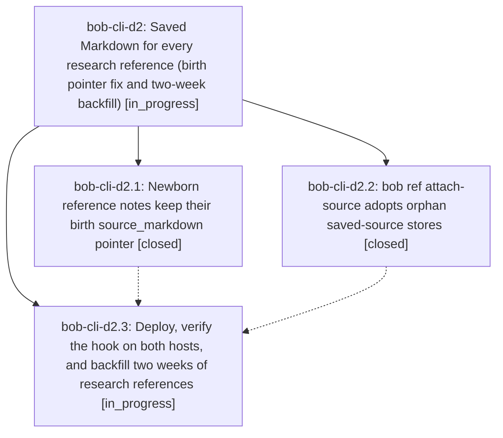

# Bead: bob-cli-d2 — Saved Markdown for every research reference (birth pointer fix and two-week backfill)

[Bead Pages](../README.md) / bob-cli-d2

**Status:** ◐ in_progress · **Type:** ▸ plan · **Tier:** epic
**Owner:** `bryanbugyi34@gmail.com` · **Created by:** [bbugyi200.athena.14o](https://github.com/bobs-org/bob-cli--agents/blob/main/sessions/bbugyi200.athena.14o.md) · **Assignee:** `bob-cli-d2.land`
**Created:** 2026-10-27 07:42:23 EDT
**Plan:** [202610/research\_ref\_saved\_markdown.md](https://github.com/bobs-org/bob-cli--plans/blob/main/202610/research_ref_saved_markdown.md)

<!-- sase:links:start -->

## Links

| Relation | Artifact | Why |
| --- | --- | --- |
| implemented-by | [plan:202610/research_ref_saved_markdown.md][1] | derived from the plan's `bead_id:` frontmatter field |

_Plus 1 automatic references — see [Referenced By](#referenced-by)._

[1]: https://github.com/bobs-org/bob-cli--plans/blob/main/202610/research_ref_saved_markdown.md

<!-- sase:links:end -->

## Description

Every research report the SASE research-highlights file hook turns into a reference carries its saved Markdown, so the Bob Refs Copy card offers C (code block), L (link), and M (Markdown). That holds for every new report on athena and apollo, and for every hook-matched report from the last two weeks.

## Phases

| Bead | Title | Status | Size | Created | Agents | Commits |
|---|---|---|---|---|---:|---:|
| [bob-cli-d2.1](bob-cli-d2.1.md) | Newborn reference notes keep their birth source\_markdown pointer | ✓ closed | small | 2026-10-27 | 1 | 1 |
| [bob-cli-d2.2](bob-cli-d2.2.md) | bob ref attach-source adopts orphan saved-source stores | ✓ closed | medium | 2026-10-27 | 1 | 1 |
| [bob-cli-d2.3](bob-cli-d2.3.md) | Deploy, verify the hook on both hosts, and backfill two weeks of research references | ◐ in_progress | medium | 2026-10-27 | 1 | 0 |

## Lineage

## Agents

| Agent | Bead | Commits |
|---|---|---:|
| [bbugyi200.athena.bob-cli-d2.1](https://github.com/bobs-org/bob-cli--agents/blob/main/agents/bbugyi200.athena.bob-cli-d2.1/README.md) | [bob-cli-d2.1](bob-cli-d2.1.md) | 1 |
| [bbugyi200.athena.bob-cli-d2.2](https://github.com/bobs-org/bob-cli--agents/blob/main/sessions/bbugyi200.athena.bob-cli-d2.2.md) | [bob-cli-d2.2](bob-cli-d2.2.md) | 1 |
| [bbugyi200.athena.bob-cli-d2.3](https://github.com/bobs-org/bob-cli--agents/blob/main/agents/bbugyi200.athena.bob-cli-d2.3/README.md) | [bob-cli-d2.3](bob-cli-d2.3.md) | 0 |
| [bbugyi200.athena.bob-cli-d2.land](https://github.com/bobs-org/bob-cli--agents/blob/main/agents/bbugyi200.athena.bob-cli-d2.land/README.md) | [bob-cli-d2](README.md) | 0 |

## Commits

| Repo | Commit | Subject | Bead | Committed |
|---|---|---|---|---|
| bob-cli | [`3a13ec6`](https://github.com/bobs-org/bob-cli/commit/3a13ec6f53ec78382dc225207bf822da5567df3a) | fix(ref): keep birth source\_markdown pointer on newborn notes | [bob-cli-d2.1](bob-cli-d2.1.md) | 2026-10-27 08:04:53 EDT |
| bob-cli | [`d38bef5`](https://github.com/bobs-org/bob-cli/commit/d38bef590c065b2bfef67745b0e83ce350707498) | feat(ref): adopt orphan saved source stores | [bob-cli-d2.2](bob-cli-d2.2.md) | 2026-10-27 08:32:19 EDT |

<!-- sase:referenced-by:start -->

## Referenced By

| Relation | Artifact | Why | Uses |
| --- | --- | --- | ---: |
| read-by | [agent:bob-cli-d2.1][1] | epic context | 1 |

[1]: https://github.com/bobs-org/bob-cli--agents/blob/main/agents/bbugyi200.athena.bob-cli-d2.1/README.md

<!-- sase:referenced-by:end -->
