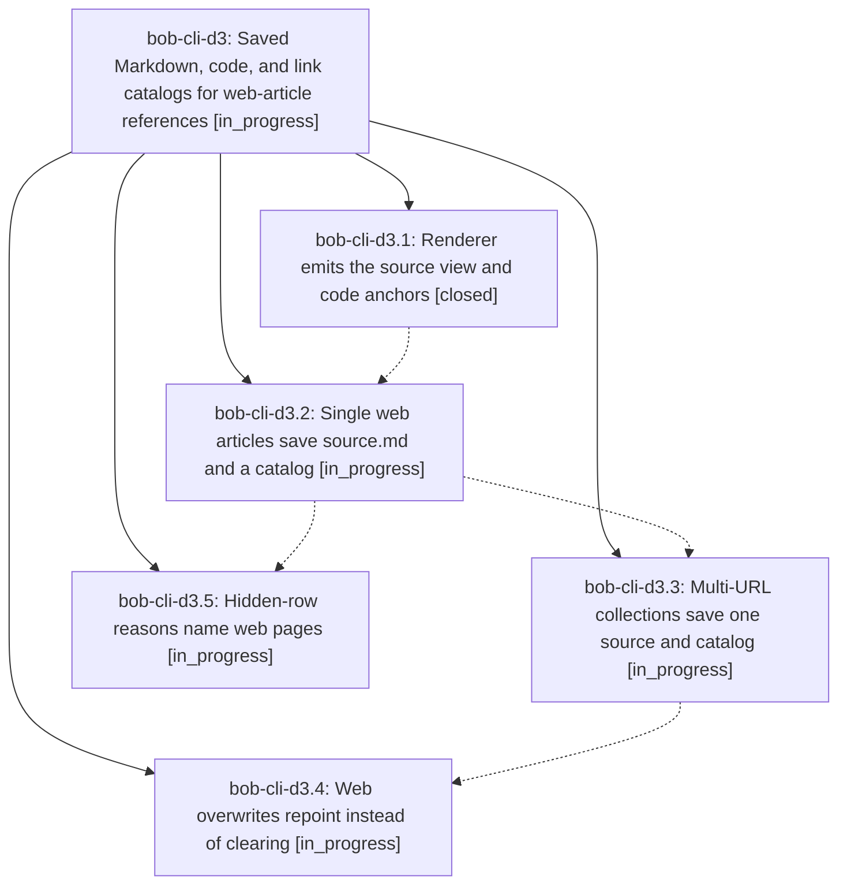

# Bead: bob-cli-d3 — Saved Markdown, code, and link catalogs for web-article references

[Bead Pages](../README.md) / bob-cli-d3

**Status:** ◐ in_progress · **Type:** ▸ plan · **Tier:** epic
**Owner:** `bryanbugyi34@gmail.com` · **Created by:** [bbugyi200.apollo.ao](https://github.com/bobs-org/bob-cli--agents/blob/main/sessions/bbugyi200.apollo.ao.md) · **Assignee:** `bob-cli-d3.land`
**Created:** 2026-10-27 11:21:28 EDT
**Plan:** [202610/web\_ref\_saved\_sources.md](https://github.com/bobs-org/bob-cli--plans/blob/main/202610/web_ref_saved_sources.md)

<!-- sase:links:start -->

## Links

| Relation | Artifact | Why |
| --- | --- | --- |
| implemented-by | [plan:202610/web_ref_saved_sources.md][1] | derived from the plan's `bead_id:` frontmatter field |

[1]: https://github.com/bobs-org/bob-cli--plans/blob/main/202610/web_ref_saved_sources.md

<!-- sase:links:end -->

## Description

References that bob ref create captures from web-article URLs (single URL, -H saved HTML, rereads, multi-URL collections, and their -f overwrite replacements) get a saved source.md and a code/link catalog, so the Bob Mac Capture Refs Copy card's M, C, and L modes work for them exactly as for Markdown-born references.

## Phases

| Bead | Title | Status | Size | Created | Agents | Commits |
|---|---|---|---|---|---:|---:|
| [bob-cli-d3.1](bob-cli-d3.1.md) | Renderer emits the source view and code anchors | ✓ closed | medium | 2026-10-27 | 1 | 1 |
| [bob-cli-d3.2](bob-cli-d3.2.md) | Single web articles save source.md and a catalog | ◐ in_progress | medium | 2026-10-27 | 1 | 0 |
| [bob-cli-d3.3](bob-cli-d3.3.md) | Multi-URL collections save one source and catalog | ◐ in_progress | small | 2026-10-27 | 1 | 0 |
| [bob-cli-d3.4](bob-cli-d3.4.md) | Web overwrites repoint instead of clearing | ◐ in_progress | medium | 2026-10-27 | 1 | 0 |
| [bob-cli-d3.5](bob-cli-d3.5.md) | Hidden-row reasons name web pages | ◐ in_progress | small | 2026-10-27 | 1 | 0 |

## Lineage

## Agents

| Agent | Bead | Commits |
|---|---|---:|
| [bbugyi200.apollo.bob-cli-d3.1](https://github.com/bobs-org/bob-cli--agents/blob/main/agents/bbugyi200.apollo.bob-cli-d3.1/README.md) | [bob-cli-d3.1](bob-cli-d3.1.md) | 1 |
| [bbugyi200.apollo.bob-cli-d3.2](https://github.com/bobs-org/bob-cli--agents/blob/main/agents/bbugyi200.apollo.bob-cli-d3.2/README.md) | [bob-cli-d3.2](bob-cli-d3.2.md) | 0 |
| [bbugyi200.apollo.bob-cli-d3.3](https://github.com/bobs-org/bob-cli--agents/blob/main/agents/bbugyi200.apollo.bob-cli-d3.3/README.md) | [bob-cli-d3.3](bob-cli-d3.3.md) | 0 |
| [bbugyi200.apollo.bob-cli-d3.4](https://github.com/bobs-org/bob-cli--agents/blob/main/agents/bbugyi200.apollo.bob-cli-d3.4/README.md) | [bob-cli-d3.4](bob-cli-d3.4.md) | 0 |
| [bbugyi200.apollo.bob-cli-d3.5](https://github.com/bobs-org/bob-cli--agents/blob/main/agents/bbugyi200.apollo.bob-cli-d3.5/README.md) | [bob-cli-d3.5](bob-cli-d3.5.md) | 0 |
| [bbugyi200.apollo.bob-cli-d3.land](https://github.com/bobs-org/bob-cli--agents/blob/main/agents/bbugyi200.apollo.bob-cli-d3.land/README.md) | [bob-cli-d3](README.md) | 0 |

## Commits

| Repo | Commit | Subject | Bead | Committed |
|---|---|---|---|---|
| bob-cli | [`f8dc405`](https://github.com/bobs-org/bob-cli/commit/f8dc405b9a318496dab8c8f3e0f7e91226ecff7b) | feat(web-clip): emit saved source views and code anchors | [bob-cli-d3.1](bob-cli-d3.1.md) | 2026-10-27 11:41:00 EDT |
