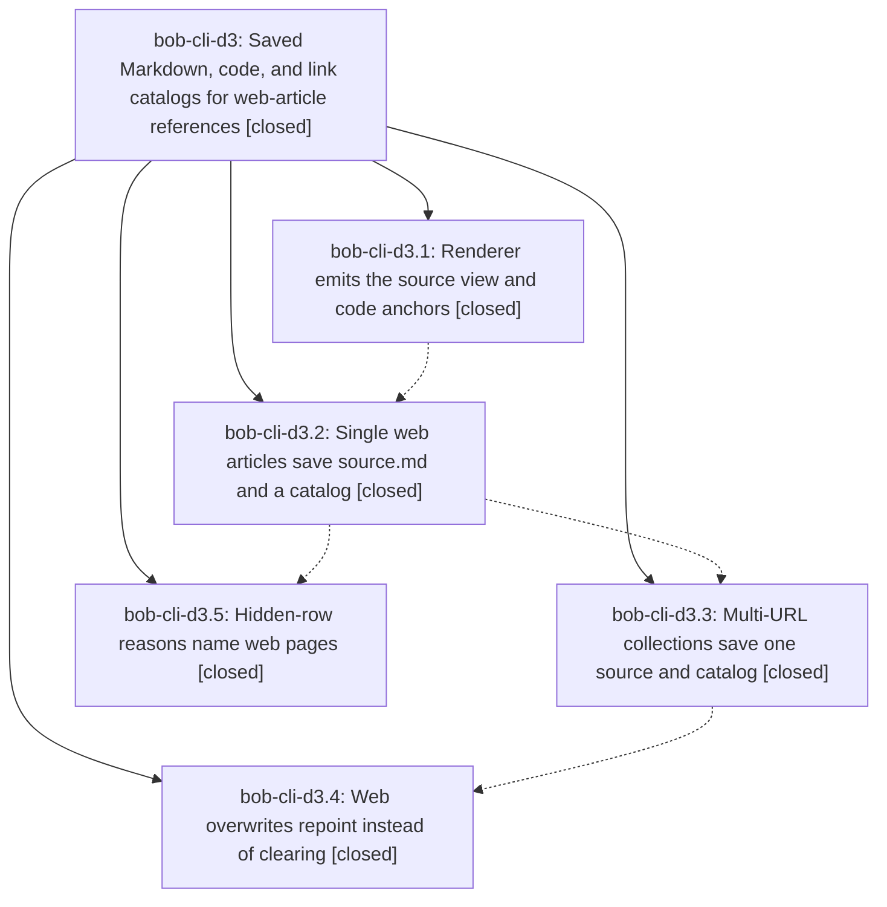

# Bead: bob-cli-d3 — Saved Markdown, code, and link catalogs for web-article references

[Bead Pages](../README.md) / bob-cli-d3

**Status:** ✓ closed · **Resolution:** done · **Type:** ▸ plan · **Tier:** epic
**Owner:** `bryanbugyi34@gmail.com` · **Created by:** [bbugyi200.apollo.ao](https://github.com/bobs-org/bob-cli--agents/blob/main/sessions/bbugyi200.apollo.ao.md) · **Assignee:** `bob-cli-d3.land`
**Created:** 2026-10-27 11:21:28 EDT · **Closed:** 2026-10-27 14:32:06 EDT
**Plan:** [202610/web\_ref\_saved\_sources.md](https://github.com/bobs-org/bob-cli--plans/blob/main/202610/web_ref_saved_sources.md)

<!-- sase:links:start -->

## Links

| Relation | Artifact | Why |
| --- | --- | --- |
| implemented-by | [plan:202610/web_ref_saved_sources.md][1] | derived from the plan's `bead_id:` frontmatter field |
| related | [bead:bob-cli-d5][2] | Epic whose saved web-article catalog this Mermaid classification feeds |

_Plus 1 automatic references — see [Referenced By](#referenced-by)._

[1]: https://github.com/bobs-org/bob-cli--plans/blob/main/202610/web_ref_saved_sources.md
[2]: https://github.com/bobs-org/bob-cli--beads/blob/main/pages/bob-cli-d5/README.md

<!-- sase:links:end -->

## Description

References that bob ref create captures from web-article URLs (single URL, -H saved HTML, rereads, multi-URL collections, and their -f overwrite replacements) get a saved source.md and a code/link catalog, so the Bob Mac Capture Refs Copy card's M, C, and L modes work for them exactly as for Markdown-born references.

## Notes

[2026-10-27T18:32:06Z · bob-cli-d3.land] LAND VERIFIED. Read the plan, epic notes, and all 5 phase beads and notes, and reviewed commits f8dc405b (d3.1 adapter source view + Chrome code anchors), 4fda80b1 (d3.2 /Dests reader, web_source.rs, web_article store on every single-article path incl. -H/reread/--audio/--listen/-k birth adoption, routes in record_source_catalog and orphan-adoption allowlist), 6dea0058 (d3.3 web_collection store), bab568fc (d3.4 overwrite stages and repoints, Clear kept for PDF URL/arXiv/fallback), and bob-mac-capture de57e2b (d3.5 strings, tests, and docs only; RefsCore is covered by portable-check; mac CI green). recatalog skips web stores as already recorded; doctor ref-sources row is route-generic; decision_record=no honored (no memory edits). LANDER FIXES (epic-caused, finished in this landing): (1) assign_anchor_pages consumed every remaining anchor when one catalog block failed to match, so a single mismatch stripped pages from all later blocks; a miss now consumes nothing, and normalization also trims leading newlines (pandoc drops the newline after <pre><code>, Chrome textContent keeps it); regression test unmatched_block_keeps_later_anchors. (2) A real capture of matklad.github.io/2021/09/04/fast-rust-builds.html gave 13 printed anchors but 0 catalog blocks: GFM cannot express <figure>, so pandoc kept figure-wrapped code and images as raw HTML. convert_source_view now runs web_source_figures.lua to unwrap figures (content plus caption) before writing GFM; test figure_wrapped_code_and_images_convert_to_markdown; docs/highlights-create.md updated. Real -o smoke captures (vault untouched): go.dev errors-are-values 12/12 and jvns.ca git-config 8/8 blocks matched before and after; matklad 0/13 before, 13/13 after; PDFs carry the bob-code-N destinations. Gates: just check passes except highlights::store_gaps::store_snapshot_create_records_note_snapshot_route (host lacks titlesec.sty; fails identically on the base tree); just docs-check passes. INTEGRATION: commits since the epic started (b1c6be2c hooks JSON, 9613af85 guides, a1dc0206 clippy deny gate, 4a43170b stats docs) needed no change, and the epic code passes the new clippy gate; bob-cli-d2 orphan adoption already accepts the web routes. FOLLOW-UPS: d3.1 Mermaid marker dropped by Defuddle -> new bob-cli-d5 (bug, medium; upstream extraction, not caused by this epic); d3.2/d3.3 titlesec.sty test failure -> new bob-cli-d6 (ci, small; the test's skip gate is too narrow; base-identical, not caused by this epic); both were search- and sweep-checked with no duplicates and are linked related. Not done: no real library create plus Mac M/C/L acceptance (it writes to the live vault); covered by fake-adapter store tests and the real -o smoke captures. epic-symbols: none; no just symvision recipe.

## Phases

| Bead | Title | Status | Size | Created | Agents | Commits |
|---|---|---|---|---|---:|---:|
| [bob-cli-d3.1](bob-cli-d3.1.md) | Renderer emits the source view and code anchors | ✓ closed | medium | 2026-10-27 | 1 | 1 |
| [bob-cli-d3.2](bob-cli-d3.2.md) | Single web articles save source.md and a catalog | ✓ closed | medium | 2026-10-27 | 1 | 1 |
| [bob-cli-d3.3](bob-cli-d3.3.md) | Multi-URL collections save one source and catalog | ✓ closed | small | 2026-10-27 | 1 | 1 |
| [bob-cli-d3.4](bob-cli-d3.4.md) | Web overwrites repoint instead of clearing | ✓ closed | medium | 2026-10-27 | 1 | 1 |
| [bob-cli-d3.5](bob-cli-d3.5.md) | Hidden-row reasons name web pages | ✓ closed | small | 2026-10-27 | 1 | 1 |

## Lineage

## Agents

| Agent | Bead | Commits |
|---|---|---:|
| [bbugyi200.apollo.bob-cli-d3.1](https://github.com/bobs-org/bob-cli--agents/blob/main/agents/bbugyi200.apollo.bob-cli-d3.1/README.md) | [bob-cli-d3.1](bob-cli-d3.1.md) | 1 |
| [bbugyi200.apollo.bob-cli-d3.2](https://github.com/bobs-org/bob-cli--agents/blob/main/agents/bbugyi200.apollo.bob-cli-d3.2/README.md) | [bob-cli-d3.2](bob-cli-d3.2.md) | 1 |
| [bbugyi200.apollo.bob-cli-d3.3](https://github.com/bobs-org/bob-cli--agents/blob/main/agents/bbugyi200.apollo.bob-cli-d3.3/README.md) | [bob-cli-d3.3](bob-cli-d3.3.md) | 1 |
| [bbugyi200.apollo.bob-cli-d3.4](https://github.com/bobs-org/bob-cli--agents/blob/main/agents/bbugyi200.apollo.bob-cli-d3.4/README.md) | [bob-cli-d3.4](bob-cli-d3.4.md) | 1 |
| [bbugyi200.apollo.bob-cli-d3.5](https://github.com/bobs-org/bob-cli--agents/blob/main/agents/bbugyi200.apollo.bob-cli-d3.5/README.md) | [bob-cli-d3.5](bob-cli-d3.5.md) | 1 |
| [bbugyi200.apollo.bob-cli-d3.land](https://github.com/bobs-org/bob-cli--agents/blob/main/agents/bbugyi200.apollo.bob-cli-d3.land/README.md) | [bob-cli-d3](README.md) | 1 |

## Commits

| Repo | Commit | Subject | Bead | Committed |
|---|---|---|---|---|
| bob-cli | [`f8dc405`](https://github.com/bobs-org/bob-cli/commit/f8dc405b9a318496dab8c8f3e0f7e91226ecff7b) | feat(web-clip): emit saved source views and code anchors | [bob-cli-d3.1](bob-cli-d3.1.md) | 2026-10-27 11:41:00 EDT |
| bob-cli | [`4fda80b`](https://github.com/bobs-org/bob-cli/commit/4fda80b13d65e59383e847073622145f3c72acd8) | feat(web-ref): single web articles save source.md and a catalog | [bob-cli-d3.2](bob-cli-d3.2.md) | 2026-10-27 12:41:16 EDT |
| bob-mac-capture | [`bob-mac-capture@de57e2b`](https://github.com/bobs-org/bob-mac-capture/commit/de57e2b7ef06e4421d6e0f07fbacffaf776f2f39) | fix(refs): mention web pages in source hints | [bob-cli-d3.5](bob-cli-d3.5.md) | 2026-10-27 12:56:13 EDT |
| bob-cli | [`6dea005`](https://github.com/bobs-org/bob-cli/commit/6dea005804abd61702ea5355d5999571dbd644aa) | feat(web-ref): multi-URL collections save one source and catalog | [bob-cli-d3.3](bob-cli-d3.3.md) | 2026-10-27 13:04:50 EDT |
| bob-cli | [`bab568f`](https://github.com/bobs-org/bob-cli/commit/bab568fc200aec3785acab3021f55942dcb8d1f5) | feat(ref): stage web overwrite sources instead of clearing | [bob-cli-d3.4](bob-cli-d3.4.md) | 2026-10-27 13:39:03 EDT |
| bob-cli | [`5bb53ca`](https://github.com/bobs-org/bob-cli/commit/5bb53caa73e6c40623d887b358f28f0d1b2f865f) | fix(web-ref): catalog figure-wrapped code and keep anchor pages after a mismatch | [bob-cli-d3](README.md) | 2026-10-27 14:33:25 EDT |

<!-- sase:referenced-by:start -->

## Referenced By

| Relation | Artifact | Why | Uses |
| --- | --- | --- | ---: |
| read-by | [agent:bob-cli-d3.3][1] | parent epic scope | 1 |

[1]: https://github.com/bobs-org/bob-cli--agents/blob/main/agents/bbugyi200.apollo.bob-cli-d3.3/README.md

<!-- sase:referenced-by:end -->
