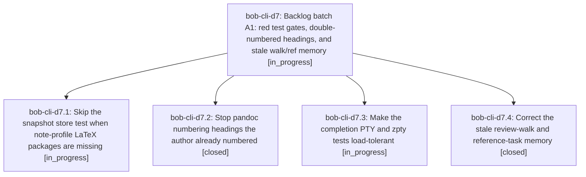

# Bead: bob-cli-d7 — Backlog batch A1: red test gates, double-numbered headings, and stale walk/ref memory

[Bead Pages](../README.md) / bob-cli-d7

**Status:** ◐ in_progress · **Type:** ▸ plan · **Tier:** epic
**Owner:** `bryanbugyi34@gmail.com` · **Created by:** [bbugyi200.athena.14v](https://github.com/bobs-org/bob-cli--agents/blob/main/sessions/bbugyi200.athena.14v.md) · **Assignee:** `bob-cli-d7.land`
**Created:** 2026-10-27 14:54:31 EDT
**Plan:** [202610/backlog\_batch\_a1.md](https://github.com/bobs-org/bob-cli--plans/blob/main/202610/backlog_batch_a1.md)

<!-- sase:links:start -->

## Links

| Relation | Artifact | Why |
| --- | --- | --- |
| implemented-by | [plan:202610/backlog_batch_a1.md][1] | derived from the plan's `bead_id:` frontmatter field |

[1]: https://github.com/bobs-org/bob-cli--plans/blob/main/202610/backlog_batch_a1.md

<!-- sase:links:end -->

## Description

The five most important open task beads are resolved: just check is green on apollo and load-tolerant on athena, rendered research PDFs stop double-numbering headings, and the decisions roster and glossary describe today's review walk and reference tasks. The lander then starts the next backlog epic, so the chain continues five beads at a time until no open task beads remain.

## Phases

| Bead | Title | Status | Size | Created | Agents | Commits |
|---|---|---|---|---|---:|---:|
| [bob-cli-d7.1](bob-cli-d7.1.md) | Skip the snapshot store test when note-profile LaTeX packages are missing | ◐ in_progress | small | 2026-10-27 | 1 | 0 |
| [bob-cli-d7.2](bob-cli-d7.2.md) | Stop pandoc numbering headings the author already numbered | ✓ closed | medium | 2026-10-27 | 1 | 1 |
| [bob-cli-d7.3](bob-cli-d7.3.md) | Make the completion PTY and zpty tests load-tolerant | ◐ in_progress | medium | 2026-10-27 | 1 | 0 |
| [bob-cli-d7.4](bob-cli-d7.4.md) | Correct the stale review-walk and reference-task memory | ✓ closed | small | 2026-10-27 | 1 | 0 |

## Lineage

## Agents

| Agent | Bead | Commits |
|---|---|---:|
| [bbugyi200.athena.bob-cli-d7.1](https://github.com/bobs-org/bob-cli--agents/blob/main/sessions/bbugyi200.athena.bob-cli-d7.1.md) | [bob-cli-d7.1](bob-cli-d7.1.md) | 0 |
| [bbugyi200.athena.bob-cli-d7.2](https://github.com/bobs-org/bob-cli--agents/blob/main/agents/bbugyi200.athena.bob-cli-d7.2/README.md) | [bob-cli-d7.2](bob-cli-d7.2.md) | 1 |
| [bbugyi200.athena.bob-cli-d7.3](https://github.com/bobs-org/bob-cli--agents/blob/main/agents/bbugyi200.athena.bob-cli-d7.3/README.md) | [bob-cli-d7.3](bob-cli-d7.3.md) | 0 |
| [bbugyi200.athena.bob-cli-d7.4](https://github.com/bobs-org/bob-cli--agents/blob/main/sessions/bbugyi200.athena.bob-cli-d7.4.md) | [bob-cli-d7.4](bob-cli-d7.4.md) | 0 |
| [bbugyi200.athena.bob-cli-d7.land](https://github.com/bobs-org/bob-cli--agents/blob/main/agents/bbugyi200.athena.bob-cli-d7.land/README.md) | [bob-cli-d7](README.md) | 0 |

## Commits

| Repo | Commit | Subject | Bead | Committed |
|---|---|---|---|---|
| bob-cli | [`f771b19`](https://github.com/bobs-org/bob-cli/commit/f771b196562ae6b6f60e4c12a086e4cecc2f02de) | fix(ref): stop pandoc numbering self-numbered Markdown headings | [bob-cli-d7.2](bob-cli-d7.2.md) | 2026-10-27 15:15:23 EDT |
