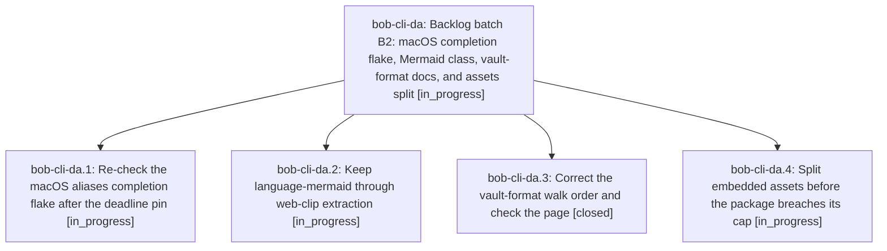

# Bead: bob-cli-da — Backlog batch B2: macOS completion flake, Mermaid class, vault-format docs, and assets split

[Bead Pages](../README.md) / bob-cli-da

**Status:** ◐ in_progress · **Type:** ▸ plan · **Tier:** epic
**Owner:** `bryanbugyi34@gmail.com` · **Created by:** [bbugyi200.athena.bob-cli-d7.land](https://github.com/bobs-org/bob-cli--agents/blob/main/sessions/bbugyi200.athena.bob-cli-d7.land.md) · **Assignee:** `bob-cli-da.land`
**Created:** 2026-10-27 16:30:19 EDT
**Plan:** [202610/backlog\_batch\_b2.md](https://github.com/bobs-org/bob-cli--plans/blob/main/202610/backlog_batch_b2.md)

## Description

Resolve the four most important remaining bob-cli beads after batch A1: re-check the macOS completion flake against the new deadline pin, restore the web-clip Mermaid classification, correct the vault-format walk order, and decide the assets-crate split before the package breaches its cap. The lander then starts the next backlog epic, so the chain continues until no open task beads remain.

## Phases

| Bead | Title | Status | Size | Created | Agents | Commits |
|---|---|---|---|---|---:|---:|
| [bob-cli-da.1](bob-cli-da.1.md) | Re-check the macOS aliases completion flake after the deadline pin | ◐ in_progress | large | 2026-10-27 | 1 | 0 |
| [bob-cli-da.2](bob-cli-da.2.md) | Keep language-mermaid through web-clip extraction | ◐ in_progress | medium | 2026-10-27 | 1 | 0 |
| [bob-cli-da.3](bob-cli-da.3.md) | Correct the vault-format walk order and check the page | ✓ closed | small | 2026-10-27 | 1 | 1 |
| [bob-cli-da.4](bob-cli-da.4.md) | Split embedded assets before the package breaches its cap | ◐ in_progress | large | 2026-10-27 | 1 | 0 |

## Lineage

## Agents

| Agent | Bead | Commits |
|---|---|---:|
| [bbugyi200.athena.bob-cli-da.1](https://github.com/bobs-org/bob-cli--agents/blob/main/sessions/bbugyi200.athena.bob-cli-da.1.md) | [bob-cli-da.1](bob-cli-da.1.md) | 0 |
| [bbugyi200.athena.bob-cli-da.2](https://github.com/bobs-org/bob-cli--agents/blob/main/sessions/bbugyi200.athena.bob-cli-da.2.md) | [bob-cli-da.2](bob-cli-da.2.md) | 0 |
| [bbugyi200.athena.bob-cli-da.3](https://github.com/bobs-org/bob-cli--agents/blob/main/agents/bbugyi200.athena.bob-cli-da.3/README.md) | [bob-cli-da.3](bob-cli-da.3.md) | 1 |
| [bbugyi200.athena.bob-cli-da.4](https://github.com/bobs-org/bob-cli--agents/blob/main/agents/bbugyi200.athena.bob-cli-da.4/README.md) | [bob-cli-da.4](bob-cli-da.4.md) | 0 |
| [bbugyi200.athena.bob-cli-da.land](https://github.com/bobs-org/bob-cli--agents/blob/main/agents/bbugyi200.athena.bob-cli-da.land/README.md) | [bob-cli-da](README.md) | 0 |

## Commits

| Repo | Commit | Subject | Bead | Committed |
|---|---|---|---|---|
| bob-cli | [`4fd8291`](https://github.com/bobs-org/bob-cli/commit/4fd82919009fa061ced90434f8033528c9eb6f85) | docs(freshness): correct vault walk order | [bob-cli-da.3](bob-cli-da.3.md) | 2026-10-27 16:40:02 EDT |
