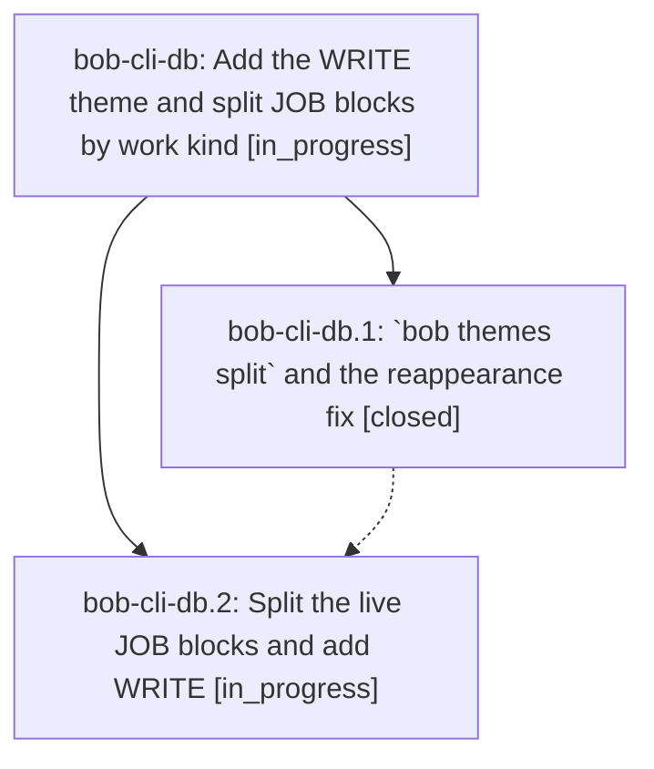

# Bead: bob-cli-db — Add the WRITE theme and split JOB blocks by work kind

[Bead Pages](../README.md) / bob-cli-db

**Status:** ◐ in_progress · **Type:** ▸ plan · **Tier:** epic
**Owner:** `bryanbugyi34@gmail.com` · **Created by:** [bbugyi200.apollo.ar.w0](https://github.com/bobs-org/bob-cli--agents/blob/main/sessions/bbugyi200.apollo.ar.w0.md) · **Assignee:** `bob-cli-db.land`
**Created:** 2026-10-27 17:11:11 EDT
**Plan:** [202610/write\_theme\_and\_job\_split.md](https://github.com/bobs-org/bob-cli--plans/blob/main/202610/write_theme_and_job_split.md)

<!-- sase:links:start -->

## Links

| Relation | Artifact | Why |
| --- | --- | --- |
| implemented-by | [plan:202610/write_theme_and_job_split.md][1] | derived from the plan's `bead_id:` frontmatter field |

[1]: https://github.com/bobs-org/bob-cli--plans/blob/main/202610/write_theme_and_job_split.md

<!-- sase:links:end -->

## Description

Every past and open JOB Pomodoro carries the work-kind theme its content supports (READ, WRITE, CHORE, PLAN, or BUILD) in one verified, revertable vault commit. WRITE is a live, pinned theme that shows in Recent. JOB is hidden. `bob themes list` reports no false rename reappearances.

## Phases

| Bead | Title | Status | Size | Created | Agents | Commits |
|---|---|---|---|---|---:|---:|
| [bob-cli-db.1](bob-cli-db.1.md) | \`bob themes split\` and the reappearance fix | ✓ closed | medium | 2026-10-27 | 1 | 1 |
| [bob-cli-db.2](bob-cli-db.2.md) | Split the live JOB blocks and add WRITE | ◐ in_progress | small | 2026-10-27 | 1 | 0 |

## Lineage

## Agents

| Agent | Bead | Commits |
|---|---|---:|
| [bbugyi200.apollo.bob-cli-db.1](https://github.com/bobs-org/bob-cli--agents/blob/main/agents/bbugyi200.apollo.bob-cli-db.1/README.md) | [bob-cli-db.1](bob-cli-db.1.md) | 1 |
| [bbugyi200.apollo.bob-cli-db.2](https://github.com/bobs-org/bob-cli--agents/blob/main/agents/bbugyi200.apollo.bob-cli-db.2/README.md) | [bob-cli-db.2](bob-cli-db.2.md) | 0 |
| [bbugyi200.apollo.bob-cli-db.land](https://github.com/bobs-org/bob-cli--agents/blob/main/agents/bbugyi200.apollo.bob-cli-db.land/README.md) | [bob-cli-db](README.md) | 0 |

## Commits

| Repo | Commit | Subject | Bead | Committed |
|---|---|---|---|---|
| bob-cli | [`a6a359b`](https://github.com/bobs-org/bob-cli/commit/a6a359b8c62c318cb82a98286cdfc72cd35c47c8) | feat(themes): add per-entry split and skip re-adopted rename reports | [bob-cli-db.1](bob-cli-db.1.md) | 2026-10-27 17:48:27 EDT |
