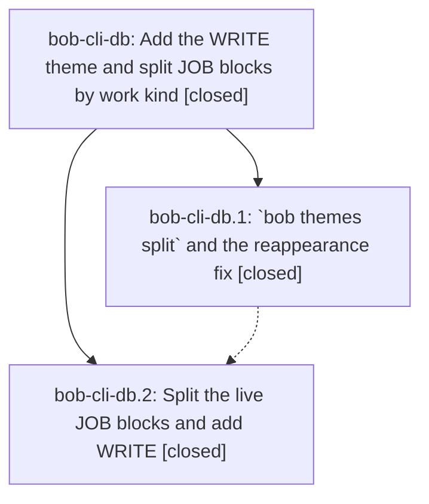

# Bead: bob-cli-db — Add the WRITE theme and split JOB blocks by work kind

[Bead Pages](../README.md) / bob-cli-db

**Status:** ✓ closed · **Resolution:** done · **Type:** ▸ plan · **Tier:** epic
**Owner:** `bryanbugyi34@gmail.com` · **Created by:** [bbugyi200.apollo.ar.w0](https://github.com/bobs-org/bob-cli--agents/blob/main/sessions/bbugyi200.apollo.ar.w0.md) · **Assignee:** `bob-cli-db.land`
**Created:** 2026-10-27 17:11:11 EDT · **Closed:** 2026-10-27 18:54:53 EDT
**Plan:** [202610/write\_theme\_and\_job\_split.md](https://github.com/bobs-org/bob-cli--plans/blob/main/202610/write_theme_and_job_split.md)

<!-- sase:links:start -->

## Links

| Relation | Artifact | Why |
| --- | --- | --- |
| implemented-by | [plan:202610/write_theme_and_job_split.md][1] | derived from the plan's `bead_id:` frontmatter field |
| related | [bead:bob-cli-dc][2] | Landing found the same byte-loss pattern in the older rename path; db repair owns split only |

_Plus 1 automatic references — see [Referenced By](#referenced-by)._

[1]: https://github.com/bobs-org/bob-cli--plans/blob/main/202610/write_theme_and_job_split.md
[2]: https://github.com/bobs-org/bob-cli--beads/blob/main/pages/bob-cli-dc/README.md

<!-- sase:links:end -->

## Description

Every past and open JOB Pomodoro carries the work-kind theme its content supports (READ, WRITE, CHORE, PLAN, or BUILD) in one verified, revertable vault commit. WRITE is a live, pinned theme that shows in Recent. JOB is hidden. `bob themes list` reports no false rename reappearances.

## Notes

[2026-10-27T22:11:09Z · bob-cli-db.land] LAND FOLLOW-UP TRIAGE before remaining-work tale: reviewed every note on db.1 and db.2. db.1 note #1 (relation-label renamed_reappeared cycle false positive) independently reproduced and routed as DISCOVERED ISSUE to causal active epic bob-cli-bj, introduced by bj.6 commit 4c46dadd1; no duplicate task after same/all-type searches and last-week sweeps. Scope correction: relations have rename/unhide/hide events, no color event. Additional pre-existing global theme rename CRLF loss independently reproduced in a clean isolated Git fixture; originates in closed epic bc.6 commit 4a6f4494 and is distinct from db new split: created small ready bug bob-cli-dc with related links to db/bc. No proposals declined or left untriaged. Split CRLF byte loss and missing completion kinds are db-owned remaining work, never deferred as unrelated tasks.

[2026-10-27T22:12:17Z · bob-cli-db.land] LAND AUDIT at bob-cli 3cc63511: audited plan and all db.1/.2 notes, read implementation/tests/docs and a6a359b8. Fetched origin/master=3cc63511; intervening b63e5a04 assets workspace split, 6b0a30bf Mermaid extraction, 3cc63511 release integration have no theme integration conflict. Opened synced vault via sase repo gh:bbugyi200/bob: 542b61da changes only 89 NAME tails in 20 notes; machine-compared every row against approved map: READ37 CHORE23 WRITE17 PLAN10 BUILD2, only Oct27 L64->L68. Verified JOB hide at 675348d8 and all five approved pins at 4e5f16a5. Post-split drift only those pins and job.md edit 8e06de5c; live sync local=remote=8e06de5c with no error; worked total still 6720m. Installed bob predates split/re-adoption, so its WRITE warning is not current-source evidence; successor must use freshly built binary (do not reinstall). Remaining db work: (1) actual apply_changes code reproduced via isolated rustc harness normalizes CRLF to LF outside selected tails; verify_split lines() hides it; (2) actual kinds lookup harness returns None for themes split:old/map, with no clap hints, so complete registry and test protocol; (3) new rename re-adoption comparator omits path, while journal fold/accepted decision uses (ts,host,path,line); correct tie ordering and docs/test it. No full just check run in this planning turn; required after repair. epic-symbols empty, no just symvision recipe. No parent_bead. Follow-up outcomes are in prior LAND FOLLOW-UP TRIAGE note. Keep epic and linked plan open pending the bounded repair tale, whose coder must finish closeout in the same turn as the fixes.

[2026-10-27T22:27:01Z · bob-cli-da.4.1.land] DISCOVERED ISSUE: The closeout ToolRun 4cb40f0989e9f203cd9e4c99fc4b6dfc ran just check at commit 3cc63511 with only closeout docs and package-check test changes, and exited 101: 3,759 lib tests passed, 2 failed, 1 was ignored. Failures: native::catalog::tests::public_leaves_are_entries_or_excluded reports public leaf themes/split missing from the catalog; native::completion::kinds::tests::every_value_arg_has_a_decision reports themes split:map and themes split:old missing kinds decisions. These source and test files are unchanged by this closeout. Both failures originate in a6a359b8, which added the themes split command. Phase bob-cli-db.1 already records this exact missing completion-kind work as owned by active epic bob-cli-db. This is corroborating evidence, not a new task or an assets regression.

[2026-10-27T22:54:53Z · bob-cli-db.land] Landing complete at bob-cli 3cc63511 (epic impl a6a359b8; intervening b63e5a04, 6b0a30bf, 3cc63511, no theme conflict; HEAD still 3cc63511, no drift). Vault migration verified: 89 tail-only changes in 20 notes (READ 37, CHORE 23, WRITE 17, PLAN 10, BUILD 2; only Oct27 L64->L68 moved; no added/dropped). JOB hide 675348d8; pins 4e5f16a5 (WRITE magenta, BUILD yellow, READ green, FIX blue, CHORE aqua). Decisions planning_blocks=plan, pin_standing=yes kept. Live (fresh debug bob): JOB absent, WRITE pinned/magenta 17, PLAN exempt, renamed_reappeared empty, hints empty, worked total 6720 (2026-10-01..27), sync clean local=remote=3e8f7ca0 (ref ingests only). Repairs: (1) split splice preserves LF/CRLF/mixed, blanks, trailing space, final newline; verify compares raw unchanged spans + terminators and rejects malformed after-image; unit + offline CRLF vault test (exact bytes, one commit, no journal). (2) kinds registers themes split old->ThemeName (incl hidden) and map->Files(None), keeps -m - stdin; protocol coverage for theme + !files after -m/--map; kinds coverage passes. (3) writer_order is (ts,host,path,line) matching fold; docs tuple fixed to (ts,host,path,line); tests cover path tiebreak (equal/inverted lines), color auto/unpin + unhide + rename-to adopting, hide non-adopting, later rename-away restoring warning. Checks: focused split 7, rename 10, completion 129, kinds 3, catalog 14, lib 3769, cli 2318, fmt/clippy clean, docs-check 447 passed. Follow-ups (from lander triage, unchanged): db.1 relation reappearance routed as DISCOVERED ISSUE on active bob-cli-bj (bj.6/4c46dadd1; relations have no color, corrected to rename-to/unhide only); pre-existing rename CRLF is ready small bob-cli-dc linked to db/bc; no duplicates, none declined, none block db.

## Phases

| Bead | Title | Status | Size | Created | Agents | Commits |
|---|---|---|---|---|---:|---:|
| [bob-cli-db.1](bob-cli-db.1.md) | \`bob themes split\` and the reappearance fix | ✓ closed | medium | 2026-10-27 | 1 | 1 |
| [bob-cli-db.2](bob-cli-db.2.md) | Split the live JOB blocks and add WRITE | ✓ closed | small | 2026-10-27 | 1 | 0 |

## Lineage

## Agents

| Agent | Bead | Commits |
|---|---|---:|
| [bbugyi200.apollo.bob-cli-db.1](https://github.com/bobs-org/bob-cli--agents/blob/main/agents/bbugyi200.apollo.bob-cli-db.1/README.md) | [bob-cli-db.1](bob-cli-db.1.md) | 1 |
| [bbugyi200.apollo.bob-cli-db.2](https://github.com/bobs-org/bob-cli--agents/blob/main/agents/bbugyi200.apollo.bob-cli-db.2/README.md) | [bob-cli-db.2](bob-cli-db.2.md) | 0 |
| [bbugyi200.apollo.bob-cli-db.land](https://github.com/bobs-org/bob-cli--agents/blob/main/sessions/bbugyi200.apollo.bob-cli-db.land.md) | [bob-cli-db](README.md) | 1 |

## Commits

| Repo | Commit | Subject | Bead | Committed |
|---|---|---|---|---|
| bob-cli | [`a6a359b`](https://github.com/bobs-org/bob-cli/commit/a6a359b8c62c318cb82a98286cdfc72cd35c47c8) | feat(themes): add per-entry split and skip re-adopted rename reports | [bob-cli-db.1](bob-cli-db.1.md) | 2026-10-27 17:48:27 EDT |
| bob-cli | [`0a896a4`](https://github.com/bobs-org/bob-cli/commit/0a896a45c6df23ab048c144a56a342e47276c45d) | fix(themes): preserve split bytes, complete completion, and order journal re-adoption | [bob-cli-db](README.md) | 2026-10-27 18:56:33 EDT |

<!-- sase:referenced-by:start -->

## Referenced By

| Relation | Artifact | Why | Uses |
| --- | --- | --- | ---: |
| read-by | [agent:bob-cli-da.4.1.land--1][1] | Preserve the existing unrelated just check failure and confirm it is tracked on bob-cli-db without duplicating it | 1 |

[1]: https://github.com/bobs-org/bob-cli--agents/blob/main/sessions/bbugyi200.apollo.bob-cli-da.4.1.land.md

<!-- sase:referenced-by:end -->
