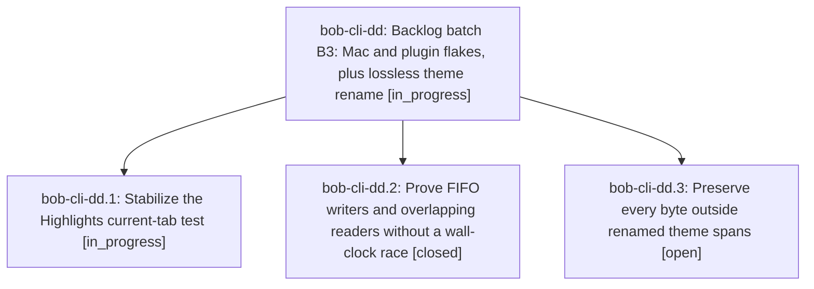

# Bead: bob-cli-dd — Backlog batch B3: Mac and plugin flakes, plus lossless theme rename

[Bead Pages](../README.md) / bob-cli-dd

**Status:** ◐ in_progress · **Type:** ▸ plan · **Tier:** epic
**Owner:** `bryanbugyi34@gmail.com` · **Created by:** [bbugyi200.athena.bob-cli-da.land](https://github.com/bobs-org/bob-cli--agents/blob/main/sessions/bbugyi200.athena.bob-cli-da.land.md) · **Assignee:** `bob-cli-dd.land`
**Created:** 2026-10-27 18:53:10 EDT
**Plan:** [202610/backlog\_batch\_b3.md](https://github.com/bobs-org/bob-cli--plans/blob/main/202610/backlog_batch_b3.md)

<!-- sase:links:start -->

## Links

| Relation | Artifact | Why |
| --- | --- | --- |
| implemented-by | [plan:202610/backlog_batch_b3.md][1] | derived from the plan's `bead_id:` frontmatter field |

[1]: https://github.com/bobs-org/bob-cli--plans/blob/main/202610/backlog_batch_b3.md

<!-- sase:links:end -->

## Description

Resolve bob-cli-d4, bob-cli-d9, and bob-cli-dc with reproducible verification, then continue the bounded backlog chain.

## Phases

| Bead | Title | Status | Size | Created | Agents | Commits |
|---|---|---|---|---|---:|---:|
| [bob-cli-dd.1](bob-cli-dd.1.md) | Stabilize the Highlights current-tab test | ◐ in_progress | large | 2026-10-27 | 1 | 0 |
| [bob-cli-dd.2](bob-cli-dd.2.md) | Prove FIFO writers and overlapping readers without a wall-clock race | ✓ closed | medium | 2026-10-27 | 1 | 1 |
| [bob-cli-dd.3](bob-cli-dd.3.md) | Preserve every byte outside renamed theme spans | ○ open | small | 2026-10-27 | 1 | 0 |

## Lineage

## Agents

| Agent | Bead | Commits |
|---|---|---:|
| [bbugyi200.athena.bob-cli-dd.1](https://github.com/bobs-org/bob-cli--agents/blob/main/sessions/bbugyi200.athena.bob-cli-dd.1.md) | [bob-cli-dd.1](bob-cli-dd.1.md) | 0 |
| [bbugyi200.athena.bob-cli-dd.2](https://github.com/bobs-org/bob-cli--agents/blob/main/agents/bbugyi200.athena.bob-cli-dd.2/README.md) | [bob-cli-dd.2](bob-cli-dd.2.md) | 1 |
| [bbugyi200.athena.bob-cli-dd.3](https://github.com/bobs-org/bob-cli--agents/blob/main/agents/bbugyi200.athena.bob-cli-dd.3/README.md) | [bob-cli-dd.3](bob-cli-dd.3.md) | 0 |
| [bbugyi200.athena.bob-cli-dd.land](https://github.com/bobs-org/bob-cli--agents/blob/main/agents/bbugyi200.athena.bob-cli-dd.land/README.md) | [bob-cli-dd](README.md) | 0 |

## Commits

| Repo | Commit | Subject | Bead | Committed |
|---|---|---|---|---|
| bob-plugins | [`bob-plugins@8baf763`](https://github.com/bobs-org/bob-plugins/commit/8baf76398048612cc0ed1c7b7b03537c87056b3b) | test(command-mode): prove writer FIFO and overlapping reads without wall-clock | [bob-cli-dd.2](bob-cli-dd.2.md) | 2026-10-27 19:07:15 EDT |
