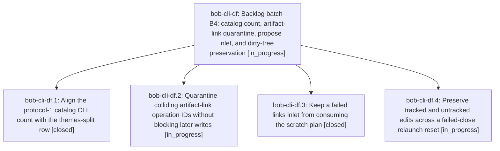

# Bead: bob-cli-df — Backlog batch B4: catalog count, artifact-link quarantine, propose inlet, and dirty-tree preservation

[Bead Pages](../README.md) / bob-cli-df

**Status:** ◐ in_progress · **Type:** ▸ plan · **Tier:** epic
**Owner:** `bryanbugyi34@gmail.com` · **Created by:** [bbugyi200.athena.bob-cli-dd.land--3](https://github.com/bobs-org/bob-cli--agents/blob/main/sessions/bbugyi200.athena.bob-cli-dd.land.md) · **Assignee:** `bob-cli-df.land`
**Created:** 2026-10-27 21:24:44 EDT
**Plan:** [202610/backlog\_batch\_b4.md](https://github.com/bobs-org/bob-cli--plans/blob/main/202610/backlog_batch_b4.md)

## Description

Resolve bob-cli-de, bob-cli-5m, bob-cli-5n, and the remaining bob-cli-cv dirty-tree loss with reproducible verification, then continue the bounded backlog chain.

## Phases

| Bead | Title | Status | Size | Created | Agents | Commits |
|---|---|---|---|---|---:|---:|
| [bob-cli-df.1](bob-cli-df.1.md) | Align the protocol-1 catalog CLI count with the themes-split row | ✓ closed | small | 2026-10-27 | 1 | 1 |
| [bob-cli-df.2](bob-cli-df.2.md) | Quarantine colliding artifact-link operation IDs without blocking later writes | ◐ in_progress | large | 2026-10-27 | 1 | 0 |
| [bob-cli-df.3](bob-cli-df.3.md) | Keep a failed links inlet from consuming the scratch plan | ✓ closed | medium | 2026-10-27 | 1 | 0 |
| [bob-cli-df.4](bob-cli-df.4.md) | Preserve tracked and untracked edits across a failed-close relaunch reset | ◐ in_progress | large | 2026-10-27 | 1 | 0 |

## Lineage

## Agents

| Agent | Bead | Commits |
|---|---|---:|
| [bbugyi200.athena.bob-cli-df.1](https://github.com/bobs-org/bob-cli--agents/blob/main/agents/bbugyi200.athena.bob-cli-df.1/README.md) | [bob-cli-df.1](bob-cli-df.1.md) | 1 |
| [bbugyi200.athena.bob-cli-df.2](https://github.com/bobs-org/bob-cli--agents/blob/main/sessions/bbugyi200.athena.bob-cli-df.2.md) | [bob-cli-df.2](bob-cli-df.2.md) | 0 |
| [bbugyi200.athena.bob-cli-df.3](https://github.com/bobs-org/bob-cli--agents/blob/main/agents/bbugyi200.athena.bob-cli-df.3/README.md) | [bob-cli-df.3](bob-cli-df.3.md) | 0 |
| [bbugyi200.athena.bob-cli-df.4](https://github.com/bobs-org/bob-cli--agents/blob/main/sessions/bbugyi200.athena.bob-cli-df.4.md) | [bob-cli-df.4](bob-cli-df.4.md) | 0 |
| [bbugyi200.athena.bob-cli-df.land](https://github.com/bobs-org/bob-cli--agents/blob/main/agents/bbugyi200.athena.bob-cli-df.land/README.md) | [bob-cli-df](README.md) | 0 |

## Commits

| Repo | Commit | Subject | Bead | Committed |
|---|---|---|---|---|
| bob-cli | [`035aad5`](https://github.com/bobs-org/bob-cli/commit/035aad56c0b5819ee8ab3bb7cf718f7df72e0307) | test(catalog): align protocol entry count with themes split | [bob-cli-df.1](bob-cli-df.1.md) | 2026-10-27 21:38:58 EDT |
