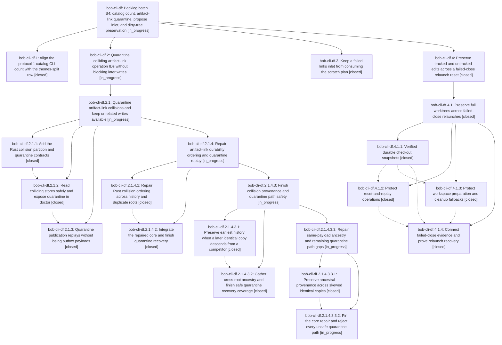

# Bead: bob-cli-df — Backlog batch B4: catalog count, artifact-link quarantine, propose inlet, and dirty-tree preservation

[Bead Pages](../README.md) / bob-cli-df

**Status:** ◐ in_progress · **Type:** ▸ plan · **Tier:** epic
**Owner:** `bryanbugyi34@gmail.com` · **Created by:** [bbugyi200.athena.bob-cli-dd.land--3](https://github.com/bobs-org/bob-cli--agents/blob/main/sessions/bbugyi200.athena.bob-cli-dd.land.md) · **Assignee:** `bob-cli-df.land`
**Created:** 2026-10-27 21:24:44 EDT
**Plan:** [202610/backlog\_batch\_b4.md](https://github.com/bobs-org/bob-cli--plans/blob/main/202610/backlog_batch_b4.md)

<!-- sase:links:start -->

## Links

| Relation | Artifact | Why |
| --- | --- | --- |
| implemented-by | [plan:202610/backlog_batch_b4.md][1] | derived from the plan's `bead_id:` frontmatter field |

_Plus 2 automatic references — see [Referenced By](#referenced-by)._

[1]: https://github.com/bobs-org/bob-cli--plans/blob/main/202610/backlog_batch_b4.md

<!-- sase:links:end -->

## Description

Resolve bob-cli-de, bob-cli-5m, bob-cli-5n, and the remaining bob-cli-cv dirty-tree loss with reproducible verification, then continue the bounded backlog chain.

## Notes

[2026-10-28T06:01:00Z · bob-cli-df.2.1.land] DISCOVERED ISSUE from bob-cli-df.2.1.land, based on df.2.1.3 close note and current source at SASE a9abdd5c97: sibling recovery commit dcb7d2a6e7 added src/sase/finalizers/_failed_close_recovery_snapshots.py:11 importing private _RecoveryAssessment from _failed_close_recovery_assess.py. Phase df.2.1.3 reports just check rejecting that exact cross-file private import, and it remains in current source. This belongs to the still-active B4 epic via df.4, not artifact-link collision quarantine; resolve visibility/import ownership and verify Symvision during B4 landing. No new task and no code fix in the quarantine audit.

[2026-10-28T08:24:42Z · bob-cli-df.2.1.4.land] DISCOVERED ISSUE corroboration from bob-cli-df.2.1.4.land: proposing phase bob-cli-df.2.1.4.2 note #2 again reports Symvision private _RecoveryAssessment import, KNOWN witness 13ea2a464abef73b3eab4bfee9e624d7. Current SASE ac23f63ee4 still has the sibling recovery import from dcb7d2a6e7. Existing B4 note #1 is the causal owner; do not charge it to quarantine repairs. No duplicate task.

[2026-10-28T10:50:54Z · bob-cli-df.2.1.4.3.land] DISCOVERED ISSUE corroboration from bob-cli-df.2.1.4.3.land: proposing bead bob-cli-df.2.1.4.3.2 note #4 again reports KNOWN Symvision private _RecoveryAssessment import, witness 13ea2a464abef73b3eab4bfee9e624d7. Existing notes #1/#2 and sibling df.4 own the causal dcb7d2a6e7 recovery change. No new task or quarantine-scope repair; preserve B4 landing ownership.

## Phases

| Bead | Title | Status | Size | Created | Agents | Commits |
|---|---|---|---|---|---:|---:|
| [bob-cli-df.1](bob-cli-df.1.md) | Align the protocol-1 catalog CLI count with the themes-split row | ✓ closed | small | 2026-10-27 | 1 | 1 |
| [bob-cli-df.2](bob-cli-df.2.md) | Quarantine colliding artifact-link operation IDs without blocking later writes | ◐ in_progress | large | 2026-10-27 | 1 | 0 |
| [bob-cli-df.3](bob-cli-df.3.md) | Keep a failed links inlet from consuming the scratch plan | ✓ closed | medium | 2026-10-27 | 1 | 0 |
| [bob-cli-df.4](bob-cli-df.4.md) | Preserve tracked and untracked edits across a failed-close relaunch reset | ✓ closed | large | 2026-10-27 | 1 | 0 |

## Lineage

## Agents

| Agent | Bead | Commits |
|---|---|---:|
| [bbugyi200.athena.bob-cli-df.1](https://github.com/bobs-org/bob-cli--agents/blob/main/agents/bbugyi200.athena.bob-cli-df.1/README.md) | [bob-cli-df.1](bob-cli-df.1.md) | 1 |
| [bbugyi200.athena.bob-cli-df.2](https://github.com/bobs-org/bob-cli--agents/blob/main/sessions/bbugyi200.athena.bob-cli-df.2.md) | [bob-cli-df.2](bob-cli-df.2.md) | 0 |
| [bbugyi200.athena.bob-cli-df.2.1.1](https://github.com/bobs-org/bob-cli--agents/blob/main/agents/bbugyi200.athena.bob-cli-df.2.1.1/README.md) | [bob-cli-df.2.1.1](bob-cli-df.2.1.1.md) | 0 |
| [bbugyi200.athena.bob-cli-df.2.1.2](https://github.com/bobs-org/bob-cli--agents/blob/main/agents/bbugyi200.athena.bob-cli-df.2.1.2/README.md) | [bob-cli-df.2.1.2](bob-cli-df.2.1.2.md) | 0 |
| [bbugyi200.athena.bob-cli-df.2.1.3](https://github.com/bobs-org/bob-cli--agents/blob/main/sessions/bbugyi200.athena.bob-cli-df.2.1.3.md) | [bob-cli-df.2.1.3](bob-cli-df.2.1.3.md) | 0 |
| [bbugyi200.athena.bob-cli-df.2.1.4.1](https://github.com/bobs-org/bob-cli--agents/blob/main/sessions/bbugyi200.athena.bob-cli-df.2.1.4.1.md) | [bob-cli-df.2.1.4.1](bob-cli-df.2.1.4.1.md) | 0 |
| [bbugyi200.athena.bob-cli-df.2.1.4.2](https://github.com/bobs-org/bob-cli--agents/blob/main/sessions/bbugyi200.athena.bob-cli-df.2.1.4.2.md) | [bob-cli-df.2.1.4.2](bob-cli-df.2.1.4.2.md) | 0 |
| [bbugyi200.athena.bob-cli-df.2.1.4.3.1](https://github.com/bobs-org/bob-cli--agents/blob/main/agents/bbugyi200.athena.bob-cli-df.2.1.4.3.1/README.md) | [bob-cli-df.2.1.4.3.1](bob-cli-df.2.1.4.3.1.md) | 0 |
| [bbugyi200.athena.bob-cli-df.2.1.4.3.2](https://github.com/bobs-org/bob-cli--agents/blob/main/sessions/bbugyi200.athena.bob-cli-df.2.1.4.3.2.md) | [bob-cli-df.2.1.4.3.2](bob-cli-df.2.1.4.3.2.md) | 0 |
| [bbugyi200.athena.bob-cli-df.2.1.4.3.3.1](https://github.com/bobs-org/bob-cli--agents/blob/main/sessions/bbugyi200.athena.bob-cli-df.2.1.4.3.3.1.md) | [bob-cli-df.2.1.4.3.3.1](bob-cli-df.2.1.4.3.3.1.md) | 0 |
| [bbugyi200.athena.bob-cli-df.2.1.4.3.3.2](https://github.com/bobs-org/bob-cli--agents/blob/main/agents/bbugyi200.athena.bob-cli-df.2.1.4.3.3.2/README.md) | [bob-cli-df.2.1.4.3.3.2](bob-cli-df.2.1.4.3.3.2.md) | 0 |
| [bbugyi200.athena.bob-cli-df.2.1.4.3.3.land](https://github.com/bobs-org/bob-cli--agents/blob/main/agents/bbugyi200.athena.bob-cli-df.2.1.4.3.3.land/README.md) | [bob-cli-df.2.1.4.3.3](bob-cli-df.2.1.4.3.3.md) | 0 |
| [bbugyi200.athena.bob-cli-df.2.1.4.3.land](https://github.com/bobs-org/bob-cli--agents/blob/main/agents/bbugyi200.athena.bob-cli-df.2.1.4.3.land/README.md) | [bob-cli-df.2.1.4.3](bob-cli-df.2.1.4.3.md) | 0 |
| [bbugyi200.athena.bob-cli-df.2.1.4.land](https://github.com/bobs-org/bob-cli--agents/blob/main/sessions/bbugyi200.athena.bob-cli-df.2.1.4.land.md) | [bob-cli-df.2.1.4](bob-cli-df.2.1.4.md) | 0 |
| [bbugyi200.athena.bob-cli-df.2.1.land](https://github.com/bobs-org/bob-cli--agents/blob/main/sessions/bbugyi200.athena.bob-cli-df.2.1.land.md) | [bob-cli-df.2.1](bob-cli-df.2.1.md) | 0 |
| [bbugyi200.athena.bob-cli-df.3](https://github.com/bobs-org/bob-cli--agents/blob/main/agents/bbugyi200.athena.bob-cli-df.3/README.md) | [bob-cli-df.3](bob-cli-df.3.md) | 0 |
| [bbugyi200.athena.bob-cli-df.4](https://github.com/bobs-org/bob-cli--agents/blob/main/sessions/bbugyi200.athena.bob-cli-df.4.md) | [bob-cli-df.4](bob-cli-df.4.md) | 0 |
| [bbugyi200.athena.bob-cli-df.4.1.1](https://github.com/bobs-org/bob-cli--agents/blob/main/sessions/bbugyi200.athena.bob-cli-df.4.1.1.md) | [bob-cli-df.4.1.1](bob-cli-df.4.1.1.md) | 0 |
| [bbugyi200.athena.bob-cli-df.4.1.2](https://github.com/bobs-org/bob-cli--agents/blob/main/sessions/bbugyi200.athena.bob-cli-df.4.1.2.md) | [bob-cli-df.4.1.2](bob-cli-df.4.1.2.md) | 0 |
| [bbugyi200.athena.bob-cli-df.4.1.3](https://github.com/bobs-org/bob-cli--agents/blob/main/agents/bbugyi200.athena.bob-cli-df.4.1.3/README.md) | [bob-cli-df.4.1.3](bob-cli-df.4.1.3.md) | 0 |
| [bbugyi200.athena.bob-cli-df.4.1.4](https://github.com/bobs-org/bob-cli--agents/blob/main/sessions/bbugyi200.athena.bob-cli-df.4.1.4.md) | [bob-cli-df.4.1.4](bob-cli-df.4.1.4.md) | 0 |
| [bbugyi200.athena.bob-cli-df.4.1.land](https://github.com/bobs-org/bob-cli--agents/blob/main/sessions/bbugyi200.athena.bob-cli-df.4.1.land.md) | [bob-cli-df.4.1](bob-cli-df.4.1.md) | 1 |
| [bbugyi200.athena.bob-cli-df.land](https://github.com/bobs-org/bob-cli--agents/blob/main/agents/bbugyi200.athena.bob-cli-df.land/README.md) | [bob-cli-df](README.md) | 0 |

## Commits

| Repo | Commit | Subject | Bead | Committed |
|---|---|---|---|---|
| bob-cli | [`035aad5`](https://github.com/bobs-org/bob-cli/commit/035aad56c0b5819ee8ab3bb7cf718f7df72e0307) | test(catalog): align protocol entry count with themes split | [bob-cli-df.1](bob-cli-df.1.md) | 2026-10-27 21:38:58 EDT |
| bob-cli--plans | [`bob-cli--plans@4e3ffdd`](https://github.com/bobs-org/bob-cli--plans/commit/4e3ffdda70b43f850834604816ba89ab449f2906) | docs(plan): mark failed-close preservation epic and tale done | [bob-cli-df.4.1](bob-cli-df.4.1.md) | 2026-10-28 00:41:25 EDT |

<!-- sase:referenced-by:start -->

## Referenced By

| Relation | Artifact | Why | Uses |
| --- | --- | --- | ---: |
| read-by | [agent:bob-cli-db.land][1] | Check whether the catalog-count fix epic owns closing bob-cli-de | 1 |
| read-by | [agent:bob-cli-df.3][2] | Need epic decisions | 1 |

[1]: https://github.com/bobs-org/bob-cli--agents/blob/main/agents/bbugyi200.athena.bob-cli-db.land/README.md
[2]: https://github.com/bobs-org/bob-cli--agents/blob/main/agents/bbugyi200.athena.bob-cli-df.3/README.md

<!-- sase:referenced-by:end -->
