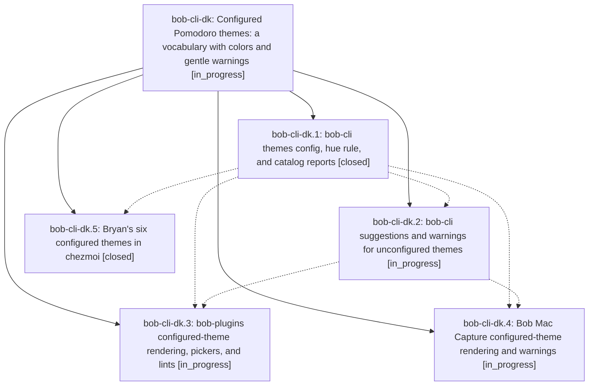

# Bead: bob-cli-dk — Configured Pomodoro themes: a vocabulary with colors and gentle warnings

[Bead Pages](../README.md) / bob-cli-dk

**Status:** ◐ in_progress · **Type:** ▸ plan · **Tier:** epic
**Owner:** `bryanbugyi34@gmail.com` · **Created by:** [bbugyi200.athena.151](https://github.com/bobs-org/bob-cli--agents/blob/main/sessions/bbugyi200.athena.151.md) · **Assignee:** `bob-cli-dk.land`
**Created:** 2026-10-28 07:47:10 EDT
**Plan:** [202610/configured\_pomodoro\_themes.md](https://github.com/bobs-org/bob-cli--plans/blob/main/202610/configured_pomodoro_themes.md)

<!-- sase:links:start -->

## Links

| Relation | Artifact | Why |
| --- | --- | --- |
| implemented-by | [plan:202610/configured_pomodoro_themes.md][1] | derived from the plan's `bead_id:` frontmatter field |

_Plus 1 automatic references — see [Referenced By](#referenced-by)._

[1]: https://github.com/bobs-org/bob-cli--plans/blob/main/202610/configured_pomodoro_themes.md

<!-- sase:links:end -->

## Description

A `themes:` block in bob's config.yml declares Bryan's Pomodoro theme vocabulary and each theme's palette color. Every bob surface shows the configured colors, the menus suggest the configured themes, and using a name outside the vocabulary always works but produces a clear warning wherever a theme gets authored. Bryan's six themes ship configured with distinct colors.

## Phases

| Bead | Title | Status | Size | Created | Agents | Commits |
|---|---|---|---|---|---:|---:|
| [bob-cli-dk.1](bob-cli-dk.1.md) | bob-cli themes config, hue rule, and catalog reports | ✓ closed | medium | 2026-10-28 | 1 | 1 |
| [bob-cli-dk.2](bob-cli-dk.2.md) | bob-cli suggestions and warnings for unconfigured themes | ◐ in_progress | medium | 2026-10-28 | 1 | 0 |
| [bob-cli-dk.3](bob-cli-dk.3.md) | bob-plugins configured-theme rendering, pickers, and lints | ◐ in_progress | medium | 2026-10-28 | 1 | 0 |
| [bob-cli-dk.4](bob-cli-dk.4.md) | Bob Mac Capture configured-theme rendering and warnings | ◐ in_progress | medium | 2026-10-28 | 1 | 0 |
| [bob-cli-dk.5](bob-cli-dk.5.md) | Bryan's six configured themes in chezmoi | ✓ closed | xsmall | 2026-10-28 | 1 | 1 |

## Lineage

## Agents

| Agent | Bead | Commits |
|---|---|---:|
| [bbugyi200.athena.bob-cli-dk.1](https://github.com/bobs-org/bob-cli--agents/blob/main/agents/bbugyi200.athena.bob-cli-dk.1/README.md) | [bob-cli-dk.1](bob-cli-dk.1.md) | 1 |
| [bbugyi200.athena.bob-cli-dk.2](https://github.com/bobs-org/bob-cli--agents/blob/main/agents/bbugyi200.athena.bob-cli-dk.2/README.md) | [bob-cli-dk.2](bob-cli-dk.2.md) | 0 |
| [bbugyi200.athena.bob-cli-dk.3](https://github.com/bobs-org/bob-cli--agents/blob/main/agents/bbugyi200.athena.bob-cli-dk.3/README.md) | [bob-cli-dk.3](bob-cli-dk.3.md) | 0 |
| [bbugyi200.athena.bob-cli-dk.4](https://github.com/bobs-org/bob-cli--agents/blob/main/agents/bbugyi200.athena.bob-cli-dk.4/README.md) | [bob-cli-dk.4](bob-cli-dk.4.md) | 0 |
| [bbugyi200.athena.bob-cli-dk.5](https://github.com/bobs-org/bob-cli--agents/blob/main/agents/bbugyi200.athena.bob-cli-dk.5/README.md) | [bob-cli-dk.5](bob-cli-dk.5.md) | 1 |
| [bbugyi200.athena.bob-cli-dk.land](https://github.com/bobs-org/bob-cli--agents/blob/main/agents/bbugyi200.athena.bob-cli-dk.land/README.md) | [bob-cli-dk](README.md) | 0 |

## Commits

| Repo | Commit | Subject | Bead | Committed |
|---|---|---|---|---|
| bob-cli | [`ec018a5`](https://github.com/bobs-org/bob-cli/commit/ec018a5bcf5f7f9e48a52f81a40de7050145be70) | feat(themes): configured themes vocabulary, config-first hue rule, and catalog reports | [bob-cli-dk.1](bob-cli-dk.1.md) | 2026-10-28 08:19:13 EDT |
| chezmoi | [`chezmoi@f04d7ff`](https://github.com/bbugyi200/dotfiles/commit/f04d7ff12d5668f32eab654b2842283b560eced4) | feat(bob): configure six Pomodoro themes vocabulary and colors | [bob-cli-dk.5](bob-cli-dk.5.md) | 2026-10-28 08:38:55 EDT |

<!-- sase:referenced-by:start -->

## Referenced By

| Relation | Artifact | Why | Uses |
| --- | --- | --- | ---: |
| read-by | [agent:bob-cli-dk.1][1] | Need epic DECISIONS and scope for phase work | 1 |

[1]: https://github.com/bobs-org/bob-cli--agents/blob/main/agents/bbugyi200.athena.bob-cli-dk.1/README.md

<!-- sase:referenced-by:end -->
