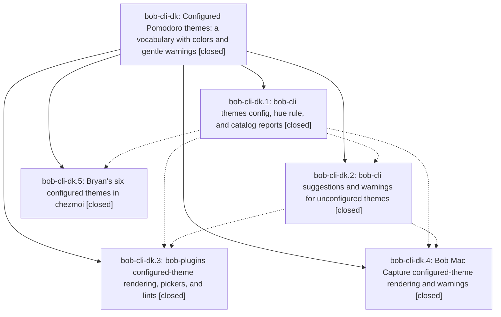

# Bead: bob-cli-dk — Configured Pomodoro themes: a vocabulary with colors and gentle warnings

[Bead Pages](../README.md) / bob-cli-dk

**Status:** ✓ closed · **Resolution:** done · **Type:** ▸ plan · **Tier:** epic
**Owner:** `bryanbugyi34@gmail.com` · **Created by:** [bbugyi200.athena.151](https://github.com/bobs-org/bob-cli--agents/blob/main/sessions/bbugyi200.athena.151.md) · **Assignee:** `bob-cli-dk.land`
**Created:** 2026-10-28 07:47:10 EDT · **Closed:** 2026-10-28 10:56:58 EDT
**Plan:** [202610/configured\_pomodoro\_themes.md](https://github.com/bobs-org/bob-cli--plans/blob/main/202610/configured_pomodoro_themes.md)

<!-- sase:links:start -->

## Links

| Relation | Artifact | Why |
| --- | --- | --- |
| implemented-by | [plan:202610/configured_pomodoro_themes.md][1] | derived from the plan's `bead_id:` frontmatter field |

_Plus 3 automatic references — see [Referenced By](#referenced-by)._

[1]: https://github.com/bobs-org/bob-cli--plans/blob/main/202610/configured_pomodoro_themes.md

<!-- sase:links:end -->

## Description

A `themes:` block in bob's config.yml declares Bryan's Pomodoro theme vocabulary and each theme's palette color. Every bob surface shows the configured colors, the menus suggest the configured themes, and using a name outside the vocabulary always works but produces a clear warning wherever a theme gets authored. Bryan's six themes ship configured with distinct colors.

## Notes

[2026-10-28T13:53:42Z · 155--code] DISCOVERED ISSUE: just docs-check fails at generated drift with 'decisions:theme-hue-is-pin-exempt-area-hash is superseded with no successors'. Reproduced on master a314b6ad with a clean tree (stash-on-quit docs changes reverted). Lint passed. decisions:theme-hue-is-config-pin-exempt-area-hash already says it supersedes the old record; docs/develop/decisions.md still publishes the old heading and the gate wants a successor. This is from this epic's memory_hue_record = yes work.

[2026-10-28T14:56:58Z · bob-cli-dk.land] Landed. VERIFIED: all 5 phases closed with notes addressed. bob-cli ec018a5b (dk.1: themes: parser with strict validation, one-read ThemeSources, config-first hue rule with config/unconfigured HueSource under unconfigured_hue=mute, configured flag on ThemeRef/known, themes list/color config-aware with config_color refusal, PT12 docs, hue vectors) and 084a2852 (dk.2: Recent scoped to configured vocabulary with 12-row empty cap and similar_to over configured keys, theme_not_configured from capture/Name-it/bob plan/rename/split/themes-list hints, themes_config_invalid lint). bob-plugins 233d060 (dk.3; its pomodoro_themes vectors.json is byte-identical to bob-cli@084a2852, later drift is bob-cli-dm's added vectors). bob-mac-capture 2497c41 (dk.4; dashed unconfigured treatment, create-row badge, preview warnings, configured Name-it chips, uniquingKeysWith hardening). chezmoi f04d7ff1 (dk.5; six-theme block matches the applied ~/.config/bob/config.yml). Smoke: cargo run themes list with the chezmoi config shows 6 configured rows in config colors, counts.configured=6, no warnings. DECISIONS honored: mute branch implemented; memory edits limited to glossary:pomodoro-theme and the two hue decision records (old superseded with metadata.status/superseded_by and back-links); no soft-vocabulary record. Epic note #1 (docs-check generated-drift failure on the superseded hue record) is resolved by 084a2852; just docs-check passes. INTEGRATION: reviewed all non-epic commits since ec018a5b (52bff016, a314b6ad, 9e814f0d, 50eb75d2, f236b9f6 are relations/docs, unrelated; a1b8766b from bob-cli-dm.1.1.1 builds on configured themes). a1b8766b's test-only Catalog::for_suggest initializer missed this epic's config_warning field, so master's lib test target failed to compile; fixed by adding config_warning: None. just check then passed (6319 tests, 0 failed). FOLLOW-UPS: dk.1 PROPOSED FOLLOW-UP (decisions:configured-themes-are-a-soft-vocabulary strand) declined: the reviewer explicitly decided memory_vocabulary_record = no for this plan, so filing it would reopen a settled user decision. epic-symbols: none.

## Phases

| Bead | Title | Status | Size | Created | Agents | Commits |
|---|---|---|---|---|---:|---:|
| [bob-cli-dk.1](bob-cli-dk.1.md) | bob-cli themes config, hue rule, and catalog reports | ✓ closed | medium | 2026-10-28 | 1 | 1 |
| [bob-cli-dk.2](bob-cli-dk.2.md) | bob-cli suggestions and warnings for unconfigured themes | ✓ closed | medium | 2026-10-28 | 1 | 1 |
| [bob-cli-dk.3](bob-cli-dk.3.md) | bob-plugins configured-theme rendering, pickers, and lints | ✓ closed | medium | 2026-10-28 | 1 | 1 |
| [bob-cli-dk.4](bob-cli-dk.4.md) | Bob Mac Capture configured-theme rendering and warnings | ✓ closed | medium | 2026-10-28 | 1 | 1 |
| [bob-cli-dk.5](bob-cli-dk.5.md) | Bryan's six configured themes in chezmoi | ✓ closed | xsmall | 2026-10-28 | 1 | 1 |

## Lineage

## Agents

| Agent | Bead | Commits |
|---|---|---:|
| [bbugyi200.athena.bob-cli-dk.1](https://github.com/bobs-org/bob-cli--agents/blob/main/agents/bbugyi200.athena.bob-cli-dk.1/README.md) | [bob-cli-dk.1](bob-cli-dk.1.md) | 1 |
| [bbugyi200.athena.bob-cli-dk.2](https://github.com/bobs-org/bob-cli--agents/blob/main/sessions/bbugyi200.athena.bob-cli-dk.2.md) | [bob-cli-dk.2](bob-cli-dk.2.md) | 1 |
| [bbugyi200.athena.bob-cli-dk.3](https://github.com/bobs-org/bob-cli--agents/blob/main/agents/bbugyi200.athena.bob-cli-dk.3/README.md) | [bob-cli-dk.3](bob-cli-dk.3.md) | 1 |
| [bbugyi200.athena.bob-cli-dk.4](https://github.com/bobs-org/bob-cli--agents/blob/main/agents/bbugyi200.athena.bob-cli-dk.4/README.md) | [bob-cli-dk.4](bob-cli-dk.4.md) | 1 |
| [bbugyi200.athena.bob-cli-dk.5](https://github.com/bobs-org/bob-cli--agents/blob/main/agents/bbugyi200.athena.bob-cli-dk.5/README.md) | [bob-cli-dk.5](bob-cli-dk.5.md) | 1 |
| [bbugyi200.athena.bob-cli-dk.land](https://github.com/bobs-org/bob-cli--agents/blob/main/agents/bbugyi200.athena.bob-cli-dk.land/README.md) | [bob-cli-dk](README.md) | 2 |

## Commits

| Repo | Commit | Subject | Bead | Committed |
|---|---|---|---|---|
| bob-cli | [`ec018a5`](https://github.com/bobs-org/bob-cli/commit/ec018a5bcf5f7f9e48a52f81a40de7050145be70) | feat(themes): configured themes vocabulary, config-first hue rule, and catalog reports | [bob-cli-dk.1](bob-cli-dk.1.md) | 2026-10-28 08:19:13 EDT |
| chezmoi | [`chezmoi@f04d7ff`](https://github.com/bbugyi200/dotfiles/commit/f04d7ff12d5668f32eab654b2842283b560eced4) | feat(bob): configure six Pomodoro themes vocabulary and colors | [bob-cli-dk.5](bob-cli-dk.5.md) | 2026-10-28 08:38:55 EDT |
| bob-cli | [`084a285`](https://github.com/bobs-org/bob-cli/commit/084a2852b121a153852a5c045b3b5ac5385ea89c) | feat(themes): scope Recent to configured themes and warn on unconfigured names | [bob-cli-dk.2](bob-cli-dk.2.md) | 2026-10-28 09:49:09 EDT |
| bob-plugins | [`bob-plugins@233d060`](https://github.com/bobs-org/bob-plugins/commit/233d060b08ac9c791d445b2cd81847d9e345537a) | feat(plugins): render configured Pomodoro themes | [bob-cli-dk.3](bob-cli-dk.3.md) | 2026-10-28 10:17:50 EDT |
| bob-mac-capture | [`bob-mac-capture@2497c41`](https://github.com/bobs-org/bob-mac-capture/commit/2497c412f20060bb90ec324daf8e41badcc44819) | feat(themes): render unconfigured Pomodoro themes with dashed treatment | [bob-cli-dk.4](bob-cli-dk.4.md) | 2026-10-28 10:33:48 EDT |
| bob-cli | [`8852f7b`](https://github.com/bobs-org/bob-cli/commit/8852f7bfa1394b001152e477bfa16a1ea7de5b11) | fix(themes): set config\_warning in the test-only Catalog::for\_suggest | [bob-cli-dk](README.md) | 2026-10-28 10:57:52 EDT |
| bob-cli--plans | [`bob-cli--plans@c618f85`](https://github.com/bobs-org/bob-cli--plans/commit/c618f85fddef358fe25e5b6e2f438d128010b6b3) | chore(plans): mark configured Pomodoro themes plan done | [bob-cli-dk](README.md) | 2026-10-28 10:59:27 EDT |

<!-- sase:referenced-by:start -->

## Referenced By

| Relation | Artifact | Why | Uses |
| --- | --- | --- | ---: |
| read-by | [agent:bob-cli-dk.1][1] | Need epic DECISIONS and scope for phase work | 1 |
| read-by | [agent:bob-cli-dk.3][2] | Need epic decisions and the phase plan before implementing bob-cli-dk.3 | 1 |
| read-by | [agent:bob-cli-dk.4][3] | Need epic decisions and sibling phase status | 1 |

[1]: https://github.com/bobs-org/bob-cli--agents/blob/main/agents/bbugyi200.athena.bob-cli-dk.1/README.md
[2]: https://github.com/bobs-org/bob-cli--agents/blob/main/agents/bbugyi200.athena.bob-cli-dk.3/README.md
[3]: https://github.com/bobs-org/bob-cli--agents/blob/main/agents/bbugyi200.athena.bob-cli-dk.4/README.md

<!-- sase:referenced-by:end -->
