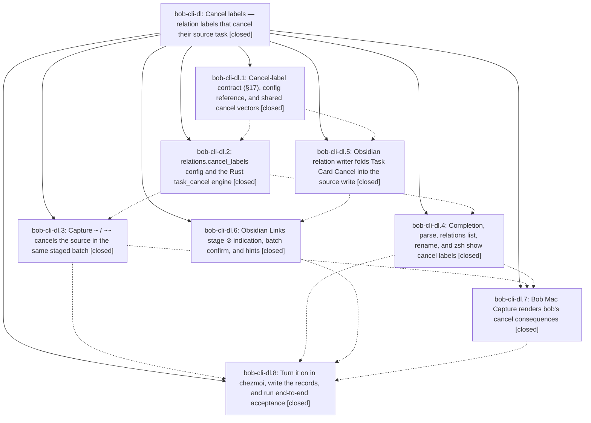

# Bead: bob-cli-dl — Cancel labels — relation labels that cancel their source task

[Bead Pages](../README.md) / bob-cli-dl

**Status:** ✓ closed · **Resolution:** done · **Type:** ▸ plan · **Tier:** epic
**Owner:** `bryanbugyi34@gmail.com` · **Created by:** [bbugyi200.apollo.research.2r.linker.w0](https://github.com/bobs-org/bob-cli--agents/blob/main/sessions/bbugyi200.apollo.research.2r.linker.w0.md) · **Assignee:** `bob-cli-dl.land`
**Created:** 2026-10-28 08:15:26 EDT · **Closed:** 2026-10-28 14:22:45 EDT
**Plan:** [202610/relation\_cancel\_labels.md](https://github.com/bobs-org/bob-cli--plans/blob/main/202610/relation_cancel_labels.md)

<!-- sase:links:start -->

## Links

| Relation | Artifact | Why |
| --- | --- | --- |
| implemented-by | [plan:202610/relation_cancel_labels.md][1] | derived from the plan's `bead_id:` frontmatter field |
| related | [bead:bob-cli-dq][2] | Cancel-label capture commits on an in-section source are one trigger of this guard |

_Plus 2 automatic references — see [Referenced By](#referenced-by)._

[1]: https://github.com/bobs-org/bob-cli--plans/blob/main/202610/relation_cancel_labels.md
[2]: https://github.com/bobs-org/bob-cli--beads/blob/main/pages/bob-cli-dq/README.md

<!-- sase:links:end -->

## Description

Committing a relation whose label is listed in `relations.cancel_labels` (starting with `duplicate of` and `superseded by`, configured in chezmoi) cancels the relation's source task in the same gesture, exactly as Task Card Cancel would: `[-]` plus `[cancelled:: today]`, its links removed from today's open Pomodoros, and blocked dependents recovered. Every surface names the task before you commit (⊘ plus words, `↵ link & cancel`), and nothing else ever cancels or reopens because of a label.

## Notes

[2026-10-28T17:47:03Z · bob-cli-dl.land] LAND FOLLOW-UP TRIAGE (bob-cli-dl.land): (1) bob-cli-dl.2 #1 stale decision successor metadata for theme-hue-is-pin-exempt-area-hash: declined, already fixed by 084a2852 (bob-cli-dk.2); just docs-check passes on 03493169. (2) bob-cli-dl.3 #1 and bob-cli-dl.4 #1 Catalog::for_suggest missing config_warning: declined, fixed by 8852f7bf (bob-cli-dk.land) and 16f3da48. (3) bob-cli-dl.3 #2 PomodoroBlockTracker vanished-entry guard on in-section task rewrites: reproduced on master (debug panic pomodoro_blocks.rs:859, release drops pomodoro_blocks), filed task bob-cli-dq (bug, medium). (4) bob-cli-dl.3 #3 || one-off hides dropped on @owner items: causally from bob-cli-bj.5 (895b9ba7), recorded as DISCOVERED ISSUE on active epic bob-cli-bj, no task. (5) bob-cli-dl.7 #1 glossary.md docs-check drift: declined, regenerated in 03493169, docs-check green. (6) bob-cli-dl.7 #2 Mac typecheck unverified: resolved, macOS CI run 40729693701 on e5f6604 built BobMacCapture and passed CaptureRelationCancelTests. Its only 4 failures are two unconfigured-theme caret tests red since 8b57693 (not this epic), filed task bob-cli-dr (ci, large). (7) bob-cli-dl.8 #1 Task Card Cancel-stage door: declined, the reviewer chose cancel_stage_door=no for this plan ('ship one door first'), so a bead would only restate a declined wish; Bryan can reopen it. (8) bob-cli-dl.8 #2 Mac Similar Tasks 'Replace it': filed task bob-cli-ds (feature, medium).

[2026-10-28T18:22:45Z · bob-cli-dl.land] Landing closeout for bob-cli-dl. Land agent verified all 8 phases against the shipped code in bob-cli, bob-plugins, and bob-mac-capture: cancel vectors are byte-identical in bob-cli and bob-plugins; chezmoi relations.cancel_labels commit b33aa49d is on origin; macOS CI run 40729693701 built the cancel cue and passed CaptureRelationCancelTests (its only failures belong to bob-cli-dr); LG16 needed no integration. This tale aligned capture with §17 CL6/CL7: relation_cancels[] serializes only cancelled sources (already-closed stays on relation_updates[].cancel_effect and a muted human line without ⊘); cancel_message names one recovered dependent and uses “unblocked {k} tasks” for two or more; structured warning quotes the label unquoted; ^prj singular is “its 1 open task stays open” in capture, capture-complete, and nav. Passed cargo test --test cli -- relations_cancel relations:: relations_rename capture::parse_relation; cargo test --lib -- task_cancel capture_complete; just check; just docs-check; scratch-vault dry-run of an already-cancelled source (no relation_cancels, cancel_effect already_closed). bob-plugins npm run build and npm test (3913) passed; nav fix committed as 62ccc99. bob plugins sync refused to overwrite bob-navigation-hotkeys (deployed from an uncommitted build of this workspace at 233d060); not forced. Follow-ups already on bob-cli-dl: tasks bob-cli-dq, bob-cli-dr, bob-cli-ds; DISCOVERED ISSUE on bob-cli-bj; cancel-stage door declined per cancel_stage_door=no; remaining land notes already fixed upstream. epic-symbols listed none. Plan status set to done.

## Phases

| Bead | Title | Status | Size | Created | Agents | Commits |
|---|---|---|---|---|---:|---:|
| [bob-cli-dl.1](bob-cli-dl.1.md) | Cancel-label contract (§17), config reference, and shared cancel vectors | ✓ closed | medium | 2026-10-28 | 1 | 1 |
| [bob-cli-dl.2](bob-cli-dl.2.md) | relations.cancel\_labels config and the Rust task\_cancel engine | ✓ closed | large | 2026-10-28 | 1 | 1 |
| [bob-cli-dl.3](bob-cli-dl.3.md) | Capture ~ / ~~ cancels the source in the same staged batch | ✓ closed | medium | 2026-10-28 | 1 | 1 |
| [bob-cli-dl.4](bob-cli-dl.4.md) | Completion, parse, relations list, rename, and zsh show cancel labels | ✓ closed | medium | 2026-10-28 | 1 | 1 |
| [bob-cli-dl.5](bob-cli-dl.5.md) | Obsidian relation writer folds Task Card Cancel into the source write | ✓ closed | large | 2026-10-28 | 1 | 1 |
| [bob-cli-dl.6](bob-cli-dl.6.md) | Obsidian Links stage ⊘ indication, batch confirm, and hints | ✓ closed | medium | 2026-10-28 | 1 | 2 |
| [bob-cli-dl.7](bob-cli-dl.7.md) | Bob Mac Capture renders bob's cancel consequences | ✓ closed | medium | 2026-10-28 | 1 | 1 |
| [bob-cli-dl.8](bob-cli-dl.8.md) | Turn it on in chezmoi, write the records, and run end-to-end acceptance | ✓ closed | small | 2026-10-28 | 1 | 3 |

## Lineage

## Agents

| Agent | Bead | Commits |
|---|---|---:|
| [bbugyi200.apollo.bob-cli-dl.1](https://github.com/bobs-org/bob-cli--agents/blob/main/sessions/bbugyi200.apollo.bob-cli-dl.1.md) | [bob-cli-dl.1](bob-cli-dl.1.md) | 1 |
| [bbugyi200.apollo.bob-cli-dl.2](https://github.com/bobs-org/bob-cli--agents/blob/main/sessions/bbugyi200.apollo.bob-cli-dl.2.md) | [bob-cli-dl.2](bob-cli-dl.2.md) | 1 |
| [bbugyi200.apollo.bob-cli-dl.3](https://github.com/bobs-org/bob-cli--agents/blob/main/agents/bbugyi200.apollo.bob-cli-dl.3/README.md) | [bob-cli-dl.3](bob-cli-dl.3.md) | 1 |
| [bbugyi200.apollo.bob-cli-dl.4](https://github.com/bobs-org/bob-cli--agents/blob/main/agents/bbugyi200.apollo.bob-cli-dl.4/README.md) | [bob-cli-dl.4](bob-cli-dl.4.md) | 1 |
| [bbugyi200.apollo.bob-cli-dl.5](https://github.com/bobs-org/bob-cli--agents/blob/main/sessions/bbugyi200.apollo.bob-cli-dl.5.md) | [bob-cli-dl.5](bob-cli-dl.5.md) | 1 |
| [bbugyi200.apollo.bob-cli-dl.6](https://github.com/bobs-org/bob-cli--agents/blob/main/sessions/bbugyi200.apollo.bob-cli-dl.6.md) | [bob-cli-dl.6](bob-cli-dl.6.md) | 2 |
| [bbugyi200.apollo.bob-cli-dl.7](https://github.com/bobs-org/bob-cli--agents/blob/main/agents/bbugyi200.apollo.bob-cli-dl.7/README.md) | [bob-cli-dl.7](bob-cli-dl.7.md) | 1 |
| [bbugyi200.apollo.bob-cli-dl.8](https://github.com/bobs-org/bob-cli--agents/blob/main/agents/bbugyi200.apollo.bob-cli-dl.8/README.md) | [bob-cli-dl.8](bob-cli-dl.8.md) | 3 |
| [bbugyi200.apollo.bob-cli-dl.land](https://github.com/bobs-org/bob-cli--agents/blob/main/sessions/bbugyi200.apollo.bob-cli-dl.land.md) | [bob-cli-dl](README.md) | 3 |

## Commits

| Repo | Commit | Subject | Bead | Committed |
|---|---|---|---|---|
| bob-cli | [`52bff01`](https://github.com/bobs-org/bob-cli/commit/52bff0161befe3ce9656117547920caaf3129644) | feat(relations): add cancel-label contract, config docs, and shared vectors | [bob-cli-dl.1](bob-cli-dl.1.md) | 2026-10-28 09:03:56 EDT |
| bob-plugins | [`bob-plugins@768fac8`](https://github.com/bobs-org/bob-plugins/commit/768fac86d256f6e7abd5c38fdff9a65c7fc4ed23) | feat(nav): cancel sources when linking a configured cancel label | [bob-cli-dl.5](bob-cli-dl.5.md) | 2026-10-28 10:14:57 EDT |
| bob-cli | [`50eb75d`](https://github.com/bobs-org/bob-cli/commit/50eb75d21dfe60754e3e0419b524a32f846e4955) | feat(relations): add cancel-label config parser and task\_cancel engine | [bob-cli-dl.2](bob-cli-dl.2.md) | 2026-10-28 10:17:06 EDT |
| bob-cli | [`8f311da`](https://github.com/bobs-org/bob-cli/commit/8f311dabaf225ae9638cdbfd6a933fed90cb7350) | docs(memory): clarify task relation cancel-label exception | [bob-cli-dl.6](bob-cli-dl.6.md) | 2026-10-28 11:07:44 EDT |
| bob-plugins | [`bob-plugins@6c73e84`](https://github.com/bobs-org/bob-plugins/commit/6c73e84e5bd0339757a15095a3b753fdaf9c5540) | feat(navigation-hotkeys): add relation cancel cues | [bob-cli-dl.6](bob-cli-dl.6.md) | 2026-10-28 11:09:55 EDT |
| bob-cli | [`0a5f41b`](https://github.com/bobs-org/bob-cli/commit/0a5f41b8781a643071707a7534f667df6b932c6e) | feat(capture): cancel-label commits retire the source in the staged batch | [bob-cli-dl.3](bob-cli-dl.3.md) | 2026-10-28 11:27:23 EDT |
| bob-cli | [`b8df2f4`](https://github.com/bobs-org/bob-cli/commit/b8df2f48b6c0a8dfda4a494c15f56088d3f37417) | feat(relations): add cancel-source surfaces for capture-complete and relations list | [bob-cli-dl.4](bob-cli-dl.4.md) | 2026-10-28 12:03:28 EDT |
| bob-mac-capture | [`bob-mac-capture@e5f6604`](https://github.com/bobs-org/bob-mac-capture/commit/e5f66043e4a704e6a19d4d83b331e6b5a2aaa7af) | feat(relation-picker): render bob's cancel-label ⊘ cue | [bob-cli-dl.7](bob-cli-dl.7.md) | 2026-10-28 12:49:05 EDT |
| bob-cli | [`0349316`](https://github.com/bobs-org/bob-cli/commit/03493169b696813136e6d484d21e27aea60a7e2e) | docs(relations): drop cancel-label planned markers for rollout | [bob-cli-dl.8](bob-cli-dl.8.md) | 2026-10-28 13:19:22 EDT |
| bob-plugins | [`bob-plugins@ff1a24c`](https://github.com/bobs-org/bob-plugins/commit/ff1a24cc49e6e5862d33d0d18b0518cc7ca9354d) | chore(nav): resync task\_cancel vectors from bob-cli | [bob-cli-dl.8](bob-cli-dl.8.md) | 2026-10-28 13:21:13 EDT |
| chezmoi | [`chezmoi@b33aa49`](https://github.com/bbugyi200/dotfiles/commit/b33aa49d022d5a27fabb801e0b332177e184bc73) | feat(bob): turn on relation cancel labels | [bob-cli-dl.8](bob-cli-dl.8.md) | 2026-10-28 13:22:04 EDT |
| bob-plugins | [`bob-plugins@62ccc99`](https://github.com/bobs-org/bob-plugins/commit/62ccc9927e53df02c384b5ebf94166121fdfeb7a) | fix(nav): use singular copy for one open ^prj resident | [bob-cli-dl](README.md) | 2026-10-28 14:18:49 EDT |
| bob-cli | [`b8d5529`](https://github.com/bobs-org/bob-cli/commit/b8d5529742330811a412d1364ea47eda1be8d5ef) | fix(capture): align cancel-label output with §17 CL6/CL7 | [bob-cli-dl](README.md) | 2026-10-28 14:25:21 EDT |
| bob-cli--plans | [`bob-cli--plans@0e162a2`](https://github.com/bobs-org/bob-cli--plans/commit/0e162a28c9ad6c5d76828e55f789b1a9a13fd2ef) | chore(plan): mark relation\_cancel\_labels done | [bob-cli-dl](README.md) | 2026-10-28 14:26:13 EDT |

<!-- sase:referenced-by:start -->

## Referenced By

| Relation | Artifact | Why | Uses |
| --- | --- | --- | ---: |
| read-by | [agent:bob-cli-dl.4][1] | Need epic children status | 1 |
| read-by | [agent:bob-cli-dl.8][2] | Need parent epic status and rollout expectations | 1 |

[1]: https://github.com/bobs-org/bob-cli--agents/blob/main/agents/bbugyi200.apollo.bob-cli-dl.4/README.md
[2]: https://github.com/bobs-org/bob-cli--agents/blob/main/agents/bbugyi200.apollo.bob-cli-dl.8/README.md

<!-- sase:referenced-by:end -->
