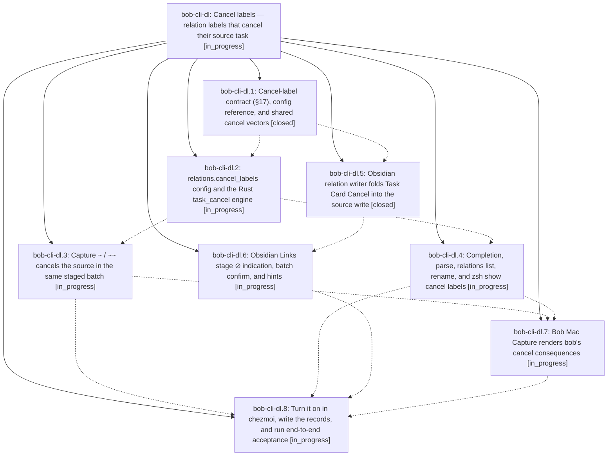

# Bead: bob-cli-dl — Cancel labels — relation labels that cancel their source task

[Bead Pages](../README.md) / bob-cli-dl

**Status:** ◐ in_progress · **Type:** ▸ plan · **Tier:** epic
**Owner:** `bryanbugyi34@gmail.com` · **Created by:** [bbugyi200.apollo.research.2r.linker.w0](https://github.com/bobs-org/bob-cli--agents/blob/main/sessions/bbugyi200.apollo.research.2r.linker.w0.md) · **Assignee:** `bob-cli-dl.land`
**Created:** 2026-10-28 08:15:26 EDT
**Plan:** [202610/relation\_cancel\_labels.md](https://github.com/bobs-org/bob-cli--plans/blob/main/202610/relation_cancel_labels.md)

<!-- sase:links:start -->

## Links

| Relation | Artifact | Why |
| --- | --- | --- |
| implemented-by | [plan:202610/relation_cancel_labels.md][1] | derived from the plan's `bead_id:` frontmatter field |

[1]: https://github.com/bobs-org/bob-cli--plans/blob/main/202610/relation_cancel_labels.md

<!-- sase:links:end -->

## Description

Committing a relation whose label is listed in `relations.cancel_labels` (starting with `duplicate of` and `superseded by`, configured in chezmoi) cancels the relation's source task in the same gesture, exactly as Task Card Cancel would: `[-]` plus `[cancelled:: today]`, its links removed from today's open Pomodoros, and blocked dependents recovered. Every surface names the task before you commit (⊘ plus words, `↵ link & cancel`), and nothing else ever cancels or reopens because of a label.

## Phases

| Bead | Title | Status | Size | Created | Agents | Commits |
|---|---|---|---|---|---:|---:|
| [bob-cli-dl.1](bob-cli-dl.1.md) | Cancel-label contract (§17), config reference, and shared cancel vectors | ✓ closed | medium | 2026-10-28 | 1 | 1 |
| [bob-cli-dl.2](bob-cli-dl.2.md) | relations.cancel\_labels config and the Rust task\_cancel engine | ◐ in_progress | large | 2026-10-28 | 1 | 0 |
| [bob-cli-dl.3](bob-cli-dl.3.md) | Capture ~ / ~~ cancels the source in the same staged batch | ◐ in_progress | medium | 2026-10-28 | 1 | 0 |
| [bob-cli-dl.4](bob-cli-dl.4.md) | Completion, parse, relations list, rename, and zsh show cancel labels | ◐ in_progress | medium | 2026-10-28 | 1 | 0 |
| [bob-cli-dl.5](bob-cli-dl.5.md) | Obsidian relation writer folds Task Card Cancel into the source write | ✓ closed | large | 2026-10-28 | 1 | 1 |
| [bob-cli-dl.6](bob-cli-dl.6.md) | Obsidian Links stage ⊘ indication, batch confirm, and hints | ◐ in_progress | medium | 2026-10-28 | 1 | 0 |
| [bob-cli-dl.7](bob-cli-dl.7.md) | Bob Mac Capture renders bob's cancel consequences | ◐ in_progress | medium | 2026-10-28 | 1 | 0 |
| [bob-cli-dl.8](bob-cli-dl.8.md) | Turn it on in chezmoi, write the records, and run end-to-end acceptance | ◐ in_progress | small | 2026-10-28 | 1 | 0 |

## Lineage

## Agents

| Agent | Bead | Commits |
|---|---|---:|
| [bbugyi200.apollo.bob-cli-dl.1](https://github.com/bobs-org/bob-cli--agents/blob/main/sessions/bbugyi200.apollo.bob-cli-dl.1.md) | [bob-cli-dl.1](bob-cli-dl.1.md) | 1 |
| [bbugyi200.apollo.bob-cli-dl.2](https://github.com/bobs-org/bob-cli--agents/blob/main/sessions/bbugyi200.apollo.bob-cli-dl.2.md) | [bob-cli-dl.2](bob-cli-dl.2.md) | 0 |
| [bbugyi200.apollo.bob-cli-dl.3](https://github.com/bobs-org/bob-cli--agents/blob/main/agents/bbugyi200.apollo.bob-cli-dl.3/README.md) | [bob-cli-dl.3](bob-cli-dl.3.md) | 0 |
| [bbugyi200.apollo.bob-cli-dl.4](https://github.com/bobs-org/bob-cli--agents/blob/main/agents/bbugyi200.apollo.bob-cli-dl.4/README.md) | [bob-cli-dl.4](bob-cli-dl.4.md) | 0 |
| [bbugyi200.apollo.bob-cli-dl.5](https://github.com/bobs-org/bob-cli--agents/blob/main/sessions/bbugyi200.apollo.bob-cli-dl.5.md) | [bob-cli-dl.5](bob-cli-dl.5.md) | 1 |
| [bbugyi200.apollo.bob-cli-dl.6](https://github.com/bobs-org/bob-cli--agents/blob/main/agents/bbugyi200.apollo.bob-cli-dl.6/README.md) | [bob-cli-dl.6](bob-cli-dl.6.md) | 0 |
| [bbugyi200.apollo.bob-cli-dl.7](https://github.com/bobs-org/bob-cli--agents/blob/main/agents/bbugyi200.apollo.bob-cli-dl.7/README.md) | [bob-cli-dl.7](bob-cli-dl.7.md) | 0 |
| [bbugyi200.apollo.bob-cli-dl.8](https://github.com/bobs-org/bob-cli--agents/blob/main/agents/bbugyi200.apollo.bob-cli-dl.8/README.md) | [bob-cli-dl.8](bob-cli-dl.8.md) | 0 |
| [bbugyi200.apollo.bob-cli-dl.land](https://github.com/bobs-org/bob-cli--agents/blob/main/agents/bbugyi200.apollo.bob-cli-dl.land/README.md) | [bob-cli-dl](README.md) | 0 |

## Commits

| Repo | Commit | Subject | Bead | Committed |
|---|---|---|---|---|
| bob-cli | [`52bff01`](https://github.com/bobs-org/bob-cli/commit/52bff0161befe3ce9656117547920caaf3129644) | feat(relations): add cancel-label contract, config docs, and shared vectors | [bob-cli-dl.1](bob-cli-dl.1.md) | 2026-10-28 09:03:56 EDT |
| bob-plugins | [`bob-plugins@768fac8`](https://github.com/bobs-org/bob-plugins/commit/768fac86d256f6e7abd5c38fdff9a65c7fc4ed23) | feat(nav): cancel sources when linking a configured cancel label | [bob-cli-dl.5](bob-cli-dl.5.md) | 2026-10-28 10:14:57 EDT |
