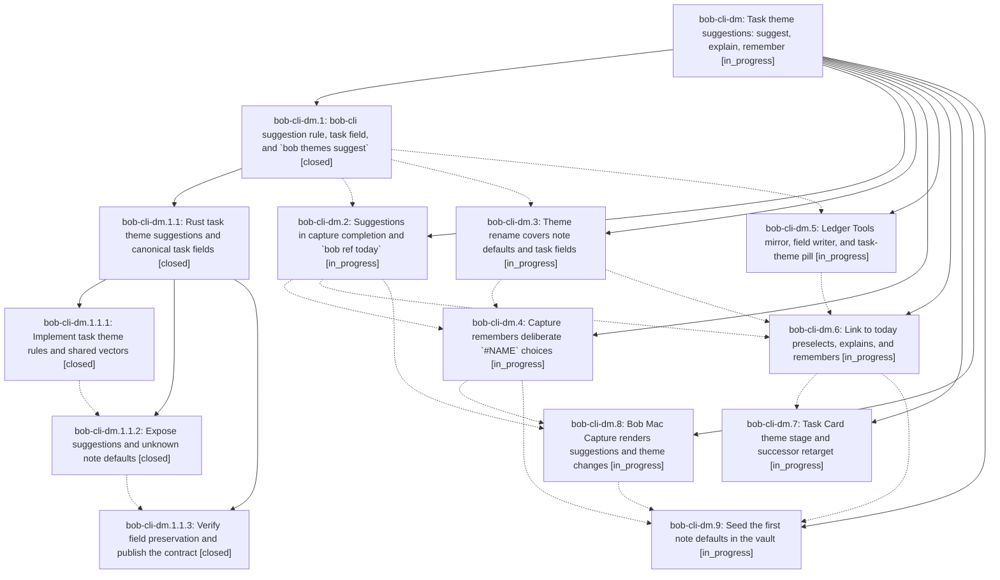

# Bead: bob-cli-dm — Task theme suggestions: suggest, explain, remember

[Bead Pages](../README.md) / bob-cli-dm

**Status:** ◐ in_progress · **Type:** ▸ plan · **Tier:** epic
**Owner:** `bryanbugyi34@gmail.com` · **Created by:** [bbugyi200.apollo.research.2s.linker.w0](https://github.com/bobs-org/bob-cli--agents/blob/main/sessions/bbugyi200.apollo.research.2s.linker.w0.md) · **Assignee:** `bob-cli-dm.land`
**Created:** 2026-10-28 08:45:53 EDT
**Plan:** [202610/task\_theme\_suggestions.md](https://github.com/bobs-org/bob-cli--plans/blob/main/202610/task_theme_suggestions.md)

<!-- sase:links:start -->

## Links

| Relation | Artifact | Why |
| --- | --- | --- |
| implemented-by | [plan:202610/task_theme_suggestions.md][1] | derived from the plan's `bead_id:` frontmatter field |

_Plus 1 automatic references — see [Referenced By](#referenced-by)._

[1]: https://github.com/bobs-org/bob-cli--plans/blob/main/202610/task_theme_suggestions.md

<!-- sase:links:end -->

## Description

Every task-aware Pomodoro menu preselects the theme a task most likely belongs to, says why in the same words on every surface, and remembers deliberate exceptions as a `[theme:: X]` field on the task line. One Rust-owned rule drives bob-cli, the Obsidian plugins mirror it under shared vectors, and Bob Mac Capture renders bob's JSON.

## Phases

| Bead | Title | Status | Size | Created | Agents | Commits |
|---|---|---|---|---|---:|---:|
| [bob-cli-dm.1](bob-cli-dm.1.md) | bob-cli suggestion rule, task field, and \`bob themes suggest\` | ✓ closed | large | 2026-10-28 | 1 | 0 |
| [bob-cli-dm.2](bob-cli-dm.2.md) | Suggestions in capture completion and \`bob ref today\` | ◐ in_progress | medium | 2026-10-28 | 1 | 0 |
| [bob-cli-dm.3](bob-cli-dm.3.md) | Theme rename covers note defaults and task fields | ◐ in_progress | medium | 2026-10-28 | 1 | 0 |
| [bob-cli-dm.4](bob-cli-dm.4.md) | Capture remembers deliberate \`#NAME\` choices | ◐ in_progress | large | 2026-10-28 | 1 | 0 |
| [bob-cli-dm.5](bob-cli-dm.5.md) | Ledger Tools mirror, field writer, and task-theme pill | ◐ in_progress | large | 2026-10-28 | 1 | 0 |
| [bob-cli-dm.6](bob-cli-dm.6.md) | Link to today preselects, explains, and remembers | ◐ in_progress | large | 2026-10-28 | 1 | 0 |
| [bob-cli-dm.7](bob-cli-dm.7.md) | Task Card theme stage and successor retarget | ◐ in_progress | large | 2026-10-28 | 1 | 0 |
| [bob-cli-dm.8](bob-cli-dm.8.md) | Bob Mac Capture renders suggestions and theme changes | ◐ in_progress | medium | 2026-10-28 | 1 | 0 |
| [bob-cli-dm.9](bob-cli-dm.9.md) | Seed the first note defaults in the vault | ◐ in_progress | xsmall | 2026-10-28 | 1 | 0 |

## Lineage

## Agents

| Agent | Bead | Commits |
|---|---|---:|
| [bbugyi200.apollo.bob-cli-dm.1](https://github.com/bobs-org/bob-cli--agents/blob/main/sessions/bbugyi200.apollo.bob-cli-dm.1.md) | [bob-cli-dm.1](bob-cli-dm.1.md) | 0 |
| [bbugyi200.apollo.bob-cli-dm.1.1.1](https://github.com/bobs-org/bob-cli--agents/blob/main/sessions/bbugyi200.apollo.bob-cli-dm.1.1.1.md) | [bob-cli-dm.1.1.1](bob-cli-dm.1.1.1.md) | 1 |
| [bbugyi200.apollo.bob-cli-dm.1.1.2](https://github.com/bobs-org/bob-cli--agents/blob/main/sessions/bbugyi200.apollo.bob-cli-dm.1.1.2.md) | [bob-cli-dm.1.1.2](bob-cli-dm.1.1.2.md) | 1 |
| [bbugyi200.apollo.bob-cli-dm.1.1.3](https://github.com/bobs-org/bob-cli--agents/blob/main/agents/bbugyi200.apollo.bob-cli-dm.1.1.3/README.md) | [bob-cli-dm.1.1.3](bob-cli-dm.1.1.3.md) | 1 |
| [bbugyi200.apollo.bob-cli-dm.1.1.land](https://github.com/bobs-org/bob-cli--agents/blob/main/sessions/bbugyi200.apollo.bob-cli-dm.1.1.land.md) | [bob-cli-dm.1.1](bob-cli-dm.1.1.md) | 1 |
| [bbugyi200.apollo.bob-cli-dm.2](https://github.com/bobs-org/bob-cli--agents/blob/main/agents/bbugyi200.apollo.bob-cli-dm.2/README.md) | [bob-cli-dm.2](bob-cli-dm.2.md) | 0 |
| [bbugyi200.apollo.bob-cli-dm.3](https://github.com/bobs-org/bob-cli--agents/blob/main/agents/bbugyi200.apollo.bob-cli-dm.3/README.md) | [bob-cli-dm.3](bob-cli-dm.3.md) | 0 |
| [bbugyi200.apollo.bob-cli-dm.4](https://github.com/bobs-org/bob-cli--agents/blob/main/agents/bbugyi200.apollo.bob-cli-dm.4/README.md) | [bob-cli-dm.4](bob-cli-dm.4.md) | 0 |
| [bbugyi200.apollo.bob-cli-dm.5](https://github.com/bobs-org/bob-cli--agents/blob/main/agents/bbugyi200.apollo.bob-cli-dm.5/README.md) | [bob-cli-dm.5](bob-cli-dm.5.md) | 0 |
| [bbugyi200.apollo.bob-cli-dm.6](https://github.com/bobs-org/bob-cli--agents/blob/main/agents/bbugyi200.apollo.bob-cli-dm.6/README.md) | [bob-cli-dm.6](bob-cli-dm.6.md) | 0 |
| [bbugyi200.apollo.bob-cli-dm.7](https://github.com/bobs-org/bob-cli--agents/blob/main/agents/bbugyi200.apollo.bob-cli-dm.7/README.md) | [bob-cli-dm.7](bob-cli-dm.7.md) | 0 |
| [bbugyi200.apollo.bob-cli-dm.8](https://github.com/bobs-org/bob-cli--agents/blob/main/agents/bbugyi200.apollo.bob-cli-dm.8/README.md) | [bob-cli-dm.8](bob-cli-dm.8.md) | 0 |
| [bbugyi200.apollo.bob-cli-dm.9](https://github.com/bobs-org/bob-cli--agents/blob/main/agents/bbugyi200.apollo.bob-cli-dm.9/README.md) | [bob-cli-dm.9](bob-cli-dm.9.md) | 0 |
| [bbugyi200.apollo.bob-cli-dm.land](https://github.com/bobs-org/bob-cli--agents/blob/main/agents/bbugyi200.apollo.bob-cli-dm.land/README.md) | [bob-cli-dm](README.md) | 0 |

## Commits

| Repo | Commit | Subject | Bead | Committed |
|---|---|---|---|---|
| bob-cli | [`a1b8766`](https://github.com/bobs-org/bob-cli/commit/a1b8766bbf6afd54c80c3aba73d496861288e11f) | feat(themes): add task theme suggestion model and field helpers | [bob-cli-dm.1.1.1](bob-cli-dm.1.1.1.md) | 2026-10-28 10:16:59 EDT |
| bob-cli | [`9409bfa`](https://github.com/bobs-org/bob-cli/commit/9409bfa58011ed66aeb1ccf3c0a7125a332748d3) | feat(themes): explain task suggestions and cache unknown note defaults | [bob-cli-dm.1.1.2](bob-cli-dm.1.1.2.md) | 2026-10-28 16:01:52 EDT |
| bob-cli | [`c624347`](https://github.com/bobs-org/bob-cli/commit/c6243477c4cbc7778cfe4749bb9c6d24a40f2b9e) | feat(themes): publish PT13 pomodoro-theme contract and preservation regressions | [bob-cli-dm.1.1.3](bob-cli-dm.1.1.3.md) | 2026-10-28 16:52:22 EDT |
| bob-cli | [`fc59428`](https://github.com/bobs-org/bob-cli/commit/fc594281b1f623738b6ee0f71c8ff86df0285246) | fix(themes): repair task-theme scalars, placement, and unused-code gates | [bob-cli-dm.1.1](bob-cli-dm.1.1.md) | 2026-10-28 17:41:19 EDT |

<!-- sase:referenced-by:start -->

## Referenced By

| Relation | Artifact | Why | Uses |
| --- | --- | --- | ---: |
| read-by | [agent:bob-cli-dk.land][1] | Check whether the later task-theme epic depends on or overlaps configured themes | 1 |

[1]: https://github.com/bobs-org/bob-cli--agents/blob/main/agents/bbugyi200.apollo.bob-cli-dk.land/README.md

<!-- sase:referenced-by:end -->
