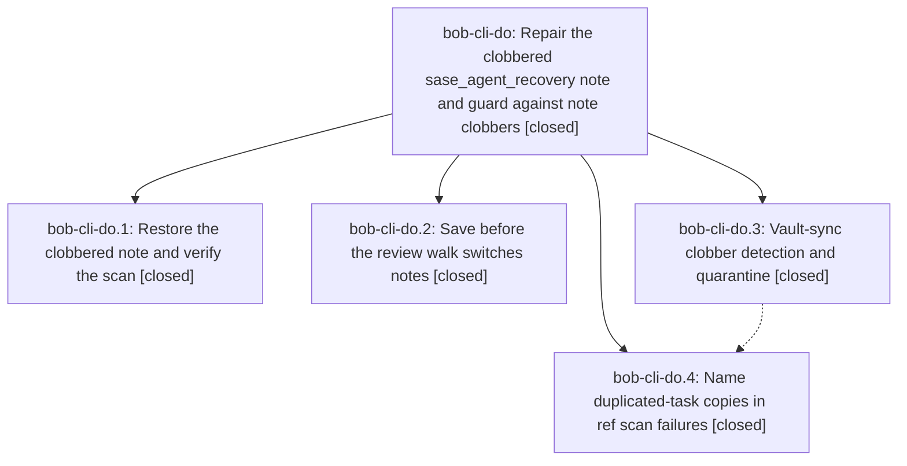

# Bead: bob-cli-do — Repair the clobbered sase\_agent\_recovery note and guard against note clobbers

[Bead Pages](../README.md) / bob-cli-do

**Status:** ✓ closed · **Resolution:** done · **Type:** ▸ plan · **Tier:** epic
**Owner:** `bryanbugyi34@gmail.com` · **Created by:** [bbugyi200.athena.157.f0](https://github.com/bobs-org/bob-cli--agents/blob/main/sessions/bbugyi200.athena.157.f0.md) · **Assignee:** `bob-cli-do.land`
**Created:** 2026-10-28 10:46:06 EDT · **Closed:** 2026-10-28 14:10:01 EDT
**Plan:** [202610/clobbered\_note\_repair\_and\_guards.md](https://github.com/bobs-org/bob-cli--plans/blob/main/202610/clobbered_note_repair_and_guards.md)

<!-- sase:links:start -->

## Links

| Relation | Artifact | Why |
| --- | --- | --- |
| implemented-by | [plan:202610/clobbered_note_repair_and_guards.md][1] | derived from the plan's `bead_id:` frontmatter field |
| related | file:explicit:8ba8616a472fa4e32615c8d9 | attached via sase artifact create --bead |
| related | file:explicit:bc73ed9db0392b2a41b250e4 | attached via sase artifact create --bead |
| related | file:explicit:d761a43e46d85b01f4fe2c1d | attached via sase artifact create --bead |

[1]: https://github.com/bobs-org/bob-cli--plans/blob/main/202610/clobbered_note_repair_and_guards.md

<!-- sase:links:end -->

## Description

`bob ref scan -w` runs clean on the MacBook again with the lost agent-recovery project restored; the review walk never leaves an unsaved plugin write behind when it switches notes; and any future whole-note clobber is caught by vault-sync and named plainly in bob's output instead of surfacing days later as cryptic ref-scan refusals.

## Notes

[2026-10-28T17:47:01Z · bob-cli-do.land] FOLLOW-UP TRIAGE completed before remaining-work tale: reviewed every note on do.1-do.4, both do.4 PROPOSED FOLLOW-UP entries, same-type and all-type duplicate searches, last-week task sweeps, and all 15 in-progress epic scopes. do.4 #1 (generated glossary drift): declined new task because causal rollout phase dl.8 already regenerated docs/reference/glossary.md in landed commit 03493169; independently reran just docs-check on 0f1898ee, all implemented gates pass (447 docs tests, one optional font-dependency skip). do.4 #2 (synthetic draft timing flake): corroborated existing bob-cli-ca with exact phase attribution and run IDs f9d3fb57f9ada3da1680791bcbf3d156/6dda6f4fd3b209fa1e6f3cff9e65b629, paired excess 517.54 ms and unchanged isolation/full-gate passes. SASE accepted +1 and reopened ca to READY; no duplicate task and no causal active epic found. Two newly reproduced quarantine defects are caused by do.3 and remain epic work, not follow-ups: first-five-ID candidate truncation misses the >=3 shared-ID signature, and clean post-restore status skips force-adding ignored quarantine files. A bounded tale will repair and close this epic. No parent_bead; epic-symbols currently empty.

[2026-10-28T17:48:50Z · bob-cli-do.land] LAND AUDIT: source/commit review covers bob-cli 16f3da48 (quarantine) and 0f1898ee (ref copy diagnostics), bob-plugins a182635 (save/tripwire), and vault repair d6f1a72dd via audited external checkout gh:bbugyi200/bob. Repair bytes exactly equal 8ca09ee75^; current note retains recovery identity and all 8 named stale mirror links are absent. Athena and Mac both scan 549 PDFs with 0 failures; sync status last_error=null on both. Mac plugins sync succeeded: all 22 files already current, resolving do.2 Mac-deploy note. Athena nav 2.56.5 and ledger 1.77.0 are deployed; a redundant nav sync refused protected uncommitted provenance, left untouched (no force). Plugin focused guard/review/unblocked tests 71/71 passed. Reviewed later bob-cli commits 8852f7bf/8f311dab/0a5f41b8/b8df2f48/03493169 and plugin 6c73e84/ff1a24c; no new direct note-switch bypass or shared Rust conflict. origin/master equals 0f1898ee after fetch. Fresh just docs-check passed all implemented gates. Remaining do.3 defects reproduced using current-source debug binary and wholly temporary repositories/remotes: file:explicit:bc73ed9db0392b2a41b250e4 (script), file:explicit:8ba8616a472fa4e32615c8d9 (results). (1) MAX_BLOCK_ID_GREP_NEEDLES=5 drops later-only z0/z1/z2 overlap when a0-a4 sort first, despite 100% displacement; no dry-run warning, while the three-ID control warns. (2) Ignoring _conflicts/ makes post-restore changed_paths empty, bypassing the force-add loop; sync exits 0 and records quarantined but neither copy nor log is committed/pushed. (3) Runbook copy-back-only false-positive instruction immediately re-triggers the same signature; needs durable acceptance guidance. No code edits in this landing; repair tale must run just check, finish closeout, and mark the original plan done. epic-symbols empty, no symvision recipe, no parent_bead.

[2026-10-28T18:10:01Z · bob-cli-do.land] Closeout repairs verified. Original work (lander audit): bob-cli 16f3da48 quarantine + 0f1898ee ref-copy diagnostics, bob-plugins a182635 save-before-switch + tripwires, vault d6f1a72dd restore byte-equal to 8ca09ee75^ with 8 stale mirrors removed; athena+Mac 549 PDFs 0 failures, Mac plugins sync 22/22 current, nav 2.56.5 + ledger 1.77.0 deployed. Later review: no drift after bob-cli 0f1898ee (HEAD==origin/master) or bob-plugins ff1a24c; redundant athena nav sync refused protected uncommitted provenance, left untouched. Repairs: (1) vault_clobber.rs removed MAX_BLOCK_ID_GREP_NEEDLES truncation; find_matching_note now runs one fixed-string git grep with -e per needle covering every new ID; (2) vault_sync.rs staging now drives force-add commit even when ordinary status is empty (ignored _conflicts/), preserving preflight/dry-run semantics; (3) docs/vault-git-sync.md replaces copy-back-only guidance with scoped accept-under-maintenance-lock procedure (copy, flock add+commit single note, sync), validated in temp repos incl. re-trigger demo + follow-up cycle with no repeat quarantine. Tests: new vault_sync_detects_clobber_when_shared_ids_sort_last + vault_sync_quarantine_with_ignored_conflicts_dir_commits_and_pushes pass with incident/dry-run/negatives (5/5), lib vault_clobber 8/8, just check green, just docs-check 447 passed 1 skipped. Follow-ups preserved: glossary drift resolved by rollout 03493169 (no new task); synthetic capture timing flake corroborated bob-cli-ca (+1, reopened READY, 517.54ms paired excess), no duplicate/active epic.

## Phases

| Bead | Title | Status | Size | Created | Agents | Commits |
|---|---|---|---|---|---:|---:|
| [bob-cli-do.1](bob-cli-do.1.md) | Restore the clobbered note and verify the scan | ✓ closed | small | 2026-10-28 | 1 | 0 |
| [bob-cli-do.2](bob-cli-do.2.md) | Save before the review walk switches notes | ✓ closed | medium | 2026-10-28 | 1 | 1 |
| [bob-cli-do.3](bob-cli-do.3.md) | Vault-sync clobber detection and quarantine | ✓ closed | medium | 2026-10-28 | 1 | 1 |
| [bob-cli-do.4](bob-cli-do.4.md) | Name duplicated-task copies in ref scan failures | ✓ closed | small | 2026-10-28 | 1 | 1 |

## Lineage

## Agents

| Agent | Bead | Commits |
|---|---|---:|
| [bbugyi200.athena.bob-cli-do.1](https://github.com/bobs-org/bob-cli--agents/blob/main/agents/bbugyi200.athena.bob-cli-do.1/README.md) | [bob-cli-do.1](bob-cli-do.1.md) | 0 |
| [bbugyi200.athena.bob-cli-do.2](https://github.com/bobs-org/bob-cli--agents/blob/main/agents/bbugyi200.athena.bob-cli-do.2/README.md) | [bob-cli-do.2](bob-cli-do.2.md) | 1 |
| [bbugyi200.athena.bob-cli-do.3](https://github.com/bobs-org/bob-cli--agents/blob/main/sessions/bbugyi200.athena.bob-cli-do.3.md) | [bob-cli-do.3](bob-cli-do.3.md) | 1 |
| [bbugyi200.athena.bob-cli-do.4](https://github.com/bobs-org/bob-cli--agents/blob/main/agents/bbugyi200.athena.bob-cli-do.4/README.md) | [bob-cli-do.4](bob-cli-do.4.md) | 1 |
| [bbugyi200.athena.bob-cli-do.land](https://github.com/bobs-org/bob-cli--agents/blob/main/sessions/bbugyi200.athena.bob-cli-do.land.md) | [bob-cli-do](README.md) | 1 |

## Commits

| Repo | Commit | Subject | Bead | Committed |
|---|---|---|---|---|
| bob-plugins | [`bob-plugins@a182635`](https://github.com/bobs-org/bob-plugins/commit/a1826356cbcbdbef67902d685ab481f61b45969e) | fix(navigation-hotkeys): guard same-pane note switches | [bob-cli-do.2](bob-cli-do.2.md) | 2026-10-28 11:08:46 EDT |
| bob-cli | [`16f3da4`](https://github.com/bobs-org/bob-cli/commit/16f3da48ac167002d29c7b0e1119fc4b0a97a125) | feat(vault-sync): quarantine displaced-plus-foreign-identity note clobbers | [bob-cli-do.3](bob-cli-do.3.md) | 2026-10-28 11:38:07 EDT |
| bob-cli | [`0f1898e`](https://github.com/bobs-org/bob-cli/commit/0f1898ee7b98a663ded6c0684af7ea6910248c86) | fix(ref): explain copied reading tasks in scan failures | [bob-cli-do.4](bob-cli-do.4.md) | 2026-10-28 13:30:25 EDT |
| bob-cli | [`792cc24`](https://github.com/bobs-org/bob-cli/commit/792cc2436f43136a228d53cb8ddb4b7110178d92) | fix(vault-sync): complete clobber-guard closeout quarantine | [bob-cli-do](README.md) | 2026-10-28 14:11:17 EDT |
