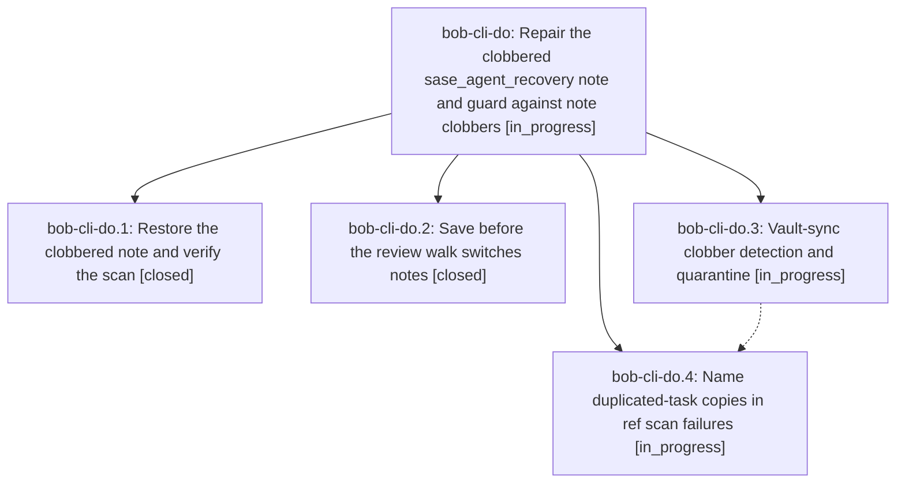

# Bead: bob-cli-do — Repair the clobbered sase\_agent\_recovery note and guard against note clobbers

[Bead Pages](../README.md) / bob-cli-do

**Status:** ◐ in_progress · **Type:** ▸ plan · **Tier:** epic
**Owner:** `bryanbugyi34@gmail.com` · **Created by:** [bbugyi200.athena.157.f0](https://github.com/bobs-org/bob-cli--agents/blob/main/sessions/bbugyi200.athena.157.f0.md) · **Assignee:** `bob-cli-do.land`
**Created:** 2026-10-28 10:46:06 EDT
**Plan:** [202610/clobbered\_note\_repair\_and\_guards.md](https://github.com/bobs-org/bob-cli--plans/blob/main/202610/clobbered_note_repair_and_guards.md)

## Description

`bob ref scan -w` runs clean on the MacBook again with the lost agent-recovery project restored; the review walk never leaves an unsaved plugin write behind when it switches notes; and any future whole-note clobber is caught by vault-sync and named plainly in bob's output instead of surfacing days later as cryptic ref-scan refusals.

## Phases

| Bead | Title | Status | Size | Created | Agents | Commits |
|---|---|---|---|---|---:|---:|
| [bob-cli-do.1](bob-cli-do.1.md) | Restore the clobbered note and verify the scan | ✓ closed | small | 2026-10-28 | 1 | 0 |
| [bob-cli-do.2](bob-cli-do.2.md) | Save before the review walk switches notes | ✓ closed | medium | 2026-10-28 | 1 | 1 |
| [bob-cli-do.3](bob-cli-do.3.md) | Vault-sync clobber detection and quarantine | ◐ in_progress | medium | 2026-10-28 | 1 | 0 |
| [bob-cli-do.4](bob-cli-do.4.md) | Name duplicated-task copies in ref scan failures | ◐ in_progress | small | 2026-10-28 | 1 | 0 |

## Lineage

## Agents

| Agent | Bead | Commits |
|---|---|---:|
| [bbugyi200.athena.bob-cli-do.1](https://github.com/bobs-org/bob-cli--agents/blob/main/agents/bbugyi200.athena.bob-cli-do.1/README.md) | [bob-cli-do.1](bob-cli-do.1.md) | 0 |
| [bbugyi200.athena.bob-cli-do.2](https://github.com/bobs-org/bob-cli--agents/blob/main/agents/bbugyi200.athena.bob-cli-do.2/README.md) | [bob-cli-do.2](bob-cli-do.2.md) | 1 |
| [bbugyi200.athena.bob-cli-do.3](https://github.com/bobs-org/bob-cli--agents/blob/main/agents/bbugyi200.athena.bob-cli-do.3/README.md) | [bob-cli-do.3](bob-cli-do.3.md) | 0 |
| [bbugyi200.athena.bob-cli-do.4](https://github.com/bobs-org/bob-cli--agents/blob/main/agents/bbugyi200.athena.bob-cli-do.4/README.md) | [bob-cli-do.4](bob-cli-do.4.md) | 0 |
| [bbugyi200.athena.bob-cli-do.land](https://github.com/bobs-org/bob-cli--agents/blob/main/agents/bbugyi200.athena.bob-cli-do.land/README.md) | [bob-cli-do](README.md) | 0 |

## Commits

| Repo | Commit | Subject | Bead | Committed |
|---|---|---|---|---|
| bob-plugins | [`bob-plugins@a182635`](https://github.com/bobs-org/bob-plugins/commit/a1826356cbcbdbef67902d685ab481f61b45969e) | fix(navigation-hotkeys): guard same-pane note switches | [bob-cli-do.2](bob-cli-do.2.md) | 2026-10-28 11:08:46 EDT |
