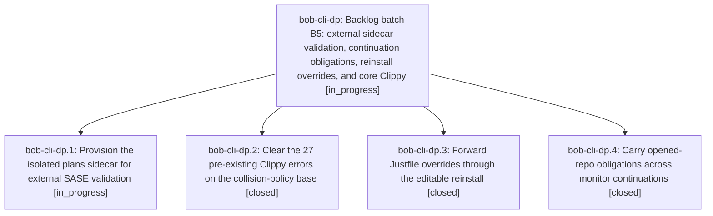

# Bead: bob-cli-dp — Backlog batch B5: external sidecar validation, continuation obligations, reinstall overrides, and core Clippy

[Bead Pages](../README.md) / bob-cli-dp

**Status:** ◐ in_progress · **Type:** ▸ plan · **Tier:** epic
**Owner:** `bryanbugyi34@gmail.com` · **Created by:** [bbugyi200.athena.bob-cli-df.land](https://github.com/bobs-org/bob-cli--agents/blob/main/sessions/bbugyi200.athena.bob-cli-df.land.md) · **Assignee:** `bob-cli-dp.land`
**Created:** 2026-10-28 11:23:29 EDT
**Plan:** [202610/backlog\_batch\_b5.md](https://github.com/bobs-org/bob-cli--plans/blob/main/202610/backlog_batch_b5.md)

<!-- sase:links:start -->

## Links

| Relation | Artifact | Why |
| --- | --- | --- |
| implemented-by | [plan:202610/backlog_batch_b5.md][1] | derived from the plan's `bead_id:` frontmatter field |

_Plus 1 automatic references — see [Referenced By](#referenced-by)._

[1]: https://github.com/bobs-org/bob-cli--plans/blob/main/202610/backlog_batch_b5.md

<!-- sase:links:end -->

## Description

Resolve bob-cli-dg, bob-cli-dh, bob-cli-di, and bob-cli-dn with reproducible verification, then continue the bounded backlog chain.

## Phases

| Bead | Title | Status | Size | Created | Agents | Commits |
|---|---|---|---|---|---:|---:|
| [bob-cli-dp.1](bob-cli-dp.1.md) | Provision the isolated plans sidecar for external SASE validation | ◐ in_progress | large | 2026-10-28 | 1 | 0 |
| [bob-cli-dp.2](bob-cli-dp.2.md) | Clear the 27 pre-existing Clippy errors on the collision-policy base | ✓ closed | medium | 2026-10-28 | 1 | 0 |
| [bob-cli-dp.3](bob-cli-dp.3.md) | Forward Justfile overrides through the editable reinstall | ✓ closed | medium | 2026-10-28 | 1 | 0 |
| [bob-cli-dp.4](bob-cli-dp.4.md) | Carry opened-repo obligations across monitor continuations | ✓ closed | large | 2026-10-28 | 1 | 0 |

## Lineage

## Agents

| Agent | Bead | Commits |
|---|---|---:|
| [bbugyi200.athena.bob-cli-dp.1](https://github.com/bobs-org/bob-cli--agents/blob/main/agents/bbugyi200.athena.bob-cli-dp.1/README.md) | [bob-cli-dp.1](bob-cli-dp.1.md) | 0 |
| [bbugyi200.athena.bob-cli-dp.2](https://github.com/bobs-org/bob-cli--agents/blob/main/sessions/bbugyi200.athena.bob-cli-dp.2.md) | [bob-cli-dp.2](bob-cli-dp.2.md) | 0 |
| [bbugyi200.athena.bob-cli-dp.3](https://github.com/bobs-org/bob-cli--agents/blob/main/agents/bbugyi200.athena.bob-cli-dp.3/README.md) | [bob-cli-dp.3](bob-cli-dp.3.md) | 0 |
| [bbugyi200.athena.bob-cli-dp.4](https://github.com/bobs-org/bob-cli--agents/blob/main/sessions/bbugyi200.athena.bob-cli-dp.4.md) | [bob-cli-dp.4](bob-cli-dp.4.md) | 0 |
| [bbugyi200.athena.bob-cli-dp.land](https://github.com/bobs-org/bob-cli--agents/blob/main/agents/bbugyi200.athena.bob-cli-dp.land/README.md) | [bob-cli-dp](README.md) | 0 |

<!-- sase:referenced-by:start -->

## Referenced By

| Relation | Artifact | Why | Uses |
| --- | --- | --- | ---: |
| read-by | [agent:bob-cli-dp.3][1] | Need epic DECISIONS and parent scope | 1 |

[1]: https://github.com/bobs-org/bob-cli--agents/blob/main/agents/bbugyi200.athena.bob-cli-dp.3/README.md

<!-- sase:referenced-by:end -->
