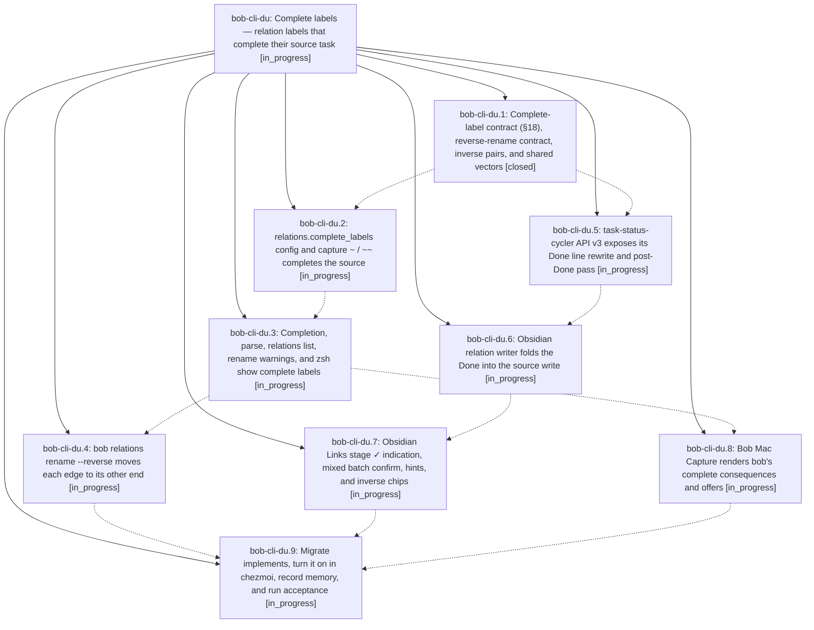

# Bead: bob-cli-du — Complete labels — relation labels that complete their source task

[Bead Pages](../README.md) / bob-cli-du

**Status:** ◐ in_progress · **Type:** ▸ plan · **Tier:** epic
**Owner:** `bryanbugyi34@gmail.com` · **Created by:** [bbugyi200.apollo.aw](https://github.com/bobs-org/bob-cli--agents/blob/main/sessions/bbugyi200.apollo.aw.md) · **Assignee:** `bob-cli-du.land`
**Created:** 2026-10-28 14:49:53 EDT
**Plan:** [202610/relation\_complete\_labels.md](https://github.com/bobs-org/bob-cli--plans/blob/main/202610/relation_complete_labels.md)

<!-- sase:links:start -->

## Links

| Relation | Artifact | Why |
| --- | --- | --- |
| implemented-by | [plan:202610/relation_complete_labels.md][1] | derived from the plan's `bead_id:` frontmatter field |

[1]: https://github.com/bobs-org/bob-cli--plans/blob/main/202610/relation_complete_labels.md

<!-- sase:links:end -->

## Description

Committing a relation whose label is listed in `relations.complete_labels` (starting with `implemented by` and `verified by`) marks the relation's source task Done in the same gesture, exactly as that surface's managed Done gesture would. Every surface names the task before commit (✓ plus words, `↵ link & complete`). Bryan's 14 `implements` links are reversed into `implemented by` by a new, previewed, revertable `bob relations rename --reverse` transaction.

## Phases

| Bead | Title | Status | Size | Created | Agents | Commits |
|---|---|---|---|---|---:|---:|
| [bob-cli-du.1](bob-cli-du.1.md) | Complete-label contract (§18), reverse-rename contract, inverse pairs, and shared vectors | ✓ closed | medium | 2026-10-28 | 1 | 1 |
| [bob-cli-du.2](bob-cli-du.2.md) | relations.complete\_labels config and capture ~ / ~~ completes the source | ◐ in_progress | large | 2026-10-28 | 1 | 0 |
| [bob-cli-du.3](bob-cli-du.3.md) | Completion, parse, relations list, rename warnings, and zsh show complete labels | ◐ in_progress | medium | 2026-10-28 | 1 | 0 |
| [bob-cli-du.4](bob-cli-du.4.md) | bob relations rename --reverse moves each edge to its other end | ◐ in_progress | large | 2026-10-28 | 1 | 0 |
| [bob-cli-du.5](bob-cli-du.5.md) | task-status-cycler API v3 exposes its Done line rewrite and post-Done pass | ◐ in_progress | medium | 2026-10-28 | 1 | 0 |
| [bob-cli-du.6](bob-cli-du.6.md) | Obsidian relation writer folds the Done into the source write | ◐ in_progress | large | 2026-10-28 | 1 | 0 |
| [bob-cli-du.7](bob-cli-du.7.md) | Obsidian Links stage ✓ indication, mixed batch confirm, hints, and inverse chips | ◐ in_progress | medium | 2026-10-28 | 1 | 0 |
| [bob-cli-du.8](bob-cli-du.8.md) | Bob Mac Capture renders bob's complete consequences and offers | ◐ in_progress | medium | 2026-10-28 | 1 | 0 |
| [bob-cli-du.9](bob-cli-du.9.md) | Migrate implements, turn it on in chezmoi, record memory, and run acceptance | ◐ in_progress | medium | 2026-10-28 | 1 | 0 |

## Lineage

## Agents

| Agent | Bead | Commits |
|---|---|---:|
| [bbugyi200.apollo.bob-cli-du.1](https://github.com/bobs-org/bob-cli--agents/blob/main/agents/bbugyi200.apollo.bob-cli-du.1/README.md) | [bob-cli-du.1](bob-cli-du.1.md) | 1 |
| [bbugyi200.apollo.bob-cli-du.2](https://github.com/bobs-org/bob-cli--agents/blob/main/agents/bbugyi200.apollo.bob-cli-du.2/README.md) | [bob-cli-du.2](bob-cli-du.2.md) | 0 |
| [bbugyi200.apollo.bob-cli-du.3](https://github.com/bobs-org/bob-cli--agents/blob/main/agents/bbugyi200.apollo.bob-cli-du.3/README.md) | [bob-cli-du.3](bob-cli-du.3.md) | 0 |
| [bbugyi200.apollo.bob-cli-du.4](https://github.com/bobs-org/bob-cli--agents/blob/main/agents/bbugyi200.apollo.bob-cli-du.4/README.md) | [bob-cli-du.4](bob-cli-du.4.md) | 0 |
| [bbugyi200.apollo.bob-cli-du.5](https://github.com/bobs-org/bob-cli--agents/blob/main/agents/bbugyi200.apollo.bob-cli-du.5/README.md) | [bob-cli-du.5](bob-cli-du.5.md) | 0 |
| [bbugyi200.apollo.bob-cli-du.6](https://github.com/bobs-org/bob-cli--agents/blob/main/agents/bbugyi200.apollo.bob-cli-du.6/README.md) | [bob-cli-du.6](bob-cli-du.6.md) | 0 |
| [bbugyi200.apollo.bob-cli-du.7](https://github.com/bobs-org/bob-cli--agents/blob/main/agents/bbugyi200.apollo.bob-cli-du.7/README.md) | [bob-cli-du.7](bob-cli-du.7.md) | 0 |
| [bbugyi200.apollo.bob-cli-du.8](https://github.com/bobs-org/bob-cli--agents/blob/main/agents/bbugyi200.apollo.bob-cli-du.8/README.md) | [bob-cli-du.8](bob-cli-du.8.md) | 0 |
| [bbugyi200.apollo.bob-cli-du.9](https://github.com/bobs-org/bob-cli--agents/blob/main/agents/bbugyi200.apollo.bob-cli-du.9/README.md) | [bob-cli-du.9](bob-cli-du.9.md) | 0 |
| [bbugyi200.apollo.bob-cli-du.land](https://github.com/bobs-org/bob-cli--agents/blob/main/agents/bbugyi200.apollo.bob-cli-du.land/README.md) | [bob-cli-du](README.md) | 0 |

## Commits

| Repo | Commit | Subject | Bead | Committed |
|---|---|---|---|---|
| bob-cli | [`847a3c5`](https://github.com/bobs-org/bob-cli/commit/847a3c5341ea70f00b4ca6f85c0d405cee8836fe) | feat(relations): add complete-label contract, reverse-rename, and shared vectors | [bob-cli-du.1](bob-cli-du.1.md) | 2026-10-28 15:13:07 EDT |
