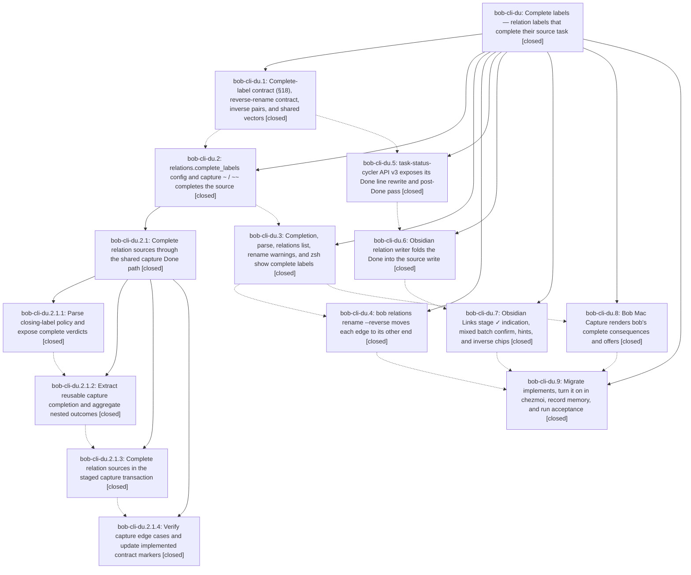

# Bead: bob-cli-du — Complete labels — relation labels that complete their source task

[Bead Pages](../README.md) / bob-cli-du

**Status:** ✓ closed · **Resolution:** done · **Type:** ▸ plan · **Tier:** epic
**Owner:** `bryanbugyi34@gmail.com` · **Created by:** [bbugyi200.apollo.aw](https://github.com/bobs-org/bob-cli--agents/blob/main/sessions/bbugyi200.apollo.aw.md) · **Assignee:** `bob-cli-du.land`
**Created:** 2026-10-28 14:49:53 EDT · **Closed:** 2026-10-28 22:56:36 EDT
**Plan:** [202610/relation\_complete\_labels.md](https://github.com/bobs-org/bob-cli--plans/blob/main/202610/relation_complete_labels.md)

<!-- sase:links:start -->

## Links

| Relation | Artifact | Why |
| --- | --- | --- |
| implemented-by | [plan:202610/relation_complete_labels.md][1] | derived from the plan's `bead_id:` frontmatter field |

_Plus 1 automatic references — see [Referenced By](#referenced-by)._

[1]: https://github.com/bobs-org/bob-cli--plans/blob/main/202610/relation_complete_labels.md

<!-- sase:links:end -->

## Description

Committing a relation whose label is listed in `relations.complete_labels` (starting with `implemented by` and `verified by`) marks the relation's source task Done in the same gesture, exactly as that surface's managed Done gesture would. Every surface names the task before commit (✓ plus words, `↵ link & complete`). Bryan's 14 `implements` links are reversed into `implemented by` by a new, previewed, revertable `bob relations rename --reverse` transaction.

## Notes

[2026-10-29T02:40:06Z · bob-cli-du.land] LAND FOLLOW-UP TRIAGE (bob-cli-du.land): (1) bob-cli-du.1 note #1 PROPOSED FOLLOW-UP (add 'Complete label' to docs/reference/glossary.md) — DECLINED, no task: that page is generated from the glossary memory web, so it needs a new strand, and the reviewer's decision authorizes only glossary:task-relation ('No other memory note may be edited'). That strand already names both closing-label status exceptions (387a4fc2; confirmed at rollout). Cancel labels have no standalone glossary term either, and filing a task would re-ask a question already decided. (2) bob-cli-du.6 note #1 PROPOSED FOLLOW-UP (cycler API v3 mismatch) — completeTaskLineText part ACCEPTED AS EPIC WORK: bob-plugins 160-plugin-completion.js returns a bare string and rewrites Cancelled and recurring lines to [x], but the shared tests/fixtures/relation_complete/vectors.json done section expects {ok, unchanged} for already-closed lines and {ok:false, reason:'recurring'} for recurring ones. The cycler vector test skips those 5 cases, which breaks the plan's 'Rust and JS pass every shared vector' acceptance. Fixed in the landing tale. finalizeClosedTasks part DECLINED: the shipped result {reopened, retired, recoveryFailures, retirementFailures, successors, successorNotice} is documented in docs/develop/plugin-apis.md and consumed by nav 597. The plan's {recovered, offered, picked} names were a sketch, and renaming them is churn with no behavior gain. (3) bob-cli-du.8's unverified Mac items: macOS CI run 40796512711 on 072055d passes Build (the app target compiles on macOS 26). Test fails only on the pre-existing CaptureRelationPanelTests refused-cancel badge expectation from c8c4366, which is not caused by this epic and is already tracked as bob-cli-dz (+1 recorded with this evidence). Light/dark screenshots were not captured. (4) Docs sweep left stale markers in docs/task-relations.md: §6 LR7 'RV10 planned, phase reverse-rename'; CP2 'live config rollout stays with the outer phases'; CP6 'planned (nav-complete-cue, mac-complete-cue)'; CP7 'capture fields implemented'. This is epic work, fixed in the landing tale. Integration drift reviewed: bob-cli non-epic commits 13b24303, ac13ab54, 74874cb5, 41cc4acc, 4005c613, 687375eb, 38f15d3e, 65413bd5 (task-theme capture writes only touch Pomodoro-link/EnsureNext items, which complete labels already refuse as item-action conflicts) and bob-plugins bc4e1b0, a2fd9f4, 5b20917, 1da19e9 (already folds the complete source by block id), and theme commits. No other integration changes are needed. epic-symbols: none. There is no symvision recipe.

[2026-10-29T02:56:36Z · bob-cli-du.land] Landing verified: all 9 phases (and child epic bob-cli-du.2.1) closed with evidence; bob-cli commits 847a3c53 a32a32fb 4c55a595 4be02241 87b6e608 d1f445ca 387a4fc2 cba7c47d 7d3ce705, bob-plugins 3c84ee3 7c088a5 7f42bb8 (+1da19e9 drift fix), bob-mac-capture 072055d, chezmoi 6a7ba18, vault migration 2c963688 reviewed. Landing tale: cycler api v3 completeTaskLineText now returns {ok, unchanged, lineText}/{ok:false, reason} and passes all 17 shared done vectors (already-closed unchanged, recurring and non-task refused) while Ctrl+Enter keeps byte-identical bytes; nav 597 consumes the object and fails safe; docs/task-relations.md LR7/CP2/CP6/CP7/CP8 markers swept. npm test 4134 pass, npm run docs:check passed (447 pass, 1 optional assets test skipped), bob plugins sync ok; just check and just docs-check green. Follow-ups: bob-cli-du.1 glossary proposal declined (memory not authorized; task-relation strand covers both exceptions); bob-cli-du.6 finalizeClosedTasks naming declined (shipped shape documented); Mac CI's only failure is pre-existing bob-cli-dz (+1 recorded). Integration drift since 847a3c53 reviewed; no other changes needed. epic-symbols none; no symvision recipe.

## Phases

| Bead | Title | Status | Size | Created | Agents | Commits |
|---|---|---|---|---|---:|---:|
| [bob-cli-du.1](bob-cli-du.1.md) | Complete-label contract (§18), reverse-rename contract, inverse pairs, and shared vectors | ✓ closed | medium | 2026-10-28 | 1 | 1 |
| [bob-cli-du.2](bob-cli-du.2.md) | relations.complete\_labels config and capture ~ / ~~ completes the source | ✓ closed | large | 2026-10-28 | 1 | 0 |
| [bob-cli-du.3](bob-cli-du.3.md) | Completion, parse, relations list, rename warnings, and zsh show complete labels | ✓ closed | medium | 2026-10-28 | 1 | 1 |
| [bob-cli-du.4](bob-cli-du.4.md) | bob relations rename --reverse moves each edge to its other end | ✓ closed | large | 2026-10-28 | 1 | 1 |
| [bob-cli-du.5](bob-cli-du.5.md) | task-status-cycler API v3 exposes its Done line rewrite and post-Done pass | ✓ closed | medium | 2026-10-28 | 1 | 1 |
| [bob-cli-du.6](bob-cli-du.6.md) | Obsidian relation writer folds the Done into the source write | ✓ closed | large | 2026-10-28 | 1 | 1 |
| [bob-cli-du.7](bob-cli-du.7.md) | Obsidian Links stage ✓ indication, mixed batch confirm, hints, and inverse chips | ✓ closed | medium | 2026-10-28 | 1 | 1 |
| [bob-cli-du.8](bob-cli-du.8.md) | Bob Mac Capture renders bob's complete consequences and offers | ✓ closed | medium | 2026-10-28 | 1 | 1 |
| [bob-cli-du.9](bob-cli-du.9.md) | Migrate implements, turn it on in chezmoi, record memory, and run acceptance | ✓ closed | medium | 2026-10-28 | 1 | 1 |

## Lineage

## Agents

| Agent | Bead | Commits |
|---|---|---:|
| [bbugyi200.apollo.bob-cli-du.1](https://github.com/bobs-org/bob-cli--agents/blob/main/agents/bbugyi200.apollo.bob-cli-du.1/README.md) | [bob-cli-du.1](bob-cli-du.1.md) | 1 |
| [bbugyi200.apollo.bob-cli-du.2](https://github.com/bobs-org/bob-cli--agents/blob/main/sessions/bbugyi200.apollo.bob-cli-du.2.md) | [bob-cli-du.2](bob-cli-du.2.md) | 0 |
| [bbugyi200.apollo.bob-cli-du.2.1.1](https://github.com/bobs-org/bob-cli--agents/blob/main/agents/bbugyi200.apollo.bob-cli-du.2.1.1/README.md) | [bob-cli-du.2.1.1](bob-cli-du.2.1.1.md) | 1 |
| [bbugyi200.apollo.bob-cli-du.2.1.2](https://github.com/bobs-org/bob-cli--agents/blob/main/agents/bbugyi200.apollo.bob-cli-du.2.1.2/README.md) | [bob-cli-du.2.1.2](bob-cli-du.2.1.2.md) | 1 |
| [bbugyi200.apollo.bob-cli-du.2.1.3](https://github.com/bobs-org/bob-cli--agents/blob/main/sessions/bbugyi200.apollo.bob-cli-du.2.1.3.md) | [bob-cli-du.2.1.3](bob-cli-du.2.1.3.md) | 1 |
| [bbugyi200.apollo.bob-cli-du.2.1.4](https://github.com/bobs-org/bob-cli--agents/blob/main/agents/bbugyi200.apollo.bob-cli-du.2.1.4/README.md) | [bob-cli-du.2.1.4](bob-cli-du.2.1.4.md) | 1 |
| [bbugyi200.apollo.bob-cli-du.2.1.land](https://github.com/bobs-org/bob-cli--agents/blob/main/sessions/bbugyi200.apollo.bob-cli-du.2.1.land.md) | [bob-cli-du.2.1](bob-cli-du.2.1.md) | 2 |
| [bbugyi200.apollo.bob-cli-du.3](https://github.com/bobs-org/bob-cli--agents/blob/main/agents/bbugyi200.apollo.bob-cli-du.3/README.md) | [bob-cli-du.3](bob-cli-du.3.md) | 1 |
| [bbugyi200.apollo.bob-cli-du.4](https://github.com/bobs-org/bob-cli--agents/blob/main/sessions/bbugyi200.apollo.bob-cli-du.4.md) | [bob-cli-du.4](bob-cli-du.4.md) | 1 |
| [bbugyi200.apollo.bob-cli-du.5](https://github.com/bobs-org/bob-cli--agents/blob/main/agents/bbugyi200.apollo.bob-cli-du.5/README.md) | [bob-cli-du.5](bob-cli-du.5.md) | 1 |
| [bbugyi200.apollo.bob-cli-du.6](https://github.com/bobs-org/bob-cli--agents/blob/main/sessions/bbugyi200.apollo.bob-cli-du.6.md) | [bob-cli-du.6](bob-cli-du.6.md) | 1 |
| [bbugyi200.apollo.bob-cli-du.7](https://github.com/bobs-org/bob-cli--agents/blob/main/agents/bbugyi200.apollo.bob-cli-du.7/README.md) | [bob-cli-du.7](bob-cli-du.7.md) | 1 |
| [bbugyi200.apollo.bob-cli-du.8](https://github.com/bobs-org/bob-cli--agents/blob/main/agents/bbugyi200.apollo.bob-cli-du.8/README.md) | [bob-cli-du.8](bob-cli-du.8.md) | 1 |
| [bbugyi200.apollo.bob-cli-du.9](https://github.com/bobs-org/bob-cli--agents/blob/main/sessions/bbugyi200.apollo.bob-cli-du.9.md) | [bob-cli-du.9](bob-cli-du.9.md) | 1 |
| [bbugyi200.apollo.bob-cli-du.land](https://github.com/bobs-org/bob-cli--agents/blob/main/sessions/bbugyi200.apollo.bob-cli-du.land.md) | [bob-cli-du](README.md) | 1 |

## Commits

| Repo | Commit | Subject | Bead | Committed |
|---|---|---|---|---|
| bob-cli | [`847a3c5`](https://github.com/bobs-org/bob-cli/commit/847a3c5341ea70f00b4ca6f85c0d405cee8836fe) | feat(relations): add complete-label contract, reverse-rename, and shared vectors | [bob-cli-du.1](bob-cli-du.1.md) | 2026-10-28 15:13:07 EDT |
| bob-plugins | [`bob-plugins@3c84ee3`](https://github.com/bobs-org/bob-plugins/commit/3c84ee3a2cb6cfcbc5dd2ba4a41e71a99dde21e7) | feat(task-status-cycler): expose Done line rewrite and post-Done pass as api v3 | [bob-cli-du.5](bob-cli-du.5.md) | 2026-10-28 15:39:19 EDT |
| bob-cli | [`a32a32f`](https://github.com/bobs-org/bob-cli/commit/a32a32fbe081506316174cb45333531055dffc50) | feat(relations): add complete-label policy and verdicts | [bob-cli-du.2.1.1](bob-cli-du.2.1.1.md) | 2026-10-28 15:49:37 EDT |
| bob-cli | [`4c55a59`](https://github.com/bobs-org/bob-cli/commit/4c55a595bfd6e6b025c4e053e3a16628a29e1d3b) | refactor(capture): extract shared task-complete completion path | [bob-cli-du.2.1.2](bob-cli-du.2.1.2.md) | 2026-10-28 16:24:52 EDT |
| bob-plugins | [`bob-plugins@7c088a5`](https://github.com/bobs-org/bob-plugins/commit/7c088a54a2127a922048fbddb7964dd9d55cc561) | feat(navigation): complete relation writer effects | [bob-cli-du.6](bob-cli-du.6.md) | 2026-10-28 16:37:37 EDT |
| bob-plugins | [`bob-plugins@7f42bb8`](https://github.com/bobs-org/bob-plugins/commit/7f42bb8234fd53e7da609a80cb3b73f67b94a0b0) | feat(navigation): show complete-label cues on the Links stage | [bob-cli-du.7](bob-cli-du.7.md) | 2026-10-28 17:12:22 EDT |
| bob-cli | [`4be0224`](https://github.com/bobs-org/bob-cli/commit/4be022419b9c07a62c9be7bb88f36bc5d120b4b5) | feat(capture): complete relation sources in the staged transaction | [bob-cli-du.2.1.3](bob-cli-du.2.1.3.md) | 2026-10-28 17:31:56 EDT |
| bob-cli | [`87b6e60`](https://github.com/bobs-org/bob-cli/commit/87b6e608912bdf1c9b37e9fdbe411e9ca3974d46) | feat(capture): add relations\_complete acceptance tests and update docs | [bob-cli-du.2.1.4](bob-cli-du.2.1.4.md) | 2026-10-28 18:02:36 EDT |
| bob-cli | [`d1f445c`](https://github.com/bobs-org/bob-cli/commit/d1f445cafc5b95a1181cf38f5ab7254ed49af872) | feat(capture): land complete-label closeout with edge grouping, scoped warnings, and acceptance | [bob-cli-du.2.1](bob-cli-du.2.1.md) | 2026-10-28 19:35:21 EDT |
| bob-cli--plans | [`bob-cli--plans@042236a`](https://github.com/bobs-org/bob-cli--plans/commit/042236a754219e29c8240ceedba27d3f949ca9e6) | docs(plans): mark complete\_label\_capture\_landing done | [bob-cli-du.2.1](bob-cli-du.2.1.md) | 2026-10-28 19:36:26 EDT |
| bob-cli | [`387a4fc`](https://github.com/bobs-org/bob-cli/commit/387a4fc2fad35d330754f4fca53dce08a78d7f67) | feat(relations): add complete-label CLI surfaces | [bob-cli-du.3](bob-cli-du.3.md) | 2026-10-28 20:03:55 EDT |
| bob-mac-capture | [`bob-mac-capture@072055d`](https://github.com/bobs-org/bob-mac-capture/commit/072055d01fea3f6e5e212b177f42f540d32f995b) | feat(mac-capture): render bob's complete-label consequences and offers | [bob-cli-du.8](bob-cli-du.8.md) | 2026-10-28 20:48:58 EDT |
| bob-cli | [`cba7c47`](https://github.com/bobs-org/bob-cli/commit/cba7c47dada6b0f409fc2b9c6ad72ecf05e97bb2) | feat(relations): reverse relation-label renames with previewed edge reversal | [bob-cli-du.4](bob-cli-du.4.md) | 2026-10-28 21:28:05 EDT |
| bob-cli | [`7d3ce70`](https://github.com/bobs-org/bob-cli/commit/7d3ce705618cb9be501abda82db15f30dc14e2c0) | docs(relations): mark complete-label nav support shipped | [bob-cli-du.9](bob-cli-du.9.md) | 2026-10-28 22:25:51 EDT |
| bob-cli | [`ce9f9e7`](https://github.com/bobs-org/bob-cli/commit/ce9f9e789877cc409a17bf8d0938841677e76155) | docs(relations): mark complete-label rollout shipped | [bob-cli-du](README.md) | 2026-10-28 22:57:38 EDT |

<!-- sase:referenced-by:start -->

## Referenced By

| Relation | Artifact | Why | Uses |
| --- | --- | --- | ---: |
| read-by | [agent:bob-cli-du.5][1] | need epic decisions and phase list | 1 |

[1]: https://github.com/bobs-org/bob-cli--agents/blob/main/agents/bbugyi200.apollo.bob-cli-du.5/README.md

<!-- sase:referenced-by:end -->
