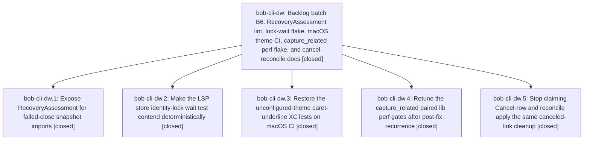

# Bead: bob-cli-dw — Backlog batch B6: RecoveryAssessment lint, lock-wait flake, macOS theme CI, capture\_related perf flake, and cancel-reconcile docs

[Bead Pages](../README.md) / bob-cli-dw

**Status:** ✓ closed · **Resolution:** done · **Type:** ▸ plan · **Tier:** epic
**Owner:** `bryanbugyi34@gmail.com` · **Created by:** [bbugyi200.athena.bob-cli-dp.land](https://github.com/bobs-org/bob-cli--agents/blob/main/sessions/bbugyi200.athena.bob-cli-dp.land.md) · **Assignee:** `bob-cli-dw.land`
**Created:** 2026-10-28 15:35:24 EDT · **Closed:** 2026-10-28 16:46:54 EDT
**Plan:** [202610/backlog\_batch\_b6.md](https://github.com/bobs-org/bob-cli--plans/blob/main/202610/backlog_batch_b6.md)

<!-- sase:links:start -->

## Links

| Relation | Artifact | Why |
| --- | --- | --- |
| implemented-by | [plan:202610/backlog_batch_b6.md][1] | derived from the plan's `bead_id:` frontmatter field |

_Plus 2 automatic references — see [Referenced By](#referenced-by)._

[1]: https://github.com/bobs-org/bob-cli--plans/blob/main/202610/backlog_batch_b6.md

<!-- sase:links:end -->

## Description

Resolve bob-cli-dt, bob-cli-dv, bob-cli-dr, bob-cli-ca, and bob-cli-dj with reproducible verification, then continue the bounded backlog chain.

## Notes

[2026-10-28T20:46:41Z · bob-cli-dw.land] FOLLOW-UP TRIAGE: (1) dw.1 #1, nine unused-public Symvision symbols in sase that the RecoveryAssessment private-import finding had masked: created bob-cli-dy (ci, small, ready, related to dt). (2) dw.1 #2, the bead_close() 10-arg TypeError in 24 failed-close recovery tests: declined. This is the intentional published sase-core-rs 0.42.7 fallback in an external sase checkout without an opened sase-core (bob-cli-di note #2); point SASE_CORE_DIR at an opened sase-core. Not a defect, and not caused by this epic. (3) dw.2 #1, the _RecoveryAssessment symvision failure: declined as a duplicate of bob-cli-dt, which dw.1 fixed and is now closed. (4) dw.3 #2, the bob-mac-capture c8c4366 refused-cancel row test (oneOff left on, expecting '1 link'): created bob-cli-dz (ci, small, ready, related to dr and bj). No in-progress epic owns it; the source tale relation_card_refused_cancel_rows is done. (5) dw.5--1 #2, capture_related draft gate at 569 ms vs 500 ms: declined. That workspace lacked dw.4's 3281de1f (750 ms ceiling), so it is the same issue as bob-cli-ca, now closed; the integrated master check a4d12b00 passed both gates.

[2026-10-28T20:46:54Z · bob-cli-dw.land] Verified all five phases against source and commits. dw.1: sase 196690f6cb makes RecoveryAssessment public and updates its consumers; the private-import symvision finding is gone; bob-cli-dt closed. dw.2: sase 9800057140 adds a FAKE_CARGO_RELEASE handshake so the lock wait is deterministic. The lander fixed a regression in it: the waiter lost FAKE_CARGO_COUNTER, so a waiter rebuild went undetected. A mutation test proved the gap, and the fix is committed with this landing. Fixed node: 3/3 serial, 8/8 concurrent, 2/2 xdist; bob-cli-dv closed. dw.3: no code needed; bob-mac-capture 2c3407d is green on macOS 26 run 40746228778 (3265 tests, 0 failures, Bundle, launch, and install ran), and both caret tests still pass on master c8c4366; bob-cli-dr closed. dw.4: bob-cli 3281de1f raises the paired-excess ceiling to 750 ms and keeps the paired-baseline design; bob-cli-ca closed. dw.5: bob-cli e998ee4e fixes the docs/projects.md parity claim; task-status-hooks.md was already correct (52bff016); bob-cli-dj closed. Integration: reviewed bob-cli commits since 15:35 (847a3c53, a32a32fb, 9409bfa5: complete-label and themes) and sase commits (564bdcdcb9, 2cf68a0d4b). No conflict or duplication; task-relations section 17 states the immediate semantics with no parity claim; no _RecoveryAssessment users remain. Gates: bob-cli sase tool run check a4d12b00c5e8ea754c1d3cbe53210e11 succeeded on integrated master e998ee4e. sase governed check 3b58ef8e passes fmt, ruff, and mypy; it fails only on the pre-existing symvision set filed as bob-cli-dy. Follow-ups: created bob-cli-dy and bob-cli-dz; declined dw.1 #2 (intentional published-core fallback, see bob-cli-di), dw.2 #1 (duplicate of dt, fixed), and dw.5--1 #2 (tree lacked 3281de1f; same as ca). Plans hygiene: removed stale duplicate 'status: wip' keys from closed epics 2k, 4q, and 7k. epic-symbols: none.

[2026-10-28T20:51:44Z · bob-cli-dw.land] SUCCESSOR RULE NOT EXECUTED IN THIS TURN: the B6 plan asks the lander to /sase_plan-propose the next backlog epic as its final action. The lander found that every earlier chained lander's plan 'status: done' edit was lost (backlog_batch_a1, b2-b5 all status: wip despite closed epics d7/da/dd/df/dp), consistent with a plan-propose handoff never committing the proposer's dirty edits. This turn holds a sase test fix (dv coverage regression) and nine plans-sidecar edits, so it ends with a final declaration to commit them, and the B7 successor proposal is deferred. Filed bob-cli-e0 (bug, large, ready, related to dn). Hand-fixed plan status for a1/b2/b3/b4/b5/b6. To resume the chain: launch a fresh agent to author B7 by the successor rule in plan:202610/backlog_batch_b6.md (new ready tasks include dx, dy, dz, e0, dq, ds), or have that agent propose only from a clean tree.

## Phases

| Bead | Title | Status | Size | Created | Agents | Commits |
|---|---|---|---|---|---:|---:|
| [bob-cli-dw.1](bob-cli-dw.1.md) | Expose RecoveryAssessment for failed-close snapshot imports | ✓ closed | small | 2026-10-28 | 1 | 0 |
| [bob-cli-dw.2](bob-cli-dw.2.md) | Make the LSP store identity-lock wait test contend deterministically | ✓ closed | small | 2026-10-28 | 1 | 0 |
| [bob-cli-dw.3](bob-cli-dw.3.md) | Restore the unconfigured-theme caret-underline XCTests on macOS CI | ✓ closed | large | 2026-10-28 | 1 | 0 |
| [bob-cli-dw.4](bob-cli-dw.4.md) | Retune the capture\_related paired lib perf gates after post-fix recurrence | ✓ closed | small | 2026-10-28 | 1 | 1 |
| [bob-cli-dw.5](bob-cli-dw.5.md) | Stop claiming Cancel-row and reconcile apply the same canceled-link cleanup | ✓ closed | small | 2026-10-28 | 1 | 1 |

## Lineage

## Agents

| Agent | Bead | Commits |
|---|---|---:|
| [bbugyi200.athena.bob-cli-dw.1](https://github.com/bobs-org/bob-cli--agents/blob/main/agents/bbugyi200.athena.bob-cli-dw.1/README.md) | [bob-cli-dw.1](bob-cli-dw.1.md) | 0 |
| [bbugyi200.athena.bob-cli-dw.2](https://github.com/bobs-org/bob-cli--agents/blob/main/agents/bbugyi200.athena.bob-cli-dw.2/README.md) | [bob-cli-dw.2](bob-cli-dw.2.md) | 0 |
| [bbugyi200.athena.bob-cli-dw.3](https://github.com/bobs-org/bob-cli--agents/blob/main/sessions/bbugyi200.athena.bob-cli-dw.3.md) | [bob-cli-dw.3](bob-cli-dw.3.md) | 0 |
| [bbugyi200.athena.bob-cli-dw.4](https://github.com/bobs-org/bob-cli--agents/blob/main/agents/bbugyi200.athena.bob-cli-dw.4/README.md) | [bob-cli-dw.4](bob-cli-dw.4.md) | 1 |
| [bbugyi200.athena.bob-cli-dw.5](https://github.com/bobs-org/bob-cli--agents/blob/main/sessions/bbugyi200.athena.bob-cli-dw.5.md) | [bob-cli-dw.5](bob-cli-dw.5.md) | 1 |
| [bbugyi200.athena.bob-cli-dw.land](https://github.com/bobs-org/bob-cli--agents/blob/main/agents/bbugyi200.athena.bob-cli-dw.land/README.md) | [bob-cli-dw](README.md) | 1 |

## Commits

| Repo | Commit | Subject | Bead | Committed |
|---|---|---|---|---|
| bob-cli | [`3281de1`](https://github.com/bobs-org/bob-cli/commit/3281de1fc2efe47dc987db741772e7436e959805) | test(capture-related): relax paired perf ceiling | [bob-cli-dw.4](bob-cli-dw.4.md) | 2026-10-28 15:50:07 EDT |
| bob-cli | [`e998ee4`](https://github.com/bobs-org/bob-cli/commit/e998ee4e649b7673c47f57fd599113ead51e583c) | docs(projects): distinguish cancel-row prune from reconcile cleanup | [bob-cli-dw.5](bob-cli-dw.5.md) | 2026-10-28 16:06:15 EDT |
| bob-cli--plans | [`bob-cli--plans@98fc47f`](https://github.com/bobs-org/bob-cli--plans/commit/98fc47fb487b47f7478ae87fbf420c1357a6a135) | chore(plans): mark landed backlog-batch plans done and drop duplicate status keys | [bob-cli-dw](README.md) | 2026-10-28 16:54:17 EDT |

<!-- sase:referenced-by:start -->

## Referenced By

| Relation | Artifact | Why | Uses |
| --- | --- | --- | ---: |
| read-by | [agent:bob-cli-dw.2][1] | Need epic DECISIONS and plan context | 1 |
| read-by | [agent:bob-cli-dw.5--1][2] | Need epic DECISIONS and whether capture_related flake is tracked | 1 |

[1]: https://github.com/bobs-org/bob-cli--agents/blob/main/agents/bbugyi200.athena.bob-cli-dw.2/README.md
[2]: https://github.com/bobs-org/bob-cli--agents/blob/main/sessions/bbugyi200.athena.bob-cli-dw.5.md

<!-- sase:referenced-by:end -->
