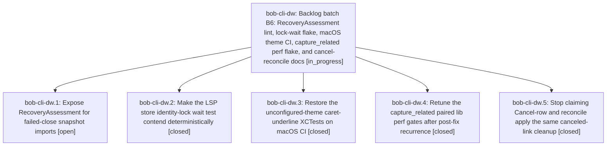

# Bead: bob-cli-dw — Backlog batch B6: RecoveryAssessment lint, lock-wait flake, macOS theme CI, capture\_related perf flake, and cancel-reconcile docs

[Bead Pages](../README.md) / bob-cli-dw

**Status:** ◐ in_progress · **Type:** ▸ plan · **Tier:** epic
**Owner:** `bryanbugyi34@gmail.com` · **Created by:** [bbugyi200.athena.bob-cli-dp.land](https://github.com/bobs-org/bob-cli--agents/blob/main/sessions/bbugyi200.athena.bob-cli-dp.land.md) · **Assignee:** `bob-cli-dw.land`
**Created:** 2026-10-28 15:35:24 EDT
**Plan:** [202610/backlog\_batch\_b6.md](https://github.com/bobs-org/bob-cli--plans/blob/main/202610/backlog_batch_b6.md)

## Description

Resolve bob-cli-dt, bob-cli-dv, bob-cli-dr, bob-cli-ca, and bob-cli-dj with reproducible verification, then continue the bounded backlog chain.

## Phases

| Bead | Title | Status | Size | Created | Agents | Commits |
|---|---|---|---|---|---:|---:|
| [bob-cli-dw.1](bob-cli-dw.1.md) | Expose RecoveryAssessment for failed-close snapshot imports | ○ open | small | 2026-10-28 | 1 | 0 |
| [bob-cli-dw.2](bob-cli-dw.2.md) | Make the LSP store identity-lock wait test contend deterministically | ✓ closed | small | 2026-10-28 | 1 | 0 |
| [bob-cli-dw.3](bob-cli-dw.3.md) | Restore the unconfigured-theme caret-underline XCTests on macOS CI | ✓ closed | large | 2026-10-28 | 1 | 0 |
| [bob-cli-dw.4](bob-cli-dw.4.md) | Retune the capture\_related paired lib perf gates after post-fix recurrence | ✓ closed | small | 2026-10-28 | 1 | 0 |
| [bob-cli-dw.5](bob-cli-dw.5.md) | Stop claiming Cancel-row and reconcile apply the same canceled-link cleanup | ✓ closed | small | 2026-10-28 | 1 | 0 |

## Lineage

## Agents

| Agent | Bead | Commits |
|---|---|---:|
| [bbugyi200.athena.bob-cli-dw.1](https://github.com/bobs-org/bob-cli--agents/blob/main/agents/bbugyi200.athena.bob-cli-dw.1/README.md) | [bob-cli-dw.1](bob-cli-dw.1.md) | 0 |
| [bbugyi200.athena.bob-cli-dw.2](https://github.com/bobs-org/bob-cli--agents/blob/main/agents/bbugyi200.athena.bob-cli-dw.2/README.md) | [bob-cli-dw.2](bob-cli-dw.2.md) | 0 |
| [bbugyi200.athena.bob-cli-dw.3](https://github.com/bobs-org/bob-cli--agents/blob/main/sessions/bbugyi200.athena.bob-cli-dw.3.md) | [bob-cli-dw.3](bob-cli-dw.3.md) | 0 |
| [bbugyi200.athena.bob-cli-dw.4](https://github.com/bobs-org/bob-cli--agents/blob/main/agents/bbugyi200.athena.bob-cli-dw.4/README.md) | [bob-cli-dw.4](bob-cli-dw.4.md) | 0 |
| [bbugyi200.athena.bob-cli-dw.5](https://github.com/bobs-org/bob-cli--agents/blob/main/sessions/bbugyi200.athena.bob-cli-dw.5.md) | [bob-cli-dw.5](bob-cli-dw.5.md) | 0 |
| [bbugyi200.athena.bob-cli-dw.land](https://github.com/bobs-org/bob-cli--agents/blob/main/agents/bbugyi200.athena.bob-cli-dw.land/README.md) | [bob-cli-dw](README.md) | 0 |
