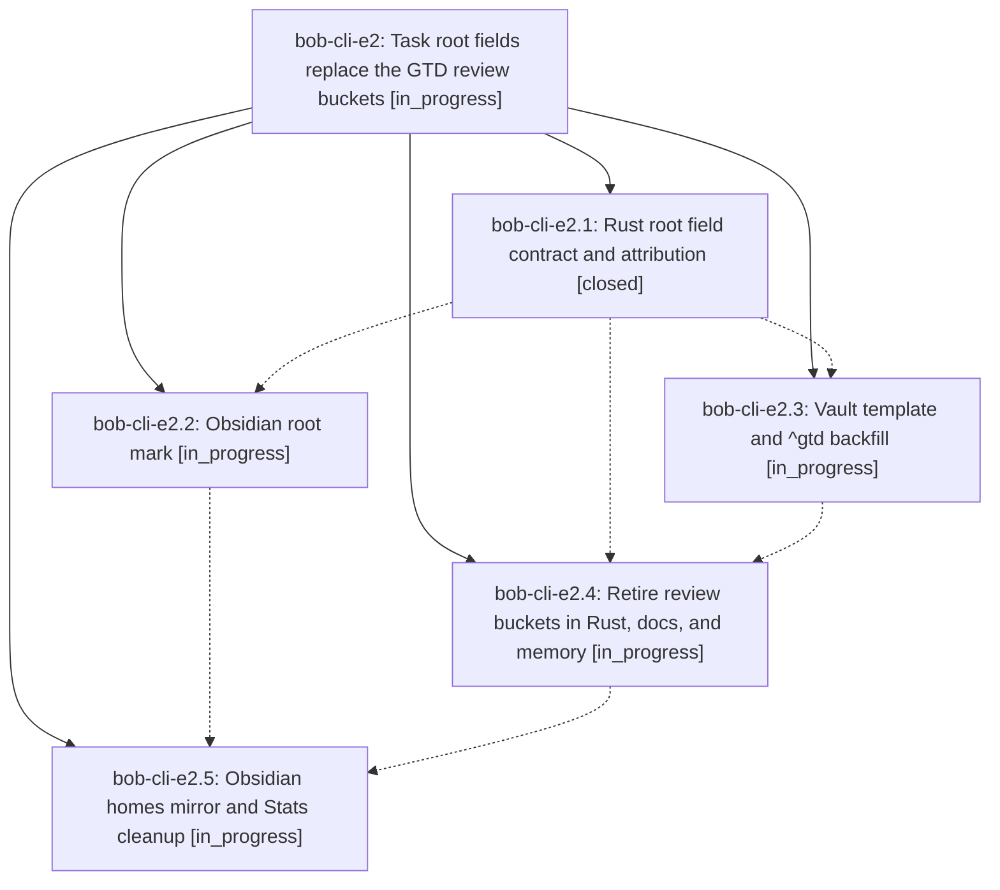

# Bead: bob-cli-e2 — Task root fields replace the GTD review buckets

[Bead Pages](../README.md) / bob-cli-e2

**Status:** ◐ in_progress · **Type:** ▸ plan · **Tier:** epic
**Owner:** `bryanbugyi34@gmail.com` · **Created by:** [bbugyi200.athena.15o](https://github.com/bobs-org/bob-cli--agents/blob/main/sessions/bbugyi200.athena.15o.md) · **Assignee:** `bob-cli-e2.land`
**Created:** 2026-10-28 22:26:42 EDT
**Plan:** [202610/task\_root\_fields.md](https://github.com/bobs-org/bob-cli--plans/blob/main/202610/task_root_fields.md)

<!-- sase:links:start -->

## Links

| Relation | Artifact | Why |
| --- | --- | --- |
| implemented-by | [plan:202610/task_root_fields.md][1] | derived from the plan's `bead_id:` frontmatter field |

[1]: https://github.com/bobs-org/bob-cli--plans/blob/main/202610/task_root_fields.md

<!-- sase:links:end -->

## Description

A task can name its root parent with `[root:: NOTE]`, rendered in Obsidian as a calm hue-dot place mark. Every daily `^gtd` task carries `[root:: gtd_daily]`, so morning review time is attributed through Task Links exactly like all other work. The `@daily` "GTD" bucket, the `@review:<NAME>` "PLAN review" buckets, review sessions, and the "daily review" theme step are gone from Rust, the Obsidian mirror, docs, and memory.

## Phases

| Bead | Title | Status | Size | Created | Agents | Commits |
|---|---|---|---|---|---:|---:|
| [bob-cli-e2.1](bob-cli-e2.1.md) | Rust root field contract and attribution | ✓ closed | medium | 2026-10-28 | 1 | 1 |
| [bob-cli-e2.2](bob-cli-e2.2.md) | Obsidian root mark | ◐ in_progress | medium | 2026-10-28 | 1 | 0 |
| [bob-cli-e2.3](bob-cli-e2.3.md) | Vault template and ^gtd backfill | ◐ in_progress | small | 2026-10-28 | 1 | 0 |
| [bob-cli-e2.4](bob-cli-e2.4.md) | Retire review buckets in Rust, docs, and memory | ◐ in_progress | medium | 2026-10-28 | 1 | 0 |
| [bob-cli-e2.5](bob-cli-e2.5.md) | Obsidian homes mirror and Stats cleanup | ◐ in_progress | medium | 2026-10-28 | 1 | 0 |

## Lineage

## Agents

| Agent | Bead | Commits |
|---|---|---:|
| [bbugyi200.athena.bob-cli-e2.1](https://github.com/bobs-org/bob-cli--agents/blob/main/agents/bbugyi200.athena.bob-cli-e2.1/README.md) | [bob-cli-e2.1](bob-cli-e2.1.md) | 1 |
| [bbugyi200.athena.bob-cli-e2.2](https://github.com/bobs-org/bob-cli--agents/blob/main/agents/bbugyi200.athena.bob-cli-e2.2/README.md) | [bob-cli-e2.2](bob-cli-e2.2.md) | 0 |
| [bbugyi200.athena.bob-cli-e2.3](https://github.com/bobs-org/bob-cli--agents/blob/main/agents/bbugyi200.athena.bob-cli-e2.3/README.md) | [bob-cli-e2.3](bob-cli-e2.3.md) | 0 |
| [bbugyi200.athena.bob-cli-e2.4](https://github.com/bobs-org/bob-cli--agents/blob/main/agents/bbugyi200.athena.bob-cli-e2.4/README.md) | [bob-cli-e2.4](bob-cli-e2.4.md) | 0 |
| [bbugyi200.athena.bob-cli-e2.5](https://github.com/bobs-org/bob-cli--agents/blob/main/agents/bbugyi200.athena.bob-cli-e2.5/README.md) | [bob-cli-e2.5](bob-cli-e2.5.md) | 0 |
| [bbugyi200.athena.bob-cli-e2.land](https://github.com/bobs-org/bob-cli--agents/blob/main/agents/bbugyi200.athena.bob-cli-e2.land/README.md) | [bob-cli-e2](README.md) | 0 |

## Commits

| Repo | Commit | Subject | Bead | Committed |
|---|---|---|---|---|
| bob-cli | [`818b875`](https://github.com/bobs-org/bob-cli/commit/818b875556cd20643a319cae39070611d073f7c4) | feat(homes): add \[root::\] field for as-if-residence attribution | [bob-cli-e2.1](bob-cli-e2.1.md) | 2026-10-28 23:12:54 EDT |
