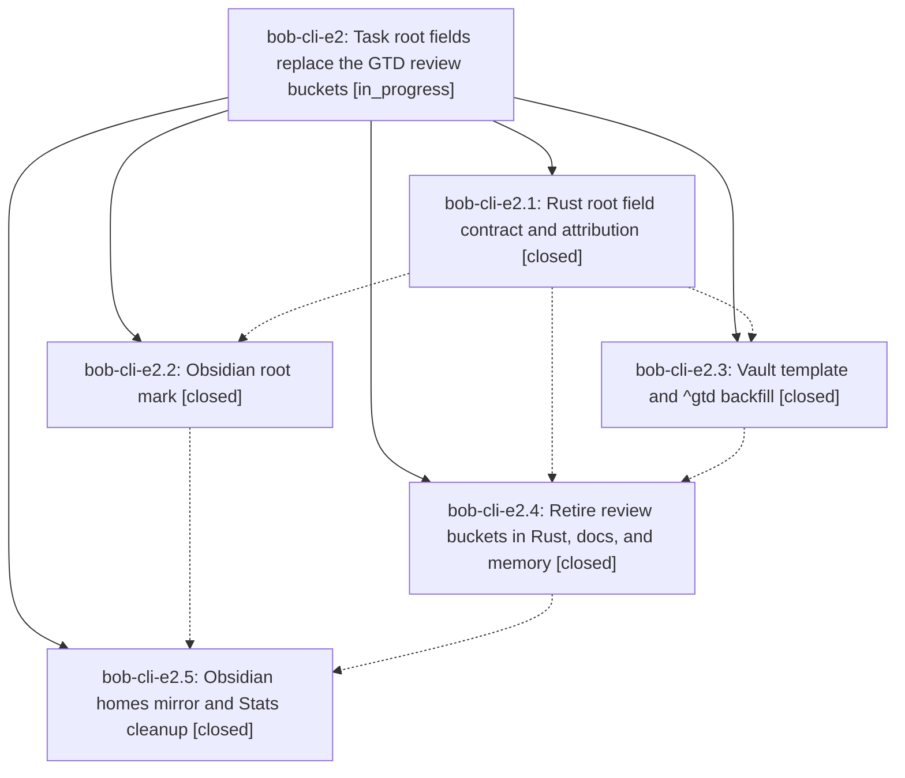

# Bead: bob-cli-e2 — Task root fields replace the GTD review buckets

[Bead Pages](../README.md) / bob-cli-e2

**Status:** ◐ in_progress · **Type:** ▸ plan · **Tier:** epic
**Owner:** `bryanbugyi34@gmail.com` · **Created by:** [bbugyi200.athena.15o](https://github.com/bobs-org/bob-cli--agents/blob/main/sessions/bbugyi200.athena.15o.md) · **Assignee:** `bob-cli-e2.land`
**Created:** 2026-10-28 22:26:42 EDT
**Plan:** [202610/task\_root\_fields.md](https://github.com/bobs-org/bob-cli--plans/blob/main/202610/task_root_fields.md)

<!-- sase:links:start -->

## Links

| Relation | Artifact | Why |
| --- | --- | --- |
| implemented-by | [plan:202610/task_root_fields.md][1] | derived from the plan's `bead_id:` frontmatter field |

[1]: https://github.com/bobs-org/bob-cli--plans/blob/main/202610/task_root_fields.md

<!-- sase:links:end -->

## Description

A task can name its root parent with `[root:: NOTE]`, rendered in Obsidian as a calm hue-dot place mark. Every daily `^gtd` task carries `[root:: gtd_daily]`, so morning review time is attributed through Task Links exactly like all other work. The `@daily` "GTD" bucket, the `@review:<NAME>` "PLAN review" buckets, review sessions, and the "daily review" theme step are gone from Rust, the Obsidian mirror, docs, and memory.

## Notes

[2026-10-29T04:28:35Z · bob-cli-dm.7.1.land] DISCOVERED ISSUE: dm.7.1 land independently reproduced the generated glossary drift proposed by bob-cli-dm.7.1.3 note #1 and bob-cli-dm.7.1.4 note #1. On clean bob-cli 8b4d1b89 and bob-plugins 21f2a0e, BOB_DOCS_BOB_PLUGINS_DIR pointing to the opened plugin checkout uv run --project tools/docs bob-docs gen --check exits 1: Plugin documentation inventory is up to date; out of date: docs/reference/glossary.md (run just docs-gen). Commit 8b4d1b89 belongs to bob-cli-e2.2 and changes only glossary/root-parent.md without regenerating its docs page. e2.4 owns remaining docs/memory retirement; regenerate the glossary with the finished root contract and verify docs-check. Same-type/all-type searches and last-week task sweep found no matching live task; routed to this causally responsible active epic instead of creating a duplicate task.

## Phases

| Bead | Title | Status | Size | Created | Agents | Commits |
|---|---|---|---|---|---:|---:|
| [bob-cli-e2.1](bob-cli-e2.1.md) | Rust root field contract and attribution | ✓ closed | medium | 2026-10-28 | 1 | 1 |
| [bob-cli-e2.2](bob-cli-e2.2.md) | Obsidian root mark | ✓ closed | medium | 2026-10-28 | 1 | 2 |
| [bob-cli-e2.3](bob-cli-e2.3.md) | Vault template and ^gtd backfill | ✓ closed | small | 2026-10-28 | 1 | 0 |
| [bob-cli-e2.4](bob-cli-e2.4.md) | Retire review buckets in Rust, docs, and memory | ✓ closed | medium | 2026-10-28 | 1 | 1 |
| [bob-cli-e2.5](bob-cli-e2.5.md) | Obsidian homes mirror and Stats cleanup | ✓ closed | medium | 2026-10-28 | 1 | 2 |

## Lineage

## Agents

| Agent | Bead | Commits |
|---|---|---:|
| [bbugyi200.athena.bob-cli-e2.1](https://github.com/bobs-org/bob-cli--agents/blob/main/agents/bbugyi200.athena.bob-cli-e2.1/README.md) | [bob-cli-e2.1](bob-cli-e2.1.md) | 1 |
| [bbugyi200.athena.bob-cli-e2.2](https://github.com/bobs-org/bob-cli--agents/blob/main/agents/bbugyi200.athena.bob-cli-e2.2/README.md) | [bob-cli-e2.2](bob-cli-e2.2.md) | 2 |
| [bbugyi200.athena.bob-cli-e2.3](https://github.com/bobs-org/bob-cli--agents/blob/main/agents/bbugyi200.athena.bob-cli-e2.3/README.md) | [bob-cli-e2.3](bob-cli-e2.3.md) | 0 |
| [bbugyi200.athena.bob-cli-e2.4](https://github.com/bobs-org/bob-cli--agents/blob/main/agents/bbugyi200.athena.bob-cli-e2.4/README.md) | [bob-cli-e2.4](bob-cli-e2.4.md) | 1 |
| [bbugyi200.athena.bob-cli-e2.5](https://github.com/bobs-org/bob-cli--agents/blob/main/sessions/bbugyi200.athena.bob-cli-e2.5.md) | [bob-cli-e2.5](bob-cli-e2.5.md) | 2 |
| [bbugyi200.athena.bob-cli-e2.land](https://github.com/bobs-org/bob-cli--agents/blob/main/agents/bbugyi200.athena.bob-cli-e2.land/README.md) | [bob-cli-e2](README.md) | 0 |

## Commits

| Repo | Commit | Subject | Bead | Committed |
|---|---|---|---|---|
| bob-cli | [`818b875`](https://github.com/bobs-org/bob-cli/commit/818b875556cd20643a319cae39070611d073f7c4) | feat(homes): add \[root::\] field for as-if-residence attribution | [bob-cli-e2.1](bob-cli-e2.1.md) | 2026-10-28 23:12:54 EDT |
| bob-cli | [`8b4d1b8`](https://github.com/bobs-org/bob-cli/commit/8b4d1b89a3141d1abd92baa2530af5ea93f9685b) | docs(memory): update root parent glossary for root fields | [bob-cli-e2.2](bob-cli-e2.2.md) | 2026-10-28 23:45:36 EDT |
| bob-plugins | [`bob-plugins@0fb4b92`](https://github.com/bobs-org/bob-plugins/commit/0fb4b92330bf136f3ec8fc36dde683fbcf242974) | feat(ledger-tools): render task root marks across views | [bob-cli-e2.2](bob-cli-e2.2.md) | 2026-10-28 23:53:01 EDT |
| bob-cli | [`511c7ad`](https://github.com/bobs-org/bob-cli/commit/511c7ad7b9e2a9d418b15ba5522d483c948a46f1) | feat!: retire GTD review buckets | [bob-cli-e2.4](bob-cli-e2.4.md) | 2026-10-29 00:37:34 EDT |
| bob-cli | [`48da763`](https://github.com/bobs-org/bob-cli/commit/48da7636e7eed1f32161fa039aa99b80b614b015) | docs: regenerate root parent glossary | [bob-cli-e2.5](bob-cli-e2.5.md) | 2026-10-29 01:28:29 EDT |
| bob-plugins | [`bob-plugins@06cda80`](https://github.com/bobs-org/bob-plugins/commit/06cda805dd71310c46f047ad50c514ede221b51b) | feat(plugins)!: mirror root fields and retire review buckets | [bob-cli-e2.5](bob-cli-e2.5.md) | 2026-10-29 01:30:00 EDT |
