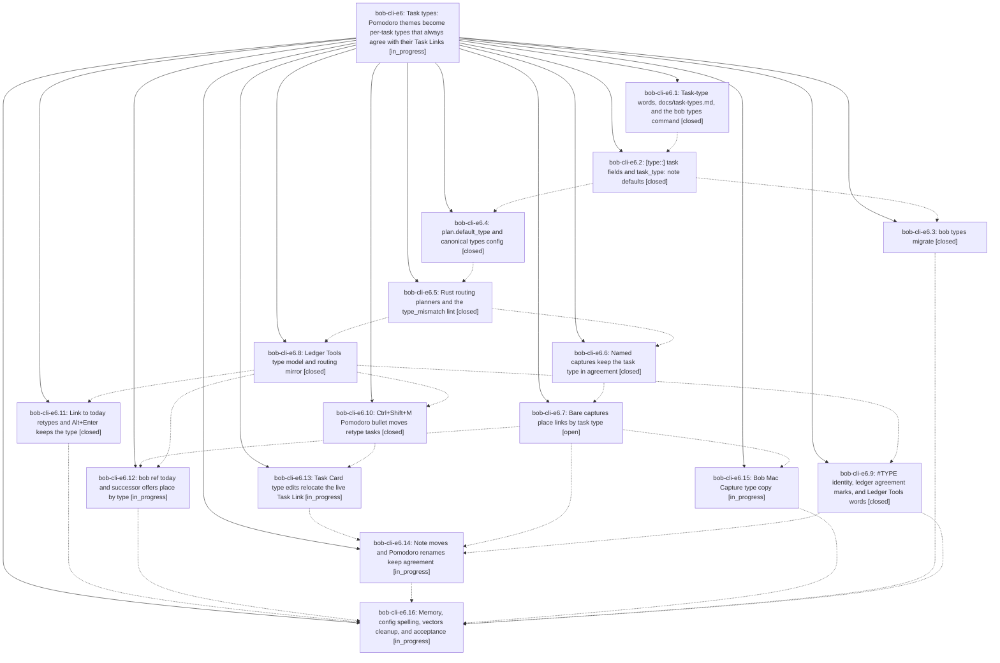

# Bead: bob-cli-e6 — Task types: Pomodoro themes become per-task types that always agree with their Task Links

[Bead Pages](../README.md) / bob-cli-e6

**Status:** ◐ in_progress · **Type:** ▸ plan · **Tier:** epic
**Owner:** `bryanbugyi34@gmail.com` · **Created by:** [bbugyi200.apollo.research.2t.linker.w0](https://github.com/bobs-org/bob-cli--agents/blob/main/sessions/bbugyi200.apollo.research.2t.linker.w0.md) · **Assignee:** `bob-cli-e6.land`
**Created:** 2026-10-29 16:16:33 EDT
**Plan:** [202610/task\_types.md](https://github.com/bobs-org/bob-cli--plans/blob/main/202610/task_types.md)

<!-- sase:links:start -->

## Links

| Relation | Artifact | Why |
| --- | --- | --- |
| implemented-by | [plan:202610/task_types.md][1] | derived from the plan's `bead_id:` frontmatter field |

_Plus 3 automatic references — see [Referenced By](#referenced-by)._

[1]: https://github.com/bobs-org/bob-cli--plans/blob/main/202610/task_types.md

<!-- sase:links:end -->

## Description

Every open task has one computed task type (field, reading rule, note default, then plan.default_type, CHORE for Bryan). Every live Task Link agrees with its task's type: type edits move links, link moves and named captures retype tasks, and Bob places new links by type. Explicit types render as a colored #TYPE in place of the #task glyph. The words "theme" and "Pomodoro theme" become "task type" everywhere a person reads them.

## Notes

[2026-10-29T21:36:54Z · bob-cli-e7.1--1] DISCOVERED ISSUE: HEAD d0603a5d (bob-cli-e6.1 types wording) leaves 7 bob-obsidian CLI tests expecting "themes" / catalog path ["themes","split"]: capture::plan_budget::{capture_plan_budget_human_reports_meter_and_destination,capture_plan_budget_warns_when_new_theme_grows_past_cap,capture_strict_mode_refuses_new_theme_past_cap_atomically}, capture::pomodoro_close_selection::capture_pomodoro_close_selection_human_output, capture::task_complete::exact_human_output_for_strike_move_dedupe_and_done, catalog::protocol_1_parses_with_schema_version_one (id themes-split still asserted at path ["themes","split"] while table.rs path is ["types","split"]), plan::plan_reports_human_budget_without_ansi_when_piped. Reproduced identically on clean HEAD with capture_plan_budget_human_reports_meter_and_destination: actual "plan 4/3 types · 4/10 links  (+1 type: NEWT)". just check then fails `-p bob-obsidian --test cli` exit 101. Later e6.16 vectors cleanup is the likely owner.

[2026-10-30T00:15:10Z · bob-cli-e7.land] DISCOVERED ISSUE follow-up audit from bob-cli-e7.land: proposals in bob-cli-e7.1 note #2 and bob-cli-e7.2 note #2 report the same seven stale themes/types CLI assertions already in this epic note #1. Source review on bob-cli 41338bcf shows c0f94390 (e6.3) repairs those seven assertions, including the themes-split ID at path [types,split]; e6.3 note #2 confirms the wider 11-assertion cleanup. No new task or +1 on bob-cli-de: de was the earlier 55-vs-54 catalog-count bug, not this vocabulary/path drift. Keep final e6 acceptance responsible for regression verification.

## Phases

| Bead | Title | Status | Size | Created | Agents | Commits |
|---|---|---|---|---|---:|---:|
| [bob-cli-e6.1](bob-cli-e6.1.md) | Task-type words, docs/task-types.md, and the bob types command | ✓ closed | medium | 2026-10-29 | 1 | 1 |
| [bob-cli-e6.10](bob-cli-e6.10.md) | Ctrl+Shift+M Pomodoro bullet moves retype tasks | ✓ closed | medium | 2026-10-29 | 1 | 1 |
| [bob-cli-e6.11](bob-cli-e6.11.md) | Link to today retypes and Alt+Enter keeps the type | ✓ closed | medium | 2026-10-29 | 1 | 1 |
| [bob-cli-e6.12](bob-cli-e6.12.md) | bob ref today and successor offers place by type | ◐ in_progress | medium | 2026-10-29 | 1 | 0 |
| [bob-cli-e6.13](bob-cli-e6.13.md) | Task Card type edits relocate the live Task Link | ◐ in_progress | medium | 2026-10-29 | 1 | 0 |
| [bob-cli-e6.14](bob-cli-e6.14.md) | Note moves and Pomodoro renames keep agreement | ◐ in_progress | medium | 2026-10-29 | 1 | 0 |
| [bob-cli-e6.15](bob-cli-e6.15.md) | Bob Mac Capture type copy | ◐ in_progress | small | 2026-10-29 | 1 | 0 |
| [bob-cli-e6.16](bob-cli-e6.16.md) | Memory, config spelling, vectors cleanup, and acceptance | ◐ in_progress | small | 2026-10-29 | 1 | 0 |
| [bob-cli-e6.2](bob-cli-e6.2.md) | \[type::\] task fields and task\_type: note defaults | ✓ closed | medium | 2026-10-29 | 1 | 1 |
| [bob-cli-e6.3](bob-cli-e6.3.md) | bob types migrate | ✓ closed | small | 2026-10-29 | 1 | 1 |
| [bob-cli-e6.4](bob-cli-e6.4.md) | plan.default\_type and canonical types config | ✓ closed | medium | 2026-10-29 | 1 | 1 |
| [bob-cli-e6.5](bob-cli-e6.5.md) | Rust routing planners and the type\_mismatch lint | ✓ closed | medium | 2026-10-29 | 1 | 1 |
| [bob-cli-e6.6](bob-cli-e6.6.md) | Named captures keep the task type in agreement | ✓ closed | medium | 2026-10-29 | 1 | 1 |
| [bob-cli-e6.7](bob-cli-e6.7.md) | Bare captures place links by task type | ○ open | medium | 2026-10-29 | 1 | 0 |
| [bob-cli-e6.8](bob-cli-e6.8.md) | Ledger Tools type model and routing mirror | ✓ closed | medium | 2026-10-29 | 1 | 1 |
| [bob-cli-e6.9](bob-cli-e6.9.md) | #TYPE identity, ledger agreement marks, and Ledger Tools words | ✓ closed | medium | 2026-10-29 | 1 | 2 |

## Lineage

## Agents

| Agent | Bead | Commits |
|---|---|---:|
| [bbugyi200.apollo.bob-cli-e6.1](https://github.com/bobs-org/bob-cli--agents/blob/main/sessions/bbugyi200.apollo.bob-cli-e6.1.md) | [bob-cli-e6.1](bob-cli-e6.1.md) | 1 |
| [bbugyi200.apollo.bob-cli-e6.10](https://github.com/bobs-org/bob-cli--agents/blob/main/agents/bbugyi200.apollo.bob-cli-e6.10/README.md) | [bob-cli-e6.10](bob-cli-e6.10.md) | 1 |
| [bbugyi200.apollo.bob-cli-e6.11](https://github.com/bobs-org/bob-cli--agents/blob/main/agents/bbugyi200.apollo.bob-cli-e6.11/README.md) | [bob-cli-e6.11](bob-cli-e6.11.md) | 1 |
| [bbugyi200.apollo.bob-cli-e6.12](https://github.com/bobs-org/bob-cli--agents/blob/main/agents/bbugyi200.apollo.bob-cli-e6.12/README.md) | [bob-cli-e6.12](bob-cli-e6.12.md) | 0 |
| [bbugyi200.apollo.bob-cli-e6.13](https://github.com/bobs-org/bob-cli--agents/blob/main/agents/bbugyi200.apollo.bob-cli-e6.13/README.md) | [bob-cli-e6.13](bob-cli-e6.13.md) | 0 |
| [bbugyi200.apollo.bob-cli-e6.14](https://github.com/bobs-org/bob-cli--agents/blob/main/agents/bbugyi200.apollo.bob-cli-e6.14/README.md) | [bob-cli-e6.14](bob-cli-e6.14.md) | 0 |
| [bbugyi200.apollo.bob-cli-e6.15](https://github.com/bobs-org/bob-cli--agents/blob/main/agents/bbugyi200.apollo.bob-cli-e6.15/README.md) | [bob-cli-e6.15](bob-cli-e6.15.md) | 0 |
| [bbugyi200.apollo.bob-cli-e6.16](https://github.com/bobs-org/bob-cli--agents/blob/main/agents/bbugyi200.apollo.bob-cli-e6.16/README.md) | [bob-cli-e6.16](bob-cli-e6.16.md) | 0 |
| [bbugyi200.apollo.bob-cli-e6.2](https://github.com/bobs-org/bob-cli--agents/blob/main/agents/bbugyi200.apollo.bob-cli-e6.2/README.md) | [bob-cli-e6.2](bob-cli-e6.2.md) | 1 |
| [bbugyi200.apollo.bob-cli-e6.3](https://github.com/bobs-org/bob-cli--agents/blob/main/sessions/bbugyi200.apollo.bob-cli-e6.3.md) | [bob-cli-e6.3](bob-cli-e6.3.md) | 1 |
| [bbugyi200.apollo.bob-cli-e6.4](https://github.com/bobs-org/bob-cli--agents/blob/main/sessions/bbugyi200.apollo.bob-cli-e6.4.md) | [bob-cli-e6.4](bob-cli-e6.4.md) | 1 |
| [bbugyi200.apollo.bob-cli-e6.5](https://github.com/bobs-org/bob-cli--agents/blob/main/agents/bbugyi200.apollo.bob-cli-e6.5/README.md) | [bob-cli-e6.5](bob-cli-e6.5.md) | 1 |
| [bbugyi200.apollo.bob-cli-e6.6](https://github.com/bobs-org/bob-cli--agents/blob/main/agents/bbugyi200.apollo.bob-cli-e6.6/README.md) | [bob-cli-e6.6](bob-cli-e6.6.md) | 1 |
| [bbugyi200.apollo.bob-cli-e6.7](https://github.com/bobs-org/bob-cli--agents/blob/main/agents/bbugyi200.apollo.bob-cli-e6.7/README.md) | [bob-cli-e6.7](bob-cli-e6.7.md) | 0 |
| [bbugyi200.apollo.bob-cli-e6.8](https://github.com/bobs-org/bob-cli--agents/blob/main/agents/bbugyi200.apollo.bob-cli-e6.8/README.md) | [bob-cli-e6.8](bob-cli-e6.8.md) | 1 |
| [bbugyi200.apollo.bob-cli-e6.9](https://github.com/bobs-org/bob-cli--agents/blob/main/agents/bbugyi200.apollo.bob-cli-e6.9/README.md) | [bob-cli-e6.9](bob-cli-e6.9.md) | 2 |
| [bbugyi200.apollo.bob-cli-e6.land](https://github.com/bobs-org/bob-cli--agents/blob/main/agents/bbugyi200.apollo.bob-cli-e6.land/README.md) | [bob-cli-e6](README.md) | 0 |

## Commits

| Repo | Commit | Subject | Bead | Committed |
|---|---|---|---|---|
| bob-cli | [`d0603a5`](https://github.com/bobs-org/bob-cli/commit/d0603a5d5180ff7e1fdbc5bddbef180c89647ed5) | feat(types): rename bob themes to bob types and adopt task-type words | [bob-cli-e6.1](bob-cli-e6.1.md) | 2026-10-29 17:01:18 EDT |
| bob-cli | [`8d7309f`](https://github.com/bobs-org/bob-cli/commit/8d7309ffb8e104fd550ee7bc5665105de4538b7a) | feat(types): store task types as \[type::\] and task\_type: with legacy theme reads | [bob-cli-e6.2](bob-cli-e6.2.md) | 2026-10-29 17:52:12 EDT |
| bob-cli | [`66ddba9`](https://github.com/bobs-org/bob-cli/commit/66ddba93b03804bc07abd581ef7cb22ccd35d984) | feat(config): add global default task type | [bob-cli-e6.4](bob-cli-e6.4.md) | 2026-10-29 19:01:21 EDT |
| bob-cli | [`c0f9439`](https://github.com/bobs-org/bob-cli/commit/c0f94390168e23f37da4a186f0b160ec591358b5) | feat(types): add bob types migrate for legacy theme spellings | [bob-cli-e6.3](bob-cli-e6.3.md) | 2026-10-29 19:48:39 EDT |
| bob-cli | [`1750474`](https://github.com/bobs-org/bob-cli/commit/17504745c584e7e0bffc25342ce3791e3857560c) | feat(types): add task-type routing planners and type\_mismatch lint | [bob-cli-e6.5](bob-cli-e6.5.md) | 2026-10-29 20:09:50 EDT |
| bob-cli | [`b5c7ef0`](https://github.com/bobs-org/bob-cli/commit/b5c7ef0f3a20a397f1affd1515b55e5e68c15338) | feat(capture)!: named Pomodoro captures keep the task type in agreement | [bob-cli-e6.6](bob-cli-e6.6.md) | 2026-10-29 21:28:29 EDT |
| bob-plugins | [`bob-plugins@d3a8ff4`](https://github.com/bobs-org/bob-plugins/commit/d3a8ff40b1b2aebce3adb1addd5a8cadae59df70) | feat(ledger-tools): mirror task types, default type, and routing planners | [bob-cli-e6.8](bob-cli-e6.8.md) | 2026-10-29 21:51:34 EDT |
| bob-plugins | [`bob-plugins@75e8191`](https://github.com/bobs-org/bob-plugins/commit/75e819164166ab1828ca56a723e7c4ff083d078f) | feat(block-id-prompt)!: Link to today keeps task types in agreement | [bob-cli-e6.11](bob-cli-e6.11.md) | 2026-10-29 22:38:18 EDT |
| bob-plugins | [`bob-plugins@a42de4d`](https://github.com/bobs-org/bob-plugins/commit/a42de4d4fc49891d43700bcefad6f2c6479ec522) | feat(navigation): retype moved Pomodoro tasks | [bob-cli-e6.10](bob-cli-e6.10.md) | 2026-10-29 22:44:02 EDT |
| bob-cli | [`dfc08c1`](https://github.com/bobs-org/bob-cli/commit/dfc08c19d08a94581cba5e5070498b2f3fdac738) | docs(task-tag-marks): #TYPE identity contract | [bob-cli-e6.9](bob-cli-e6.9.md) | 2026-10-29 22:59:42 EDT |
| bob-plugins | [`bob-plugins@eb71f95`](https://github.com/bobs-org/bob-plugins/commit/eb71f95aa8ab038091e799252f02be8dcb90e624) | feat(ledger-tools): render explicit task types as colored #TYPE | [bob-cli-e6.9](bob-cli-e6.9.md) | 2026-10-29 23:11:21 EDT |

<!-- sase:referenced-by:start -->

## Referenced By

| Relation | Artifact | Why | Uses |
| --- | --- | --- | ---: |
| read-by | [agent:bob-cli-e6.2][1] | Need epic scope and plan | 1 |
| read-by | [agent:bob-cli-e7.1--1][2] | Need the epic scope for themes-to-types CLI test drift | 1 |
| read-by | [agent:bob-cli-e7.2--1][3] | Need the epic scope to see if leftover themes CLI test failures belong here | 1 |

[1]: https://github.com/bobs-org/bob-cli--agents/blob/main/agents/bbugyi200.apollo.bob-cli-e6.2/README.md
[2]: https://github.com/bobs-org/bob-cli--agents/blob/main/sessions/bbugyi200.apollo.bob-cli-e7.1.md
[3]: https://github.com/bobs-org/bob-cli--agents/blob/main/sessions/bbugyi200.apollo.bob-cli-e7.2.md

<!-- sase:referenced-by:end -->
