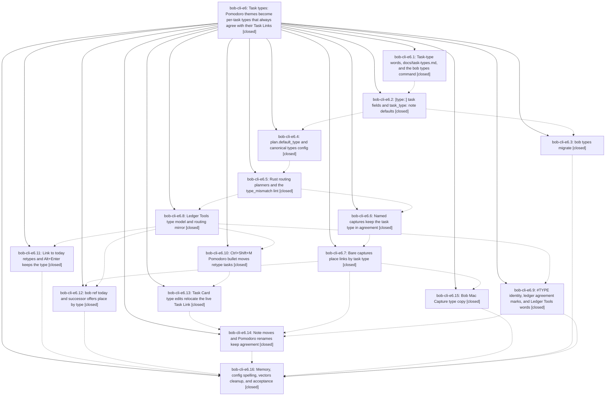

# Bead: bob-cli-e6 — Task types: Pomodoro themes become per-task types that always agree with their Task Links

[Bead Pages](../README.md) / bob-cli-e6

**Status:** ✓ closed · **Resolution:** done · **Type:** ▸ plan · **Tier:** epic · **↺ Reopened:** ↺1
**Owner:** `bryanbugyi34@gmail.com` · **Created by:** [bbugyi200.apollo.research.2t.linker.w0](https://github.com/bobs-org/bob-cli--agents/blob/main/sessions/bbugyi200.apollo.research.2t.linker.w0.md) · **Assignee:** `bob-cli-e6.land`
**Created:** 2026-10-29 16:16:33 EDT · **Closed:** 2026-10-30 09:57:55 EDT
**Plan:** [202610/task\_types.md](https://github.com/bobs-org/bob-cli--plans/blob/main/202610/task_types.md)

## Previously Closed

> ↺ Closed 2026-10-30T07:57:41Z · done
>
> (none)
>
> Reopened 2026-10-30T13:45:42Z by `sase bead open`

<!-- sase:links:start -->

## Links

| Relation | Artifact | Why |
| --- | --- | --- |
| implemented-by | [plan:202610/task_types.md][1] | derived from the plan's `bead_id:` frontmatter field |
| related | [bead:bob-cli-ec][2] | Deferred closeout steps of the task-types epic (phase closeout, bob-cli-e6.16 note #1) |

_Plus 8 automatic references — see [Referenced By](#referenced-by)._

[1]: https://github.com/bobs-org/bob-cli--plans/blob/main/202610/task_types.md
[2]: https://github.com/bobs-org/bob-cli--beads/blob/main/pages/bob-cli-ec/README.md

<!-- sase:links:end -->

## Description

Every open task has one computed task type (field, reading rule, note default, then plan.default_type, CHORE for Bryan). Every live Task Link agrees with its task's type: type edits move links, link moves and named captures retype tasks, and Bob places new links by type. Explicit types render as a colored #TYPE in place of the #task glyph. The words "theme" and "Pomodoro theme" become "task type" everywhere a person reads them.

## Notes

[2026-10-29T21:36:54Z · bob-cli-e7.1--1] DISCOVERED ISSUE: HEAD d0603a5d (bob-cli-e6.1 types wording) leaves 7 bob-obsidian CLI tests expecting "themes" / catalog path ["themes","split"]: capture::plan_budget::{capture_plan_budget_human_reports_meter_and_destination,capture_plan_budget_warns_when_new_theme_grows_past_cap,capture_strict_mode_refuses_new_theme_past_cap_atomically}, capture::pomodoro_close_selection::capture_pomodoro_close_selection_human_output, capture::task_complete::exact_human_output_for_strike_move_dedupe_and_done, catalog::protocol_1_parses_with_schema_version_one (id themes-split still asserted at path ["themes","split"] while table.rs path is ["types","split"]), plan::plan_reports_human_budget_without_ansi_when_piped. Reproduced identically on clean HEAD with capture_plan_budget_human_reports_meter_and_destination: actual "plan 4/3 types · 4/10 links  (+1 type: NEWT)". just check then fails `-p bob-obsidian --test cli` exit 101. Later e6.16 vectors cleanup is the likely owner.

[2026-10-30T00:15:10Z · bob-cli-e7.land] DISCOVERED ISSUE follow-up audit from bob-cli-e7.land: proposals in bob-cli-e7.1 note #2 and bob-cli-e7.2 note #2 report the same seven stale themes/types CLI assertions already in this epic note #1. Source review on bob-cli 41338bcf shows c0f94390 (e6.3) repairs those seven assertions, including the themes-split ID at path [types,split]; e6.3 note #2 confirms the wider 11-assertion cleanup. No new task or +1 on bob-cli-de: de was the earlier 55-vs-54 catalog-count bug, not this vocabulary/path drift. Keep final e6 acceptance responsible for regression verification.

[2026-10-30T03:21:19Z · bryanbugyi34@gmail.com] If possible, we should align the type value text (e.g. 'FIX') with the '#' character and leave no whitespace between the '#' and the type value text. See the 🔒 20261029\_232010.png screenshot for context.

[2026-10-30T06:32:25Z · bob-cli-e6.land] LAND TRIAGE (bob-cli-e6.land, bob-cli a3735b91, bob-plugins 957f741, bob-mac-capture 2609650) — every PROPOSED FOLLOW-UP:
RESOLVED, declined: e6.4 #1 / e6.5 #2 / epic #1-#2 stale theme CLI assertions (fixed by c0f94390; not in today's cargo test failures); e6.5 #1 fmt drift in config/themes.rs (no longer in the fmt diff); e6.7 #1 ref-today parity (passes; fixed by e6.12); e6.8 #1 task-card-theme-edit TypeErrors (suite passes after e6.13); e6.12 #1, e6.13 #2, e6.15 #1 generated glossary.md/decisions.md drift (just docs-check and bob-plugins npm run docs:check both pass); e6.13 #3 ledger-tools deploy (now synced/unchanged).
NOT REPRODUCED, declined: e6.6 #1 / e6.7 #2 capture_related archive_closed_window_respects_mtime (passes in today's full cargo test); e6.5 #2 stats/completion parallel-load flakes (not seen; capture_related perf flakes are already tracked by bob-cli-ca/bo).
OTHER EPICS: e6.8/e6.10/e6.13/e6.14 grey-pill card-view test → bisected to bob-cli-e8.5 13ac4dc, recorded as a DISCOVERED ISSUE on bob-cli-e8. The gcal gate failures I found (fmt tests/gcal_list.rs, clippy gcal/classify.rs:75, catalog count 59/58, completion gcal:day) come from bob-cli-ea.5 44058f67 and are recorded as a DISCOVERED ISSUE on bob-cli-ea.
DUPLICATE: e6.14 #1 nav-hotkeys deploy blocked by a dirty bob-cli_16 build → +1 on bob-cli-e4. The deployed build is a strict subset of master 74d6da2; the landing tale force-syncs.
NEW TASK: e6.16 #1 chezmoi themes:→types: plus the live-vault bob types migrate -d preview, which need a released bob with `bob types` (installed 0.4.0 lacks it) → bob-cli-ec (small).
EPIC WORK (landing tale): e6.16 #3 successor-wiring test failures (bisected to e6.12 6562b63: the harness fakes the old api.themes without effectiveTypeFor/planRetype); e6.14 #3 rename picker count preview and Node tests; e6.15 #2 Mac theme copy; e6.16 #4 remaining plugin theme copy; e6.16 #2 planThemeChange wrapper (no plugin calls api.themes.planThemeChange; only block-id-prompt 077 has an opts fallback, so remove it per the closeout plan); epic note #3 (Bryan) #TYPE glyph/name alignment, unaddressed. Also found by the land agent: cargo fmt drift in e6.14 files; clippy gate errors at capture/pomodoro_link.rs:671 (needless_option_as_deref) and task_complete/successors.rs:2193 (collapsible_if) from e6.12; stale cli test ref_library::today::ledger_and_resolution_refusals (typed READ placement now creates a placeholder instead of no_open_pomodoro).
INTEGRATION: concurrent commits reviewed (event-task close 4f2828e3/9c63d95 already write [type:: MEET]; text mentions, wikilink_task, templates, gcal, highlights, web-clip, and the Mac (( picker have no theme/type overlap). Glossary has no stale [[pomodoro-theme]] links. Shared vectors are byte-identical in all 3 copies. epic-symbols: none.

[2026-10-30T07:57:41Z · bob-cli-e6.land--4] Land verification reviewed all 16 phases against D1–D12, confirmed shared contract vectors byte-identical across bob-cli, bob-plugins, and Bob Mac Capture, integrated concurrent commits, and triaged phase proposals in LAND TRIAGE; epic-symbols is empty. This landing completed the remaining CLI gates and stale test update, successor wiring, Pomodoro rename preview/tests, text-hash #TYPE geometry, remaining user-facing type copy, and planThemeChange retirement. Final gates: focused ref-today CLI test passed; just check is blocked only by the tracked bob-cli-ea gcal clone_on_copy finding; root docs generation/check, plugin build/build:check, plugin docs check, Mac portable-check, and Mac docs check passed. npm test has only the pre-existing grey-pill card-view failure bisected to bob-cli-e8.5. Deployed all five changed plugins from workspace 16; bob plugins list against that checkout reports 8/8 synced, with force used only for bob-navigation-hotkeys. bob-cli-e4 closed.

[2026-10-30T13:18:00Z · bob-cli-e6.land] CLOSED-BEAD LAUNCH: agent bob-cli-e6.land launched against this closed bead; status left closed.
Launch submitted 2026-10-30T13:07:17.368241Z; run 20261030090721.
Prior close: 2026-10-30T07:57:41Z · done.

[2026-10-30T13:57:55Z · bob-cli-e6.land] RELAUNCH LANDING (bob-cli-e6.land, run 20261030090721). The 07:57Z close was incomplete. Prior close note #5 said the bob-plugins work had landed, but no bob-plugins commit carried it: bob-plugins origin/master had only 957f741 plus later gcal commits. The plan was also still status: wip. The vault was running five plugins (block-id-prompt, bob-command-mode, bob-ledger-tools, bob-navigation-hotkeys, task-status-cycler) built from uncommitted files in bob-cli_16. I reopened the bead and recovered that diff (`git diff HEAD --binary`, 50 files, +570/-484) minutes before bob-cli_16 was recycled. I applied it cleanly on bob-plugins 5ba4683 and committed it through this turn's finalizer.
VERIFIED: the recovered diff covers every note-#5 claim. Successor-wiring harness on effectiveTypeFor/planRetype (fixes e6.16 #3). Pomodoro rename preview plus Node tests (e6.14 #3). #TYPE drawn as "#" attr(data-bob-type) with no glyph gap (Bryan's epic note #3). Remaining user-facing "task type" copy (e6.16 #4). planThemeChange fully retired: zero references in src, scripts, or docs (e6.16 #2). npm run build is a no-op, build:check passes, and every rebuilt main.js, styles.css, and manifest.json is byte-identical to the vault. bob plugins list against this checkout shows 8/8 synced, and sync is a no-op (22 unchanged). Five stamps still say "deploy stamp does not match vault bytes" because the prior deploy wrote unstamped files. The deploy guard rewrites stamps on the next sync from a clean checkout at the new HEAD, because the bytes match exactly. npm run docs:check passes. npm test fails four tests. Three also fail on clean master in isolation: the grey-pill card-view test (bob-cli-e8.5, on bob-cli-e8) and the two below that 1295e52 caused. The fourth, Live Preview perf, passes in isolation. The e6 patch causes no regressions. bob-cli master f40a625a: just check and just docs-check pass, including the gcal clippy item the prior close was blocked on. bob-mac-capture 2f9a70a (e6) is on origin. All 16 phases closed; DECISIONS honored per notes #4/#5. epic-symbols: none.
INTEGRATION since 3b0ffa0a: a0a6b497 gcal has no type overlap. 59d5a093, 23ba4805, and f40a625a (active epic bob-cli-ee, capture t: markers) reuse e6's type catalog and routing rather than duplicating them. No conflicts.
FOLLOW-UPS: NEW bob-cli-eh (task(ci), small, ready): ledger-tools note-ready and relation-index startup tests fail since bob-cli-ea.8 1295e52, because the single-slot onLayoutReady fakes are overwritten by setupGcalEvents. Not e6. NEW bob-cli-ei (task(bug), large, ready; related dn, e0, cv): land--4's finalizer surfaced dirty bob-plugins and plans yet committed only bob-cli and bob-mac-capture. That is SASE infra, not e6 product work. All earlier proposal outcomes stand as recorded in note #4. Plan file marked status: done.

## Attachments

- 🔒 20261029\_232010.png · image/png · 2854×1686 · 442.023 KiB (private attachment)

## Phases

| Bead | Title | Status | Size | Created | Agents | Commits |
|---|---|---|---|---|---:|---:|
| [bob-cli-e6.1](bob-cli-e6.1.md) | Task-type words, docs/task-types.md, and the bob types command | ✓ closed | medium | 2026-10-29 | 1 | 1 |
| [bob-cli-e6.10](bob-cli-e6.10.md) | Ctrl+Shift+M Pomodoro bullet moves retype tasks | ✓ closed | medium | 2026-10-29 | 1 | 1 |
| [bob-cli-e6.11](bob-cli-e6.11.md) | Link to today retypes and Alt+Enter keeps the type | ✓ closed | medium | 2026-10-29 | 1 | 1 |
| [bob-cli-e6.12](bob-cli-e6.12.md) | bob ref today and successor offers place by type | ✓ closed | medium | 2026-10-29 | 1 | 2 |
| [bob-cli-e6.13](bob-cli-e6.13.md) | Task Card type edits relocate the live Task Link | ✓ closed | medium | 2026-10-29 | 1 | 1 |
| [bob-cli-e6.14](bob-cli-e6.14.md) | Note moves and Pomodoro renames keep agreement | ✓ closed | medium | 2026-10-29 | 1 | 2 |
| [bob-cli-e6.15](bob-cli-e6.15.md) | Bob Mac Capture type copy | ✓ closed | small | 2026-10-29 | 1 | 1 |
| [bob-cli-e6.16](bob-cli-e6.16.md) | Memory, config spelling, vectors cleanup, and acceptance | ✓ closed | small | 2026-10-29 | 1 | 2 |
| [bob-cli-e6.2](bob-cli-e6.2.md) | \[type::\] task fields and task\_type: note defaults | ✓ closed | medium | 2026-10-29 | 1 | 1 |
| [bob-cli-e6.3](bob-cli-e6.3.md) | bob types migrate | ✓ closed | small | 2026-10-29 | 1 | 1 |
| [bob-cli-e6.4](bob-cli-e6.4.md) | plan.default\_type and canonical types config | ✓ closed | medium | 2026-10-29 | 1 | 1 |
| [bob-cli-e6.5](bob-cli-e6.5.md) | Rust routing planners and the type\_mismatch lint | ✓ closed | medium | 2026-10-29 | 1 | 1 |
| [bob-cli-e6.6](bob-cli-e6.6.md) | Named captures keep the task type in agreement | ✓ closed | medium | 2026-10-29 | 1 | 1 |
| [bob-cli-e6.7](bob-cli-e6.7.md) | Bare captures place links by task type | ✓ closed | medium | 2026-10-29 | 1 | 1 |
| [bob-cli-e6.8](bob-cli-e6.8.md) | Ledger Tools type model and routing mirror | ✓ closed | medium | 2026-10-29 | 1 | 1 |
| [bob-cli-e6.9](bob-cli-e6.9.md) | #TYPE identity, ledger agreement marks, and Ledger Tools words | ✓ closed | medium | 2026-10-29 | 1 | 2 |

## Lineage

## Agents

| Agent | Bead | Commits |
|---|---|---:|
| [bbugyi200.apollo.bob-cli-e6.1](https://github.com/bobs-org/bob-cli--agents/blob/main/sessions/bbugyi200.apollo.bob-cli-e6.1.md) | [bob-cli-e6.1](bob-cli-e6.1.md) | 1 |
| [bbugyi200.apollo.bob-cli-e6.10](https://github.com/bobs-org/bob-cli--agents/blob/main/agents/bbugyi200.apollo.bob-cli-e6.10/README.md) | [bob-cli-e6.10](bob-cli-e6.10.md) | 1 |
| [bbugyi200.apollo.bob-cli-e6.11](https://github.com/bobs-org/bob-cli--agents/blob/main/agents/bbugyi200.apollo.bob-cli-e6.11/README.md) | [bob-cli-e6.11](bob-cli-e6.11.md) | 1 |
| [bbugyi200.apollo.bob-cli-e6.12](https://github.com/bobs-org/bob-cli--agents/blob/main/agents/bbugyi200.apollo.bob-cli-e6.12/README.md) | [bob-cli-e6.12](bob-cli-e6.12.md) | 2 |
| [bbugyi200.apollo.bob-cli-e6.13](https://github.com/bobs-org/bob-cli--agents/blob/main/agents/bbugyi200.apollo.bob-cli-e6.13/README.md) | [bob-cli-e6.13](bob-cli-e6.13.md) | 1 |
| [bbugyi200.apollo.bob-cli-e6.14](https://github.com/bobs-org/bob-cli--agents/blob/main/agents/bbugyi200.apollo.bob-cli-e6.14/README.md) | [bob-cli-e6.14](bob-cli-e6.14.md) | 2 |
| [bbugyi200.apollo.bob-cli-e6.15](https://github.com/bobs-org/bob-cli--agents/blob/main/agents/bbugyi200.apollo.bob-cli-e6.15/README.md) | [bob-cli-e6.15](bob-cli-e6.15.md) | 1 |
| [bbugyi200.apollo.bob-cli-e6.16](https://github.com/bobs-org/bob-cli--agents/blob/main/agents/bbugyi200.apollo.bob-cli-e6.16/README.md) | [bob-cli-e6.16](bob-cli-e6.16.md) | 2 |
| [bbugyi200.apollo.bob-cli-e6.2](https://github.com/bobs-org/bob-cli--agents/blob/main/agents/bbugyi200.apollo.bob-cli-e6.2/README.md) | [bob-cli-e6.2](bob-cli-e6.2.md) | 1 |
| [bbugyi200.apollo.bob-cli-e6.3](https://github.com/bobs-org/bob-cli--agents/blob/main/sessions/bbugyi200.apollo.bob-cli-e6.3.md) | [bob-cli-e6.3](bob-cli-e6.3.md) | 1 |
| [bbugyi200.apollo.bob-cli-e6.4](https://github.com/bobs-org/bob-cli--agents/blob/main/sessions/bbugyi200.apollo.bob-cli-e6.4.md) | [bob-cli-e6.4](bob-cli-e6.4.md) | 1 |
| [bbugyi200.apollo.bob-cli-e6.5](https://github.com/bobs-org/bob-cli--agents/blob/main/agents/bbugyi200.apollo.bob-cli-e6.5/README.md) | [bob-cli-e6.5](bob-cli-e6.5.md) | 1 |
| [bbugyi200.apollo.bob-cli-e6.6](https://github.com/bobs-org/bob-cli--agents/blob/main/agents/bbugyi200.apollo.bob-cli-e6.6/README.md) | [bob-cli-e6.6](bob-cli-e6.6.md) | 1 |
| [bbugyi200.apollo.bob-cli-e6.7](https://github.com/bobs-org/bob-cli--agents/blob/main/agents/bbugyi200.apollo.bob-cli-e6.7/README.md) | [bob-cli-e6.7](bob-cli-e6.7.md) | 1 |
| [bbugyi200.apollo.bob-cli-e6.8](https://github.com/bobs-org/bob-cli--agents/blob/main/agents/bbugyi200.apollo.bob-cli-e6.8/README.md) | [bob-cli-e6.8](bob-cli-e6.8.md) | 1 |
| [bbugyi200.apollo.bob-cli-e6.9](https://github.com/bobs-org/bob-cli--agents/blob/main/agents/bbugyi200.apollo.bob-cli-e6.9/README.md) | [bob-cli-e6.9](bob-cli-e6.9.md) | 2 |
| [bbugyi200.apollo.bob-cli-e6.land](https://github.com/bobs-org/bob-cli--agents/blob/main/agents/bbugyi200.apollo.bob-cli-e6.land/README.md) | [bob-cli-e6](README.md) | 3 |

## Commits

| Repo | Commit | Subject | Bead | Committed |
|---|---|---|---|---|
| bob-cli | [`d0603a5`](https://github.com/bobs-org/bob-cli/commit/d0603a5d5180ff7e1fdbc5bddbef180c89647ed5) | feat(types): rename bob themes to bob types and adopt task-type words | [bob-cli-e6.1](bob-cli-e6.1.md) | 2026-10-29 17:01:18 EDT |
| bob-cli | [`8d7309f`](https://github.com/bobs-org/bob-cli/commit/8d7309ffb8e104fd550ee7bc5665105de4538b7a) | feat(types): store task types as \[type::\] and task\_type: with legacy theme reads | [bob-cli-e6.2](bob-cli-e6.2.md) | 2026-10-29 17:52:12 EDT |
| bob-cli | [`66ddba9`](https://github.com/bobs-org/bob-cli/commit/66ddba93b03804bc07abd581ef7cb22ccd35d984) | feat(config): add global default task type | [bob-cli-e6.4](bob-cli-e6.4.md) | 2026-10-29 19:01:21 EDT |
| bob-cli | [`c0f9439`](https://github.com/bobs-org/bob-cli/commit/c0f94390168e23f37da4a186f0b160ec591358b5) | feat(types): add bob types migrate for legacy theme spellings | [bob-cli-e6.3](bob-cli-e6.3.md) | 2026-10-29 19:48:39 EDT |
| bob-cli | [`1750474`](https://github.com/bobs-org/bob-cli/commit/17504745c584e7e0bffc25342ce3791e3857560c) | feat(types): add task-type routing planners and type\_mismatch lint | [bob-cli-e6.5](bob-cli-e6.5.md) | 2026-10-29 20:09:50 EDT |
| bob-cli | [`b5c7ef0`](https://github.com/bobs-org/bob-cli/commit/b5c7ef0f3a20a397f1affd1515b55e5e68c15338) | feat(capture)!: named Pomodoro captures keep the task type in agreement | [bob-cli-e6.6](bob-cli-e6.6.md) | 2026-10-29 21:28:29 EDT |
| bob-plugins | [`bob-plugins@d3a8ff4`](https://github.com/bobs-org/bob-plugins/commit/d3a8ff40b1b2aebce3adb1addd5a8cadae59df70) | feat(ledger-tools): mirror task types, default type, and routing planners | [bob-cli-e6.8](bob-cli-e6.8.md) | 2026-10-29 21:51:34 EDT |
| bob-plugins | [`bob-plugins@75e8191`](https://github.com/bobs-org/bob-plugins/commit/75e819164166ab1828ca56a723e7c4ff083d078f) | feat(block-id-prompt)!: Link to today keeps task types in agreement | [bob-cli-e6.11](bob-cli-e6.11.md) | 2026-10-29 22:38:18 EDT |
| bob-plugins | [`bob-plugins@a42de4d`](https://github.com/bobs-org/bob-plugins/commit/a42de4d4fc49891d43700bcefad6f2c6479ec522) | feat(navigation): retype moved Pomodoro tasks | [bob-cli-e6.10](bob-cli-e6.10.md) | 2026-10-29 22:44:02 EDT |
| bob-cli | [`dfc08c1`](https://github.com/bobs-org/bob-cli/commit/dfc08c19d08a94581cba5e5070498b2f3fdac738) | docs(task-tag-marks): #TYPE identity contract | [bob-cli-e6.9](bob-cli-e6.9.md) | 2026-10-29 22:59:42 EDT |
| bob-plugins | [`bob-plugins@eb71f95`](https://github.com/bobs-org/bob-plugins/commit/eb71f95aa8ab038091e799252f02be8dcb90e624) | feat(ledger-tools): render explicit task types as colored #TYPE | [bob-cli-e6.9](bob-cli-e6.9.md) | 2026-10-29 23:11:21 EDT |
| bob-cli | [`1ba6437`](https://github.com/bobs-org/bob-cli/commit/1ba6437a8e813ca2f0fbbf9245237d97f384622b) | feat(capture): bare captures place links by task type | [bob-cli-e6.7](bob-cli-e6.7.md) | 2026-10-29 23:29:46 EDT |
| bob-plugins | [`bob-plugins@74d6da2`](https://github.com/bobs-org/bob-plugins/commit/74d6da21efb222fd52d7a364776f071aa3b02947) | feat(navigation-hotkeys): Task Card type edits move the live Task Link | [bob-cli-e6.13](bob-cli-e6.13.md) | 2026-10-29 23:43:49 EDT |
| bob-mac-capture | [`bob-mac-capture@7ac2bd9`](https://github.com/bobs-org/bob-mac-capture/commit/7ac2bd9dfb885cb0269468c4e2f83fd627da7345) | feat(capture): show task-type placement and type copy | [bob-cli-e6.15](bob-cli-e6.15.md) | 2026-10-29 23:57:58 EDT |
| bob-cli | [`175b749`](https://github.com/bobs-org/bob-cli/commit/175b7498a1471308de85f9736284ee97477d0358) | feat(ref)!: bob ref today places reading tasks by type | [bob-cli-e6.12](bob-cli-e6.12.md) | 2026-10-30 00:19:18 EDT |
| bob-plugins | [`bob-plugins@6562b63`](https://github.com/bobs-org/bob-plugins/commit/6562b63522c8c1d333c2f3c426db7e005cb0a592) | feat(task-status-cycler): successor offers place by task type | [bob-cli-e6.12](bob-cli-e6.12.md) | 2026-10-30 00:21:38 EDT |
| bob-cli | [`785c1ae`](https://github.com/bobs-org/bob-cli/commit/785c1aecbf62b999fdc4b3797df971eee91d3e26) | feat(task-move,capture): gesture-retype keeps agreement on note moves and Pomodoro renames | [bob-cli-e6.14](bob-cli-e6.14.md) | 2026-10-30 01:19:19 EDT |
| bob-plugins | [`bob-plugins@8b262bb`](https://github.com/bobs-org/bob-plugins/commit/8b262bb92c16e5b886c32ab7b5adb0430e1a82a8) | feat(navigation-hotkeys): relocate live Task Link on note moves, retype on Pomodoro renames | [bob-cli-e6.14](bob-cli-e6.14.md) | 2026-10-30 01:24:26 EDT |
| bob-cli | [`3aa31b3`](https://github.com/bobs-org/bob-cli/commit/3aa31b349ab2dd1e290bb7f26e2c43c74f9657df) | chore(types): close out glossary docs and vectors | [bob-cli-e6.16](bob-cli-e6.16.md) | 2026-10-30 01:55:16 EDT |
| bob-plugins | [`bob-plugins@957f741`](https://github.com/bobs-org/bob-plugins/commit/957f74120580d12cc9f03164c97cde82469e902a) | test(types): remove retired write-rule vectors | [bob-cli-e6.16](bob-cli-e6.16.md) | 2026-10-30 01:57:06 EDT |
| bob-cli | [`3b0ffa0`](https://github.com/bobs-org/bob-cli/commit/3b0ffa0a360a1df70a185cc864c641b2e9489c9f) | feat: complete task type workflow integration | [bob-cli-e6](README.md) | 2026-10-30 04:20:42 EDT |
| bob-mac-capture | [`bob-mac-capture@2f9a70a`](https://github.com/bobs-org/bob-mac-capture/commit/2f9a70a7a6417858b0ac6fc469a7b73042d823b7) | feat(capture): present task-type labels and budgets | [bob-cli-e6](README.md) | 2026-10-30 04:35:00 EDT |
| bob-plugins | [`bob-plugins@81a75b8`](https://github.com/bobs-org/bob-plugins/commit/81a75b8a10e33fa84af36898e2f333aecaf16b12) | feat: finish task-type plugin closeout | [bob-cli-e6](README.md) | 2026-10-30 09:58:58 EDT |

<!-- sase:referenced-by:start -->

## Referenced By

| Relation | Artifact | Why | Uses |
| --- | --- | --- | ---: |
| read-by | [agent:bob-cli-e6.13][1] | Need epic scope for phase e6.13 | 1 |
| read-by | [agent:bob-cli-e6.14][2] | need epic context for phase | 1 |
| read-by | [agent:bob-cli-e6.2][3] | Need epic scope and plan | 1 |
| read-by | [agent:bob-cli-e6.7][4] | Need epic scope | 1 |
| read-by | [agent:bob-cli-e6.land--4][5] | Verify epic closeout criteria, plugin deploy dependency, and the documented test owner | 1 |
| read-by | [agent:bob-cli-e7.1--1][6] | Need the epic scope for themes-to-types CLI test drift | 1 |
| read-by | [agent:bob-cli-e7.2--1][7] | Need the epic scope to see if leftover themes CLI test failures belong here | 1 |
| read-by | [agent:bob-cli-ea.land][8] | Check how e6's close handled the bob-plugins successor-wiring test failures | 4 |

[1]: https://github.com/bobs-org/bob-cli--agents/blob/main/agents/bbugyi200.apollo.bob-cli-e6.13/README.md
[2]: https://github.com/bobs-org/bob-cli--agents/blob/main/agents/bbugyi200.apollo.bob-cli-e6.14/README.md
[3]: https://github.com/bobs-org/bob-cli--agents/blob/main/agents/bbugyi200.apollo.bob-cli-e6.2/README.md
[4]: https://github.com/bobs-org/bob-cli--agents/blob/main/agents/bbugyi200.apollo.bob-cli-e6.7/README.md
[5]: https://github.com/bobs-org/bob-cli--agents/blob/main/sessions/bbugyi200.apollo.bob-cli-e6.land.md
[6]: https://github.com/bobs-org/bob-cli--agents/blob/main/sessions/bbugyi200.apollo.bob-cli-e7.1.md
[7]: https://github.com/bobs-org/bob-cli--agents/blob/main/sessions/bbugyi200.apollo.bob-cli-e7.2.md
[8]: https://github.com/bobs-org/bob-cli--agents/blob/main/agents/bbugyi200.apollo.bob-cli-ea.land/README.md

<!-- sase:referenced-by:end -->
