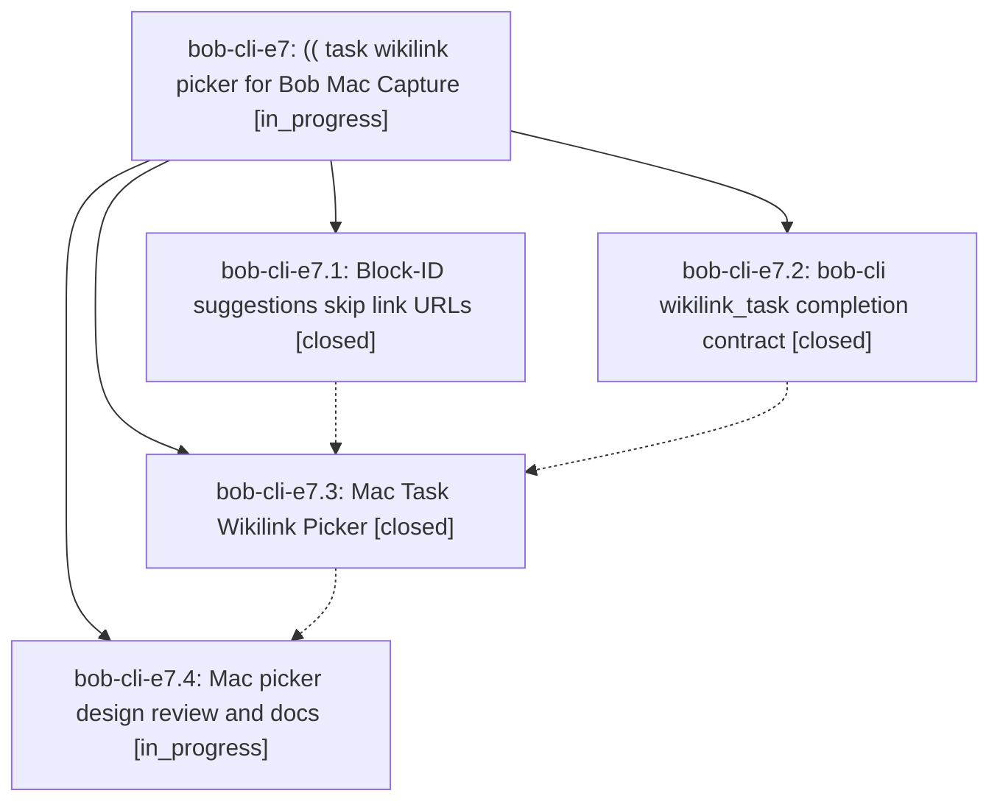

# Bead: bob-cli-e7 — (( task wikilink picker for Bob Mac Capture

[Bead Pages](../README.md) / bob-cli-e7

**Status:** ◐ in_progress · **Type:** ▸ plan · **Tier:** epic
**Owner:** `bryanbugyi34@gmail.com` · **Created by:** [bbugyi200.apollo.b3](https://github.com/bobs-org/bob-cli--agents/blob/main/sessions/bbugyi200.apollo.b3.md) · **Assignee:** `bob-cli-e7.land`
**Created:** 2026-10-29 17:02:45 EDT
**Plan:** [202610/wikilink\_task\_picker.md](https://github.com/bobs-org/bob-cli--plans/blob/main/202610/wikilink_task_picker.md)

<!-- sase:links:start -->

## Links

| Relation | Artifact | Why |
| --- | --- | --- |
| implemented-by | [plan:202610/wikilink_task_picker.md][1] | derived from the plan's `bead_id:` frontmatter field |

[1]: https://github.com/bobs-org/bob-cli--plans/blob/main/202610/wikilink_task_picker.md

<!-- sase:links:end -->

## Description

Typing `((` anywhere free text is allowed in a Bob Mac Capture draft opens a large, fuzzy, keyboard-first picker over every task in the vault. Choosing a task replaces the `((` token with a valid Obsidian block link such as `[[foo#^bar]]`. A task without a block ID is named first through a prompt prefilled with a good suggested ID. bob-cli owns the trigger grammar, the candidates, the link text, and the ID write; the app only presents them.

## Phases

| Bead | Title | Status | Size | Created | Agents | Commits |
|---|---|---|---|---|---:|---:|
| [bob-cli-e7.1](bob-cli-e7.1.md) | Block-ID suggestions skip link URLs | ✓ closed | small | 2026-10-29 | 1 | 1 |
| [bob-cli-e7.2](bob-cli-e7.2.md) | bob-cli wikilink\_task completion contract | ✓ closed | medium | 2026-10-29 | 1 | 1 |
| [bob-cli-e7.3](bob-cli-e7.3.md) | Mac Task Wikilink Picker | ✓ closed | medium | 2026-10-29 | 1 | 1 |
| [bob-cli-e7.4](bob-cli-e7.4.md) | Mac picker design review and docs | ◐ in_progress | small | 2026-10-29 | 1 | 0 |

## Lineage

## Agents

| Agent | Bead | Commits |
|---|---|---:|
| [bbugyi200.apollo.bob-cli-e7.1](https://github.com/bobs-org/bob-cli--agents/blob/main/sessions/bbugyi200.apollo.bob-cli-e7.1.md) | [bob-cli-e7.1](bob-cli-e7.1.md) | 1 |
| [bbugyi200.apollo.bob-cli-e7.2](https://github.com/bobs-org/bob-cli--agents/blob/main/sessions/bbugyi200.apollo.bob-cli-e7.2.md) | [bob-cli-e7.2](bob-cli-e7.2.md) | 1 |
| [bbugyi200.apollo.bob-cli-e7.3](https://github.com/bobs-org/bob-cli--agents/blob/main/agents/bbugyi200.apollo.bob-cli-e7.3/README.md) | [bob-cli-e7.3](bob-cli-e7.3.md) | 1 |
| [bbugyi200.apollo.bob-cli-e7.4](https://github.com/bobs-org/bob-cli--agents/blob/main/agents/bbugyi200.apollo.bob-cli-e7.4/README.md) | [bob-cli-e7.4](bob-cli-e7.4.md) | 0 |
| [bbugyi200.apollo.bob-cli-e7.land](https://github.com/bobs-org/bob-cli--agents/blob/main/agents/bbugyi200.apollo.bob-cli-e7.land/README.md) | [bob-cli-e7](README.md) | 0 |

## Commits

| Repo | Commit | Subject | Bead | Committed |
|---|---|---|---|---|
| bob-cli | [`30e093a`](https://github.com/bobs-org/bob-cli/commit/30e093ac9f8742c39575de476a7a9cf23b927602) | fix(capture): skip URLs in block-ID suggestions | [bob-cli-e7.1](bob-cli-e7.1.md) | 2026-10-29 17:41:28 EDT |
| bob-cli | [`53bf3df`](https://github.com/bobs-org/bob-cli/commit/53bf3dfaddc8d30aec4a0dd539dd1d3d281d2e9d) | feat(capture): add wikilink\_task (( completion contract | [bob-cli-e7.2](bob-cli-e7.2.md) | 2026-10-29 18:09:17 EDT |
| bob-mac-capture | [`bob-mac-capture@031f100`](https://github.com/bobs-org/bob-mac-capture/commit/031f100f52fbb2bfc758d28b5334886e4a9d02e0) | feat(mac-capture): add (( task wikilink picker | [bob-cli-e7.3](bob-cli-e7.3.md) | 2026-10-29 19:03:51 EDT |
