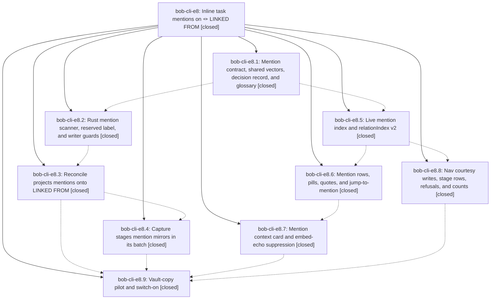

# Bead: bob-cli-e8 — Inline task mentions on 🪢 LINKED FROM

[Bead Pages](../README.md) / bob-cli-e8

**Status:** ✓ closed · **Resolution:** done · **Type:** ▸ plan · **Tier:** epic
**Owner:** `bryanbugyi34@gmail.com` · **Created by:** [bbugyi200.apollo.research.2v.linker.w0](https://github.com/bobs-org/bob-cli--agents/blob/main/sessions/bbugyi200.apollo.research.2v.linker.w0.md) · **Assignee:** `bob-cli-e8.land`
**Created:** 2026-10-29 17:20:21 EDT · **Closed:** 2026-10-30 11:16:02 EDT
**Plan:** [202610/inline\_task\_mentions.md](https://github.com/bobs-org/bob-cli--plans/blob/main/202610/inline_task_mentions.md)

<!-- sase:links:start -->

## Links

| Relation | Artifact | Why |
| --- | --- | --- |
| implemented-by | [plan:202610/inline_task_mentions.md][1] | derived from the plan's `bead_id:` frontmatter field |
| related | [bead:bob-cli-ek][2] | Follow-up from the inline task mentions epic (plan 202610/inline_task_mentions.md Follow-ups section) |
| related | [bead:bob-cli-el][3] | Follow-up from the inline task mentions epic (plan 202610/inline_task_mentions.md Follow-ups section) |
| related | [bead:bob-cli-em][4] | Follow-up from the inline task mentions epic (plan 202610/inline_task_mentions.md Follow-ups section) |
| related | [bead:bob-cli-en][5] | Follow-up from the inline task mentions epic (plan 202610/inline_task_mentions.md Follow-ups section) |

_Plus 5 automatic references — see [Referenced By](#referenced-by)._

[1]: https://github.com/bobs-org/bob-cli--plans/blob/main/202610/inline_task_mentions.md
[2]: https://github.com/bobs-org/bob-cli--beads/blob/main/pages/bob-cli-ek/README.md
[3]: https://github.com/bobs-org/bob-cli--beads/blob/main/pages/bob-cli-el/README.md
[4]: https://github.com/bobs-org/bob-cli--beads/blob/main/pages/bob-cli-em/README.md
[5]: https://github.com/bobs-org/bob-cli--beads/blob/main/pages/bob-cli-en/README.md

<!-- sase:links:end -->

## Description

When one task's own text links another task (`[[note#^id]]`, embedded or struck too), the target's generated 🪢 LINKED FROM line gains an inert `[[S]] (💬 mentions)` entry that explains itself at a glance with a `💬 mentioned in` / `💬 embedded in` pill, a live quote, and a context card that jumps to the sentence. Nothing is written on the mentioning task except a silent `^id`, a dependency or relation on the pair wins, and Rust and both plugins agree on every shared vector.

## Notes

[2026-10-30T06:29:19Z · bob-cli-e6.land] DISCOVERED ISSUE: bob-plugins scripts/test-navigation-task-card-view.cjs test 'theme menu stays grey when hueFor is missing or throws, and header matches null hues' fails (header pill lacks is-muted). Bisected on bob-plugins: passes at 68db3fb (84/0), fails from 13ac4dc (bob-cli-e8.5, 'live mention index and relationIndex v2') onward (83/1), still failing on master 957f741. Reported as pre-existing by bob-cli-e8.8 #1 and bob-cli-e6.8/e6.10/e6.13/e6.14 proposals; triaged by bob-cli-e6 land agent as caused by e8.5.

[2026-10-30T08:27:22Z · bob-cli-e6.land--4] DISCOVERED ISSUE: Fresh npm test reproduction in bob-plugins on the dirty task-type integration tree: scripts/test-navigation-task-card-view.cjs test theme menu stays grey when hueFor is missing or throws, and header matches null hues failed at line 3014 because the option pill lacked is-muted. 4,372 tests passed and this one failed. This matches existing bob-cli-e8 note #1; the current diff in 313-task-card-theme-projection.js changes wording only around task-card theme/type projection. No new task filed.

[2026-10-30T15:16:02Z · bob-cli-e8.land] VERIFIED (steps 1-2): Read the epic, all 9 phase beads, every note, and the plan. Checked source against the plan: Rust task_relations/mentions.rs + fixture tests, LabelError::ReservedMention refusals, reverse.rs should_preserve_mention (MN24), reconcile projection/JSON (mention_edges, mentions_added/removed, reason), capture/relations_mentions.rs + 13 tests/cli/capture/mentions.rs cases (e8.4's lost f47c639f was correctly restored as 22a8c84f), config default true with invalid-value fallback in Rust, ledger-tools, and nav; relationIndex v2 linkedFrom/scanMentions; fixture copied byte-for-byte; verify-only cycler and block-id-prompt tests; docs §19, configuration, see-task-mentions guide, nav and index. Decisions honored: rollout=enable (b081097c, 8dbcbea); memory_record=no (no decision strand exists); memory_glossary edited only task-mention, task-relation, task-link.
LANDING FIXES: (1) bob-plugins test 'theme menu stays grey…header matches null hues' (e8 notes #1/#2) was caused by e8.5 13ac4dc. Its nav rebuild from src dropped 68db3fb's main.js-only " is-muted" header-pill fallback. Restored it in src/330-task-card-view.js and rebuilt; that file is now 84/0. (2) docs/reference/glossary.md had not been regenerated after e8.9's glossary strand edits, so just docs-check failed; ran just docs-gen. (3) Integration: documented in docs/capture.md that e7's (( wikilink_task link produces a §19 text mention through capture. No other post-epic commit (types, gcal, ref, highlights) touches a LINKED FROM writer or relation code; gcal block links are Pomodoro Task Links (excluded by M1). (4) Deployed: bob plugins sync refused ledger-tools/nav because of stale stamps. The vault bytes differed from the repo only by e8.9's default-on flip plus fix (1); the earlier local edits had since landed in 81a75b8. Force-synced those two with backups, then a full sync showed 22 unchanged. This resolves e8.9 PROPOSED FOLLOW-UP #8.
CHECKS: just check passed (4077 lib, 2526 CLI, all suites). just docs-check passed (447 passed, 1 expected skip). bob-plugins npm test: 4384 tests, 4382 passed; the only 2 failures are the gcal harness bug below, which reproduces at 1295e52 without any e8 code.
FOLLOW-UP TRIAGE: e8.2 #1 (12 CLI failures) and e8.3 #1 (archive_closed_window_respects_mtime) declined: both now pass on master. e8.5 #1, e8.6 #2, e8.7 #1, and e8.8 #1 (nav theme tests): 4 already fixed on master, the 5th fixed above. The perf-flake part of e8.5 #1 was filed as bob-cli-ej (flake). e8.9 #2 became bob-cli-ek, #3 bob-cli-el, #4 bob-cli-em, #5 bob-cli-en (features, linked to e8). e8.9 #8 was resolved by the deploy above. Discovered: note-ready and relation-index onLayoutReady single-slot harness failures from bob-cli-ea.8 1295e52, a duplicate of bob-cli-eh; +1 recorded there. No epic-symbol entries.

## Phases

| Bead | Title | Status | Size | Created | Agents | Commits |
|---|---|---|---|---|---:|---:|
| [bob-cli-e8.1](bob-cli-e8.1.md) | Mention contract, shared vectors, decision record, and glossary | ✓ closed | medium | 2026-10-29 | 1 | 1 |
| [bob-cli-e8.2](bob-cli-e8.2.md) | Rust mention scanner, reserved label, and writer guards | ✓ closed | medium | 2026-10-29 | 1 | 1 |
| [bob-cli-e8.3](bob-cli-e8.3.md) | Reconcile projects mentions onto LINKED FROM | ✓ closed | medium | 2026-10-29 | 1 | 1 |
| [bob-cli-e8.4](bob-cli-e8.4.md) | Capture stages mention mirrors in its batch | ✓ closed | medium | 2026-10-29 | 1 | 1 |
| [bob-cli-e8.5](bob-cli-e8.5.md) | Live mention index and relationIndex v2 | ✓ closed | medium | 2026-10-29 | 1 | 1 |
| [bob-cli-e8.6](bob-cli-e8.6.md) | Mention rows, pills, quotes, and jump-to-mention | ✓ closed | medium | 2026-10-29 | 1 | 1 |
| [bob-cli-e8.7](bob-cli-e8.7.md) | Mention context card and embed-echo suppression | ✓ closed | medium | 2026-10-29 | 1 | 1 |
| [bob-cli-e8.8](bob-cli-e8.8.md) | Nav courtesy writes, stage rows, refusals, and counts | ✓ closed | medium | 2026-10-29 | 1 | 1 |
| [bob-cli-e8.9](bob-cli-e8.9.md) | Vault-copy pilot and switch-on | ✓ closed | small | 2026-10-29 | 1 | 2 |

## Lineage

## Agents

| Agent | Bead | Commits |
|---|---|---:|
| [bbugyi200.apollo.bob-cli-e8.1](https://github.com/bobs-org/bob-cli--agents/blob/main/agents/bbugyi200.apollo.bob-cli-e8.1/README.md) | [bob-cli-e8.1](bob-cli-e8.1.md) | 1 |
| [bbugyi200.apollo.bob-cli-e8.2](https://github.com/bobs-org/bob-cli--agents/blob/main/sessions/bbugyi200.apollo.bob-cli-e8.2.md) | [bob-cli-e8.2](bob-cli-e8.2.md) | 1 |
| [bbugyi200.apollo.bob-cli-e8.3](https://github.com/bobs-org/bob-cli--agents/blob/main/agents/bbugyi200.apollo.bob-cli-e8.3/README.md) | [bob-cli-e8.3](bob-cli-e8.3.md) | 1 |
| [bbugyi200.apollo.bob-cli-e8.4](https://github.com/bobs-org/bob-cli--agents/blob/main/agents/bbugyi200.apollo.bob-cli-e8.4/README.md) | [bob-cli-e8.4](bob-cli-e8.4.md) | 1 |
| [bbugyi200.apollo.bob-cli-e8.5](https://github.com/bobs-org/bob-cli--agents/blob/main/agents/bbugyi200.apollo.bob-cli-e8.5/README.md) | [bob-cli-e8.5](bob-cli-e8.5.md) | 1 |
| [bbugyi200.apollo.bob-cli-e8.6](https://github.com/bobs-org/bob-cli--agents/blob/main/agents/bbugyi200.apollo.bob-cli-e8.6/README.md) | [bob-cli-e8.6](bob-cli-e8.6.md) | 1 |
| [bbugyi200.apollo.bob-cli-e8.7](https://github.com/bobs-org/bob-cli--agents/blob/main/agents/bbugyi200.apollo.bob-cli-e8.7/README.md) | [bob-cli-e8.7](bob-cli-e8.7.md) | 1 |
| [bbugyi200.apollo.bob-cli-e8.8](https://github.com/bobs-org/bob-cli--agents/blob/main/agents/bbugyi200.apollo.bob-cli-e8.8/README.md) | [bob-cli-e8.8](bob-cli-e8.8.md) | 1 |
| [bbugyi200.apollo.bob-cli-e8.9](https://github.com/bobs-org/bob-cli--agents/blob/main/sessions/bbugyi200.apollo.bob-cli-e8.9.md) | [bob-cli-e8.9](bob-cli-e8.9.md) | 2 |
| [bbugyi200.apollo.bob-cli-e8.land](https://github.com/bobs-org/bob-cli--agents/blob/main/agents/bbugyi200.apollo.bob-cli-e8.land/README.md) | [bob-cli-e8](README.md) | 2 |

## Commits

| Repo | Commit | Subject | Bead | Committed |
|---|---|---|---|---|
| bob-cli | [`fe56228`](https://github.com/bobs-org/bob-cli/commit/fe56228f3b15f51867d2fd0a99ea13dd7fe99b2a) | docs(relations): add inert text-mention contract, shared MN vectors, and glossary | [bob-cli-e8.1](bob-cli-e8.1.md) | 2026-10-29 18:09:12 EDT |
| bob-plugins | [`bob-plugins@13ac4dc`](https://github.com/bobs-org/bob-plugins/commit/13ac4dcc70e66cbf80d7e8c1aa1532e6d37350b3) | feat(ledger-tools): live mention index and relationIndex v2 | [bob-cli-e8.5](bob-cli-e8.5.md) | 2026-10-29 18:41:59 EDT |
| bob-plugins | [`bob-plugins@d096507`](https://github.com/bobs-org/bob-plugins/commit/d0965076319fadb8d5ab826710e915c54ab99e1d) | feat(ledger-tools): render task mention rows | [bob-cli-e8.6](bob-cli-e8.6.md) | 2026-10-29 19:17:29 EDT |
| bob-plugins | [`bob-plugins@7366cfd`](https://github.com/bobs-org/bob-plugins/commit/7366cfdd33029d5a6017a70845ed9e096bf0de3b) | feat(navigation): inline task-mention courtesy writes, stage rows, and unlink downgrade | [bob-cli-e8.8](bob-cli-e8.8.md) | 2026-10-29 19:43:43 EDT |
| bob-plugins | [`bob-plugins@90dbc6a`](https://github.com/bobs-org/bob-plugins/commit/90dbc6a1c302e2fa6e89668a53ad274c519a6892) | feat(mentions): add accessible context cards and embed echo suppression | [bob-cli-e8.7](bob-cli-e8.7.md) | 2026-10-29 19:56:57 EDT |
| bob-cli | [`41338bc`](https://github.com/bobs-org/bob-cli/commit/41338bcfdf28959528b3f94471e2f16928ae53b6) | feat(task-relations): parse and preserve text mentions | [bob-cli-e8.2](bob-cli-e8.2.md) | 2026-10-29 20:03:12 EDT |
| bob-cli | [`b8bcc78`](https://github.com/bobs-org/bob-cli/commit/b8bcc78a6a5218d5075b6efeef892685fdb79fbf) | feat(task-relations): project text mentions onto LINKED FROM | [bob-cli-e8.3](bob-cli-e8.3.md) | 2026-10-29 21:44:01 EDT |
| bob-cli | [`22a8c84`](https://github.com/bobs-org/bob-cli/commit/22a8c84fb3d6853d537ba663d0c10b371f1a5769) | feat(capture): stage task mention mirrors atomically | [bob-cli-e8.4](bob-cli-e8.4.md) | 2026-10-30 09:42:42 EDT |
| bob-cli | [`b081097`](https://github.com/bobs-org/bob-cli/commit/b081097cbcd7b914d7299f8db4767d4e497ba952) | feat(task-mentions): enable linked-from mentions by default | [bob-cli-e8.9](bob-cli-e8.9.md) | 2026-10-30 10:28:00 EDT |
| bob-plugins | [`bob-plugins@8dbcbea`](https://github.com/bobs-org/bob-plugins/commit/8dbcbead6ec550b874d046f7190ae64b26efd9cb) | feat(task-mentions): enable mention mirrors by default | [bob-cli-e8.9](bob-cli-e8.9.md) | 2026-10-30 10:28:41 EDT |
| bob-cli | [`3c9536a`](https://github.com/bobs-org/bob-cli/commit/3c9536a7bc6c3a256f51d2d51ab085547d8aca36) | docs(task-mentions): link (( capture links to text mentions and regenerate the glossary | [bob-cli-e8](README.md) | 2026-10-30 11:17:38 EDT |
| bob-plugins | [`bob-plugins@aad2915`](https://github.com/bobs-org/bob-plugins/commit/aad29157edd94010d29715c7e7525835156f736a) | fix(navigation): keep null-hue Task Card type header pills muted | [bob-cli-e8](README.md) | 2026-10-30 11:18:07 EDT |

<!-- sase:referenced-by:start -->

## Referenced By

| Relation | Artifact | Why | Uses |
| --- | --- | --- | ---: |
| read-by | [agent:bob-cli-e6.land--4][1] | Verify epic closeout criteria, plugin deploy dependency, and the documented test owner | 1 |
| read-by | [agent:bob-cli-e8.1][2] | Need parent epic scope, notes, and remaining work from earlier agents | 1 |
| read-by | [agent:bob-cli-e8.4][3] | Determine whether the finished capture phase is pending epic integration or missing from master | 1 |
| read-by | [agent:bob-cli-e8.5][4] | Check epic phase statuses | 1 |
| read-by | [agent:bob-cli-e8.8][5] | Need epic status and sibling phase completion for plugin-nav | 1 |

[1]: https://github.com/bobs-org/bob-cli--agents/blob/main/sessions/bbugyi200.apollo.bob-cli-e6.land.md
[2]: https://github.com/bobs-org/bob-cli--agents/blob/main/agents/bbugyi200.apollo.bob-cli-e8.1/README.md
[3]: https://github.com/bobs-org/bob-cli--agents/blob/main/agents/bbugyi200.apollo.bob-cli-e8.4/README.md
[4]: https://github.com/bobs-org/bob-cli--agents/blob/main/agents/bbugyi200.apollo.bob-cli-e8.5/README.md
[5]: https://github.com/bobs-org/bob-cli--agents/blob/main/agents/bbugyi200.apollo.bob-cli-e8.8/README.md

<!-- sase:referenced-by:end -->
