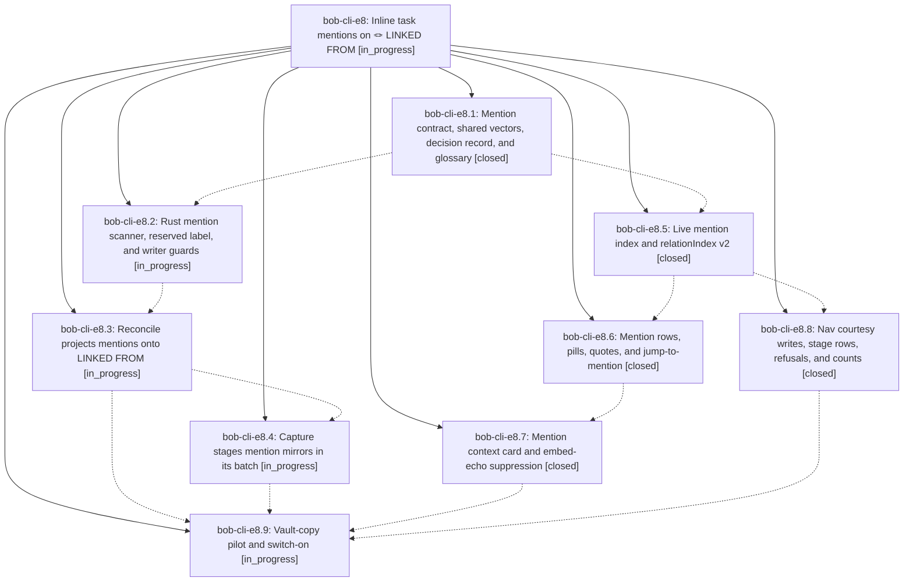

# Bead: bob-cli-e8 — Inline task mentions on 🪢 LINKED FROM

[Bead Pages](../README.md) / bob-cli-e8

**Status:** ◐ in_progress · **Type:** ▸ plan · **Tier:** epic
**Owner:** `bryanbugyi34@gmail.com` · **Created by:** [bbugyi200.apollo.research.2v.linker.w0](https://github.com/bobs-org/bob-cli--agents/blob/main/sessions/bbugyi200.apollo.research.2v.linker.w0.md) · **Assignee:** `bob-cli-e8.land`
**Created:** 2026-10-29 17:20:21 EDT
**Plan:** [202610/inline\_task\_mentions.md](https://github.com/bobs-org/bob-cli--plans/blob/main/202610/inline_task_mentions.md)

<!-- sase:links:start -->

## Links

| Relation | Artifact | Why |
| --- | --- | --- |
| implemented-by | [plan:202610/inline_task_mentions.md][1] | derived from the plan's `bead_id:` frontmatter field |

_Plus 3 automatic references — see [Referenced By](#referenced-by)._

[1]: https://github.com/bobs-org/bob-cli--plans/blob/main/202610/inline_task_mentions.md

<!-- sase:links:end -->

## Description

When one task's own text links another task (`[[note#^id]]`, embedded or struck too), the target's generated 🪢 LINKED FROM line gains an inert `[[S]] (💬 mentions)` entry that explains itself at a glance with a `💬 mentioned in` / `💬 embedded in` pill, a live quote, and a context card that jumps to the sentence. Nothing is written on the mentioning task except a silent `^id`, a dependency or relation on the pair wins, and Rust and both plugins agree on every shared vector.

## Phases

| Bead | Title | Status | Size | Created | Agents | Commits |
|---|---|---|---|---|---:|---:|
| [bob-cli-e8.1](bob-cli-e8.1.md) | Mention contract, shared vectors, decision record, and glossary | ✓ closed | medium | 2026-10-29 | 1 | 1 |
| [bob-cli-e8.2](bob-cli-e8.2.md) | Rust mention scanner, reserved label, and writer guards | ◐ in_progress | medium | 2026-10-29 | 1 | 0 |
| [bob-cli-e8.3](bob-cli-e8.3.md) | Reconcile projects mentions onto LINKED FROM | ◐ in_progress | medium | 2026-10-29 | 1 | 0 |
| [bob-cli-e8.4](bob-cli-e8.4.md) | Capture stages mention mirrors in its batch | ◐ in_progress | medium | 2026-10-29 | 1 | 0 |
| [bob-cli-e8.5](bob-cli-e8.5.md) | Live mention index and relationIndex v2 | ✓ closed | medium | 2026-10-29 | 1 | 1 |
| [bob-cli-e8.6](bob-cli-e8.6.md) | Mention rows, pills, quotes, and jump-to-mention | ✓ closed | medium | 2026-10-29 | 1 | 1 |
| [bob-cli-e8.7](bob-cli-e8.7.md) | Mention context card and embed-echo suppression | ✓ closed | medium | 2026-10-29 | 1 | 1 |
| [bob-cli-e8.8](bob-cli-e8.8.md) | Nav courtesy writes, stage rows, refusals, and counts | ✓ closed | medium | 2026-10-29 | 1 | 1 |
| [bob-cli-e8.9](bob-cli-e8.9.md) | Vault-copy pilot and switch-on | ◐ in_progress | small | 2026-10-29 | 1 | 0 |

## Lineage

## Agents

| Agent | Bead | Commits |
|---|---|---:|
| [bbugyi200.apollo.bob-cli-e8.1](https://github.com/bobs-org/bob-cli--agents/blob/main/agents/bbugyi200.apollo.bob-cli-e8.1/README.md) | [bob-cli-e8.1](bob-cli-e8.1.md) | 1 |
| [bbugyi200.apollo.bob-cli-e8.2](https://github.com/bobs-org/bob-cli--agents/blob/main/sessions/bbugyi200.apollo.bob-cli-e8.2.md) | [bob-cli-e8.2](bob-cli-e8.2.md) | 0 |
| [bbugyi200.apollo.bob-cli-e8.3](https://github.com/bobs-org/bob-cli--agents/blob/main/agents/bbugyi200.apollo.bob-cli-e8.3/README.md) | [bob-cli-e8.3](bob-cli-e8.3.md) | 0 |
| [bbugyi200.apollo.bob-cli-e8.4](https://github.com/bobs-org/bob-cli--agents/blob/main/agents/bbugyi200.apollo.bob-cli-e8.4/README.md) | [bob-cli-e8.4](bob-cli-e8.4.md) | 0 |
| [bbugyi200.apollo.bob-cli-e8.5](https://github.com/bobs-org/bob-cli--agents/blob/main/agents/bbugyi200.apollo.bob-cli-e8.5/README.md) | [bob-cli-e8.5](bob-cli-e8.5.md) | 1 |
| [bbugyi200.apollo.bob-cli-e8.6](https://github.com/bobs-org/bob-cli--agents/blob/main/agents/bbugyi200.apollo.bob-cli-e8.6/README.md) | [bob-cli-e8.6](bob-cli-e8.6.md) | 1 |
| [bbugyi200.apollo.bob-cli-e8.7](https://github.com/bobs-org/bob-cli--agents/blob/main/agents/bbugyi200.apollo.bob-cli-e8.7/README.md) | [bob-cli-e8.7](bob-cli-e8.7.md) | 1 |
| [bbugyi200.apollo.bob-cli-e8.8](https://github.com/bobs-org/bob-cli--agents/blob/main/agents/bbugyi200.apollo.bob-cli-e8.8/README.md) | [bob-cli-e8.8](bob-cli-e8.8.md) | 1 |
| [bbugyi200.apollo.bob-cli-e8.9](https://github.com/bobs-org/bob-cli--agents/blob/main/agents/bbugyi200.apollo.bob-cli-e8.9/README.md) | [bob-cli-e8.9](bob-cli-e8.9.md) | 0 |
| [bbugyi200.apollo.bob-cli-e8.land](https://github.com/bobs-org/bob-cli--agents/blob/main/agents/bbugyi200.apollo.bob-cli-e8.land/README.md) | [bob-cli-e8](README.md) | 0 |

## Commits

| Repo | Commit | Subject | Bead | Committed |
|---|---|---|---|---|
| bob-cli | [`fe56228`](https://github.com/bobs-org/bob-cli/commit/fe56228f3b15f51867d2fd0a99ea13dd7fe99b2a) | docs(relations): add inert text-mention contract, shared MN vectors, and glossary | [bob-cli-e8.1](bob-cli-e8.1.md) | 2026-10-29 18:09:12 EDT |
| bob-plugins | [`bob-plugins@13ac4dc`](https://github.com/bobs-org/bob-plugins/commit/13ac4dcc70e66cbf80d7e8c1aa1532e6d37350b3) | feat(ledger-tools): live mention index and relationIndex v2 | [bob-cli-e8.5](bob-cli-e8.5.md) | 2026-10-29 18:41:59 EDT |
| bob-plugins | [`bob-plugins@d096507`](https://github.com/bobs-org/bob-plugins/commit/d0965076319fadb8d5ab826710e915c54ab99e1d) | feat(ledger-tools): render task mention rows | [bob-cli-e8.6](bob-cli-e8.6.md) | 2026-10-29 19:17:29 EDT |
| bob-plugins | [`bob-plugins@7366cfd`](https://github.com/bobs-org/bob-plugins/commit/7366cfdd33029d5a6017a70845ed9e096bf0de3b) | feat(navigation): inline task-mention courtesy writes, stage rows, and unlink downgrade | [bob-cli-e8.8](bob-cli-e8.8.md) | 2026-10-29 19:43:43 EDT |
| bob-plugins | [`bob-plugins@90dbc6a`](https://github.com/bobs-org/bob-plugins/commit/90dbc6a1c302e2fa6e89668a53ad274c519a6892) | feat(mentions): add accessible context cards and embed echo suppression | [bob-cli-e8.7](bob-cli-e8.7.md) | 2026-10-29 19:56:57 EDT |

<!-- sase:referenced-by:start -->

## Referenced By

| Relation | Artifact | Why | Uses |
| --- | --- | --- | ---: |
| read-by | [agent:bob-cli-e8.1][1] | Need parent epic scope, notes, and remaining work from earlier agents | 1 |
| read-by | [agent:bob-cli-e8.5][2] | Check epic phase statuses | 1 |
| read-by | [agent:bob-cli-e8.8][3] | Need epic status and sibling phase completion for plugin-nav | 1 |

[1]: https://github.com/bobs-org/bob-cli--agents/blob/main/agents/bbugyi200.apollo.bob-cli-e8.1/README.md
[2]: https://github.com/bobs-org/bob-cli--agents/blob/main/agents/bbugyi200.apollo.bob-cli-e8.5/README.md
[3]: https://github.com/bobs-org/bob-cli--agents/blob/main/agents/bbugyi200.apollo.bob-cli-e8.8/README.md

<!-- sase:referenced-by:end -->
