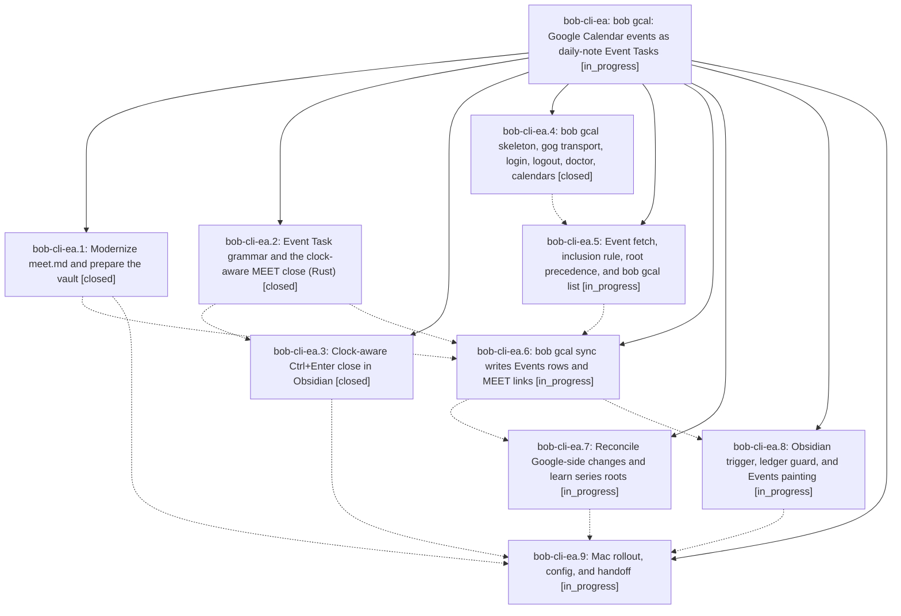

# Bead: bob-cli-ea — bob gcal: Google Calendar events as daily-note Event Tasks

[Bead Pages](../README.md) / bob-cli-ea

**Status:** ◐ in_progress · **Type:** ▸ plan · **Tier:** epic
**Owner:** `bryanbugyi34@gmail.com` · **Created by:** [bbugyi200.apollo.research.2w.linker.w0](https://github.com/bobs-org/bob-cli--agents/blob/main/sessions/bbugyi200.apollo.research.2w.linker.w0.md) · **Assignee:** `bob-cli-ea.land`
**Created:** 2026-10-29 19:40:03 EDT
**Plan:** [202610/bob\_gcal\_daily\_events.md](https://github.com/bobs-org/bob-cli--plans/blob/main/202610/bob_gcal_daily_events.md)

<!-- sase:links:start -->

## Links

| Relation | Artifact | Why |
| --- | --- | --- |
| implemented-by | [plan:202610/bob_gcal_daily_events.md][1] | derived from the plan's `bead_id:` frontmatter field |

[1]: https://github.com/bobs-org/bob-cli--plans/blob/main/202610/bob_gcal_daily_events.md

<!-- sase:links:end -->

## Description

Every day, the Google Calendar events Bryan said yes to appear as Event Tasks in a `## Events` section above `## Pomodoros`. Each one is rooted where its time belongs (`meet` by default, or a root the event names) and linked under one appended MEET Pomodoro. A plain close of a MEET session completes, carries, or defers each meeting by the clock. `bob gcal` (calendars, doctor, list, login, logout, sync) makes setup a single read-only login, makes every sync idempotent, and never overwrites Bryan's edits. The Mac runs sync automatically and Obsidian shows the Events beautifully.

## Phases

| Bead | Title | Status | Size | Created | Agents | Commits |
|---|---|---|---|---|---:|---:|
| [bob-cli-ea.1](bob-cli-ea.1.md) | Modernize meet.md and prepare the vault | ✓ closed | small | 2026-10-29 | 1 | 1 |
| [bob-cli-ea.2](bob-cli-ea.2.md) | Event Task grammar and the clock-aware MEET close (Rust) | ✓ closed | medium | 2026-10-29 | 1 | 1 |
| [bob-cli-ea.3](bob-cli-ea.3.md) | Clock-aware Ctrl+Enter close in Obsidian | ✓ closed | medium | 2026-10-29 | 1 | 1 |
| [bob-cli-ea.4](bob-cli-ea.4.md) | bob gcal skeleton, gog transport, login, logout, doctor, calendars | ✓ closed | medium | 2026-10-29 | 1 | 0 |
| [bob-cli-ea.5](bob-cli-ea.5.md) | Event fetch, inclusion rule, root precedence, and bob gcal list | ◐ in_progress | medium | 2026-10-29 | 1 | 0 |
| [bob-cli-ea.6](bob-cli-ea.6.md) | bob gcal sync writes Events rows and MEET links | ◐ in_progress | medium | 2026-10-29 | 1 | 0 |
| [bob-cli-ea.7](bob-cli-ea.7.md) | Reconcile Google-side changes and learn series roots | ◐ in_progress | medium | 2026-10-29 | 1 | 0 |
| [bob-cli-ea.8](bob-cli-ea.8.md) | Obsidian trigger, ledger guard, and Events painting | ◐ in_progress | medium | 2026-10-29 | 1 | 0 |
| [bob-cli-ea.9](bob-cli-ea.9.md) | Mac rollout, config, and handoff | ◐ in_progress | small | 2026-10-29 | 1 | 0 |

## Lineage

## Agents

| Agent | Bead | Commits |
|---|---|---:|
| [bbugyi200.apollo.bob-cli-ea.1](https://github.com/bobs-org/bob-cli--agents/blob/main/sessions/bbugyi200.apollo.bob-cli-ea.1.md) | [bob-cli-ea.1](bob-cli-ea.1.md) | 1 |
| [bbugyi200.apollo.bob-cli-ea.2](https://github.com/bobs-org/bob-cli--agents/blob/main/sessions/bbugyi200.apollo.bob-cli-ea.2.md) | [bob-cli-ea.2](bob-cli-ea.2.md) | 1 |
| [bbugyi200.apollo.bob-cli-ea.3](https://github.com/bobs-org/bob-cli--agents/blob/main/agents/bbugyi200.apollo.bob-cli-ea.3/README.md) | [bob-cli-ea.3](bob-cli-ea.3.md) | 1 |
| [bbugyi200.apollo.bob-cli-ea.4](https://github.com/bobs-org/bob-cli--agents/blob/main/sessions/bbugyi200.apollo.bob-cli-ea.4.md) | [bob-cli-ea.4](bob-cli-ea.4.md) | 0 |
| [bbugyi200.apollo.bob-cli-ea.5](https://github.com/bobs-org/bob-cli--agents/blob/main/agents/bbugyi200.apollo.bob-cli-ea.5/README.md) | [bob-cli-ea.5](bob-cli-ea.5.md) | 0 |
| [bbugyi200.apollo.bob-cli-ea.6](https://github.com/bobs-org/bob-cli--agents/blob/main/agents/bbugyi200.apollo.bob-cli-ea.6/README.md) | [bob-cli-ea.6](bob-cli-ea.6.md) | 0 |
| [bbugyi200.apollo.bob-cli-ea.7](https://github.com/bobs-org/bob-cli--agents/blob/main/agents/bbugyi200.apollo.bob-cli-ea.7/README.md) | [bob-cli-ea.7](bob-cli-ea.7.md) | 0 |
| [bbugyi200.apollo.bob-cli-ea.8](https://github.com/bobs-org/bob-cli--agents/blob/main/agents/bbugyi200.apollo.bob-cli-ea.8/README.md) | [bob-cli-ea.8](bob-cli-ea.8.md) | 0 |
| [bbugyi200.apollo.bob-cli-ea.9](https://github.com/bobs-org/bob-cli--agents/blob/main/agents/bbugyi200.apollo.bob-cli-ea.9/README.md) | [bob-cli-ea.9](bob-cli-ea.9.md) | 0 |
| [bbugyi200.apollo.bob-cli-ea.land](https://github.com/bobs-org/bob-cli--agents/blob/main/agents/bbugyi200.apollo.bob-cli-ea.land/README.md) | [bob-cli-ea](README.md) | 0 |

## Commits

| Repo | Commit | Subject | Bead | Committed |
|---|---|---|---|---|
| bob-cli | [`1dc5fa4`](https://github.com/bobs-org/bob-cli/commit/1dc5fa427d63cb6382859f7cf1bf4cd58fcda808) | docs(homes): record meet as a top-level violet area | [bob-cli-ea.1](bob-cli-ea.1.md) | 2026-10-29 22:02:24 EDT |
| bob-cli | [`4f2828e`](https://github.com/bobs-org/bob-cli/commit/4f2828e3b28390b6ddfe0694c46ef85c9778b8ce) | feat(capture): close event tasks by meeting clock | [bob-cli-ea.2](bob-cli-ea.2.md) | 2026-10-29 22:50:50 EDT |
| bob-plugins | [`bob-plugins@9c63d95`](https://github.com/bobs-org/bob-plugins/commit/9c63d95e0e568ae36a4b738d6a22f9a99d355738) | feat(task-status-cycler): close Event Task links by the meeting clock | [bob-cli-ea.3](bob-cli-ea.3.md) | 2026-10-29 23:25:26 EDT |
