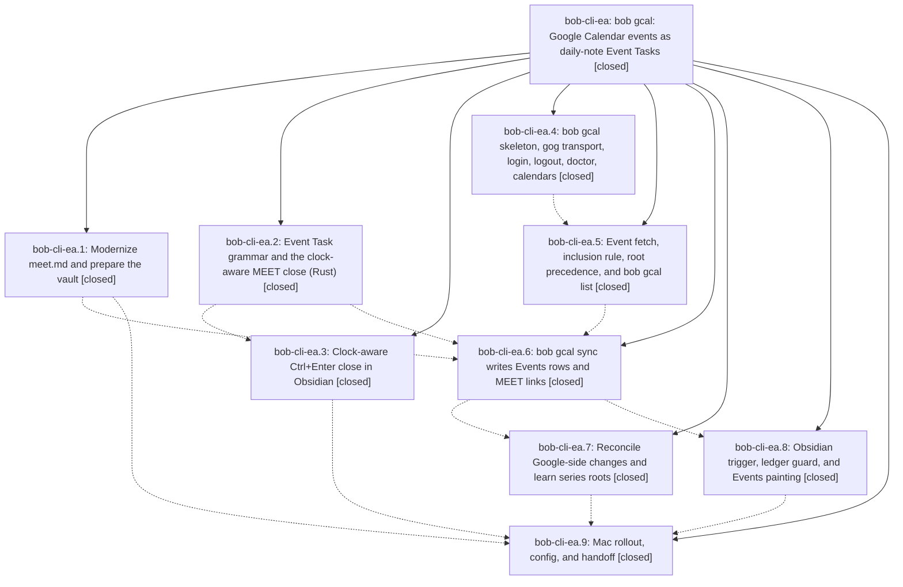

# Bead: bob-cli-ea — bob gcal: Google Calendar events as daily-note Event Tasks

[Bead Pages](../README.md) / bob-cli-ea

**Status:** ✓ closed · **Resolution:** done · **Type:** ▸ plan · **Tier:** epic
**Owner:** `bryanbugyi34@gmail.com` · **Created by:** [bbugyi200.apollo.research.2w.linker.w0](https://github.com/bobs-org/bob-cli--agents/blob/main/sessions/bbugyi200.apollo.research.2w.linker.w0.md) · **Assignee:** `bob-cli-ea.land`
**Created:** 2026-10-29 19:40:03 EDT · **Closed:** 2026-10-30 04:37:20 EDT
**Plan:** [202610/bob\_gcal\_daily\_events.md](https://github.com/bobs-org/bob-cli--plans/blob/main/202610/bob_gcal_daily_events.md)

<!-- sase:links:start -->

## Links

| Relation | Artifact | Why |
| --- | --- | --- |
| implemented-by | [plan:202610/bob_gcal_daily_events.md][1] | derived from the plan's `bead_id:` frontmatter field |

_Plus 4 automatic references — see [Referenced By](#referenced-by)._

[1]: https://github.com/bobs-org/bob-cli--plans/blob/main/202610/bob_gcal_daily_events.md

<!-- sase:links:end -->

## Description

Every day, the Google Calendar events Bryan said yes to appear as Event Tasks in a `## Events` section above `## Pomodoros`. Each one is rooted where its time belongs (`meet` by default, or a root the event names) and linked under one appended MEET Pomodoro. A plain close of a MEET session completes, carries, or defers each meeting by the clock. `bob gcal` (calendars, doctor, list, login, logout, sync) makes setup a single read-only login, makes every sync idempotent, and never overwrites Bryan's edits. The Mac runs sync automatically and Obsidian shows the Events beautifully.

## Notes

[2026-10-30T06:29:27Z · bob-cli-e6.land] DISCOVERED ISSUE: bob-cli master a3735b91 'just check' gate: cargo fmt --check diffs tests/gcal_list.rs:132 and clippy -D clippy::clone_on_copy fails at src/native/gcal/classify.rs:75 (clone on DateTime<FixedOffset>); both files come only from 44058f67 (bob-cli-ea.5, gcal list). Also red on master: native::catalog::tests::document_shape and cli catalog::protocol_1_parses_with_schema_version_one (59 vs 58) and completion kinds every_value_arg_has_a_decision (gcal:day, gcal list:day) — bob-cli-ea.6 #1 reports fixing those two in its not-yet-landed work. Found by bob-cli-e6 land agent; the other two clippy gate errors (pomodoro_link.rs:671, successors.rs:2193) are e6's and are fixed in e6's landing.

[2026-10-30T08:20:01Z · bob-cli-e6.land--4] DISCOVERED ISSUE: Fresh independent reproduction during paused-merge verification on integrated bob-cli tree at base HEAD 8e7fa97c182c2d2706e991a460a06596fa1b9321: just check passed formatting, then failed its denied Clippy lint at src/native/gcal/classify.rs:75 (clone_on_copy on DateTime<FixedOffset>, start.clone()). just lint reproduced the same error; cargo test --workspace --no-fail-fast passed. classify.rs is unchanged by the paused task-type commit. This corroborates the unresolved gcal-list finding recorded in ea.5 #1; no new task filed.

[2026-10-30T08:36:46Z · bob-cli-ea.land] LAND TRIAGE (bob-cli-ea.land; bob-cli 3b0ffa0a + landing edits, bob-plugins 1295e52), one outcome per PROPOSED FOLLOW-UP:
NEW TASK: ea.4 #1, moving highlights_ref/clip_adapter.rs onto the shared subprocess_runner, filed as bob-cli-ef (task(feature), small, ready, related link to ea.4). The plan deferred it on purpose.
RESOLVED, declined: ea.3 #2 and ea.8 #1 generated glossary.md/decisions.md drift (just docs-gen leaves no diff; just docs-check passes). ea.7 #1 ref_library::today::ledger_and_resolution_refusals (caused by non-epic 175b7498; fixed by e6 landing 3b0ffa0a; full just check now green). ea.7 #2 repo-wide fmt drift in five e6 files (fixed by 3b0ffa0a; cargo fmt --check clean). Epic note #1 gate failures: gcal_list.rs fmt and the catalog/completion counts were already fixed by ea.6/ea.7. This landing fixed clippy clone_on_copy at gcal/classify.rs:75 and the bool_comparison at tests/gcal_sync.rs:467 that it had been hiding.
OWNED ELSEWHERE, declined: ea.3 #1 bob-plugins failures. task-card-theme-edit now passes (14/14). The task-card-view grey-pill failure is bisected to bob-cli-e8.5 13ac4dc and already recorded as a DISCOVERED ISSUE on active epic bob-cli-e8, so no duplicate note. ea.8 #2 four successor-theme wiring failures (bisected to e6.12 6562b63): bob-cli-e6's close note reports its landing fixed them and deployed from its own workspace. Its bob-plugins commit was not on origin/master when checked (still 1295e52, 4/17 failing in test-task-status-cycler-successor-wiring.cjs). That is e6's work, not this epic's.

[2026-10-30T08:37:20Z · bob-cli-ea.land] Verified all 9 phases against the plan and DECISIONS (events_paint, launch_agent, glossary, and decision_records all yes) by reading child notes, source, and commits 1dc5fa42, 4f2828e3, 26e6b1d1, 44058f67, 98f9a23a, and 1a8e784f.
- bob-cli: the event_task parser and clock classifier with the clock-aware x close, plus shared vectors byte-identical to the bob-plugins copy. gkeep runs on the shared subprocess_runner and task_text_escape. The gcal module provides calendars, doctor, list (bare default), login, logout, sync, and lifecycle (three-way spans, the CANCEL LOG creator, RSVP transitions, series roots). Catalog rows gcal-doctor, gcal-list, and gcal-sync; the 📅-is-not-a-due-date regression test.
- Docs and memory: gcal.md, the connect guide, vault-format, capture, projects, task-dependencies, and json-outputs. Memory has the event-task glossary strand, the area-note exception, and 3 decision records.
- bob-plugins: task-status-cycler clock pre-pass and Pomodoros guard (the gesture lives there, not in nav-hotkeys); ledger-tools daily-note trigger and painting (session-only toggles per that plugin's convention); command-mode gcal-sync adapter. 29 focused tests pass.
- Vault: meet.md is a violet area with task_type MEET; .bob/gcal git rules; gtd_daily reworded. chezmoi gcal block and LaunchAgent pushed as 13744456.
Integration with concurrent commits: e6 type agreement (gcal's [type:: MEET] choice and the type_mismatch lint both use suggest_for_task, so they agree), 1ba6437a type placement, 785c1aec retype, and 3b0ffa0a.
Landing fixes: clippy at gcal/classify.rs:75 and tests/gcal_sync.rs:467; stale gcal.colors/tentative config docs; gcal.md Contents, a new 'Where it runs' section, and Known limits; getting-started gains gcal list and sync rows; vault-git-sync gains a gcal journal section, union list, and LaunchAgent; bob-plugins package.json duplicate test entries.
Gates: just check passes (fmt, clippy, 6765 tests, 0 failed); docs-gen leaves no diff; docs-check passes; epic-symbols is empty. The Mac was unreachable over ssh, so Bryan's on-Mac login checklist (ea.9 note #1) is still pending. Follow-up triage is in the epic's notes (bob-cli-ef created).

## Phases

| Bead | Title | Status | Size | Created | Agents | Commits |
|---|---|---|---|---|---:|---:|
| [bob-cli-ea.1](bob-cli-ea.1.md) | Modernize meet.md and prepare the vault | ✓ closed | small | 2026-10-29 | 1 | 1 |
| [bob-cli-ea.2](bob-cli-ea.2.md) | Event Task grammar and the clock-aware MEET close (Rust) | ✓ closed | medium | 2026-10-29 | 1 | 1 |
| [bob-cli-ea.3](bob-cli-ea.3.md) | Clock-aware Ctrl+Enter close in Obsidian | ✓ closed | medium | 2026-10-29 | 1 | 1 |
| [bob-cli-ea.4](bob-cli-ea.4.md) | bob gcal skeleton, gog transport, login, logout, doctor, calendars | ✓ closed | medium | 2026-10-29 | 1 | 1 |
| [bob-cli-ea.5](bob-cli-ea.5.md) | Event fetch, inclusion rule, root precedence, and bob gcal list | ✓ closed | medium | 2026-10-29 | 1 | 1 |
| [bob-cli-ea.6](bob-cli-ea.6.md) | bob gcal sync writes Events rows and MEET links | ✓ closed | medium | 2026-10-29 | 1 | 1 |
| [bob-cli-ea.7](bob-cli-ea.7.md) | Reconcile Google-side changes and learn series roots | ✓ closed | medium | 2026-10-29 | 1 | 1 |
| [bob-cli-ea.8](bob-cli-ea.8.md) | Obsidian trigger, ledger guard, and Events painting | ✓ closed | medium | 2026-10-29 | 1 | 3 |
| [bob-cli-ea.9](bob-cli-ea.9.md) | Mac rollout, config, and handoff | ✓ closed | small | 2026-10-29 | 1 | 1 |

## Lineage

## Agents

| Agent | Bead | Commits |
|---|---|---:|
| [bbugyi200.apollo.bob-cli-ea.1](https://github.com/bobs-org/bob-cli--agents/blob/main/sessions/bbugyi200.apollo.bob-cli-ea.1.md) | [bob-cli-ea.1](bob-cli-ea.1.md) | 1 |
| [bbugyi200.apollo.bob-cli-ea.2](https://github.com/bobs-org/bob-cli--agents/blob/main/sessions/bbugyi200.apollo.bob-cli-ea.2.md) | [bob-cli-ea.2](bob-cli-ea.2.md) | 1 |
| [bbugyi200.apollo.bob-cli-ea.3](https://github.com/bobs-org/bob-cli--agents/blob/main/agents/bbugyi200.apollo.bob-cli-ea.3/README.md) | [bob-cli-ea.3](bob-cli-ea.3.md) | 1 |
| [bbugyi200.apollo.bob-cli-ea.4](https://github.com/bobs-org/bob-cli--agents/blob/main/sessions/bbugyi200.apollo.bob-cli-ea.4.md) | [bob-cli-ea.4](bob-cli-ea.4.md) | 1 |
| [bbugyi200.apollo.bob-cli-ea.5](https://github.com/bobs-org/bob-cli--agents/blob/main/sessions/bbugyi200.apollo.bob-cli-ea.5.md) | [bob-cli-ea.5](bob-cli-ea.5.md) | 1 |
| [bbugyi200.apollo.bob-cli-ea.6](https://github.com/bobs-org/bob-cli--agents/blob/main/agents/bbugyi200.apollo.bob-cli-ea.6/README.md) | [bob-cli-ea.6](bob-cli-ea.6.md) | 1 |
| [bbugyi200.apollo.bob-cli-ea.7](https://github.com/bobs-org/bob-cli--agents/blob/main/agents/bbugyi200.apollo.bob-cli-ea.7/README.md) | [bob-cli-ea.7](bob-cli-ea.7.md) | 1 |
| [bbugyi200.apollo.bob-cli-ea.8](https://github.com/bobs-org/bob-cli--agents/blob/main/agents/bbugyi200.apollo.bob-cli-ea.8/README.md) | [bob-cli-ea.8](bob-cli-ea.8.md) | 3 |
| [bbugyi200.apollo.bob-cli-ea.9](https://github.com/bobs-org/bob-cli--agents/blob/main/agents/bbugyi200.apollo.bob-cli-ea.9/README.md) | [bob-cli-ea.9](bob-cli-ea.9.md) | 1 |
| [bbugyi200.apollo.bob-cli-ea.land](https://github.com/bobs-org/bob-cli--agents/blob/main/agents/bbugyi200.apollo.bob-cli-ea.land/README.md) | [bob-cli-ea](README.md) | 2 |

## Commits

| Repo | Commit | Subject | Bead | Committed |
|---|---|---|---|---|
| bob-cli | [`1dc5fa4`](https://github.com/bobs-org/bob-cli/commit/1dc5fa427d63cb6382859f7cf1bf4cd58fcda808) | docs(homes): record meet as a top-level violet area | [bob-cli-ea.1](bob-cli-ea.1.md) | 2026-10-29 22:02:24 EDT |
| bob-cli | [`4f2828e`](https://github.com/bobs-org/bob-cli/commit/4f2828e3b28390b6ddfe0694c46ef85c9778b8ce) | feat(capture): close event tasks by meeting clock | [bob-cli-ea.2](bob-cli-ea.2.md) | 2026-10-29 22:50:50 EDT |
| bob-plugins | [`bob-plugins@9c63d95`](https://github.com/bobs-org/bob-plugins/commit/9c63d95e0e568ae36a4b738d6a22f9a99d355738) | feat(task-status-cycler): close Event Task links by the meeting clock | [bob-cli-ea.3](bob-cli-ea.3.md) | 2026-10-29 23:25:26 EDT |
| bob-cli | [`26e6b1d`](https://github.com/bobs-org/bob-cli/commit/26e6b1d1e50b0c9c70daa497214e7f5420c60283) | feat(gcal): add bob gcal login, logout, doctor, and calendars | [bob-cli-ea.4](bob-cli-ea.4.md) | 2026-10-29 23:27:30 EDT |
| bob-cli | [`44058f6`](https://github.com/bobs-org/bob-cli/commit/44058f67ee227e3de850e5294edc44da21b0b349) | feat(gcal): add calendar list command | [bob-cli-ea.5](bob-cli-ea.5.md) | 2026-10-30 00:25:23 EDT |
| bob-cli | [`98f9a23`](https://github.com/bobs-org/bob-cli/commit/98f9a23ad26f92df23ca9c6fc6b789353a3bd3a4) | feat(gcal): add bob gcal sync | [bob-cli-ea.6](bob-cli-ea.6.md) | 2026-10-30 02:24:20 EDT |
| bob-plugins | [`bob-plugins@cd214ff`](https://github.com/bobs-org/bob-plugins/commit/cd214ff67db0a6f78199275854446f4d2d3bcb9c) | fix(task-status-cycler): keep task rows out of Pomodoros | [bob-cli-ea.8](bob-cli-ea.8.md) | 2026-10-30 02:49:15 EDT |
| bob-plugins | [`bob-plugins@116ad00`](https://github.com/bobs-org/bob-plugins/commit/116ad007e2b23449f74a55c9748aa36837ebd1cb) | feat(command-mode): summarize Calendar sync outcomes | [bob-cli-ea.8](bob-cli-ea.8.md) | 2026-10-30 02:51:00 EDT |
| bob-plugins | [`bob-plugins@1295e52`](https://github.com/bobs-org/bob-plugins/commit/1295e525c0eff07e7c56a34caa113f5c6f313462) | feat(ledger-tools): sync and paint Calendar events | [bob-cli-ea.8](bob-cli-ea.8.md) | 2026-10-30 02:51:46 EDT |
| bob-cli | [`1a8e784`](https://github.com/bobs-org/bob-cli/commit/1a8e784fa4302ba83b9174c2cc3ade5b421b2c22) | feat(gcal): three-way span updates, cancels, RSVP, series learning, list and doctor | [bob-cli-ea.7](bob-cli-ea.7.md) | 2026-10-30 03:39:55 EDT |
| chezmoi | [`chezmoi@1374445`](https://github.com/bbugyi200/dotfiles/commit/13744456df8e16ada7c30b7166dd3a6d72c4cce0) | feat(gcal): add chezmoi gcal config block and Mac sync LaunchAgent | [bob-cli-ea.9](bob-cli-ea.9.md) | 2026-10-30 03:51:09 EDT |
| bob-cli | [`a0a6b49`](https://github.com/bobs-org/bob-cli/commit/a0a6b497467c4411076f8526407c1b801a0be739) | fix(gcal): land bob gcal with clippy fixes and integration docs | [bob-cli-ea](README.md) | 2026-10-30 04:38:35 EDT |
| bob-plugins | [`bob-plugins@5ba4683`](https://github.com/bobs-org/bob-plugins/commit/5ba4683d997ee62a3434b30d4e47074e144044a6) | test: drop duplicate gcal test entries from npm test list | [bob-cli-ea](README.md) | 2026-10-30 04:40:13 EDT |

<!-- sase:referenced-by:start -->

## Referenced By

| Relation | Artifact | Why | Uses |
| --- | --- | --- | ---: |
| read-by | [agent:bob-cli-e6.land--4][1] | Verify the independent Clippy failure evidence was recorded on its active owning epic | 2 |
| read-by | [agent:bob-cli-ea.3][2] | Need epic DECISIONS and plan context for phase work | 1 |
| read-by | [agent:bob-cli-ea.6][3] | epic scope and decisions | 1 |
| read-by | [agent:bob-cli-ea.9][4] | epic context | 1 |

[1]: https://github.com/bobs-org/bob-cli--agents/blob/main/sessions/bbugyi200.apollo.bob-cli-e6.land.md
[2]: https://github.com/bobs-org/bob-cli--agents/blob/main/agents/bbugyi200.apollo.bob-cli-ea.3/README.md
[3]: https://github.com/bobs-org/bob-cli--agents/blob/main/agents/bbugyi200.apollo.bob-cli-ea.6/README.md
[4]: https://github.com/bobs-org/bob-cli--agents/blob/main/agents/bbugyi200.apollo.bob-cli-ea.9/README.md

<!-- sase:referenced-by:end -->
