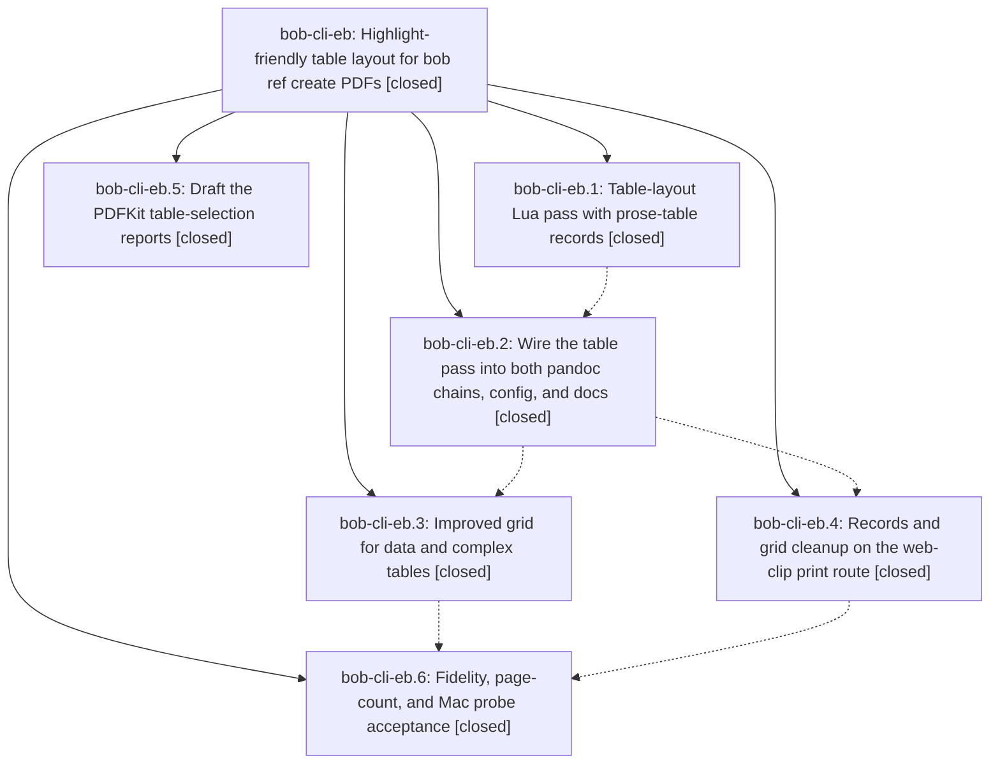

# Bead: bob-cli-eb — Highlight-friendly table layout for bob ref create PDFs

[Bead Pages](../README.md) / bob-cli-eb

**Status:** ✓ closed · **Resolution:** done · **Type:** ▸ plan · **Tier:** epic
**Owner:** `bryanbugyi34@gmail.com` · **Created by:** [bbugyi200.apollo.research.2u.linker.w0](https://github.com/bobs-org/bob-cli--agents/blob/main/sessions/bbugyi200.apollo.research.2u.linker.w0.md) · **Assignee:** `bob-cli-eb.land`
**Created:** 2026-10-29 20:03:06 EDT · **Closed:** 2026-10-30 03:41:52 EDT
**Plan:** [202610/ref\_table\_layout\_for\_highlights.md](https://github.com/bobs-org/bob-cli--plans/blob/main/202610/ref_table_layout_for_highlights.md)

<!-- sase:links:start -->

## Links

| Relation | Artifact | Why |
| --- | --- | --- |
| implemented-by | [plan:202610/ref_table_layout_for_highlights.md][1] | derived from the plan's `bead_id:` frontmatter field |
| related | [bead:bob-cli-ed][2] | Epic whose prose-table records layout this decisions strand records; all six phases proposed it |

[1]: https://github.com/bobs-org/bob-cli--plans/blob/main/202610/ref_table_layout_for_highlights.md
[2]: https://github.com/bobs-org/bob-cli--beads/blob/main/pages/bob-cli-ed/README.md

<!-- sase:links:end -->

## Description

Tables whose cells hold prose print in bob-typeset reference PDFs (Markdown, vault-note, and web-article routes) as single-column row records that Highlights can select and annotate on macOS 26. Short-cell data tables keep a more readable grid. The choice can be reversed at the config, document, and table level, existing PDFs are never touched, and the result is checked for text fidelity, page counts, and PDFKit selection on the Mac.

## Notes

[2026-10-30T06:33:25Z · bob-cli-eb.land] LAND TRIAGE (bob-cli-eb.land): (1) decisions strand prose-tables-print-as-records — proposed by all six phases (eb.1 #1, eb.2 #1, eb.3 #1, eb.4 #1, eb.5 #1, eb.6 #1); not epic work because decision_record=no declined it in-epic; filed as memory task bob-cli-ed (small, depends on bob-cli-eb, linked related) for Bryan's approval. (2) capture_related::tests::archive_closed_window_respects_mtime failure (eb.1 #3) — declined: already fixed on master by 1dc5fa42 (bob-cli-ea.1 pinned archive mtimes to the BOB_NOW window); passes on HEAD a3735b91. (3) ref_library::today::today_matches_unnamed_capture_and_named_capture_remembers_theme failure (eb.3 #2, eb.4 #2) — declined: already fixed by 175b7498 (feat(ref)!: bob ref today places reading tasks by type); passes on HEAD. (4) per-document page growth (eb.6 #2: sase_core_maintainability_audit 19->20, agents_tab_inbox_and_history_views 28->31) — caused by this epic and unmet R3, so it stays epic work: land agent measured that grid-only renders are at or under baseline (28, 18), i.e. growth comes from records; a run-in lead-in + packing <=3-word labeled fields + zero in-record parskip with a 6pt record gap renders all eight acceptance documents at or under baseline (agents_tab 28, sase_core 17, roadmap 18, memory_built 23, daily_stats 22, now_tag 4, fixture 2). Planned as the landing tale.

[2026-10-30T07:41:35Z · bob-cli-eb.land--1] LAND VERIFICATION (pack-branch tale, bob-cli-eb.land): acceptance re-run with current pack binary vs b8bcc78a baseline into /tmp/bob-eb-acceptance-out: every doc at/under baseline (roadmap 23->18, sase_core 19->17, memory 34->23, daily 28->22, agents_tab 28->28, now_tag 4->4, both fixtures 2->2; total 140->116); ordered fidelity 1752/1752 pass; kept_grid_warnings empty; only warning lines are known listen-card + Mermaid-scale + pre-existing web-guard/sandbox lines; vault status identical. Mac probe NOT RUN (ssh to mac timed out twice); no layout fallback triggered. just check blocked by pre-existing gates: cargo fmt 30 diffs in unrelated files (capture_pomodoro_name, task_move/command, task_theme, tests/cli/task_move, pomodoro_themes/tests; zero in tale files), gated clippy 3 errors in unrelated files (pomodoro_link.rs:671, gcal/classify.rs:75, successors.rs:2193), docs-check decisions.md drift. Full cargo test suite: 6746 passed / 1 failed; sole failure ref_library::today::ledger_and_resolution_refusals fails identically on clean tree (pre-existing). Table-layout tests: 37/37 pass.

[2026-10-30T07:41:44Z · bob-cli-eb.land--1] PROPOSED FOLLOW-UP: Pre-existing just check gates fail on clean master (unrelated to table layout; left untouched per tale). (1) cargo fmt --check: 30 diffs in src/native/capture_pomodoro_name.rs, src/native/task_move/command.rs, src/native/task_theme.rs, src/native/pomodoro_themes/tests.rs, tests/cli/task_move.rs. (2) Gated clippy: needless_option_as_deref at src/native/capture/pomodoro_link.rs:671, clone_on_copy at src/native/gcal/classify.rs:75, collapsible_if at src/native/task_complete/successors.rs:2193. (3) just docs-check: generated drift in docs/develop/decisions.md. (4) Full test suite: ref_library::today::ledger_and_resolution_refusals (tests/cli/ref_library/today.rs:887) fails identically with tale changes stashed. Two shell-completion tests flaked once under full-suite parallelism but pass in isolation on both trees.

[2026-10-30T07:41:52Z · bob-cli-eb.land--1] LAND CLOSE (pack-branch tale): Children: all six phases reviewed against notes, epic DECISIONS, and commits b47617dc, 7d765b80, 66bdd211, a984ec57, a3735b91. grid_hairlines=no honored (no hairlines; docs say grids get widths and row air only). decision_record=no honored (no memory edits; strand tracked as task bob-cli-ed). bob ref attach-source correctly lacks the pass. Integration: no non-epic commit since b47617dc touched highlights render code; gcal commits 26e6b1d1/44058f67 touched config/mod.rs + configuration.md without conflict. Follow-ups: LAND TRIAGE note recorded (bob-cli-ed filed; two test-failure proposals declined as fixed by 175b7498/1dc5fa42; page growth fixed by this tale) plus new note with pre-existing just check gates (fmt 30 unrelated diffs, 3 unrelated clippy errors, decisions.md drift, 1 pre-existing today-ledger test failure). Tale: run-in lead-in + PACK_WORDS=3 packing + zero in-record parskip + 6pt gap in table_layout.lua/.tex (+tests, +docs); table_layout tests 37/37; acceptance 140->116 pages total with every doc at/under baseline, fidelity 1752/1752, vault unchanged; Mac probe not run (host unreachable), no fallback triggered. Working tree holds the 4 tale files for review.

## Phases

| Bead | Title | Status | Size | Created | Agents | Commits |
|---|---|---|---|---|---:|---:|
| [bob-cli-eb.1](bob-cli-eb.1.md) | Table-layout Lua pass with prose-table records | ✓ closed | medium | 2026-10-29 | 1 | 1 |
| [bob-cli-eb.2](bob-cli-eb.2.md) | Wire the table pass into both pandoc chains, config, and docs | ✓ closed | medium | 2026-10-29 | 1 | 1 |
| [bob-cli-eb.3](bob-cli-eb.3.md) | Improved grid for data and complex tables | ✓ closed | small | 2026-10-29 | 1 | 1 |
| [bob-cli-eb.4](bob-cli-eb.4.md) | Records and grid cleanup on the web-clip print route | ✓ closed | medium | 2026-10-29 | 1 | 1 |
| [bob-cli-eb.5](bob-cli-eb.5.md) | Draft the PDFKit table-selection reports | ✓ closed | small | 2026-10-29 | 1 | 1 |
| [bob-cli-eb.6](bob-cli-eb.6.md) | Fidelity, page-count, and Mac probe acceptance | ✓ closed | medium | 2026-10-29 | 1 | 2 |

## Lineage

## Dependencies

- **Blocks:** [bob-cli-ed](../bob-cli-ed/README.md) ◇ · ⧖ 2026-10-30

## Agents

| Agent | Bead | Commits |
|---|---|---:|
| [bbugyi200.apollo.bob-cli-eb.1](https://github.com/bobs-org/bob-cli--agents/blob/main/sessions/bbugyi200.apollo.bob-cli-eb.1.md) | [bob-cli-eb.1](bob-cli-eb.1.md) | 1 |
| [bbugyi200.apollo.bob-cli-eb.2](https://github.com/bobs-org/bob-cli--agents/blob/main/agents/bbugyi200.apollo.bob-cli-eb.2/README.md) | [bob-cli-eb.2](bob-cli-eb.2.md) | 1 |
| [bbugyi200.apollo.bob-cli-eb.3](https://github.com/bobs-org/bob-cli--agents/blob/main/sessions/bbugyi200.apollo.bob-cli-eb.3.md) | [bob-cli-eb.3](bob-cli-eb.3.md) | 1 |
| [bbugyi200.apollo.bob-cli-eb.4](https://github.com/bobs-org/bob-cli--agents/blob/main/sessions/bbugyi200.apollo.bob-cli-eb.4.md) | [bob-cli-eb.4](bob-cli-eb.4.md) | 1 |
| [bbugyi200.apollo.bob-cli-eb.5](https://github.com/bobs-org/bob-cli--agents/blob/main/agents/bbugyi200.apollo.bob-cli-eb.5/README.md) | [bob-cli-eb.5](bob-cli-eb.5.md) | 1 |
| [bbugyi200.apollo.bob-cli-eb.6](https://github.com/bobs-org/bob-cli--agents/blob/main/sessions/bbugyi200.apollo.bob-cli-eb.6.md) | [bob-cli-eb.6](bob-cli-eb.6.md) | 2 |
| [bbugyi200.apollo.bob-cli-eb.land](https://github.com/bobs-org/bob-cli--agents/blob/main/sessions/bbugyi200.apollo.bob-cli-eb.land.md) | [bob-cli-eb](README.md) | 1 |

## Commits

| Repo | Commit | Subject | Bead | Committed |
|---|---|---|---|---|
| bob-cli--research | [`bob-cli--research@8b39823`](https://github.com/bobs-org/bob-cli--research/commit/8b39823c5f49bb2fd3d03cf7f067cf74dd8beb14) | docs(research): draft PDFKit table-selection reports | [bob-cli-eb.5](bob-cli-eb.5.md) | 2026-10-29 20:14:21 EDT |
| bob-cli | [`b47617d`](https://github.com/bobs-org/bob-cli/commit/b47617dc9e066a9bb0c53ddf724f01f81b7007f0) | feat(ref): embed table-layout Lua pass for prose-table records | [bob-cli-eb.1](bob-cli-eb.1.md) | 2026-10-29 21:53:00 EDT |
| bob-cli | [`7d765b8`](https://github.com/bobs-org/bob-cli/commit/7d765b80e89549700ea4f88a0633c4181f0bb338) | feat(highlights): add configurable table layout for reference renders | [bob-cli-eb.2](bob-cli-eb.2.md) | 2026-10-29 23:38:21 EDT |
| bob-cli | [`66bdd21`](https://github.com/bobs-org/bob-cli/commit/66bdd211e8e8c366b4b53af9828ce2e2e594d029) | feat(highlights): improve grid table widths and row spacing | [bob-cli-eb.3](bob-cli-eb.3.md) | 2026-10-30 00:22:24 EDT |
| bob-cli | [`a984ec5`](https://github.com/bobs-org/bob-cli/commit/a984ec5755138c678842aa2fd39ce6c38c8863e7) | feat(web-clip): records and grid cleanup on print route | [bob-cli-eb.4](bob-cli-eb.4.md) | 2026-10-30 00:59:41 EDT |
| bob-cli | [`a3735b9`](https://github.com/bobs-org/bob-cli/commit/a3735b914939d208f038dd96573c4359b00eff53) | fix(ref): reduce record spacing for table PDFs | [bob-cli-eb.6](bob-cli-eb.6.md) | 2026-10-30 01:59:39 EDT |
| bob-cli--research | [`bob-cli--research@bae76a1`](https://github.com/bobs-org/bob-cli--research/commit/bae76a1bbd9b3e55140ad7db88954a741ef913e0) | docs(research): document table layout acceptance evidence | [bob-cli-eb.6](bob-cli-eb.6.md) | 2026-10-30 02:01:28 EDT |
| bob-cli--research | [`bob-cli--research@ec17041`](https://github.com/bobs-org/bob-cli--research/commit/ec17041cde18f30bbf37686a4ed612e19b7b2bd9) | docs(research): record pack-branch page-budget acceptance for table layout | [bob-cli-eb](README.md) | 2026-10-30 03:41:28 EDT |
| bob-cli--plans | [`bob-cli--plans@2ffd227`](https://github.com/bobs-org/bob-cli--plans/commit/2ffd2275eb9fea1bff8ab23284a532d16ba9c9c9) | docs(plans): mark ref\_table\_layout\_for\_highlights done (bob-cli-eb closed) | [bob-cli-eb](README.md) | 2026-10-30 03:42:27 EDT |
| bob-cli | [`8e7fa97`](https://github.com/bobs-org/bob-cli/commit/8e7fa97c182c2d2706e991a460a06596fa1b9321) | feat(highlights): pack short record fields to meet the page budget | [bob-cli-eb](README.md) | 2026-10-30 03:43:57 EDT |
