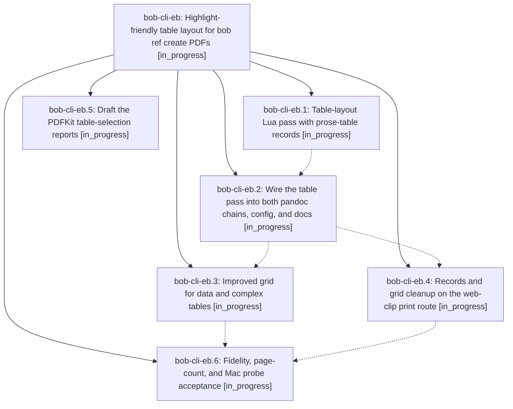

# Bead: bob-cli-eb — Highlight-friendly table layout for bob ref create PDFs

[Bead Pages](../README.md) / bob-cli-eb

**Status:** ◐ in_progress · **Type:** ▸ plan · **Tier:** epic
**Owner:** `bryanbugyi34@gmail.com` · **Created by:** [bbugyi200.apollo.research.2u.linker.w0](https://github.com/bobs-org/bob-cli--agents/blob/main/sessions/bbugyi200.apollo.research.2u.linker.w0.md) · **Assignee:** `bob-cli-eb.land`
**Created:** 2026-10-29 20:03:06 EDT
**Plan:** [202610/ref\_table\_layout\_for\_highlights.md](https://github.com/bobs-org/bob-cli--plans/blob/main/202610/ref_table_layout_for_highlights.md)

## Description

Tables whose cells hold prose print in bob-typeset reference PDFs (Markdown, vault-note, and web-article routes) as single-column row records that Highlights can select and annotate on macOS 26. Short-cell data tables keep a more readable grid. The choice can be reversed at the config, document, and table level, existing PDFs are never touched, and the result is checked for text fidelity, page counts, and PDFKit selection on the Mac.

## Phases

| Bead | Title | Status | Size | Created | Agents | Commits |
|---|---|---|---|---|---:|---:|
| [bob-cli-eb.1](bob-cli-eb.1.md) | Table-layout Lua pass with prose-table records | ◐ in_progress | medium | 2026-10-29 | 1 | 0 |
| [bob-cli-eb.2](bob-cli-eb.2.md) | Wire the table pass into both pandoc chains, config, and docs | ◐ in_progress | medium | 2026-10-29 | 1 | 0 |
| [bob-cli-eb.3](bob-cli-eb.3.md) | Improved grid for data and complex tables | ◐ in_progress | small | 2026-10-29 | 1 | 0 |
| [bob-cli-eb.4](bob-cli-eb.4.md) | Records and grid cleanup on the web-clip print route | ◐ in_progress | medium | 2026-10-29 | 1 | 0 |
| [bob-cli-eb.5](bob-cli-eb.5.md) | Draft the PDFKit table-selection reports | ◐ in_progress | small | 2026-10-29 | 1 | 1 |
| [bob-cli-eb.6](bob-cli-eb.6.md) | Fidelity, page-count, and Mac probe acceptance | ◐ in_progress | medium | 2026-10-29 | 1 | 0 |

## Lineage

## Agents

| Agent | Bead | Commits |
|---|---|---:|
| [bbugyi200.apollo.bob-cli-eb.1](https://github.com/bobs-org/bob-cli--agents/blob/main/agents/bbugyi200.apollo.bob-cli-eb.1/README.md) | [bob-cli-eb.1](bob-cli-eb.1.md) | 0 |
| [bbugyi200.apollo.bob-cli-eb.2](https://github.com/bobs-org/bob-cli--agents/blob/main/agents/bbugyi200.apollo.bob-cli-eb.2/README.md) | [bob-cli-eb.2](bob-cli-eb.2.md) | 0 |
| [bbugyi200.apollo.bob-cli-eb.3](https://github.com/bobs-org/bob-cli--agents/blob/main/agents/bbugyi200.apollo.bob-cli-eb.3/README.md) | [bob-cli-eb.3](bob-cli-eb.3.md) | 0 |
| [bbugyi200.apollo.bob-cli-eb.4](https://github.com/bobs-org/bob-cli--agents/blob/main/agents/bbugyi200.apollo.bob-cli-eb.4/README.md) | [bob-cli-eb.4](bob-cli-eb.4.md) | 0 |
| [bbugyi200.apollo.bob-cli-eb.5](https://github.com/bobs-org/bob-cli--agents/blob/main/agents/bbugyi200.apollo.bob-cli-eb.5/README.md) | [bob-cli-eb.5](bob-cli-eb.5.md) | 1 |
| [bbugyi200.apollo.bob-cli-eb.6](https://github.com/bobs-org/bob-cli--agents/blob/main/agents/bbugyi200.apollo.bob-cli-eb.6/README.md) | [bob-cli-eb.6](bob-cli-eb.6.md) | 0 |
| [bbugyi200.apollo.bob-cli-eb.land](https://github.com/bobs-org/bob-cli--agents/blob/main/agents/bbugyi200.apollo.bob-cli-eb.land/README.md) | [bob-cli-eb](README.md) | 0 |

## Commits

| Repo | Commit | Subject | Bead | Committed |
|---|---|---|---|---|
| bob-cli--research | [`bob-cli--research@8b39823`](https://github.com/bobs-org/bob-cli--research/commit/8b39823c5f49bb2fd3d03cf7f067cf74dd8beb14) | docs(research): draft PDFKit table-selection reports | [bob-cli-eb.5](bob-cli-eb.5.md) | 2026-10-29 20:14:21 EDT |
