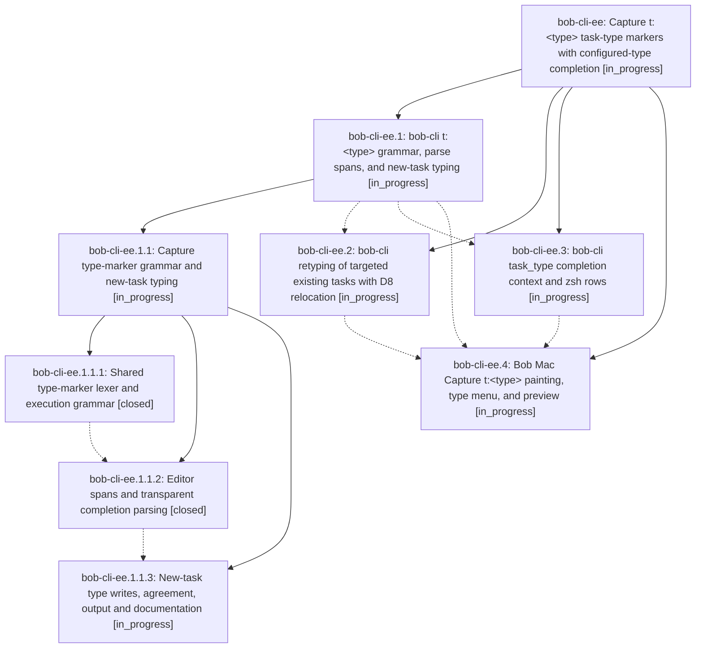

# Bead: bob-cli-ee — Capture t:\<type\> task-type markers with configured-type completion

[Bead Pages](../README.md) / bob-cli-ee

**Status:** ◐ in_progress · **Type:** ▸ plan · **Tier:** epic
**Owner:** `bryanbugyi34@gmail.com` · **Created by:** [bbugyi200.apollo.b6](https://github.com/bobs-org/bob-cli--agents/blob/main/sessions/bbugyi200.apollo.b6.md) · **Assignee:** `bob-cli-ee.land`
**Created:** 2026-10-30 04:22:33 EDT
**Plan:** [202610/capture\_type\_marker.md](https://github.com/bobs-org/bob-cli--plans/blob/main/202610/capture_type_marker.md)

<!-- sase:links:start -->

## Links

| Relation | Artifact | Why |
| --- | --- | --- |
| implemented-by | [plan:202610/capture_type_marker.md][1] | derived from the plan's `bead_id:` frontmatter field |

[1]: https://github.com/bobs-org/bob-cli--plans/blob/main/202610/capture_type_marker.md

<!-- sase:links:end -->

## Description

Typing `t:` at either edge of any capture line opens a fast, beautiful menu of your configured task types in Bob Mac Capture (and zsh). The accepted `t:fix` marker types the task the item creates or targets, and the live preview says exactly what will happen. Existing Task Links stay in agreement with the new type, and adding `t:` never changes what the rest of the draft means.

## Phases

| Bead | Title | Status | Size | Created | Agents | Commits |
|---|---|---|---|---|---:|---:|
| [bob-cli-ee.1](bob-cli-ee.1.md) | bob-cli t:\<type\> grammar, parse spans, and new-task typing | ◐ in_progress | large | 2026-10-30 | 1 | 0 |
| [bob-cli-ee.2](bob-cli-ee.2.md) | bob-cli retyping of targeted existing tasks with D8 relocation | ◐ in_progress | medium | 2026-10-30 | 1 | 0 |
| [bob-cli-ee.3](bob-cli-ee.3.md) | bob-cli task\_type completion context and zsh rows | ◐ in_progress | medium | 2026-10-30 | 1 | 0 |
| [bob-cli-ee.4](bob-cli-ee.4.md) | Bob Mac Capture t:\<type\> painting, type menu, and preview | ◐ in_progress | large | 2026-10-30 | 1 | 0 |

## Lineage

## Agents

| Agent | Bead | Commits |
|---|---|---:|
| [bbugyi200.apollo.bob-cli-ee.1](https://github.com/bobs-org/bob-cli--agents/blob/main/sessions/bbugyi200.apollo.bob-cli-ee.1.md) | [bob-cli-ee.1](bob-cli-ee.1.md) | 0 |
| [bbugyi200.apollo.bob-cli-ee.1.1.1](https://github.com/bobs-org/bob-cli--agents/blob/main/agents/bbugyi200.apollo.bob-cli-ee.1.1.1/README.md) | [bob-cli-ee.1.1.1](bob-cli-ee.1.1.1.md) | 1 |
| [bbugyi200.apollo.bob-cli-ee.1.1.2](https://github.com/bobs-org/bob-cli--agents/blob/main/agents/bbugyi200.apollo.bob-cli-ee.1.1.2/README.md) | [bob-cli-ee.1.1.2](bob-cli-ee.1.1.2.md) | 1 |
| [bbugyi200.apollo.bob-cli-ee.1.1.3](https://github.com/bobs-org/bob-cli--agents/blob/main/agents/bbugyi200.apollo.bob-cli-ee.1.1.3/README.md) | [bob-cli-ee.1.1.3](bob-cli-ee.1.1.3.md) | 0 |
| [bbugyi200.apollo.bob-cli-ee.1.1.land](https://github.com/bobs-org/bob-cli--agents/blob/main/agents/bbugyi200.apollo.bob-cli-ee.1.1.land/README.md) | [bob-cli-ee.1.1](bob-cli-ee.1.1.md) | 0 |
| [bbugyi200.apollo.bob-cli-ee.2](https://github.com/bobs-org/bob-cli--agents/blob/main/agents/bbugyi200.apollo.bob-cli-ee.2/README.md) | [bob-cli-ee.2](bob-cli-ee.2.md) | 0 |
| [bbugyi200.apollo.bob-cli-ee.3](https://github.com/bobs-org/bob-cli--agents/blob/main/agents/bbugyi200.apollo.bob-cli-ee.3/README.md) | [bob-cli-ee.3](bob-cli-ee.3.md) | 0 |
| [bbugyi200.apollo.bob-cli-ee.4](https://github.com/bobs-org/bob-cli--agents/blob/main/agents/bbugyi200.apollo.bob-cli-ee.4/README.md) | [bob-cli-ee.4](bob-cli-ee.4.md) | 0 |
| [bbugyi200.apollo.bob-cli-ee.land](https://github.com/bobs-org/bob-cli--agents/blob/main/agents/bbugyi200.apollo.bob-cli-ee.land/README.md) | [bob-cli-ee](README.md) | 0 |

## Commits

| Repo | Commit | Subject | Bead | Committed |
|---|---|---|---|---|
| bob-cli | [`59d5a09`](https://github.com/bobs-org/bob-cli/commit/59d5a09380248882dc8ebba850af671ac6b7e0b1) | feat(capture): parse task type markers | [bob-cli-ee.1.1.1](bob-cli-ee.1.1.1.md) | 2026-10-30 05:15:00 EDT |
| bob-cli | [`23ba480`](https://github.com/bobs-org/bob-cli/commit/23ba4805ecbdd6741b4e47d2e3a01b0317849640) | feat(capture): editor spans and transparent completion parsing | [bob-cli-ee.1.1.2](bob-cli-ee.1.1.2.md) | 2026-10-30 06:50:59 EDT |
