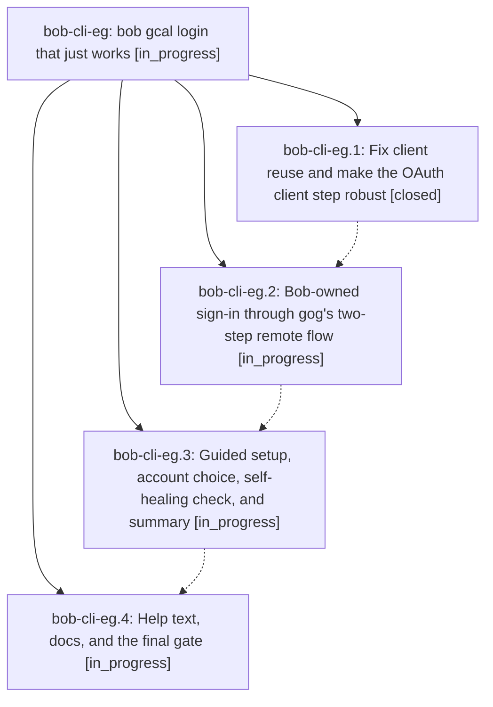

# Bead: bob-cli-eg — bob gcal login that just works

[Bead Pages](../README.md) / bob-cli-eg

**Status:** ◐ in_progress · **Type:** ▸ plan · **Tier:** epic
**Owner:** `bryanbugyi34@gmail.com` · **Created by:** [bbugyi200.athena.165](https://github.com/bobs-org/bob-cli--agents/blob/main/sessions/bbugyi200.athena.165.md) · **Assignee:** `bob-cli-eg.land`
**Created:** 2026-10-30 09:42:40 EDT
**Plan:** [202610/gcal\_login\_redesign.md](https://github.com/bobs-org/bob-cli--plans/blob/main/202610/gcal_login_redesign.md)

<!-- sase:links:start -->

## Links

| Relation | Artifact | Why |
| --- | --- | --- |
| implemented-by | [plan:202610/gcal_login_redesign.md][1] | derived from the plan's `bead_id:` frontmatter field |

[1]: https://github.com/bobs-org/bob-cli--plans/blob/main/202610/gcal_login_redesign.md

<!-- sase:links:end -->

## Description

`bob gcal login` connects Google Calendar in one command on any host (Mac with a browser, athena over SSH): it fixes the gog-client reuse failure, owns a sign-in flow that cannot hang, explains every Google screen in plain words, recovers from the usual Cloud Console mistakes in place, and renders a calm, beautiful step transcript.

## Phases

| Bead | Title | Status | Size | Created | Agents | Commits |
|---|---|---|---|---|---:|---:|
| [bob-cli-eg.1](bob-cli-eg.1.md) | Fix client reuse and make the OAuth client step robust | ✓ closed | medium | 2026-10-30 | 1 | 1 |
| [bob-cli-eg.2](bob-cli-eg.2.md) | Bob-owned sign-in through gog's two-step remote flow | ◐ in_progress | medium | 2026-10-30 | 1 | 0 |
| [bob-cli-eg.3](bob-cli-eg.3.md) | Guided setup, account choice, self-healing check, and summary | ◐ in_progress | medium | 2026-10-30 | 1 | 0 |
| [bob-cli-eg.4](bob-cli-eg.4.md) | Help text, docs, and the final gate | ◐ in_progress | small | 2026-10-30 | 1 | 0 |

## Lineage

## Agents

| Agent | Bead | Commits |
|---|---|---:|
| [bbugyi200.athena.bob-cli-eg.1](https://github.com/bobs-org/bob-cli--agents/blob/main/agents/bbugyi200.athena.bob-cli-eg.1/README.md) | [bob-cli-eg.1](bob-cli-eg.1.md) | 1 |
| [bbugyi200.athena.bob-cli-eg.2](https://github.com/bobs-org/bob-cli--agents/blob/main/agents/bbugyi200.athena.bob-cli-eg.2/README.md) | [bob-cli-eg.2](bob-cli-eg.2.md) | 0 |
| [bbugyi200.athena.bob-cli-eg.3](https://github.com/bobs-org/bob-cli--agents/blob/main/agents/bbugyi200.athena.bob-cli-eg.3/README.md) | [bob-cli-eg.3](bob-cli-eg.3.md) | 0 |
| [bbugyi200.athena.bob-cli-eg.4](https://github.com/bobs-org/bob-cli--agents/blob/main/agents/bbugyi200.athena.bob-cli-eg.4/README.md) | [bob-cli-eg.4](bob-cli-eg.4.md) | 0 |
| [bbugyi200.athena.bob-cli-eg.land](https://github.com/bobs-org/bob-cli--agents/blob/main/agents/bbugyi200.athena.bob-cli-eg.land/README.md) | [bob-cli-eg](README.md) | 0 |

## Commits

| Repo | Commit | Subject | Bead | Committed |
|---|---|---|---|---|
| bob-cli | [`2ca76ca`](https://github.com/bobs-org/bob-cli/commit/2ca76ca05a1bc544f16a3686774ac4a6538a9550) | fix(gcal): reuse gog clients by piping normalized client JSON | [bob-cli-eg.1](bob-cli-eg.1.md) | 2026-10-30 10:13:17 EDT |
